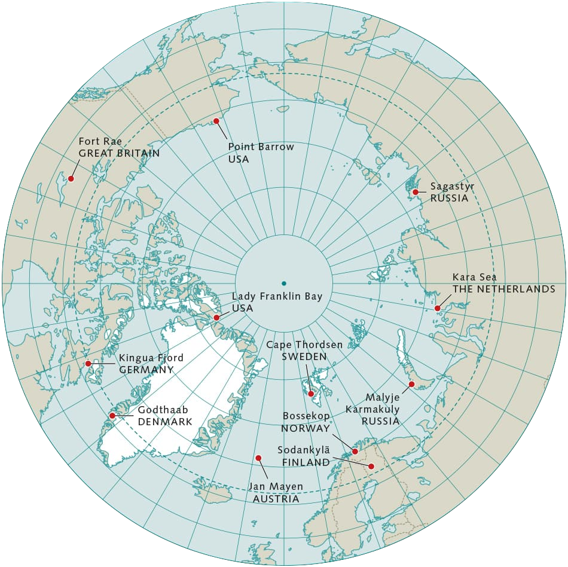
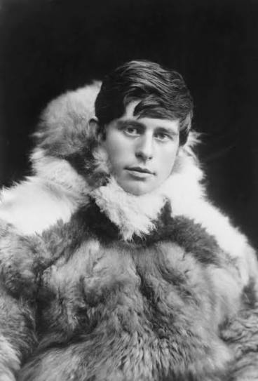
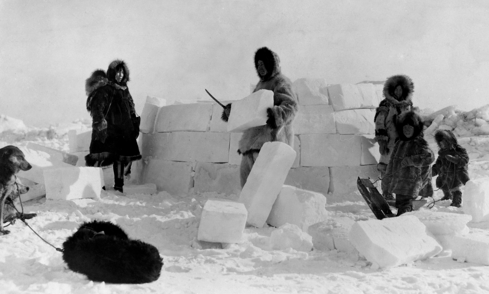
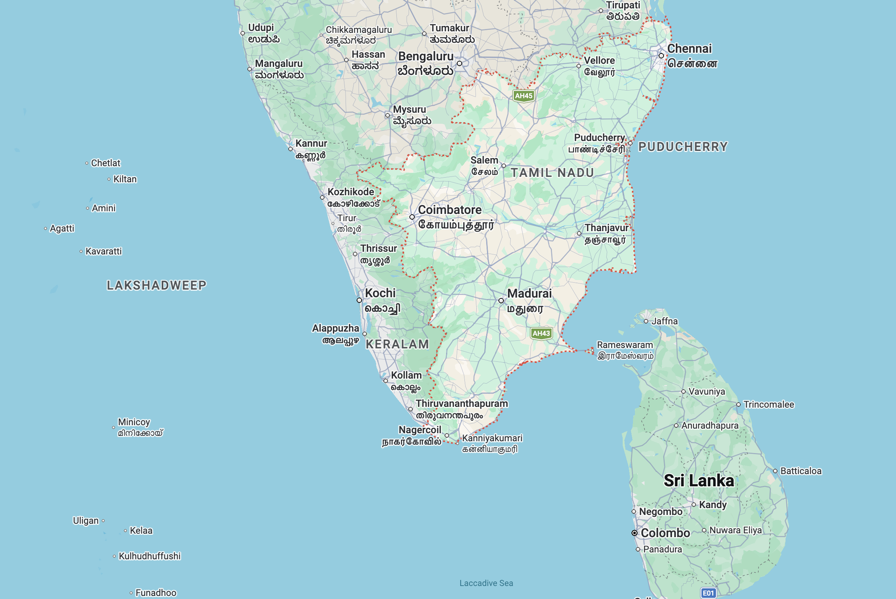
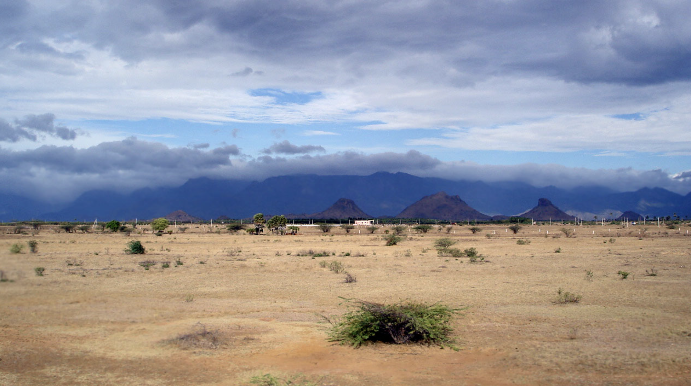
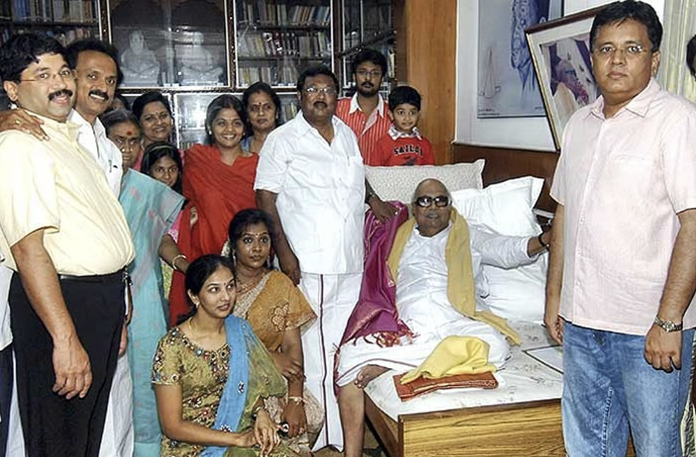
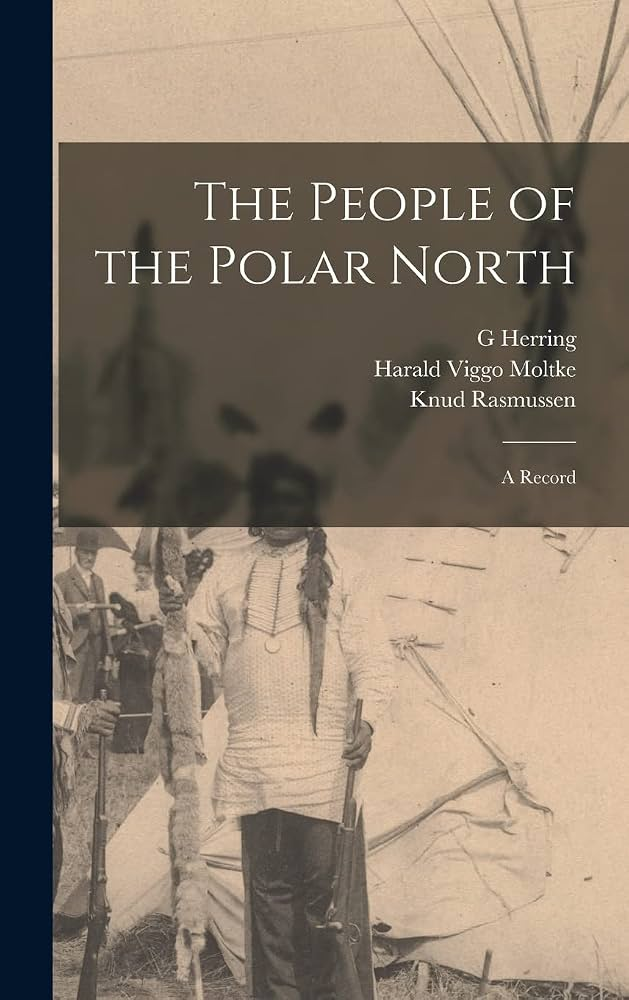

# Introduction

Scandinavia and the Arctic are far, far away from most of us.
Over the past few years, I have occasionally come across the surname Rasmussen, which made me curious about its origins. Rasmussen is a Scandinavian patronymic surname meaning "son of Rasmus." The name Rasmus derives from Erasmus, which has Greek roots associated with the meaning "beloved."

In Greenland, a wife softens sealskin while her husband hunts. In Tirunelveli, a groom’s father hands over a salary slip. Both are answering one question, Can he provide?

<figure style="display: inline-block; width: 750px; max-width: 130%; margin: 1.5rem 0; padding: 0;">
  
  <figcaption style="margin-top: 0.5rem; margin-left: 6%; padding: 0; text-align: left;">
    Map of Polar North. 
  </figcaption>
</figure>

This small curiosity eventually led me to a much larger question:

> What is life like among people living in the Arctic?
> How do they organize their families?
> What do they believe about marriage, women, children, ancestry, and relationships?
> How have generations of people adapted to some of the coldest inhabited environments on Earth?

I was looking at anthropologists who have done scholarly work on arctic folks. 
I was surprised to find many writings on life of people in Arctic. However, few authors stood out to me. One author stood out to me, Knud Rasmussen (1879–1933), the Greenlandic-Danish explorer and ethnographer. He made substantial contributions to the documentation of Inuit societies. His book The People of the Polar North (1908) presents observations of everyday life, marriage, gender relations, hunting, mythology, spirituality, and family organization among Greenlandic Inuit communities.

<figure style="display: inline-block; width: 350px; max-width: 70%; margin: 1.5rem 0; padding: 0;">
  
  <figcaption style="margin-top: 0.5rem; margin-left: 6%; padding: 0; text-align: left;">
    Knud Rasmussen, Ethnographer.
  </figcaption>
</figure>

Popular Indigenous peoples who live in Arctic or near Arctic are Inuit, Iñupiat, Yup’ik, Sámi, Nenets, Evenki, Eveny, Chukchi, Koryak, Yukaghir, and Nivkh. These communities differ considerably in language, ancestry, religion, kinship organization, and subsistence practices. I was struck by similarity of marriage practices, beliefs about family among people living near the arctic and Tamil people, who live north of the equator in South India. 

Among the Polar Inuit, a man's ability to hunt and provide food was an important measure of his suitability as a husband. Similarly, among Tamil communities, a prospective groom's salary, employment, property ownership, and family wealth can strongly influence marriage decisions. 

<figure style="display: inline-block; width: 550px; max-width: 100%; margin: 1.5rem 0; padding: 0;">
  
  <figcaption style="margin-top: 0.5rem; margin-left: 6%; padding: 0; text-align: left;">
Inuit building Igloo. 
  </figcaption>
</figure>

The psychologist Eli Finkel, in *The All-or-Nothing Marriage* [@finkel2017allornothing], describes American marriage moving through three stages. First, marriage served survival and economic security: food, shelter, protection. Later it, came to center on love and companionship. More recently it has been expected to support personal growth and self-fulfillment. Finkel was describing American history, but the same stages can be observed in many societies. In both Arctic and Tamil societies, marriage has historically been understood primarily as a practical and social institution rather than exclusively a romantic relationship.

In both societies, Men were traditionally expected to provide economically, while women performed essential responsibilities in household management, childcare, and family life. Romantic love was not necessarily considered a prerequisite for marriage. Instead, affection and companionship were expected to develop through living together and fulfilling mutual responsibilities. Marriage was also closely associated with having children, maintaining family continuity, and supporting dependents. Established social customs influenced marriage decisions, sometimes restricting individual choice, particularly for women. The striking similarity is that a man's economic capacity could determine his desirability as a husband, while marriage was understood primarily as a practical and social institution rather than exclusively a romantic relationship.

# Tamil People

Tamil people have been in Southern India, for a continuous history of human occupation for more than 3,800 years.
<figure style="display: inline-block; width: 750px; max-width: 100%; margin: 1.5rem 0; padding: 0;">
  
  <figcaption style="margin-top: 0.5rem; margin-left: 6%; padding: 0; text-align: left;">
    Map of Tamil Nadu. 
  </figcaption>
</figure>
Tamil is one of the longest-surviving languages, with over two thousand years of written history, between 300 BCE and 300 CE.
Historian Michael Wood called the Tamils the last surviving classical civilization on Earth, because the Tamils have preserved substantial elements of their past regarding belief, culture, music, and literature despite the influence of globalization.

## Climate and the environment

Towns like Tirunelveli, Chennai, Madurai, Vellore, Coimbatore’s weather ranges from 74-115 degrees (23°C to 46°C). 
Majority of us raised are used to the hot weather. However, I’d say we have not properly mastered our environment, taken advantage of every essential modern tool, urban planning, infrastructure to keep our life comfortable and the region productive. Nevertheless, the more interesting comparison concerns marriage and the organization of family life. 

<figure style="display: inline-block; width: 550px; max-width: 100%; margin: 1.5rem 0; padding: 0;">
  
  <figcaption style="margin-top: 0.5rem; margin-left: 6%; padding: 0; text-align: left;">
    Semi-Arid Climate of Tirunelveli. 
  </figcaption>
</figure>

So, I was quite struck by similarities, beliefs of marriage among Arctic communities and Tamil people. Tamil people’s beliefs about marriage choice, family are traditional, conservative and are not tainted by enlightenment values. 

## Tamil Women

Caste and kinship have historically played central roles in organizing Tamil marriages. Majority of Tamil women prefer marriage within their caste, subcaste. Majority of the time, Tamil women prefer to Marry up [@clarkdeces2014spouse], prefer men to have ownership of property, a house, and handsome pay. Tamil people also practice dowry[@india1961dowry], which is contentious, it is still practiced. For this, the Tamil women’s family gifts whatsoever is asked or out of their own will, many around Nagercoil, Tirunelveli justify this behavior, saying it is for self-respect or to maintain their social-status, social-standing. Another comical practice of Tamil people is many of the marriages are decided in just the groom visiting the bride’s home, just once or twice, and the parents simply force the daughter to marry. 

My particular vivid memory is a friend, whose parents picked one resume out of 3 choices for her marriage. When I asked, why this haste in an important decision? Her parents told her, for your dark skin looks, this is all you will get, just agree and get married. And she got married due to her parent's decision. So after few visits, majority of the families move on, for getting the women married. 

Unfortunately, Women's skin tone is a major factor in Tamil marriage, and many families prefer fair-skinned women. This is a reflection of Tamil family's beliefs, even though there is no scientific basis for this preference, it is a deeply ingrained cultural norm. It is racism , and it is a form of colorism, which is a form of discrimination based on skin tone. Many Tamil women struggle with this skin tone, who are darker skinned, and they are often treated as inferior, and they are often discriminated against in marriage. 

## Tamil Men

Among Tamil people, unfortunately, a Man is valued for his salary, and people publicly ask how much is the salary of Man? 
Especially in wedding/marriage purpose, some families ask their Men to provide their salary slip to prove their income. So together with income, property ownership, educational qualifications, and family wealth are carefully evaluated. In my view, majority of Tamils are insecure to break social rules to marry whoever they like, regardless of social status or any other norm. Now, there are not a large spectrum of liberals among Tamils. The majority are conservative due to lack of effects of enlightenment values, writers, authors. The furthest is the works of social critic Periyar. 

The role of men in Tamil society is strictly economic provision, and the role of traditional-women is strictly domestic. Even if the wives start working, the salaries are controlled by the husband. In many cases, Tamil Men are threatened by women working, and so they prefer to keep their wives at home. In discussions, some Tamil men have confided to me, that they do not want their wives to question them, with finances, women start to gain power, and they do not want to lose their authority. So, they prefer to keep their wives at home, and the wives are expected to manage the household and care for children.

## Tamil Family

Among traditional Tamil families, authority is often exercised hierarchically. As culturally all Tamils are raised with the belief that older people are respected/superior or vice-versa, young Tamils are tricked into believing this. This social dynamic ebbs all the way into Tamil politics, where younger Tamils have no opportunities in exercising authority nor consider them as equals. So authority is exercised through older parents, elders, and extended kinship networks. 

## Family Honour for Tamil Families

Tamil marriage arrangements can involve honor/shame, comparisons between families concerning wealth, education, occupation, caste, property, and social reputation. In Tamil Christian’s wedding, many Tamil families frequently blow up about $100-$500k wedding. This is to protect their face, honor, social-standing among peer families, providing food for unknown 100-500 strangers for the wedding. 

Marriage ceremonies and gift exchanges may become public expressions of family standing in Tamil society. In some cases, the desire to maintain prestige encourages expenditures that exceed a household's financial means, which means lot of Tamil families go into debt[@aljazeera2021weddingburden]. The marriage process can therefore reproduce existing social hierarchies while imposing significant economic and emotional pressures upon prospective spouses and their families. Similar expectations remain influential in many Tamil families, where a prospective groom's employment, salary, property ownership, educational qualifications, and family wealth are carefully evaluated.

In some Tamil families, they are so obsessed with their social status, that they will not allow their children to marry outside their caste, sub-caste, or social standing. In some cases, this can lead to intergenerational conflict, as younger family members may wish to marry for love or personal compatibility rather than strictly adhering to traditional expectations. This is a recurring theme[@tnie2024thanjavur] in many Tamil families, where the tension between individual choice and familial or societal expectations can create significant emotional strain. It also creates violence among families, as some have been known to kill[@express2026tenkasi] their own children [@tamilarasu2026castebarriers] for marrying outside their caste, sub-caste, or social standing[@indianexpress2019thoothukudi].

## Older Tamil people

Older Tamil people are usually kept on a pedestal by all Tamils. Some older Tamils develop entitlement that younger Tamils are automatically there to serve them. And the Older Tamils will enforce the belief that they are older, therefore, they are superior by experience, many would find it repulsive to hear, the belief that all are equal in dignity, regardless of age. 
Some older Tamils who are wealthy or have accumulated political power like, late Thiru Karunanidhi maintained their significant reverence until their older age in his 90s.

<figure style="display: inline-block; width: 550px; max-width: 100%; margin: 1.5rem 0; padding: 0;">
  
  <figcaption style="margin-top: 0.5rem; margin-left: 6%; padding: 0; text-align: left;">
    Thiru Karunanidhi Family with Nephews 
  </figcaption>
</figure>

Older Tamil women usually take responsibility of caregiving, raising grand-children, caring for their families. It’s considered to be highly shameful to put older Tamil men or women into nursing homes or old-age homes, as many Tamils associate it with abandonment, which attaches shame to the person. Honor and Shame is how social fabric of Tamil society works, the goal of everyone is to have reasonable honor, face, and losing face means one loses his identity, self-image, that is tantamount to death, suicide. 

# People of the Polar North 

In The People of the Polar North (1908)[@rasmussen1908polar], particularly the chapter Women (pp. 54–68), Knud Rasmussen documents the social position of women, marriage customs, gender expectations, and relationships between men and women among the Polar Inuit of northern Greenland.

<figure style="display: inline-block; width: 550px; max-width: 100%; margin: 1.5rem 0; padding: 0;">
   <figcaption style="margin-top: 0.5rem; margin-left: 6%; padding: 0; text-align: left;">
    The People of the Polar North 
  </figcaption>
</figure>

## Women's roles and responsibilities

Women were indispensable to the survival of the household [@rasmussen1908polar]. Their principal responsibilities included preparing animal skins, making and maintaining warm clothing, caring for children, and managing domestic life. In the extreme Arctic environment, these activities were essential rather than secondary. A hunter depended upon his wife's ability to prepare protective clothing, while the household depended upon his success in obtaining food. Rasmussen observed that women recognized their importance and took pride in their contributions. Although men claimed authority over their wives, women exercised considerable influence in everyday household decisions.

## Men's roles and social expectations

Men were primarily responsible for hunting seals, walruses, and other animals, providing food, and protecting their dependents from hunger. Hunting skill, strength, industriousness, and the ability to support a family were important measures of masculine competence[@rasmussen1908polar]. Rasmussen describes how an unsuccessful or idle hunter could become the subject of ridicule. Marriage also imposed responsibilities upon men: a husband marrying a widow was expected to support her existing children, while a man marrying a woman with elderly parents could become responsible for their welfare. One elderly man explained his understanding of male authority by arguing that because men provided food, they should exercise control over their households.

## Marriage and the selection of partners

Rasmussen reports that girls generally married around sixteen and that the number of men exceeded the number of women in the northern communities he encountered. Marriage was understood primarily as a practical arrangement essential for establishing and maintaining a household. The ability to provide food and clothing was especially important in selecting a partner[@rasmussen1908polar]. Romantic attraction was not necessarily the foundation of marriage. Instead, affection was believed to develop through living together, cooperation, and shared responsibilities. Rasmussen nevertheless describes couples demonstrating genuine tenderness, physical affection, companionship, and happiness.

## Women's choice and agency

Although marriage operated within a male-dominated social structure, women were not entirely without influence over their relationships. Rasmussen describes a widow named Aleqasina, who had four children and chose to live with a younger man named Erè, partly because she needed someone to help support her family. Another man recounted how his wife left him after he became physically disabled and could no longer hunt, choosing instead a man who could provide for her[@rasmussen1908polar]. These examples suggest that economic security influenced women's choices and that marital relationships were not always permanent. However, the extent of women's freedom varied considerably across different circumstances.

## Male authority and treatment of wives

Rasmussen documents beliefs among some men that a husband was entitled to discipline his wife to maintain obedience. Domestic violence could be socially tolerated, and relatives sometimes refused to intervene in conflicts between husbands and wives. In one incident, Aleqasina was beaten by Erè after refusing to sharpen his knife[@rasmussen1908polar]. She resisted him physically and verbally, demonstrating that women could actively challenge their husbands. Rasmussen also records the view, expressed by some of his male informants, that occasional punishment reinforced male authority. These accounts reveal a distinction between women's influence in daily household affairs and their limited protection against marital violence.

## Sexual customs and wife exchange

One of Rasmussen's most significant findings concerns temporary wife exchange. He reports that men sometimes agreed to exchange wives for a night or longer, particularly in connection with hunting expeditions. Such arrangements could facilitate travel, provide companionship during expeditions, or serve as a means of managing marital disagreements[@rasmussen1908polar]. Women were not necessarily consulted, and Rasmussen records instances in which refusal could result in punishment. This demonstrates that women's substantial domestic responsibilities and influence did not guarantee autonomy in sexual relationships. Polygyny also existed, although Rasmussen describes it as uncommon because women were relatively few.

## Motherhood and children

Having children was considered an important purpose of marriage[@rasmussen1908polar]. Children brought affection and happiness to their parents and were expected to contribute to family security as they grew older, particularly by supporting aging relatives. Rasmussen portrays motherhood as central to women's social identity and suggests that childlessness could bring considerable sorrow. His account also shows that widows with children could remarry and that their new husbands assumed responsibilities toward children from previous relationships.

## Beliefs about happiness and relationships

Rasmussen was struck by the coexistence of domestic affection, laughter, and companionship with unequal authority and physical violence[@rasmussen1908polar]. He believed that many women experienced happiness and satisfaction despite circumstances that European observers might interpret as oppressive. However, this was Rasmussen's interpretation rather than a systematic investigation of women's own experiences. His descriptions of women as content, despite acknowledging violence and restricted sexual autonomy, must be evaluated critically.

## Older People

Rasmussen describes an elderly man named Ivaluardjuk, who possessed extensive geographical knowledge, knew traditional stories and songs, and was recognized for his familiarity with the surrounding country. Rasmussen was particularly impressed when Ivaluardjuk drew a map of the coastline from Repulse Bay to Pond Inlet from memory. 

However, despite his knowledge and experience, Ivaluardjuk was concerned about becoming old and helpless without a wife. His first wife had died, and his children were already grown. He explained that he feared loneliness and dependence as he aged. He subsequently entered another marriage, under circumstances Rasmussen records that involved an adoptive daughter. Ivaluardjuk described his later life as more comfortable because he no longer felt alone[@rasmussen1908polar].

## Older People, Abandonment, and Death

In Intellectual Culture of the Iglulik Eskimos (1929)[@rasmussen1929iglulik], Knud Rasmussen documented that families were generally expected to support elderly people, widows, orphans, and other individuals unable to provide for themselves. However, he also recorded instances in which elderly men and women who could no longer accompany migrating hunting groups were abandoned and sometimes died from starvation or exposure. 

These individuals were called qimatät, meaning "those who were left behind." Elderly women who could no longer perform useful household work were particularly vulnerable. Rasmussen attributed some cases to severe food scarcity and others to cruelty, emphasizing that abandonment was nevertheless considered shameful. He also documented elderly individuals who died by suicide, sometimes in circumstances involving illness, bereavement, or beliefs about reunion with deceased relatives. These accounts reveal a tension between communal obligations toward older people and the harsh economic realities of Arctic survival. They represent particular historical practices and incidents, not universal Inuit attitudes toward aging.

# Overall anthropological findings

Rasmussen's observations suggest that marriage among these Polar Inuit communities was fundamentally shaped by economic interdependence, environmental survival, reproduction, and kinship obligations. Men were generally valued for their hunting ability and provision of food, while women were valued for their domestic skills, clothing production, and motherhood. Romantic love could develop after marriage rather than preceding it. Women possessed meaningful influence within households and sometimes exercised choice in relationships, but men maintained greater recognized authority over marriage and sexuality. The society Rasmussen described therefore combined practical cooperation and emotional attachment with significant gender inequalities. These findings represent Rasmussen's observations and the beliefs expressed by particular individuals in northern Greenland during the early twentieth century. These days, some of the customs, beliefs might have changed due to outside contact.

Marriage among traditional Tamil people has been strongly shaped by economic security, caste, kinship obligations, family reputation, and social hierarchy. Men are frequently evaluated according to their salary, employment, educational qualifications, property ownership, and ability to provide financial stability, while women have traditionally been evaluated according to their family background, caste, appearance, domestic responsibilities, and suitability for motherhood. 

For Tamil families, *Romantic love is not necessarily considered a prerequisite for marriage*, as parents and relatives often prioritize economic compatibility, caste endogamy, and family standing, expecting affection to develop after marriage. Dowry, marriage expenditures, and displays of wealth can further reinforce social hierarchies and place financial pressure on families. Older family members often exercise considerable authority over matrimonial decisions, sometimes restricting individual choice. 

Women may possess substantial influence within households while experiencing unequal expectations concerning marriage, caregiving, and family obligations. Respect for elders, preservation of family honor, and the continuation of caste and kinship relationships remain influential social expectations. Nevertheless, education, urbanization, women's employment, migration, and changing attitudes toward individual autonomy are transforming these traditions. These findings reflect historical anthropological scholarship and observations of particular Tamil communities, rather than uniform beliefs shared by all Tamil people.

# Related Posts to this Article

- [The Nayars of Kerala](https://rickrejeleene.me/Tamil/posts/2026-03-21-Nayars/index.html) - Matrilineal families, marriage customs, women's autonomy, inheritance, and household authority.

- [Caste-Endogamy Missed Opportunities to Develop Finance Sector](https://rickrejeleene.me/Tamil/posts/2025-05-10-caste-nagarathar/index.html) - How marriage within caste boundaries influences family wealth, economic relationships, and social mobility?

- [Nadars: From Palm Trees to Entrepreneur & Wealthiest Social Groups](https://rickrejeleene.me/Tamil/posts/2025-08-29-Nadar/index.html) : Caste mobility, marriage practices, family wealth, kinship, and changing social status?

- [Nagarathar Chettiar: Social Group of Tamil Nadu](https://rickrejeleene.me/Tamil/posts/2026-06-25-NagaratharCaste/index.html) : Kinship organization, marriage arrangements, inheritance, and family economic networks.

- [Caste in Tamil Nadu by Anthropologist Diane P. Mines](https://rickrejeleene.me/Tamil/posts/2025-08-14-Caste-System-Anthropologist/index.html) : Anthropological perspectives on caste, marriage, endogamy, family relationships, and social hierarchy [@mines2005fierce].

- [Thevar Caste: A Social Group in Tamil Nadu](https://rickrejeleene.me/Tamil/posts/2025-08-14-Kallar-Caste/index.html) : Caste identity, kinship, traditional authority, and social standing in southern Tamil Nadu.

- [Tamil Brahmins: From Village Priests to Software Engineers and Industrialists](https://rickrejeleene.me/Tamil/posts/2025-08-19-Tamil-Brahmins/index.html) : Education, marriage preferences, caste identity, professional status, and economic mobility [@fuller2008companionate].

- [Castes in India: Their Mechanism, Genesis and Development by B. R. Ambedkar](https://rickrejeleene.me/Tamil/posts/2025-05-28-castes-in-india-ambedkar/index.html) : How endogamy and restrictions on marriage reproduce caste boundaries across generations[@ambedkar1917castes].

- [The Modern Caste System in Tamil Nadu](https://rickrejeleene.me/Tamil/posts/2015-08-10-Caste-System-India/index.html) : Persistence of caste hierarchy, social expectations, and inherited inequalities in modern Tamil society.

- [Book Summary: Nadars of Tamil Nadu, India](https://rickrejeleene.me/Tamil/posts/book1/index.html) : Historical changes in caste status, family organization, economic advancement, and social mobility.

- [The All-Or-Nothing Marriage: How the Best Marriages Work](https://rickrejeleene.me/Tamil/posts/book9/index.html) : Modern expectations of romantic love, emotional intimacy, companionship, and marital satisfaction.

- [Kongu Region of Tamil Nadu](https://rickrejeleene.me/Tamil/posts/2025-10-10-Kongu/index.html) : Regional social organization, community identity, economic development, and family traditions.

- [Caste and Electoral Politics in Tamil Nadu by K. A. Manikumar](https://rickrejeleene.me/Tamil/posts/book2/index.html) : Connections between caste hierarchy, community authority, social identity, and political organization.

- [How to Make Friends](https://rickrejeleene.me/Tamil/posts/2026-01-01-Friends/index.html) :   Formation of interpersonal relationships, companionship, and social connections beyond family obligations.

- [Why Tamil Nadu Elects Film Stars?](https://rickrejeleene.me/Tamil/posts/2026-05-06-ThreeTamilNadu/) : Public authority, social influence, and the relationship between cultural identity and political leadership.

- [Why India Needs a New Political Theory for the Modern World](https://rickrejeleene.me/Tamil/posts/2026-01-22-IndiaPoliticalTheory/index.html) : Traditional hierarchies, individual autonomy, institutional modernization, and changing social values.

- [India Needs a Professional Political Class](https://rickrejeleene.me/Tamil/posts/2026-04-19-SlidesEastAsia/index.html) : Authority, merit, leadership, and the influence of inherited social structures on institutions.

# References

::: {#refs}
:::