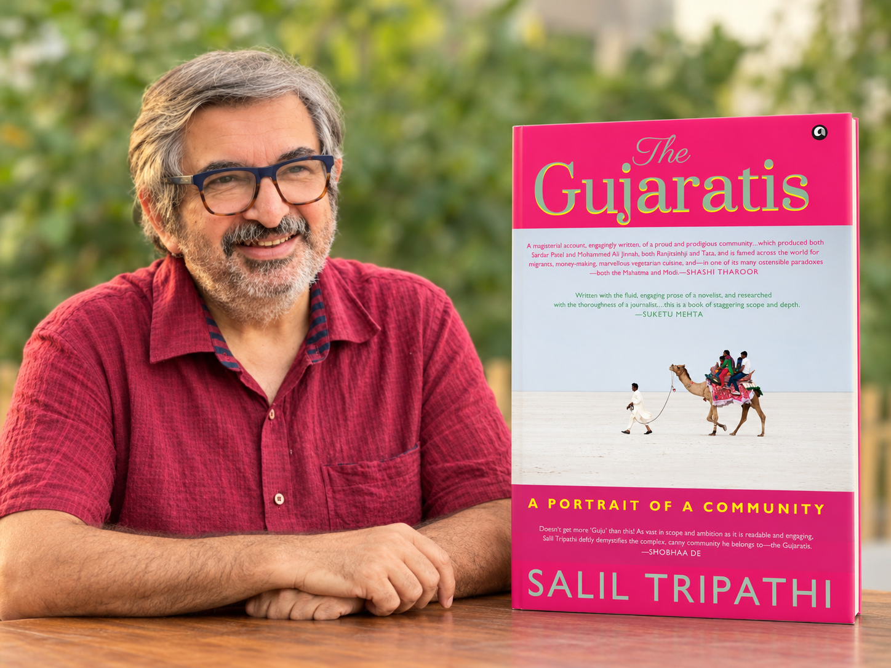
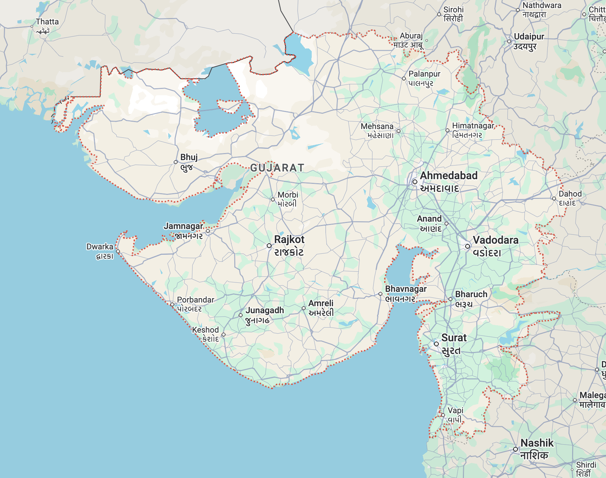
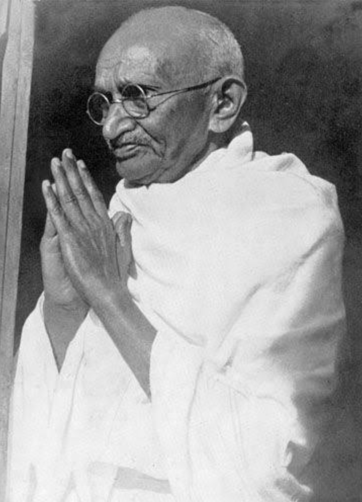
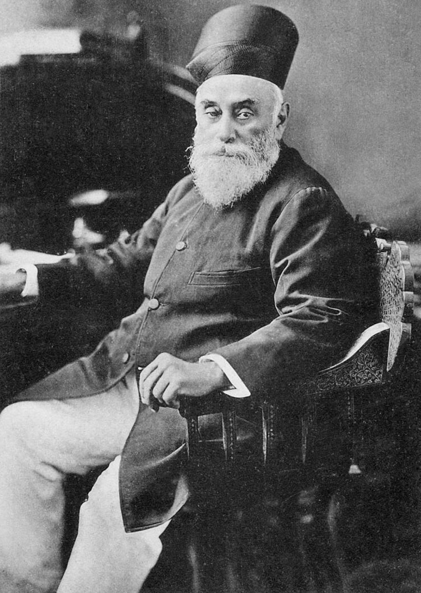
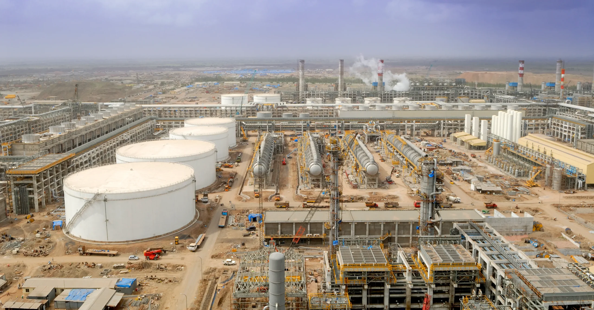
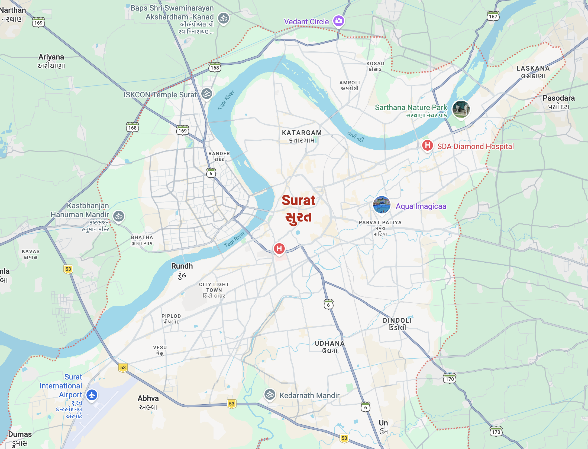
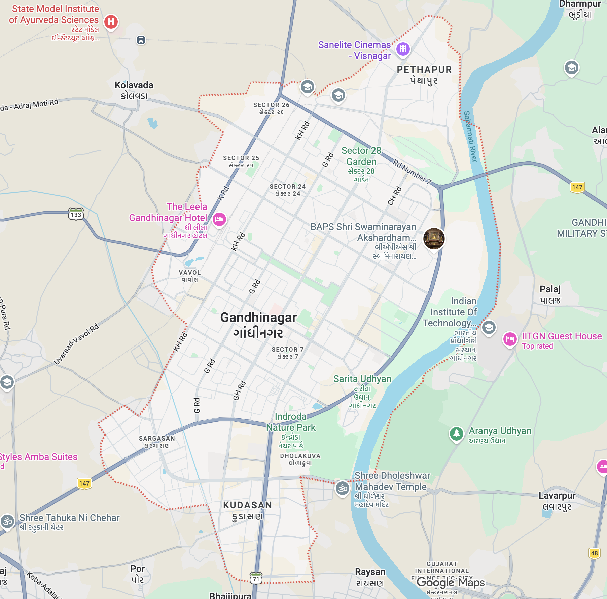
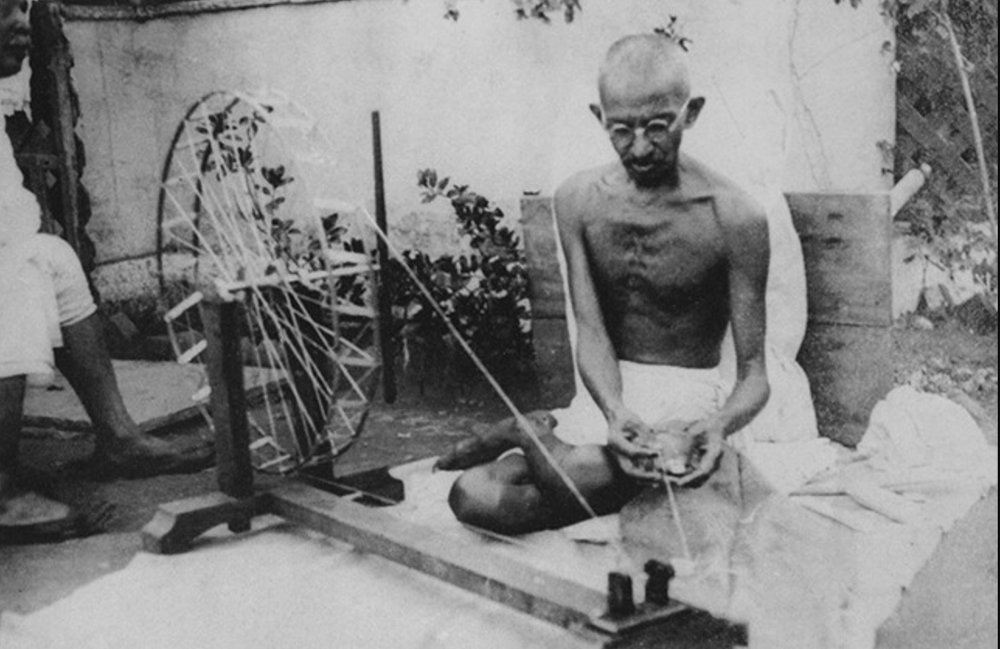
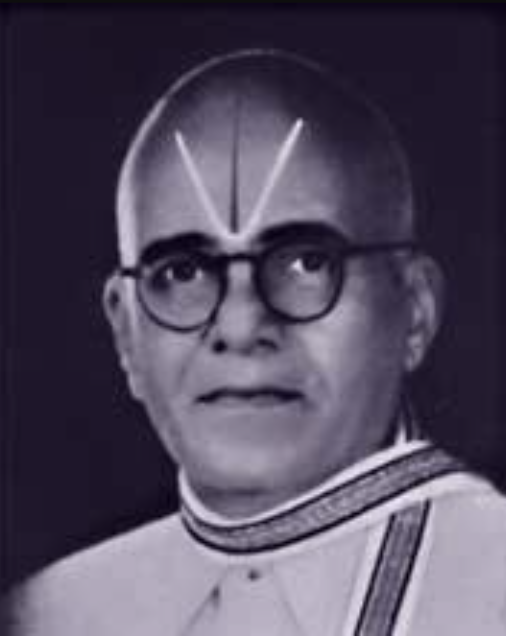

# The Gujaratis: A Portrait of a Community by Salil Tripathi

<figure style="display: inline-block; width: 750px; max-width: 130%; margin: 1.5rem 0; padding: 0;">
  
  <figcaption style="margin-top: 0.5rem; margin-left: 6%; padding: 0; text-align: left;">
    The Gujaratis: A Portrait of a Community by Salil Tripathi. 
  </figcaption>
</figure>

## Introduction

This book had been on my reading list for some time. 
I feel happy that I finally got the opportunity to read it.
The author, Salil Tripathi, was born in Bombay and educated at Dartmouth College in the United States. He draws upon his personal experiences, travels, interviews, historical scholarship, and observations of Gujarati communities across the world. I want to give credit to his hard-work, efforts to compile such a good work that describes Gujarati people. 

Sometime ago, I covered reading works on the business history of India by Claude Markovits[@markovits2008merchants]. It discussed various mercantile communities originating from Gujarat[@rejeleene2026markovitsreview]. Those works introduced me to the remarkable commercial achievements of Gujarati traders, their international networks, and their contributions to Indian business history. Now, many Tamils who I interact with downplay, Gujaratis due to difference in politics. It’s unfortunate that they are not able to separate politics, take the best from Gujarati, especially learning their mercantile acumen.

<figure style="display: inline-block; width: 750px; max-width: 130%; margin: 1.5rem 0; padding: 0;">
  
  <figcaption style="margin-top: 0.5rem; margin-left: 6%; padding: 0; text-align: left;">
    Map of Gujarat. 
  </figcaption>
</figure>

I have never visited Gujarat. However, I have always been curious to learn about the people, their ways of life, traditions, family upbringing, religious beliefs, occupations, and social institutions.

Tripathi broadly defines Gujarati identity through language and cultural belonging rather than exclusively through caste, religion, or geographical origin. This is particularly interesting because Gujarati-speaking communities are spread across many countries and represent considerable religious, social, and occupational diversity.

## Outline of the Book

1. [Part I: Who We Are](#part-i-who-we-are)
2. [Part II: The Way We Are](#part-ii-the-way-we-are)
3. [Part III: Whence We Came](#part-iii-whence-we-came)
4. [Part IV: Where We Live](#part-iv-where-we-live)
5. [Part V: Beyond India](#part-v-beyond-india)
6. [Part VI: The Way We Earn](#part-vi-the-way-we-earn)
7. [Part VII: The Way We Politick](#part-vii-the-way-we-politick)
8. [Part VIII: The Way We Create](#part-viii-the-way-we-create)
9. [Part IX: The Way We Give, The Way We Pray](#part-ix-the-way-we-give-the-way-we-pray)
10. [Part X: The Way We Eat](#part-x-the-way-we-eat)
11. [Part XI: The Way We Play](#part-xi-the-way-we-play)
12. [Part XII: The Way We Kill](#part-xii-the-way-we-kill)

## My Impressions of Gujaratis Before Reading the Book

Before discussing the book, I would like to share some of my earlier impressions of Gujaratis. The first Gujarati who comes to my mind is Mahatma Gandhi. I consider Gandhi one of the greatest Indians of the twentieth century. His deep theism, extraordinary willpower, intellectual curiosity, and moral convictions enabled him to confront overwhelming political oppression through nonviolent resistance.

<figure style="display: inline-block; width: 450px; max-width: 130%; margin: 1.5rem 0; padding: 0;">
  
  <figcaption style="margin-top: 0.5rem; margin-left: 6%; padding: 0; text-align: left;">
    Mahatma Gandhi - One of the Greatest Indians of the Twentieth Century. 
  </figcaption>
</figure>

I was particularly impressed to learn that Gandhi possessed a copy of Joseph Butler's *The Analogy of Religion, Natural and Revealed, to the Constitution and Course of Nature*. To me, this illustrates the breadth of his intellectual curiosity and his willingness to engage with philosophical and theological works beyond the traditions of his upbringing. My other impression concerns the entrepreneurial achievements of Gujarati communities.

<figure style="display: inline-block; width: 350px; max-width: 130%; margin: 1.5rem 0; padding: 0;">
  
  <figcaption style="margin-top: 0.5rem; margin-left: 6%; padding: 0; text-align: left;">
    Jamsetji, founder of Tata Group, One of India's Leading Industrial Conglomerates. 
  </figcaption>
</figure>

Jamsetji Nusserwanji Tata (1839–1904), born into a Parsi family of priests in Navsari, Gujarat, became one of India's pioneering industrialists. 
Jamsetji joined his father's enterprise, gaining commercial experience and international exposure before founding his own trading company in 1868 with ₹21,000 in capital. The Tata's together in a century, generated one of the highest number of private sector jobs in India. As a conglomerate, Tata group recorded, $185 billion USD in revenue for the year 2025-2026. They employ over 1,160,000 people globally. He made significant contributions to India's leading research institute, Indian Institute of Science, Bangalore.

<figure style="display: inline-block; width: 350px; max-width: 130%; margin: 1.5rem 0; padding: 0;">
  
  <figcaption style="margin-top: 0.5rem; margin-left: 6%; padding: 0; text-align: left;">
    Mukesh Ambani, He built the most profitable Oil Refinery in the World. 
  </figcaption>
</figure>

Another example is Mukesh Ambani and Reliance Industries. The Jamnagar oil refining complex represents one of the most extraordinary industrial achievements on Indian soil in the last 200–300 years. In my view, it is among the most remarkable revenue-generating and profitable industrial enterprises ever established in India. It is a money-making machine. The scale of engineering, capital investment, industrial organization, and entrepreneurial ambition required to build such an enterprise is astonishing. Such feats demonstrate the extraordinary entrepreneurial spirit of Gujarati businessmen. 

Lastly, Gujaratis have historically established extensive commercial networks across Africa, Europe, Southeast Asia, Australia, Britain, Canada, and the United States. Their enterprises have included textiles, shipping, finance, diamonds, manufacturing, retail, hospitality, and international trade. I am reminded of Muljibhai Madhvani, who established a significant industrial enterprise in Uganda. His achievements illustrate how a migrant entrepreneur could develop businesses in unfamiliar geographical, political, and commercial environments.

Coming from Tamil Nadu, I cannot help, comparing these achievements with the priorities I observe in my own state. I believe many Tamil people are distracted by cinema, spending considerable amounts of their time, attention, and money on films and film personalities rather than developing a stronger culture of scientific inquiry, industrial ambition, entrepreneurship, and intellectual achievement. 

In my view, promoting hands-on engineering, entrepreneurship, industrial development, and scientific research should be a higher priority for Tamil Nadu. I believe that the state has the potential to become a hub of industrial innovation, technological advancement, and global commerce. However, this requires a cultural shift towards valuing education, research, and enterprise over entertainment and celebrity culture. Recently, I was struck by the fact that China has been promoting it's scientists and engineers to inspire their Youth towards full filling their potential. I think Tamil Nadu should do the same.

## Part I: Who We Are

The author examines Gujarati identity, cultural characteristics, commercial pragmatism, humour, courage, and collective pride. He says, there are approximately 55 million Gujarati speakers. The author also refers to an estimate that approximately one in three Indians living abroad is Gujarati.
One of the remarkable features of Gujarati society is its global presence. Gujarati traders, professionals, and entrepreneurs have established themselves in distant regions while preserving many of their linguistic and cultural traditions.

The poet Ardeshir Khabardar (1881–1953) expressed this sentiment:

*Jyan jyan vase ek Gujarati,*  
*Tyan tyan sada-kaal Gujarat.*
Wherever lives a Gujarati, there is Gujarat forever.

The verse conveys the idea that Gujarati identity extends beyond geographical boundaries. Language, traditions, family relationships, and shared cultural memories allow communities to preserve a sense of belonging even when they live abroad.

### Pragmatism and Entrepreneurship

He says, Gujaratis are practical, commercially minded, adaptable, and enterprising. One humorous anecdote illustrates this reputation.

A Gujarati businessman wanted to hire an accountant. He advertised the position and shortlisted three candidates. The first candidate was a Tamil auditor, who had excelled in mathematics. The businessman asked him what two plus two equalled.

The Tamil candidate replied, four.
The second candidate was a Bengali statistician. When asked the same question, he replied twenty-two, imagining that he was demonstrating lateral thinking.
The third candidate was a Gujarati accountant.
When the businessman asked him what two plus two equalled, the Gujarati candidate responded by asking what the businessman wanted the answer to be.

He received the job.

The anecdote humorously conveys the stereotype of Gujarati commercial pragmatism. Rather than following rigid procedures, the Gujarati businessman is portrayed as adaptable and attentive to what his customers want. Of course, this is a cultural joke and should not be interpreted as evidence that Gujaratis possess an inherent commercial advantage over other communities.

### Education and Language Policy

The author shares, consequences of language policy in Gujarat.
He argues that political decisions to prioritize Gujarati-medium education, without providing adequate opportunities to learn English, disadvantaged sections of the population. Students from wealthier families could often access English-medium education, whereas students from economically disadvantaged backgrounds had fewer opportunities.

This contributed to inequalities in access to higher education, professional occupations, and international opportunities. Preserving one's mother tongue and learning English need not be mutually exclusive objectives.

### Gujarati Asmita: Collective Identity, Dignity, and Pride

One of the most important discussions in Part I concerns *asmita*, a concept associated with identity, dignity, and collective pride. The author traces its development through competing intellectual and political traditions.

Mahatma Gandhi advanced a philosophy emphasizing nonviolence, religious coexistence, social responsibility, and service to the weakest members of society. This was a vision of Gujarat that got lost among people. 

In contrast, K. M. Munshi popularized a romanticized vision of Gujarat's Hindu-Jain past, particularly through his historical novels set during the Chaulukya period. The author points Munshi’s writing to be the popularizer of communal polarization, myth-making in Gujarati History. In this, Muslims were considered as invaders. This explains much of the current political ideology of India. 

The author says contemporary Gujarat increasingly embraced aspects of Munshi's cultural nationalism rather than Gandhi's inclusive ethical vision.
He associates this development partly with the political rise of Hindu nationalism and the BJP's prolonged dominance in Gujarat.

## Part II: The Way We Are

This section examines Gujarat's remarkable social diversity, demographics. 
The name Gujarat is associated historically with Gujaratta and Gurjar-rashtra, referring to the territory connected with the Gurjar people.

The Anthropological Survey of India’s People of India project, initiated on 2 October 1985, initially identified 6,748 communities nationally and studied 4,635 in detail. Its Gujarat volume identified 289 communities, although sociologists A. M. Shah and I. P. Desai suggested that the number exceeded 300 [@singh1992people]. According to 2001 Census figures cited in the volume, approximately 89% of Gujarat’s population was Hindu, 9.06% Muslim, and just under 1% Jain; these figures illustrate the state’s religious composition at that time. Christianity is a minority religion in Gujarat, with about 0.52% of 60.4 million in 2026. Jainism is 0.96 % of the population.
While, Islam is 9.67% of the population.

Anthropological surveys cited for Gujarat report that roughly 70% of people claim their community migrated into the state or region, examples include Audichya Brahmins traditionally tracing origins to present-day Uttar Pradesh.

###  Caste and Social Classification

The author recounts his childhood journeys from Bombay to Nadiad, where his maternal grandparents lived. 
During these journeys, strangers frequently asked him *tame keva?*, meaning something like, what kind of person are you?
Although the question appeared innocent, its underlying purpose was often to determine his caste or religion. 
His first name, Salil, was sometimes mistaken for the Muslim name Salim. Meanwhile, his surname, Tripathi, led others to assume that he originated from Uttar Pradesh. As a child, he misunderstood these questions. As an adult, he came to recognize their social significance.

This type of question is popular in Tamil society, where people frequently ask, *un paer ena?*, meaning what's your name? 
If I were to answer the question, Rick. The next assumption might be, "Rick, you are a Christian, right?"
Usually, name infers religion, caste. People also ask, What does your father do? Another way to uncover their social standing in Tamil Society. 
Castes are still important in Tamil society, while people might not have caste surnames, except a few. 

### Mercantile Communities

The author describes the Bhatias, Kapols, Lohanas, Jains, Parsis, and Patidars.
Many developed influential commercial networks across India and overseas.
Their commercial achievements were supported by family enterprises, access to capital, established trading relationships. The Jain community occupies a particularly important position because of its influence on commerce, philanthropy, religious traditions, and vegetarianism. 

The Parsi community also made significant contributions to industry, education, commerce, and cultural institutions, particularly in Bombay. 
The Patidar or Patel communities illustrate how groups historically associated with agriculture developed substantial influence in business, politics, and migration. Regardless of their social standing, the author shares complexity of requiring affirmative action or reservations. 

###  Dalits, Adivasis, and Marginalized Communities

The author shares attention to communities frequently excluded from celebratory accounts of Gujarat's prosperity. Dalits have experienced caste discrimination, occupational restrictions, and unequal access to resources and social opportunities. Dalit literature, particularly the writings of Joseph Macwan, provides insight into the experience of social exclusion and resistance. Adivasi communities and denotified tribes have faced different forms of historical marginalization, including inequalities associated with colonial classifications and development policies.

Pastoral and nomadic communities contribute further diversity to Gujarat's cultural landscape, particularly in Kachchh and neighbouring regions.The author also challenges the tendency to portray Gujarati Muslims as outsiders, despite their long participation in the region's commercial, linguistic, and cultural life.

##  Part III: Whence We Came

Gujarat's geographical position on the western coast of India made it an important participant in Indian Ocean trade. 
Its ports connected merchants with West Asia, Africa, and Europe.

### The Chaulukya Period

The Chaulukya or Solanki dynasty occupies a prominent position in Gujarati historical imagination. K. M. Munshi's historical novels popularized the idea of this period as a golden age of Gujarati civilization. However, the author questions narratives that present Gujarat's history exclusively through the opposition between glorious Hindu kingdoms and destructive Muslim invaders. Many Gujaratis consider Chaulukya period to be golden era of Gujarat. It's popular to this day.

###  Somnath and Historical Memory

The Somnath temple provides an important example of how historical events are remembered and interpreted. 
The temple was destroyed and rebuilt multiple times, over centuries. The modern reconstruction, built in traditional Chalukya-style architecture using creamy yellow stone, was completed and inaugurated on May 11, 1951. The author examines the attack by Mahmud of Ghazni in the eleventh century, subsequent historical narratives, and the reconstruction of the temple after Indian independence. Drawing upon Romila Thapar's scholarship, he explains how chronicles, religious traditions, colonial accounts, and modern political movements have interpreted Somnath differently. This event has been used to justify communal polarization, political mobilization, and the construction of historical memory. 

### Surat, Bombay, and Colonial Commerce

Surat emerged as a major commercial port connecting Indian merchants with international markets. 
European trading companies gradually transformed existing commercial relationships. Bombay subsequently developed into a major colonial centre of finance, shipping, trade, and industry, attracting Gujarati merchants and migrants from different backgrounds.

<figure style="display: inline-block; width: 750px; max-width: 130%; margin: 1.5rem 0; padding: 0;">
  
  <figcaption style="margin-top: 0.5rem; margin-left: 6%; padding: 0; text-align: left;">
    Surat, Gujarat, India. It's the diamond city of India. 
  </figcaption>
</figure>

### The Formation of Modern Gujarat

The modern state of Gujarat was formed on 1 May 1960 following the division of Bombay State. The Mahagujarat movement advocated a separate state for Gujarati-speaking populations. However, the new state brought together regions with distinctive histories and cultural traditions, including mainland Gujarat, Saurashtra, and Kachchh. While Kachchh is looked down within Gujaratis as it is poorer part of Gujarat, dry, frequently affected by drought. 

Gandhinagar is the capital of Gujarat, while Ahmedabad is the largest city. 

<figure style="display: inline-block; width: 550px; max-width: 110%; margin: 1.5rem 0; padding: 0;">
  
  <figcaption style="margin-top: 0.5rem; margin-left: 6%; padding: 0; text-align: left;">
    Gandhinagar, Gujarat, India. It's next to Ahmedabad, the largest city of Gujarat. Nicknamed, the Green City of India, as it is planned city with wide roads, parks, and greenery.
  </figcaption>
</figure>

##  Part IV: Where We Live

Bombay became a centre of commerce, finance, education, journalism, and cultural activity. Gujarati merchants, professionals, workers, and intellectuals contributed significantly to its development. Ahmedabad emerged as a major textile manufacturing centre and became known as the Manchester of the East. Its textile mills generated employment and industrial wealth while also shaping relationships between workers, industrialists, trade unions, and political organizations. Surat retained its commercial importance through textiles, diamonds, international trade, and entrepreneurship. Vadodara developed as an important centre of education, literature, and modern art, supported particularly by the Gaekwad rulers and Maharaja Sayajirao University.

##  Part V: Beyond India

The author traces Gujarati migration across the Indian Ocean to Oman, East Africa, Southeast Asia, Britain, and North America. Gujarat's western coastline facilitated trade with Arab, African, and Asian ports. Merchants established businesses involving textiles, spices, shipping, agricultural commodities, finance, and precious stones. Their international expansion depended on maritime knowledge, access to capital, family relationships, reputation, and established commercial networks.

### Gujaratis in Africa

Gujarati merchants established significant communities in Uganda, Kenya, Tanzania, and South Africa. Some became prominent industrialists, while others operated smaller businesses in retail, manufacturing, and trade. Their experiences were not uniformly prosperous. Political instability, racial discrimination, and changing citizenship policies periodically threatened their livelihoods. 

The expulsion of Asians from Uganda under Idi Amin in 1972 demonstrated how quickly political decisions could destroy established businesses and family lives. Many displaced Gujaratis subsequently rebuilt their lives in Britain and other countries. Tripathi also discusses Gujarati participation in anti-colonial and anti-apartheid movements, challenging the assumption that overseas Gujaratis were concerned exclusively with business. Unfortunately, this is one of the saddest stories of Gujaratis in Africa. Many Gujaratis were expelled from Uganda, after attaining prosperity in Uganda. 

<figure style="display: inline-block; width: 450px; max-width: 70%; margin: 1.5rem 0; padding: 0;">
  
  <figcaption style="margin-top: 0.5rem; margin-left: 6%; padding: 0; text-align: left;">
    Zohran Mamdani - New York City Mayor 2026.  
  </figcaption>
</figure>

Currently, One popular Gujarati in the United States is Zohran Mamdani, who was elected as the first South Asian mayor of New York City. He took office in 2026. Zohran Mamdani, was born in Kampala, Uganda. His father is a Gujarati Muslim. His mother is a Punjabi Hindu.

### Gujaratis in Britain and America

Gujarati migrants established enterprises in retail, finance, hospitality, manufacturing, and related industries. 
In the United States, Patels became particularly prominent in the motel industry. Many Indians who live in the United States might recognize Patel Brother's, a popular chain of Indian grocery stores. Mafat Patel and his brother Tulsi Patel opened a small shop in Devon Avenue in Chicago in 1974. The business expanded into a chain of stores across the United States, providing Indian groceries, spices, and household products to Gujarati and other South Asian communities.

What was saddening to read is when many Gujaratis were excluded, asked to leave Uganda, many of them had British Citizenship, India under Indira Gandhi did not accept them as refugees, neither did Britain accepted, even though they had British citizenship, how traumatic? 
The plight of the families whose assets were confiscated by Idi Amin and they had no where to go? 

<figure style="display: inline-block; width: 750px; max-width: 130%; margin: 1.5rem 0; padding: 0;">
  
  <figcaption style="margin-top: 0.5rem; margin-left: 6%; padding: 0; text-align: left;">
    India Square, New Jersey also known as Little India.  
  </figcaption>
</figure>

##  Part VI: The Way We Earn

The author shares Gujarati entrepreneurship, commercial networks, major industries, economic institutions, and the pursuit of wealth. One important theme is the role of trust. Commercial transactions frequently depend on reputation, reliable partners, established relationships, and repeated interactions. Family and community networks can provide access to information, capital, and business opportunities. However, these relationships may also concentrate opportunities among established insiders.

### The Diamond Industry

Gujarati merchants and workers became major participants in international diamond trading, cutting, and polishing. Almost 90% of World’s diamonds is polished in Surat. Palanpuri Jains from Palanpur in Gujarat, India, control an estimated between 70% and 95%, who arrived in Antwerp to replace Hasidic Jewish merchants, who were formed majority holders in the trade. 

### Amul and Cooperative Development

Another significant achievement is Amul, developed through the cooperative movement led by Tribhuvandas Patel and Verghese Kurien. By organizing milk procurement, processing, and distribution collectively, dairy farmers gained greater bargaining power, reduced their dependence on intermediaries, and improved their incomes. 

### Gujarat's Development Model

The author examines Gujarat's economic development model, particularly the Vibrant Gujarat investment summits, which promoted the state as an attractive destination for domestic and international investment. The model emphasized industrialization, infrastructure development, private enterprise, and cooperation between government and large corporations. However, the author questions whether investment announcements necessarily translate into actual investments, productive employment, higher wages, and improvements in education, healthcare, and living standards. Most likely, it did not raise inclusive living standards for all in Gujarat. He also discusses financial scandals and commercial misconduct, challenging the assumption that entrepreneurial success guarantees ethical behavior. 

## Part VII: The Way We Politick

This section examines Gujarat's political history, particularly its contributions to Indian nationalism and the influence of Mahatma Gandhi. And different approaches to resisting British rule, including constitutional politics, revolutionary nationalism, and nonviolent resistance.

### Gandhi and Political Transformation

<figure style="display: inline-block; width: 450px; max-width: 130%; margin: 1.5rem 0; padding: 0;">
  
  <figcaption style="margin-top: 0.5rem; margin-left: 6%; padding: 0; text-align: left;">
    Mahatma Gandhi - The Father of the Indian Nation. 
  </figcaption>
</figure>

Gandhi occupies a central position in the book. His philosophy combined nonviolent resistance, civil disobedience, religious conviction, moral responsibility, and concern for the vulnerable. The author traces Gandhi's intellectual development, his return to India, and the establishment of his ashram in Ahmedabad. He also examines Gandhi's contradictions, including tensions between his conservative social attitudes and radical political methods. Women played an important role in Gandhian movements, contributing to political mobilization, social reform, and community organization.

### Gujarat after Gandhi

The author investigates how Gujarat's political environment changed following independence. Caste-based political coalitions, reservation policies, social movements, and competing electoral strategies transformed the state's political landscape. The KHAM coalition under Madhavsinh Solanki brought together Kshatriyas, Dalits, Adivasis, and Muslims. It challenged established political privileges and contributed to a significant electoral realignment. However, opposition to expanded reservations intensified unrest among some influential communities.The author examines how these conflicts intersected with the political rise of Hindu nationalism

The author narrates, Narendra Modi's political rise and how he combined Gujarati regional pride, Hindu nationalism, and economic development into a broader political narrative. Following the communal violence of 2002, Modi organized the Gaurav Yatra, invoking Gujarati asmita and portraying criticism of his government as an affront to Gujarat's dignity. The campaign used Narmad's patriotic poetry and Hindu religious symbolism to reinforce regional identity. Modi subsequently promoted Gujarat as a model of industrial development through initiatives such as Vibrant Gujarat, launched in 2003, attracting business investment and emphasizing infrastructure, manufacturing, and economic growth. 

Tripathi argues that Modi transformed this regional development narrative into a national political identity, presenting Gujarat's experience as a model for India. He also examines Modi's use of historical figures such as Gandhi, Sardar Patel, and Ambedkar to construct a broader national narrative. However, the author questions whether economic achievements and political mobilization translated into equivalent improvements in social equality, religious coexistence, and the welfare of disadvantaged communities.

## Part VIII: The Way We Create

This section examines Gujarati literature, language, journalism, cinema, theatre, music, and visual art. British scholars such as Alexander Kinloch Forbes, Joseph Van S. Taylor, and Robert Drummond contributed to documenting Gujarati history, grammar, and vocabulary. Narmad's *Narmakosh*, published in 1861, became an important landmark in Gujarati lexicography. Later, Gandhi encouraged efforts to standardize Gujarati spelling, leading to the publication of *Jodanikosh* in 1929. Another monumental contribution came from Bhagwatsinh Jadeja, the ruler of Gondal. He supported women's education and initiated the compilation of *Bhagwadgomandal*, an encyclopedic dictionary that eventually documented more than 280,000 words.

Importantly, the dictionary incorporated vocabulary from different communities and regional dialects rather than concentrating exclusively on the language of educated literary elites. Ratilal Chanderia later supported the digitization of this work through the Gujarati Lexicon project.

### Literature, Journalism, and the Arts

The author examines Gujarat's rich literary and artistic traditions, highlighting writers such as Govardhanram Tripathi, K. M. Munshi, Jhaverchand Meghani, and modernist critic Suresh Joshi. He also discusses women writers including Himanshi Shelat, Saroop Dhruv, and Panna Naik, whose works explore feminism, social inequality, identity, and migration.

Gujarati journalism has a long history, beginning with publications such as Mumbai Samachar (1822), Jam-e-Jamshed (1832), Janmabhoomi (1934), and Chitralekha. These newspapers and magazines contributed to public debate, literary development, and political awareness. However, Tripathi criticizes sections of the Gujarati press, particularly Sandesh and Gujarat Samachar, for their reporting during the 2002 communal violence, contrasting them with newspapers that attempted to promote restraint.

In cinema, Tripathi highlights Ketan Mehta's Bhavni Bhavai (1980), which challenged caste discrimination through satire and traditional Gujarati theatre. He also discusses Gujarati sugam sangeet (light classical and poetry-based music), represented by musicians such as Ashit Desai and Purushottam Upadhyay. In visual art, Gujarat produced internationally recognized artists including Bhupen Khakhar, Tyeb Mehta, Gulammohammed Sheikh, and Haku Shah. However, the author expresses concern about the declining prominence of serious contemporary Gujarati literature, observing the growing popularity of motivational speakers, commercial self-help books, and religious publications

## Part IX: The Way We Give, The Way We Pray

The relationship between religion, philanthropy, wealth, and social institutions in Gujarati society. Jain, Hindu, Parsi, and mercantile communities have contributed to education, healthcare, religious institutions, and charitable activities. 

He describes the Jain tradition of boli, where devotees bid for opportunities to perform religious rituals or support temples. He also discusses charitable initiatives providing food, medical assistance, and disaster relief, including the humanitarian efforts of Digvijaysinhji, the ruler of Nawanagar, who sheltered Polish refugee children during the Second World War. An interesting observation concerns Gujarati satsangs, which function not only as religious gatherings but also as occasions for business networking, discussing investments, strengthening community relationships, and arranging marriages. Tripathi examines the considerable influence of spiritual leaders and the Swaminarayan movement, particularly its ability to establish religious institutions and preserve Gujarati identity among overseas communities.

## Part X: The Way We Eat

The author examines Gujarati cuisine, hospitality, and the relationship between food, religion, caste, and cultural identity. Gujarati food is known for its distinctive combinations of sweet, salty, sour, and spicy flavours, while hospitality and sharing meals are important aspects of social life. Although Gujaratis are commonly portrayed as vegetarians, largely because of influential Jain and Hindu traditions, dietary practices vary considerably across communities, with many consuming meat and fish. Tripathi also discusses how Gujaratis adapt dishes from other regions to suit local tastes. His broader argument is that food reflects Gujarat's cultural diversity, and the dietary practices of socially influential communities should not be mistaken for those of the entire population.

##  Part XI: The Way We Play

The author describes cricket, romantic relationships, marriage, and sexuality in Gujarati society. Cricket reflects the influence of nationalism, commercial interests, and collective identity, while marriage and romantic relationships are often shaped by family expectations, caste, religion, economic security, and social reputation. He also discusses LGBTQ+ experiences and the difficulties faced by individuals whose relationships challenge traditional social norms. The broader argument is that Gujarati cultural identity influences not only public life but also personal relationships, marriage choices, sexuality, and individual freedom.

## Part XII: The Way We Kill

The concluding section examines one of the most troubling aspects of Gujarati history: communal violence. Tripathi confronts the contradiction between Gujarat's association with Gandhi, vegetarianism, religious devotion, and nonviolence, and its history of caste and religious conflict.
He argues that Gujarat's communal divisions did not originate with a single incident or political party. Rather, they developed through historical memory, economic insecurity, caste competition, political mobilization, religious nationalism, and repeated episodes of violence.

### Historical Origins of Communal Divisions

Tripathi traces communal tensions to periods preceding Indian independence.
Hindu-Muslim tensions to the colonial period, including violence in Godhra during 1927–28. The Partition of India intensified religious suspicion, but tensions existed much earlier. The Ahmedabad riots of 1969 represented an important turning point. The violence damaged relationships between communities and encouraged some Hindu and Muslim families to move away from religiously mixed neighbourhoods. Ela Bhatt, who witnessed the violence, reflected on how Gandhi's ideal of religious equality appeared to be weakening. The decline of Ahmedabad's textile industry also contributed to economic insecurity. As factories closed and employment opportunities diminished, resentment grew among workers occupying different social and occupational positions.

### The Political Conflicts of the 1980s

Caste politics contributed to Gujarat's communal polarization during the 1980s. Congress leader Madhavsinh Solanki formed the KHAM coalition, uniting Kshatriyas, Harijans (Dalits), Adivasis, and Muslims, and secured 149 of 182 Assembly seats in 1985. His expansion of educational and employment reservations provoked opposition from influential upper-caste and Patidar communities, contributing to violent protests that later acquired communal dimensions. The author argues that the BJP capitalized on this political realignment by promoting a broader Hindu identity that could unite previously competing caste groups. The Ram Janmabhoomi movement, L. K. Advani's Rath Yatra in 1990, and the demolition of the Babri Masjid in 1992 further intensified Hindu-Muslim divisions. The broader argument is that caste competition, changing political power, and religious mobilization reinforced one another, contributing to Gujarat's communal polarization.

### Godhra and the Communal Violence of 2002

In February 2002, a fire aboard the Sabarmati Express at Godhra killed 59 passengers, triggering widespread communal violence across Gujarat, particularly against Muslims. Tripathi examines the suffering of victims, the involvement of political organizations, and the failures of administrative institutions, criticizing the state government's response. He argues that the violence reflected decades of communal polarization rather than an isolated incident.

### Juhapura and Residential Segregation

The author narrates Juhapura, a predominantly Muslim neighbourhood in Ahmedabad, where many families relocated following repeated communal violence. Although the area offered relative security, residential segregation contributed to discrimination, employment difficulties, inadequate public infrastructure, and reduced interactions between Hindus and Muslims. He argues that such separation perpetuates mistrust and weakens social cohesion.

### Reasons for Hope

Tripathi concludes with examples of individuals overcoming religious divisions through friendship, interfaith relationships, compassion, and social activism. He emphasizes that lasting reconciliation requires equal rights, institutional accountability, religious coexistence, and opportunities for meaningful interaction, reflecting Gandhi's ideals of nonviolence and human dignity. Reading Salil Tripathi's The Gujaratis made me reflect upon the similarities and differences between Gujarati and Tamil commercial cultures. 

Much like the Gujarati Bhatias, Lohanas, Jains, and other mercantile communities, Tamil Nadu produced the Nagarathar Chettiars[@rudner1994caste], whose banking and commercial networks extended across Southeast Asia[@rejeleene2026nagarathar]. Both communities accumulated considerable wealth through international commerce, commercial trust, family relationships, and access to credit.

# On Tamil Society 

In Tamil Society, closest equivalent of the Gujarati mercantile community are Nagarathar Chettiars. The Nattukottai Nagarathar Chettiars were among the most influential Tamil mercantile and banking communities of the colonial Bay of Bengal world. 

Their networks in Burma, Malacca, Penang, Singapore, and Ceylon generated substantial wealth, much of which was invested in the ornate mansions of Chettinadu. The Great Depression, Japanese occupation of Burma, postwar decolonization, and Burmese land nationalization destroyed much of that overseas fortune and left a lasting financial and psychological trauma[@kuncheria2025chettiars]. While the surviving families have diversified within Tamil Nadu to various sectors, their wealth, as a whole, Tamil society does not encourage Tamils to take risks especially in new ventures. 

Failing in a new venture is considered to be shameful. During the ages of 20-35 Tamil men are subjected to cultural demands, most Tamil men would be passed for marriage prospects if they were to start a business. This creates a cultural environment, where less number of Tamils might take a risk. 
Majority of the Tamil Middle Class families are risk-averse, prefer Government jobs. 
Unfortunately, many suffer from middle class morality and live their lives pleasing others or pleasing society. 

In Tamil society, Middle-class morality is a set of social expectations that prioritizes economic stability, respectable employment, educational credentials, marriageability, family reputation, and conformity to established norms, sometimes at the expense of entrepreneurial risk-taking, experimentation, individual ambition, and unconventional career choices

A lot of Tamil industrialists stay in tight-knit social circle[@rejeleene2026economy]. They do not publicly promote others to join ventures. There are initiatives like StartupTamil Nadu, that has been trying to change, shape the culture. In Tirunelveli, the old money, industrialists continue to build their businesses, they prefer to marry among another old-money or a newly minted nouveau rich Tamil family. They are active in Chamber of commerce meetings, which is present in all major towns of Tamil Nadu. 

### Older Tamil Industrialists: 

 A. M. Murugappa Chettiar[@murugappaHistory], born into the Nagarathar mercantile community, began as a financial apprentice in Burma in 1898, eventually establishing a banking enterprise. His family's businesses suffered during World War II, but the preservation of some assets enabled subsequent generations to diversify into manufacturing[@tiiHistory]. 
 
<figure style="display: inline-block; width: 350px; max-width: 80%; margin: 1.5rem 0; padding: 0;">
  
  <figcaption style="margin-top: 0.5rem; margin-left: 6%; padding: 0; text-align: left;">
    Founder of TVS, Indian multinational conglomerate. T. V. Sundram Iyengar, born in Tirunelveli district. 
  </figcaption>
</figure>

T. V. Sundram Iyengar, born into an educated Brahmin family in Thirukkurungudi, Tirunelveli, initially pursued salaried employment in accordance with family expectations. After an unsuccessful timber venture, he returned to business using inherited capital and established the transport enterprise that became TVS in 1911[@tvsHistory]. 
 
P. A. C. Ramasamy Raja[@ramcoHistory], who inherited family commercial interests in Rajapalayam, recognized the opportunity to process locally grown cotton and mobilized investors to establish Rajapalayam Mills in 1938, despite substantial capital requirements. 

P. Nachimuthu Gounder, from an agricultural background near Pollachi, began with bullock-cart transportation in the 1920s and gradually expanded into motorized transport, laying the foundations of the Sakthi Group. His son, N. Mahalingam, inherited an established business rather than starting from nothing, equipped with an engineering education, he expanded the enterprise into manufacturing and invested in technical education and philanthropy[@sakthiHistory]. 

### Newer Tamil Industrialists:

K. P. Ramasamy[@rejeleene2025kongupresent] [@kprFounder], from an agricultural and cotton-trading background, developed KPR Mill into a major textile and garment manufacturing enterprise, although the extent of his inherited wealth is not clearly documented. Collectively, some of the above Tamil Men highlight that Tamil industrialists emerge through various backgrounds, including inherited wealth, family business experience, and formal education [@rejeleene2025kongu].

Another remarkable example is R. G. Chandramogan, the founder of Hatsun Agro, who came from the Nadar community of Thiruthangal[@rejeleene2025nadars], near Sivakasi. His family experienced financial difficulties, and his own academic journey was interrupted by educational setbacks. His father eventually sold ancestral land to provide approximately ₹13,000, enabling him to establish a modest ice-cream business in 1970 that eventually developed into Hatsun Agro, one of India's largest private dairy enterprises, reaching $1.16 USD billion in 2026. 

C. K. Ranganathan, born into an entrepreneurial family in Cuddalore, disagreed with his brothers over the management of their family business. Despite possessing valuable industry knowledge, he reportedly left without claiming family-business assets and established Chik shampoo with approximately ₹15,000 in savings, overcoming limited financing and competition from established companies[@cavinkareLeadership]. 

Among contemporary Tamil entrepreneurs, Suresh Sambandam, the founder of Kissflow, is a particularly interesting example. Coming from a modest background, he studied commerce, taught himself software development, and pursued a career in technology without completing a conventional engineering degree. After working in the software industry, he established OrangeScape in 2003, initially struggling to find a commercially successful product before developing Kissflow[@kissflowHistory]. 

His entrepreneurial journey involved years of experimentation, financial uncertainty, and adapting to changing markets. Although he has publicly expressed the ambition of building Kissflow into a $100 million annual-revenue company, that milestone should not be presented as achieved without verified financial figures. Beyond his own business, he co-founded SaaSBoomi[@saasboomiHistory] and established Dream Tamil Nadu, encouraging young Tamils to become entrepreneurs rather than exclusively pursuing salaried employment.

Girish Mathrubootham, who had established a successful professional career at Zoho, resigned from his senior management position in 2010 to establish Freshdesk, subsequently renamed Freshworks. He had a family, children, and a housing mortgage, making the decision financially consequential. His opportunity emerged after observing customer dissatisfaction with competing helpdesk software, particularly Zendesk's pricing changes. Drawing upon his experience in software product management, he developed a competing SaaS product with co-founder Shan Krishnasamy. Freshworks eventually became a publicly traded company on Nasdaq in 2021[@freshworksIPO2021]. 

And finally, there is Sridhar Vembu, the Tamil billionaire who helped build the bootstrapped software company Zoho[@zohoStory]. In my view, Sridhar Vembu may well be the wealthiest entrepreneur to have established a significant business base in the Tirunelveli region over the past 200–300 years. His family's wealth is estimated in the billions of dollars. Sridhar Vembu is likely the wealthiest person in the last 200-300 years, who put his base in the region. In my view, he is the wealthiest person ever to be living in Tirunelveli district from the last 200-300 years.

Sridhar Vembu, Meanwhile, came from a modest middle-class Tamil family, his father worked as a stenographer at the Madras High Court, and neither parents attended college. 

# My Related Writings on Tamil Society

### Caste, Kinship, and Social Organization

- [Caste in Tamil Nadu by Anthropologist Diane P. Mines](https://rickrejeleene.me/Tamil/posts/2025-08-14-Caste-System-Anthropologist/index.html)
- [Thevar Caste: A Social Group in Tamil Nadu](https://rickrejeleene.me/Tamil/posts/2025-08-14-Kallar-Caste/index.html)
- [Castes in India by B. R. Ambedkar](https://rickrejeleene.me/Tamil/posts/2025-05-28-castes-in-india-ambedkar/index.html)
- [The Modern Caste System in Tamil Nadu](https://rickrejeleene.me/Tamil/posts/2015-08-10-Caste-System-India/index.html)
- [The Nadars of Tamil Nadu: From Palm Trees to Entrepreneur](https://rickrejeleene.me/Tamil/posts/2025-08-29-Nadar/index.html)
- [The Kongu Vellalar Caste of Tamil Nadu](https://rickrejeleene.me/Tamil/posts/2025-10-10-Kongu/)
- [Tamil Brahmins: From Village Priests to Industrialists](https://rickrejeleene.me/Tamil/posts/2025-08-19-Tamil-Brahmins/index.html)
- [Nagarathar Chettiar: Social Group of Tamil Nadu](https://rickrejeleene.me/Tamil/posts/2026-06-25-NagaratharCaste/index.html)

### Commerce, Industrialization, and Economic Development

- [Tamil Nadu's Economy is growing & Who is benefitting?](https://rickrejeleene.me/Tamil/posts/2025-08-10-Tamil-Economy25/index.html)
- [Economic Transitions, From Feudalism to Economic Prosperity](https://rickrejeleene.me/Tamil/posts/2025-08-20-Feudalism-Economy/index.html)
- [Why an Agriculture-Centric Economic Model Is Unworkable?](https://rickrejeleene.me/Tamil/posts/2026-07-03-EconomicsTamilNaduSeeman/index.html)
- [A Tamil library stands testament of Capitalism](https://rickrejeleene.me/Tamil/posts/2025-04-06-Tamil-Capitalism/index.html)
- [Visvesvaraya — Reconstruction of India (1920)](https://rickrejeleene.me/Tamil/posts/2025-06-28-Visvesvaraya/index.html)

### Social Change, Marriage, and Politics

- [Marriage, Women, and Family: From the Arctic to Tamil Nadu](https://rickrejeleene.me/Tamil/posts/2026-10-12-MarriagePractices/index.html)
- [Why Tamil Nadu Elects Film Stars?](https://rickrejeleene.me/Tamil/posts/2026-05-06-ThreeTamilNadu/index.html)
- [Why are South Indian towns underperforming?](https://rickrejeleene.me/Tamil/posts/2026-07-05-UrbanPlanningTamilNaduSlides/index.html)

# References

::: {#refs}
:::

