# Related Posts

I have written several other tutorials exploring electronics, microcontrollers, digital displays, and the engineering principles behind everyday devices.

- [How to Solder and Build a Simple Alarm Clock?](https://rickrejeleene.me/Tamil/posts/2026-03-29-TutorialSoldering/index.html) — Learn the fundamentals of soldering and electronic assembly.

- [How to Build a Handheld Game Console?](https://rickrejeleene.me/Tamil/posts/2026-04-20-TutorialHandheldConsole/index.html) — Explore 8051-family microcontrollers, LEDs, circuit boards, and embedded firmware.

- [How to Build a Microcontroller Relay Control with Temperature Sensor?](https://rickrejeleene.me/Tamil/posts/2026-02-19-TutorialBreadboard/) — Learn how to interface an ESP32 with sensors and relay modules.

- [How to Build a Weather Station with Temperature Display?](https://rickrejeleene.me/Tamil/posts/2026-03-07-TutorialLED/index.html) — Explore sensor measurements and electronic displays.

- [How to Store and Build Weather Data Logging Using ESP32?](https://rickrejeleene.me/Tamil/posts/2026-03-14-BasicsLogging/index.html) — Extend embedded systems into sensor data collection.

- [How Does the Nokia 3210 4G Work?](https://rickrejeleene.me/Tamil/posts/2026-05-20Nokia3210/) — Explore the internal hardware, embedded computing, and power systems of a mobile phone.

- [How Do Mobile Phones Work?](https://rickrejeleene.me/Tamil/posts/2026-05-13NokiaPhone/index.html) — Understand mobile devices from electronics to wireless communication.

- [Reverse-Engineering Window AC: A Teardown and Cost Analysis](https://rickrejeleene.me/Tamil/posts/2025-08-21-Window_AC/) — Investigate the electronic control boards and physical components of an air conditioner.

- [How Airconditioners Work?](https://rickrejeleene.me/Tamil/posts/2025-07-15-Airconditioners/index.html) — Explore electrical engineering, sensors, control circuitry, and power electronics.


# Part I - Motivation and Introduction

## Motivation

**How marvelous is the world of electronics?**

More than a century ago, the world witnessed one of the remarkable achievements in the history of electrical engineering.

<div align="center">
  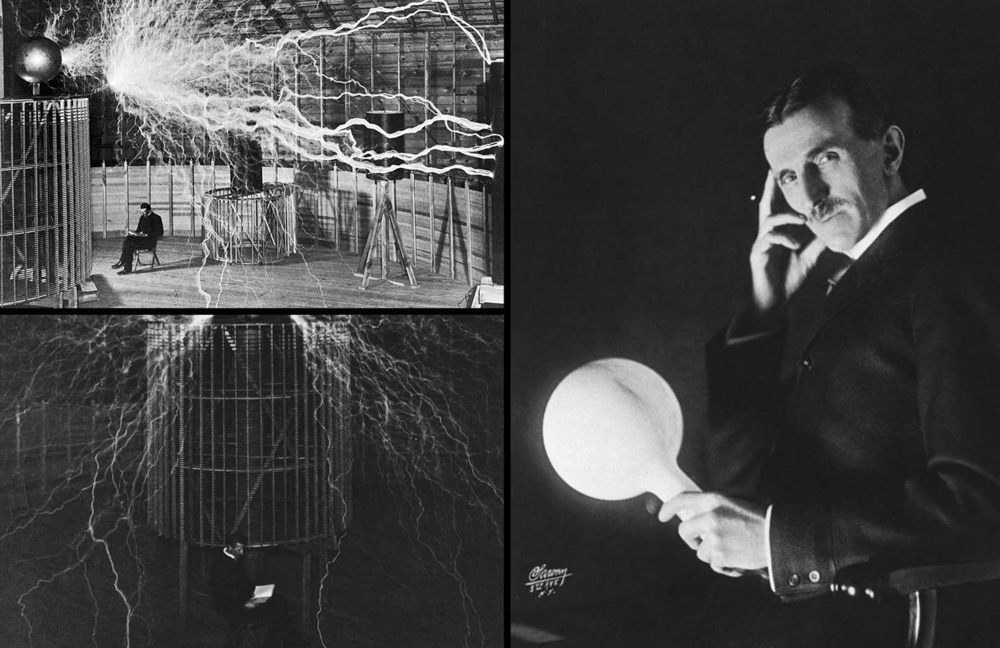
  <p><strong>Nikola Tesla (1856–1943)</strong></p>
</div>

In 1895, engineers began harnessing the immense energy of Niagara Falls[@electricalreview1896] to generate electricity on an unprecedented scale. The project employed an alternating-current (AC) system developed through the pioneering work of Nikola Tesla, with major engineering contributions from George Westinghouse and his company.

<div align="center">
  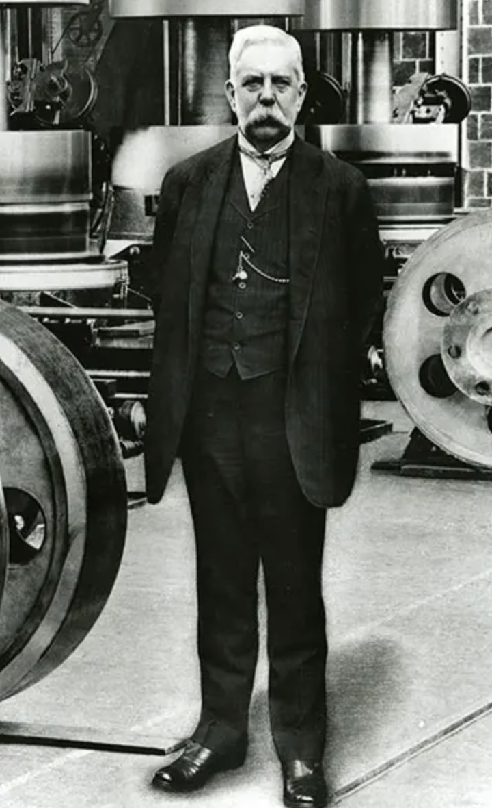
  <p><strong>George Westinghouse (1846–1914)</strong></p>
</div>

On November 16, 1896, electricity generated from the flowing waters of Niagara Falls was successfully transmitted to Buffalo, New York, approximately 20 miles away. For the first time, a major hydroelectric power station demonstrated how electricity could be generated on a large scale and delivered over considerable distances for practical use.

<div align="center">
  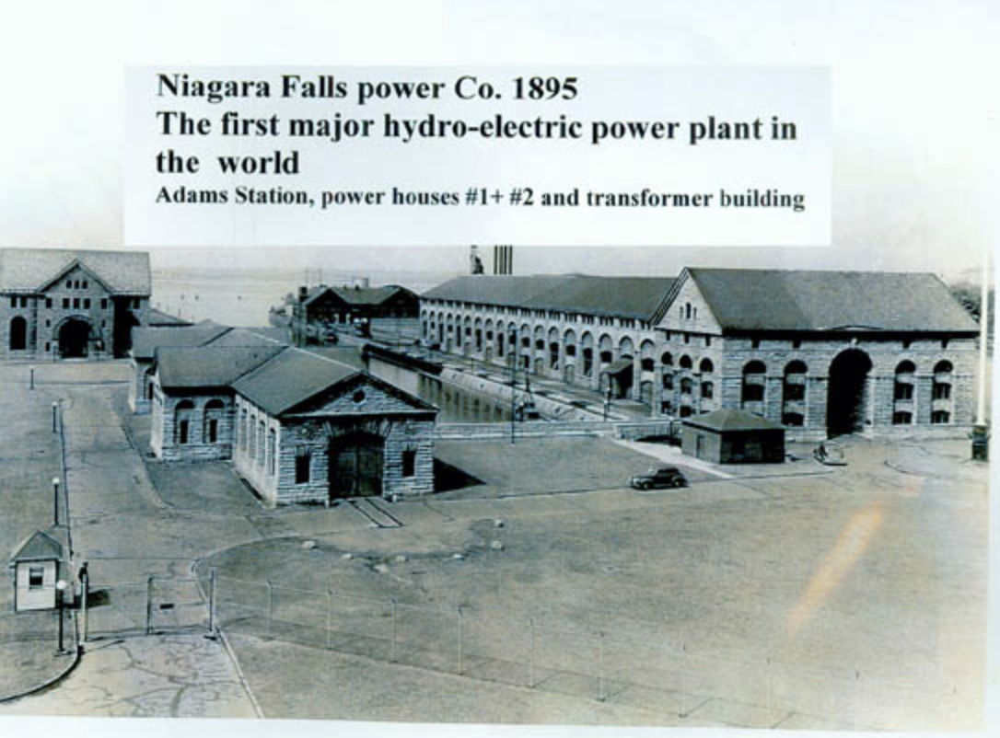
  <p><em>Niagara Falls — A milestone in the history of hydroelectric power generation.</em></p>
</div>

The achievement helped establish alternating current as a foundation of modern electrical power systems.

What had once been the mechanical energy of falling water could now illuminate streets, operate machinery, and power industries miles away

Today, we are surrounded by electronic devices that make our lives easier and more connected. From smartphones to smart homes, electronics have become an integral part of our daily lives. I am in awe of the ingenuity of scientists, engineers who have harnessed the power of electricity, which has blessed our lives with countless innovations, since the late 1880s. Yet, whenever I examine these extraordinary achievements, I cannot help reflecting on my own educational experiences.

# Education of Tamils

I have some grievances about the current state of hands-on engineering education. 
Growing up in Tirunelveli, Tamil Nadu, India, I have two complaints. 

First one, is that, there wasn't an emphasis on hands-on, reverse engineering, figuring out how things work, and building products. My high-school emphasized rote learning, memorization of mathematical formula. It was not about curiousity, how did the formulas come to be? I am disappointed. I want to express my sorrowful feelings of regret. In my high-school, the top memorizers, I call them, parrots, as they repeated exactly what was in the textbook, or fed to them, from my school became physicians in Tamil Nadu. 

The second complaint is my entire high-school education, never taught anyone of the 1000s of student's in my school, How to make money? 
This is a serious disappointment to me, I stayed all through 1st grade to 12th grade in Tirunelveli, never having a single class, or opportunity to learn how to make money. 

Meanwhile, the owner of the school was obessed with making money, and the school was business, and the students were just a means to an end, to make money for the owner of the school. And he expanded, opening hospital, small women's college. Not to mention, the environment in high-school was worse than prison, obessessed with marks, teacher's would constantly beat the student's with rulers for scoring poorly. **I believe, you gotta fall in love, be in awe with physics, electricity, electronics. And it's the teacher's job to raise the curiousity.**

## Introduction

In this tutorial, We will understand essential electronics and learn how to build a 6 Bits Digital LED Electronic Clock DIY Kit (EK1323). 
What the AT89C2051[@atmel2008] does is combine, electricity, electronic components, digital logic, microcontrollers, programming for our benefit of observering time. 

By the end of this tutorial, you will have learned many of the principles used in embedded computers, industrial controllers, sensors, and electronic appliances. We'd try to understand from fundamentals for a Clock. 

# Fundamentals of Clock 

As I was trained as a Scientist from Computer Science discipline; I like to break down most technical problems into inputs and outputs. 
If we think at the fundamental level, majority of engineering problems can be broken down in this way. 
It's also part of reductionism, a complex system is sum of its parts. 

Traditionally, clocks depended upon gears, springs, oscillating mechanisms. The pendulum was a major improvement because, for small swings, its period depends mainly on its length. But mechanical clocks were still affected by friction, temperature, wear, and changes in spring tension.
The Digital clocks replaced them for everyday use. It's because they are more accurate, cheaper, smaller, and need far less maintenance than gear-and-spring mechanical clocks.

::: {style="background-color: white; border-left: 5px solid #B8860B; padding: 15px; border-radius: 5px;"}
A **digital LED clock** is an electronic device that measures and displays time using light-emitting diodes (LEDs).
It displays time in hours, minutes, and sometimes seconds. Although it appears simple, it integrates **physics, electrical engineering, electronics, digital logic, and computer science**.
:::

When we turn on a Digital clock, Electrical energy enters the circuit through a power supply. A voltage regulator provides a stable operating voltage. An oscillator generates periodic electrical signals, which a microcontroller uses to measure elapsed time. The microcontroller processes this information and controls a series of LEDs to display the corresponding hours, minutes, and seconds. And this operates without any mechanical gears or moving clock hands. A Digital Clock has three functional stages.

## 1. Input: Electrical Energy and User Commands

When we connect the clock to a suitable power supply, electrical energy enters the circuit. A voltage regulator converts the supplied voltage into a stable operating voltage for the electronic components. The clock also receives inputs through push buttons, allowing users to adjust time settings and interact with other available functions.

## 2. Processing: Oscillation, Timekeeping, and Computation

A quartz crystal oscillator[@horowitz2015] provides a stable, periodic electrical reference. 
The microcontroller uses this timing reference, together with internal hardware timers and embedded software, to calculate the passage of seconds, minutes, and hours. The AT89C2051 microcontroller[@atmel2008] serves as the computational center of our digital clock. It executes programmed instructions, processes button inputs, maintains timekeeping variables, and determines which LEDs should illuminate.

## 3. Output: Displaying Time

Finally, the microcontroller controls the LED display circuitry to represent the calculated time numerically.

For example, the six-digit display may show: 14:35:42 — 2 hours, 35 minutes, and 42 seconds after noon. The circuit may also produce audible signals through a buzzer, depending on the functions implemented in its firmware. All these operations take place continuously without mechanical gears, pendulums, or moving clock hand.

The input is coming from electrical energy. This powers the system, the manipulation takes place through periodic oscillations, which provides a timing reference, and digital computation maintains the time. The output is displayed through the LEDs, that communicate the result to the observer.

# Part II:Understanding the Physics of Electricity

## a. What is electricity?

We might take this for granted. We have been using electricity[@openstax2016vol2] only for the last two centuries. 
Matter consists of atoms. Each atoms contains a small, dense nucleus surrounded by electrons. 
The nucleus has two types of particles, protons and neutrons. Protons are positively charged and Neutrons are neutrally charged. 
These have different electrical properties and mass. An electrically neutral atom contains equal numbers of protons and electrons.
However, an atom gains or loses electrons, it becomes an electrically charged ion. 

Now, you might ask, Why is this important? Electric charge is responsible for the electromagnetic interactions that make electrical circuits possible. Another question might arise, If electrons are inside atoms, how can electricity travel through a copper wire? 

In school, we might have learnt, electrons are often shown orbiting the nucleus like planets around the Sun. 
This is not fully accurate, In quantum mechanics, electrons occupy quantum states described by wavefunctions. 
This means, an electron is described by a mathematical state, rather than by a definite path like a planet orbiting the Sun.
Its wavefunction represented by ψ, lets us calculate the probabilities of different measurement outcomes, including where the electron might be detected. A wavefunction uses three variables to describe the position of an electron.

When atoms combine to form solids, their electronic states interact. In crystalline materials, this interaction produces ranges of allowed electron energies, called energy bands. These bands help explain why some materials conduct electricity easily while others resist the movement of electrical charge. Copper is a good electrical conductor because it contains mobile electronic states that can respond to an applied electric field.
Plastic is generally an insulator because its electrons are strongly bound and there are very few mobile charge carriers under ordinary conditions.
Silicon is a semiconductor because its electrical conductivity can be controlled through doping, temperature, light, and electric fields.

Without conductors, semiconductors, and insulators, modern electronic devices would not exist in their present form.
Our digital clock depends on all three, copper conductors connect components, semiconductor devices process signals, and insulating materials.

## b. How does the Electric charge move?

An electric charge[@openstax2016vol2] produces an electric field around itself. Other charged particles experience forces when placed in that field.
The electric force acting on a particle is F = qE, where F is electric force, \(q\) is the electric charge, \(\mathbf{E}\) is the electric field.
A positive charge experiences force in the direction of the electric field, while a negative charge experiences force in the opposite direction.

## c. Voltage

Voltage[@openstax2016vol2] is one of the most important concepts in electrical engineering.
Voltage is the difference in electric potential between two points, It describes the change in electric potential energy per unit charge.

Mathematically, voltage is the difference in electric potential energy per unit charge:
$$
V = \frac{\Delta U}{q}
$$

where $\Delta U$ is the change in electric potential energy (joules), and $q$ is electric charge (coulombs). Voltage is measured in volts (V).

Suppose our digital clock operates using a regulated 5 V power supply. A charge passing through a potential difference of 5 V corresponds to an energy transfer of 5 joules per coulomb.The supply maintains a potential difference between its positive terminal and ground. This enables electric fields to drive current through the connected circuit.

Voltage alone, however, does not guarantee current, we need a conducting path. 

## d. Electric Current

Electric current[@openstax2016vol2] is the rate at which electric charge flows through a conductor.

$$
I = \frac{dQ}{dt}
$$

where:

- $I$ is electric current, measured in amperes (A).
- $Q$ is electric charge, measured in coulombs (C).
- $t$ is time, measured in seconds (s).

One ampere represents one coulomb of charge passing through a cross-section each second. Consider an LED in our clock that draws 10 milliamperes.
At one second, it contains, 62 quadrillion elementary charges per second. Even a small LED involves an enormous number of charge carriers.

## e. Resistance

Resistance describes the opposition a material or component presents to electric current.
When we connect a voltage source to a circuit, what determines how much current flows?
For many conductors under approximately constant physical conditions, voltage, current, and resistance are related by **Ohm's law**

$$
V = IR
$$

where $V$ is voltage (volts), $I$ is current (amperes), and $R$ is resistance (ohms)

## f. Direct Current and Alternating Current

Direct current (DC) flows in a consistent direction, although its magnitude may vary with time.
Alternating current (AC) periodically reverses direction. Household electrical outlets in the United States typically provide alternating current at 60 Hz. However, our AT89C2051 microcontroller[@atmel2008] requires a suitable low-voltage DC power supply.

A power adapter can convert household AC electricity into DC. Depending on the clock kit's design, additional circuitry may regulate or condition the supplied voltage. We want to recall the distinction, Electronics focuses particularly on controlling the behavior of electrical charge and signals using components and circuits.

Electrical engineering broadly concerns the generation, transmission, conversion, and utilization of electrical energy.
For example, an electric heater primarily converts electrical energy into thermal energy.
A digital clock, however, does something more sophisticated. It uses electrical signals to represent information, perform logical operations, count time intervals, and display numbers.

## g. And how does it do that?

The key is the semiconductor. Silicon is widely used in electronic devices because its conductivity can be controlled.
Pure crystalline silicon has a relatively low concentration of mobile charge carriers at room temperature compared with a metal.
Adding controlled concentrations of impurity atoms, a process called doping, changes its electrical behavior.

## h. How does an LED produce Light?

An LED (light-emitting diode) is a semiconductor device that converts electrical energy into light. When electrons and holes recombine inside the semiconductor, they release energy as photons (light). Different semiconductor materials produce different colors. Isn't it fascinating that the glowing numbers on our clock are an application of quantum mechanics? The AT89C2051 microcontroller[@atmel2008] controls which LEDs illuminate to display the time.

## i. How does electricity become Digital Information?

The answer is using digital logic. How does the Electricty measure Time? 

Traditional mechanical clocks used periodic motion, such as a swinging pendulum.
Our digital clock uses a quartz crystal oscillator[@horowitz2015], which provides a stable periodic electrical timing reference.
Quartz exhibits the piezoelectric effect: electrical fields can produce mechanical deformation, and mechanical stress can produce electrical polarization. When connected to a suitable oscillator circuit, a quartz crystal vibrates near its resonant frequency.
The AT89C2051 microcontroller uses this timing reference, together with internal timers and software, to calculate elapsed time.
The software maintains the seconds, minutes, and hours, while the electronic circuitry displays these values through LED.

## j. Summarize

a. Electricity supplies energy to the circuit
b. Resistors and semiconductors control electrical currents and signals
c. Quartz oscillations provide a timing reference
d. The microcontroller processes information and maintains time
e. LEDs convert electrical energy into visible light

# Part III: Understanding Electronic Components

Before building our digital clock, let us examine its essential electronic components[@horowitz2015] and their functions.

<style>
.component-table {
  overflow-x: auto;
  margin: 1.5rem 0;
  border: 1px solid #d2ccc3;
  border-radius: 12px;
  background-color: #f7f5f1;
}

.component-table table {
  width: 100%;
  border-collapse: collapse;
  margin: 0;
  font-size: 0.95rem;
}

.component-table th {
  background: #5f5b57;
  color: #ffffff;
  padding: 14px 16px;
  text-align: left;
  font-weight: 600;
}

.component-table td {
  padding: 12px 16px;
  vertical-align: middle;
  border-bottom: 1px solid #d2ccc3;
  color: #2f3a45;
}

.component-table tbody tr:nth-child(odd) {
  background: #f1efea;
}

.component-table tbody tr:nth-child(even) {
  background: #e8e5df;
}

.component-table tbody tr:hover {
  background: #ddd8cf;
}

.component-table td:first-child {
  width: 95px;
  text-align: center;
}

.component-table td:nth-child(2) {
  font-weight: 600;
  color: #4a4a4a;
}

.component-table img {
  width: 72px;
  height: 58px;
  object-fit: contain;
  border-radius: 6px;
  background: white;
  padding: 3px;
  border: 1px solid #d8d2c9;
}

.component-table tbody tr:last-child td {
  border-bottom: none;
}
</style>

<div class="component-table">
<table>
<thead>
<tr>
  <th>Picture</th>
  <th>Component</th>
  <th>Function in Our Clock</th>
</tr>
</thead>
<tbody>
<tr>
<td></td>
<td>Resistor</td>
<td>Limits electrical current and protects components.</td>
</tr>

<tr>
<td></td>
<td>Capacitor</td>
<td>Stores energy and stabilizes voltage.</td>
</tr>

<tr>
<td></td>
<td>Diode</td>
<td>Allows current predominantly in one direction.</td>
</tr>

<tr>
<td></td>
<td>Transistor</td>
<td>Acts as an electronic switch for the display.</td>
</tr>

<tr>
<td></td>
<td>Quartz Crystal</td>
<td>Provides a stable timing reference.</td>
</tr>

<tr>
<td></td>
<td>AT89C2051 Microcontroller</td>
<td>Processes inputs, maintains time, and controls the display.</td>
</tr>

<tr>
<td></td>
<td>Seven-Segment LED Display</td>
<td>Shows hours, minutes, and seconds.</td>
</tr>

<tr>
<td></td>
<td>Push Button</td>
<td>Allows users to adjust clock settings.</td>
</tr>

<tr>
<td></td>
<td>Buzzer</td>
<td>Produces audible alerts.</td>
</tr>

<tr>
<td></td>
<td>Voltage Regulator</td>
<td>Provides a stable operating voltage.</td>
</tr>

<tr>
<td></td>
<td>Printed Circuit Board (PCB)</td>
<td>Holds and electrically connects the components.</td>
</tr>
</tbody>
</table>
</div>


# Part IV:Understanding Digital Electronics and Computing

We now understand the electronic components inside our digital clock. 
But how do these components work together to perform calculations, measure time, and display numbers?

The answer lies in digital electronics and computer science.
In the field of Computer Science, We represent all information in 0s and 1s.


**Binary Numbers: How Computers Represent Information**

Digital Computers represent information binary digits, 0 and 1. 
In circuit, the binary value is representaed by voltage levels. 
A logic 0 might correspond to low voltage, logic 1 corresponds to a high voltage.


Consider the decimal number 5:

$$
5_{10} = 101_2
$$

In binary, 101 represents:

$$
(1 \times 2^2) + (0 \times 2^1) + (1 \times 2^0) = 5
$$

By combining binary digits, electronic circuits can represent numbers, instructions, and other information.

## How does the microcontroller knows what to display?


Our AT89C2051 microcontroller[@atmel2008] contains digital circuitry that executes programmed instructions.
A Micro-controller has Logic Gates, that gets signals as inputs to produce binary outputs. 
Digital circuits use logic gates, which process binary inputs and produce binary outputs.

Three fundamental gates are, AND, OR, NOT. Output is 1 only when both inputs are 1. Not reverses the input. 
eg: 1 AND 1 = 1, 1 OR 0 = 1, NOT 1 = 0.

Seven commonly used logic gates are **AND, OR, NOT, NAND, NOR, XOR, and XNOR**.

Try the interactive simulator below to understand how each gate works.

```{=html}
<div id="logic-simulator" class="logic-simulator">

  <style>
    #logic-simulator {
      max-width: 720px;
      margin: 28px auto;
      padding: 24px;
      border: 1px solid #a1a1aa;
      border-radius: 16px;
      font-family: inherit;
      color: var(--bs-body-color, #333);
    }

    #logic-simulator * {
      box-sizing: border-box;
    }

    #logic-simulator h3,
    #logic-simulator .description {
      text-align: center;
    }

    #logic-simulator .gate-buttons {
      display: flex;
      flex-wrap: wrap;
      justify-content: center;
      gap: 8px;
      margin: 20px 0;
    }

    #logic-simulator .gate-button {
      border: 1px solid #64748b;
      background: transparent;
      color: inherit;
      padding: 9px 15px;
      border-radius: 8px;
      cursor: pointer;
      font-weight: 600;
    }

    #logic-simulator .gate-button.active {
      background: #2563eb;
      border-color: #2563eb;
      color: white;
    }

    #logic-simulator .inputs {
      display: flex;
      justify-content: center;
      gap: 32px;
      margin: 22px 0;
    }

    #logic-simulator .input-box {
      text-align: center;
      padding: 15px 25px;
      border: 1px solid #94a3b8;
      border-radius: 10px;
    }

    #logic-simulator select {
      display: block;
      margin: 10px auto 0;
      padding: 7px 16px;
      border-radius: 6px;
      background: var(--bs-body-bg, white);
      color: var(--bs-body-color, black);
      border: 1px solid #94a3b8;
    }

    #logic-simulator .diagram {
      max-width: 440px;
      margin: 20px auto;
    }

    #logic-simulator .output-panel {
      text-align: center;
      padding: 18px;
      border-radius: 12px;
      background: rgba(128,128,128,0.10);
    }

    #logic-simulator .output-value {
      font-size: 36px;
      font-weight: bold;
      margin: 8px;
    }

    #logic-simulator .gate-explanation {
      text-align: center;
      margin: 16px 0;
    }

    #logic-simulator .truth-table {
      width: 100%;
      border-collapse: collapse;
      margin-top: 18px;
      text-align: center;
    }

    #logic-simulator .truth-table th,
    #logic-simulator .truth-table td {
      padding: 9px;
      border: 1px solid #94a3b8;
    }

    #logic-simulator .truth-table .selected-row {
      background: rgba(37,99,235,0.19);
      font-weight: bold;
    }
  </style>

  <h3>Digital Logic Gate Simulator</h3>

  <p class="description">
    Select a logic gate and change the binary inputs.
  </p>

  <div class="gate-buttons" role="group" aria-label="Choose logic gate">
    <button type="button" class="gate-button active" data-gate="AND">AND</button>
    <button type="button" class="gate-button" data-gate="OR">OR</button>
    <button type="button" class="gate-button" data-gate="NOT">NOT</button>
    <button type="button" class="gate-button" data-gate="NAND">NAND</button>
    <button type="button" class="gate-button" data-gate="NOR">NOR</button>
    <button type="button" class="gate-button" data-gate="XOR">XOR</button>
    <button type="button" class="gate-button" data-gate="XNOR">XNOR</button>
  </div>

  <div class="inputs">
    <div class="input-box">
      <label for="logic-a">Input A</label>
      <select id="logic-a">
        <option value="0">0</option>
        <option value="1">1</option>
      </select>
    </div>

    <div class="input-box" id="logic-b-group">
      <label for="logic-b">Input B</label>
      <select id="logic-b">
        <option value="0">0</option>
        <option value="1">1</option>
      </select>
    </div>
  </div>

  <div class="diagram">
    <svg viewBox="0 0 440 170" width="100%"
         role="img" aria-label="Logic gate circuit diagram">

      <g fill="none" stroke="currentColor" stroke-width="3">
        <path id="wire-a" d="M40 50 H145"/>
        <path id="wire-b" d="M40 120 H145"/>

        <path id="gate-shape"
              d="M145 25 H195 A60 60 0 0 1 195 145 H145 Z"
              fill="#dbeafe" stroke="#2563eb"/>

        <circle id="inversion-bubble"
                cx="265" cy="85" r="8"
                fill="white" stroke="#2563eb"
                style="display:none"/>

        <path id="wire-out" d="M255 85 H370"/>
      </g>

      <text id="gate-symbol" x="190" y="93"
            text-anchor="middle" font-size="24"
            fill="#1d4ed8">&amp;</text>

      <text id="label-a" x="20" y="55"
            fill="currentColor" font-size="17">0</text>

      <text id="label-b" x="20" y="125"
            fill="currentColor" font-size="17">0</text>

      <circle id="output-led" cx="390" cy="85" r="19"
              fill="#94a3b8"/>

      <text id="output-led-label" x="390" y="91"
            text-anchor="middle" font-size="18"
            font-weight="bold" fill="white">0</text>
    </svg>
  </div>

  <div class="output-panel" aria-live="polite">
    <div>Binary Output</div>
    <div class="output-value" id="logic-result">0</div>
    <strong id="logic-expression">0 AND 0 = 0</strong>
  </div>

  <p class="gate-explanation" id="gate-explanation">
    AND produces 1 only when both inputs are 1.
  </p>

  <h4>Truth Table</h4>

  <table class="truth-table">
    <thead id="truth-head"></thead>
    <tbody id="truth-body"></tbody>
  </table>

</div>

<script>
(function () {
  const root = document.getElementById("logic-simulator");
  if (!root || root.dataset.initialized) return;
  root.dataset.initialized = "true";

  const el = id => root.querySelector("#" + id);

  let currentGate = "AND";

  const descriptions = {
    AND: "AND produces 1 only when both inputs are 1.",
    OR: "OR produces 1 when at least one input is 1.",
    NOT: "NOT reverses the input value.",
    NAND: "NAND produces 0 only when both inputs are 1.",
    NOR: "NOR produces 1 only when both inputs are 0.",
    XOR: "XOR produces 1 when the two inputs are different.",
    XNOR: "XNOR produces 1 when the two inputs are equal."
  };

  function calculate(gate, a, b) {
    switch (gate) {
      case "AND": return a & b;
      case "OR": return a | b;
      case "NOT": return 1 - a;
      case "NAND": return 1 - (a & b);
      case "NOR": return 1 - (a | b);
      case "XOR": return a ^ b;
      case "XNOR": return 1 - (a ^ b);
    }
  }

  const shapes = {
    AND: "M145 25 H195 A60 60 0 0 1 195 145 H145 Z",
    NAND: "M145 25 H195 A60 60 0 0 1 195 145 H145 Z",
    OR: "M145 25 Q180 85 145 145 Q215 150 255 85 Q215 20 145 25 Z",
    NOR: "M145 25 Q180 85 145 145 Q215 150 255 85 Q215 20 145 25 Z",
    XOR: "M155 25 Q190 85 155 145 Q225 150 255 85 Q225 20 155 25 Z",
    XNOR: "M155 25 Q190 85 155 145 Q225 150 255 85 Q225 20 155 25 Z",
    NOT: "M145 30 L145 140 L255 85 Z"
  };

  function updateTruthTable(a, b) {
    const isNOT = currentGate === "NOT";

    el("truth-head").innerHTML = isNOT
      ? "<tr><th>A</th><th>Output</th></tr>"
      : "<tr><th>A</th><th>B</th><th>Output</th></tr>";

    const combinations = isNOT
      ? [[0, 0], [1, 0]]
      : [[0, 0], [0, 1], [1, 0], [1, 1]];

    el("truth-body").innerHTML = combinations.map(([x, z]) => {
      const output = calculate(currentGate, x, z);
      const selected = isNOT ? x === a : x === a && z === b;

      return `<tr class="${selected ? "selected-row" : ""}">
        <td>${x}</td>
        ${isNOT ? "" : `<td>${z}</td>`}
        <td>${output}</td>
      </tr>`;
    }).join("");
  }

  function update() {
    const a = Number(el("logic-a").value);
    const b = Number(el("logic-b").value);
    const y = calculate(currentGate, a, b);
    const isNOT = currentGate === "NOT";

    el("logic-b-group").style.display = isNOT ? "none" : "";
    el("wire-b").style.display = isNOT ? "none" : "";
    el("label-b").style.display = isNOT ? "none" : "";

    el("wire-a").setAttribute("d",
      isNOT ? "M40 85 H145" : "M40 50 H145");

    const inverted = ["NOT", "NAND", "NOR", "XNOR"].includes(currentGate);

    el("inversion-bubble").style.display = inverted ? "" : "none";

    // A small circle represents output inversion.
    // The output wire begins after this inversion bubble.
    el("wire-out").setAttribute("d",
      inverted ? "M273 85 H370" : "M255 85 H370");

    el("gate-shape").setAttribute("d", shapes[currentGate]);

    // XOR and XNOR have an additional curved input line.
    let xorCurve = el("xor-curve");

    if (!xorCurve) {
      xorCurve = document.createElementNS("http://www.w3.org/2000/svg", "path");
      xorCurve.setAttribute("id", "xor-curve");
      xorCurve.setAttribute("fill", "none");
      xorCurve.setAttribute("stroke", "#2563eb");
      xorCurve.setAttribute("stroke-width", "3");
      el("gate-shape").parentNode.appendChild(xorCurve);
    }

    const isXOR = ["XOR", "XNOR"].includes(currentGate);

    xorCurve.style.display = isXOR ? "" : "none";
    xorCurve.setAttribute("d", "M140 25 Q175 85 140 145");

    const symbols = {
      AND: "&",
      NAND: "&",
      OR: "≥1",
      NOR: "≥1",
      XOR: "=1",
      XNOR: "=1",
      NOT: "1"
    };

    el("gate-symbol").textContent = symbols[currentGate];

    el("label-a").textContent = a;
    el("label-a").setAttribute("y", isNOT ? "90" : "55");
    el("label-b").textContent = b;

    el("output-led").setAttribute("fill",
      y === 1 ? "#16a34a" : "#94a3b8");

    el("output-led-label").textContent = y;
    el("logic-result").textContent = y;

    el("logic-expression").textContent = isNOT
      ? `NOT ${a} = ${y}`
      : `${a} ${currentGate} ${b} = ${y}`;

    el("gate-explanation").textContent = descriptions[currentGate];

    updateTruthTable(a, b);
  }

  root.querySelectorAll(".gate-button").forEach(button => {
    button.addEventListener("click", () => {
      currentGate = button.dataset.gate;

      root.querySelectorAll(".gate-button").forEach(btn => {
        btn.classList.toggle("active", btn === button);
      });

      update();
    });
  });

  el("logic-a").addEventListener("change", update);
  el("logic-b").addEventListener("change", update);

  update();
})();
</script>
```

These gates are constructed from transistors. 
By combining them, engineers create arithmetic circuits, memory, counters, and microprocessors.


## What does the Microcontroller do?

The AT89C2051 is an 8-bit microcontroller[@atmel2008] based on the 8051 architecture that acts as a computer on a chip, integrating several computer components into a single integrated circuit. Its CPU executes instructions and performs calculations, while its flash memory stores the clock’s program, also called firmware. Its RAM holds temporary information, such as timekeeping variables, and its timers/counters count intervals derived from the oscillator. Input/output pins allow it to communicate with buttons and display circuitry. The microcontroller continuously executes its firmware to control the electronic circuit and coordinate the clock’s operation.

## How Do Logic Gates Help Our Digital Clock Work?

We have learned that logic gates process binary inputs (0 and 1) and produce binary outputs. But how do these simple operations help our digital clock measure and display time?

Consider our clock displaying **14:35:59**. One second later, it must display **14:36:00**.

The microcontroller performs several operations:

1. **Counting:** The quartz crystal oscillator provides a periodic timing reference. Hardware timers count intervals derived from this reference.

2. **Arithmetic:** The microcontroller increments the seconds variable by one. Binary arithmetic circuits, constructed using digital logic, support these calculations.

3. **Decision-making:** When the seconds count reaches 60, the firmware resets it to zero and increments the minutes.

4. **Memory:** The updated hours, minutes, and seconds are stored as binary values in the microcontroller's RAM.

5. **Display:** The firmware determines which LED segments must illuminate and controls the corresponding output signals.

For example, XOR and AND gates can be combined to construct a simple binary half-adder:

$$
S = A \oplus B
$$

$$
C = A \land B
$$

Here, $S$ represents the sum bit and $C$ represents the carry bit.

This demonstrates how logic gates can perform arithmetic, one of the fundamental operations used by microcontrollers.

The logic-gate simulator above illustrates Boolean operations. It does not reproduce the exact internal transistor-level circuitry of the AT89C2051.

## How Does the Microcontroller Display Numbers?

Our digital clock uses seven-segment LED displays. Each digit consists of seven segments labeled A through G.

By illuminating different combinations of these segments, the clock represents numbers from 0 to 9.

For example:

- **1** illuminates segments B and C.
- **7** illuminates segments A, B, and C.
- **8** illuminates all seven segments.

Try the interactive simulator below.

```{=html}
<div id="seven-segment-demo">
  <style>
    #seven-segment-demo {
      max-width: 650px;
      margin: 25px auto;
      padding: 24px;
      border: 1px solid #9ca3af;
      border-radius: 14px;
      font-family: inherit;
    }

    #seven-segment-demo * {
      box-sizing: border-box;
    }

    #seven-segment-demo h3,
    #seven-segment-demo .intro {
      text-align: center;
    }

    #seven-segment-demo .display {
      background: #111827;
      border-radius: 12px;
      padding: 25px;
      text-align: center;
      margin: 20px auto;
      max-width: 260px;
    }

    #seven-segment-demo .digit-buttons {
      display: flex;
      justify-content: center;
      flex-wrap: wrap;
      gap: 8px;
      margin: 20px 0;
    }

    #seven-segment-demo button {
      padding: 9px 15px;
      border: 1px solid #64748b;
      border-radius: 7px;
      background: transparent;
      color: inherit;
      cursor: pointer;
      font-weight: 600;
    }

    #seven-segment-demo button.active {
      background: #2563eb;
      color: white;
      border-color: #2563eb;
    }

    #seven-segment-demo .segment-grid {
      display: grid;
      grid-template-columns: repeat(7, 1fr);
      gap: 6px;
      margin-top: 18px;
    }

    #seven-segment-demo .segment-box {
      text-align: center;
      border: 1px solid #94a3b8;
      border-radius: 7px;
      padding: 10px 2px;
    }

    #seven-segment-demo .segment-box.on {
      background: #dbeafe;
      color: #1d4ed8;
    }

    #seven-segment-demo .segment-box.off {
      background: rgba(128,128,128,0.08);
    }

    #seven-segment-demo .segment-state {
      font-size: 23px;
      font-weight: bold;
    }

    #seven-segment-demo .binary-output {
      margin-top: 18px;
      padding: 15px;
      border-radius: 9px;
      background: rgba(128,128,128,0.09);
      text-align: center;
      overflow-wrap: anywhere;
    }

    #seven-segment-demo .note {
      margin-top: 15px;
      font-size: 0.88rem;
      opacity: 0.8;
    }
  </style>

  <h3>Interactive Seven-Segment LED Display</h3>

  <p class="intro">
    Select a decimal number to observe how seven LED
    segments produce the corresponding digit.
  </p>

  <div class="display">
    <svg viewBox="0 0 140 190"
         width="150"
         role="img"
         aria-label="Seven-segment LED digit">

      <g fill="none"
         stroke-width="12"
         stroke-linecap="round">

        <line id="seg-a" x1="30" y1="15"
              x2="110" y2="15"/>

        <line id="seg-b" x1="120" y1="25"
              x2="120" y2="85"/>

        <line id="seg-c" x1="120" y1="105"
              x2="120" y2="165"/>

        <line id="seg-d" x1="30" y1="175"
              x2="110" y2="175"/>

        <line id="seg-e" x1="20" y1="105"
              x2="20" y2="165"/>

        <line id="seg-f" x1="20" y1="25"
              x2="20" y2="85"/>

        <line id="seg-g" x1="30" y1="95"
              x2="110" y2="95"/>

      </g>
    </svg>
  </div>

  <div class="digit-buttons" role="group"
       aria-label="Select a digit">
    <button type="button" data-digit="0">0</button>
    <button type="button" data-digit="1">1</button>
    <button type="button" data-digit="2">2</button>
    <button type="button" data-digit="3">3</button>
    <button type="button" data-digit="4">4</button>
    <button type="button" data-digit="5">5</button>
    <button type="button" data-digit="6">6</button>
    <button type="button" data-digit="7">7</button>
    <button type="button" data-digit="8">8</button>
    <button type="button" data-digit="9">9</button>
  </div>

  <h4>Binary Segment Signals</h4>

  <div class="segment-grid" id="segment-grid"></div>

  <div class="binary-output" aria-live="polite">
    <strong>Selected Digit:</strong>
    <span id="selected-digit">8</span>

    <p>
      <strong>Segment Pattern (ABCDEFG):</strong>
      <span id="segment-binary">1111111</span>
    </p>
  </div>

  <p class="note">
    This simulator assumes active-high signals:
    1 = ON and 0 = OFF.
    The actual clock kit may use active-low signals
    or additional display-driving circuitry.
  </p>
</div>

<script>
(function () {
  const root = document.getElementById(
    "seven-segment-demo"
  );

  if (!root || root.dataset.initialized) return;
  root.dataset.initialized = "true";

  const patterns = {
    0: "abcdef",
    1: "bc",
    2: "abdeg",
    3: "abcdg",
    4: "bcfg",
    5: "acdfg",
    6: "acdefg",
    7: "abc",
    8: "abcdefg",
    9: "abcdfg"
  };

  const segments = "abcdefg";

  function updateDigit(digit) {
    const active = patterns[digit];

    segments.split("").forEach(segment => {
      const element = root.querySelector(
        "#seg-" + segment
      );

      element.setAttribute(
        "stroke",
        active.includes(segment)
          ? "#ff4939"
          : "#493032"
      );
    });

    const binary = segments
      .split("")
      .map(s => active.includes(s) ? "1" : "0")
      .join("");

    root.querySelector(
      "#selected-digit"
    ).textContent = digit;

    root.querySelector(
      "#segment-binary"
    ).textContent = binary;

    root.querySelector(
      "#segment-grid"
    ).innerHTML = segments
      .split("")
      .map(s => {
        const on = active.includes(s);

        return `
          <div class="segment-box ${on ? "on" : "off"}">
            <strong>${s.toUpperCase()}</strong>
            <div class="segment-state">
              ${on ? 1 : 0}
            </div>
            <small>${on ? "ON" : "OFF"}</small>
          </div>
        `;
      })
      .join("");

    root.querySelectorAll(
      "[data-digit]"
    ).forEach(button => {
      const selected =
        Number(button.dataset.digit) === digit;

      button.classList.toggle(
        "active",
        selected
      );

      button.setAttribute(
        "aria-pressed",
        String(selected)
      );
    });
  }

  root.querySelectorAll(
    "[data-digit]"
  ).forEach(button => {
    button.addEventListener("click", () => {
      updateDigit(
        Number(button.dataset.digit)
      );
    });
  });

  updateDigit(8);
})();
</script>
```

### Connecting the Simulation to Our Clock

When we select the number 8, all seven segments illuminate.

Its segment pattern is:

$$
ABCDEFG = 1111111
$$

When we select the number 1, only segments B and C illuminate:

$$
ABCDEFG = 0110000
$$

The important observation is that the number displayed is determined by the combination of binary control signals sent to the display circuitry.

In the AT89C2051 clock, the firmware determines the necessary patterns for displaying the time. The microcontroller's output pins, together with the display-driving circuitry, control the physical LEDs.

For a six-digit clock, the display may use **multiplexing**, where different digits are activated in rapid succession. This reduces the number of control connections required.

The essential idea is that the microcontroller transforms **binary information into electrical signals, and the LEDs transform those signals into visible numbers**..


# Part V:Building the Digital Clock

Before assembling the circuit, let us identify the electronic components and understand what each one does.

First, We have the Printed Circuit Board (PCB), for the three digit display electronic display.
This is built around 8051-family microcontroller. Specifically, a AT89C2051 microcontroller. 
The AT89C2051 is the brain of the circuit, which executes the program. 


```{=html}
<style>
/* Main two-column layout */
.pcb-layout {
  display: grid;
  grid-template-columns: minmax(0, 42fr) minmax(0, 58fr);
  gap: 22px;
  align-items: start;
  margin: 1.5rem 0 2rem;
}

/* PCB image */
.pcb-image-panel {
  position: sticky;
  top: 85px;
  background: #f5f8fc;
  padding: 15px;
  border: 1px solid #d5e2ec;
  border-radius: 14px;
  text-align: center;
}

.pcb-image-panel img {
  width: 100%;
  height: auto;
  border-radius: 8px;
  display: block;
}

.pcb-image-caption {
  font-size: 0.85rem;
  color: #64748b;
  margin-top: 12px;
  line-height: 1.5;
}

/* Table styling */
.pcb-table-container {
  min-width: 0;
  overflow-x: auto;
  border: 1px solid #d5e2ec;
  border-radius: 14px;
  box-shadow: 0 4px 16px rgba(25,60,90,0.07);
}

.pcb-component-table {
  width: 100%;
  border-collapse: collapse;
  font-size: 0.84rem;
  line-height: 1.5;
  margin: 0 !important;
}

.pcb-component-table thead th {
  background: #234e70 !important;
  color: #fff !important;
  padding: 12px 10px;
  text-align: left;
  font-weight: 700;
}

.pcb-component-table tbody td {
  padding: 11px 10px;
  vertical-align: middle;
  border-bottom: 1px solid #e3eaf1;
  color: #263746;
}

.pcb-component-table tbody tr:nth-child(odd) {
  background: #f4f8fc;
}

.pcb-component-table tbody tr:nth-child(even) {
  background: #fffaf1;
}

.pcb-component-table tbody tr:hover {
  background: #e5f2fa !important;
}

/* Colorful component labels */
.pcb-tag {
  display: inline-block;
  padding: 4px 7px;
  border-radius: 6px;
  font-size: 0.78rem;
  font-weight: 700;
}

.pcb-blue   { background: #dbeafe; color: #1d4ed8; }
.pcb-purple { background: #ede9fe; color: #6d28d9; }
.pcb-green  { background: #dcfce7; color: #166534; }
.pcb-orange { background: #ffedd5; color: #9a3412; }
.pcb-pink   { background: #fce7f3; color: #9d174d; }
.pcb-teal   { background: #ccfbf1; color: #115e59; }
.pcb-red    { background: #fee2e2; color: #991b1b; }
.pcb-yellow { background: #fef9c3; color: #854d0e; }

.pcb-component-table td:nth-child(2) {
  font-weight: 600;
  color: #234e70;
}

.pcb-table-caption {
  font-size: 0.82rem;
  color: #64748b;
  text-align: center;
  margin-top: 9px;
}

/* Mobile layout */
@media (max-width: 900px) {
  .pcb-layout {
    grid-template-columns: 1fr;
  }

  .pcb-image-panel {
    position: static;
    max-width: 650px;
    margin: 0 auto;
  }

  .pcb-component-table {
    min-width: 520px;
  }
}

/* Quarto dark theme */
body.quarto-dark .pcb-image-panel,
body.quarto-dark .pcb-table-container {
  background: #202d3a;
  border-color: #415265;
}

body.quarto-dark .pcb-component-table tbody tr:nth-child(odd) {
  background: #202d3a;
}

body.quarto-dark .pcb-component-table tbody tr:nth-child(even) {
  background: #263544;
}

body.quarto-dark .pcb-component-table tbody td {
  color: #e2e8f0;
  border-color: #415265;
}

body.quarto-dark .pcb-component-table td:nth-child(2) {
  color: #93c5fd;
}
</style>

<div class="pcb-layout">

  <!-- LEFT: PCB Photograph -->
  <div class="pcb-image-panel">
    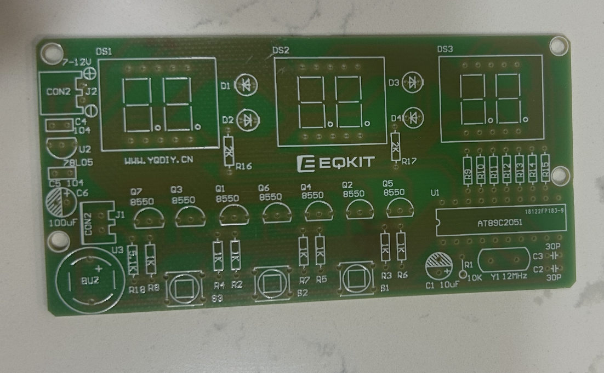
    <div class="pcb-image-caption">
      <strong>Figure 1.</strong>
      Printed Circuit Board (PCB) for the
      AT89C2051-based digital clock.
      The printed labels identify where
      each electronic component belongs.
    </div>
  </div>

  <!-- RIGHT: Component Table -->
  <div>
    <div class="pcb-table-container">
      <table class="pcb-component-table">
        <thead>
          <tr>
            <th>PCB Label</th>
            <th>Component</th>
            <th>Purpose</th>
          </tr>
        </thead>
        <tbody>
          <tr>
            <td><span class="pcb-tag pcb-blue">U1 – AT89C2051</span></td>
            <td>8-bit Microcontroller</td>
            <td>Executes the program and controls the circuit.</td>
          </tr>
          <tr>
            <td><span class="pcb-tag pcb-purple">DS1, DS2, DS3</span></td>
            <td>7-Segment Displays</td>
            <td>Three 2-digit displays showing up to six digits.</td>
          </tr>
          <tr>
            <td><span class="pcb-tag pcb-green">Y1 – 12 MHz</span></td>
            <td>Crystal Oscillator</td>
            <td>Provides a stable timing reference.</td>
          </tr>
          <tr>
            <td><span class="pcb-tag pcb-orange">Q1–Q7 (8550)</span></td>
            <td>PNP Transistors</td>
            <td>Switch electrical current to circuit loads.</td>
          </tr>
          <tr>
            <td><span class="pcb-tag pcb-pink">S1, S2, S3</span></td>
            <td>Push Buttons</td>
            <td>Allow users to adjust settings.</td>
          </tr>
          <tr>
            <td><span class="pcb-tag pcb-teal">BUZ</span></td>
            <td>Buzzer</td>
            <td>Produces audible alerts.</td>
          </tr>
          <tr>
            <td><span class="pcb-tag pcb-red">U2 – 78L05</span></td>
            <td>Voltage Regulator</td>
            <td>Regulates the supply voltage to 5V.</td>
          </tr>
          <tr>
            <td><span class="pcb-tag pcb-yellow">CON2 – 7–12V</span></td>
            <td>Power Input</td>
            <td>Connects the external power supply.</td>
          </tr>
          <tr>
            <td><span class="pcb-tag pcb-blue">R1–R17</span></td>
            <td>Resistors</td>
            <td>Limit current and set electrical levels.</td>
          </tr>
          <tr>
            <td><span class="pcb-tag pcb-purple">C1–C6</span></td>
            <td>Capacitors</td>
            <td>Filter noise and support timing circuits.</td>
          </tr>
        </tbody>
      </table>
    </div>

    <p class="pcb-table-caption">
      Table 1. Main electronic components and their functions.
    </p>
  </div>

</div>
```

<!--
PART V CONTINUATION — paste immediately after your existing PCB-and-components table,
before "# Part VI: Conclusion and Further Learning".

Image paths assume all listed media are in ../../images/tutorials/clock/
The file connectedwithbeep.MOV is linked, rather than embedded, because
MOV playback is not reliable across web browsers.
-->

<style>
/* Responsive photo pairs for the clock build log */
.clock-build-gallery {
  display: grid;
  grid-template-columns: repeat(2, minmax(0, 1fr));
  gap: 1rem;
  margin: 1.15rem 0 1.8rem;
}
.clock-build-gallery figure {
  margin: 0;
  border: 1px solid var(--bs-border-color, #d5e2ec);
  border-radius: 12px;
  overflow: hidden;
  background: var(--bs-body-bg, #fff);
}
.clock-build-gallery img {
  display: block;
  width: 100%;
  height: 260px;
  object-fit: contain;
  background: rgba(130, 150, 170, 0.07);
}
.clock-build-gallery figure:only-child { grid-column: 1 / -1; }
.clock-build-gallery figure:only-child img { max-height: 440px; }
.clock-build-gallery figcaption {
  padding: 0.65rem 0.8rem;
  font-size: 0.84rem;
  line-height: 1.5;
  color: var(--bs-secondary-color, #64748b);
}
.clock-build-note {
  border-left: 4px solid #b8860b;
  background: rgba(184, 134, 11, 0.07);
  padding: 0.85rem 1.05rem;
  border-radius: 0 9px 9px 0;
  margin: 1.1rem 0 1.6rem;
}
.clock-build-note p:last-child { margin-bottom: 0; }
@media (max-width: 740px) {
  .clock-build-gallery { grid-template-columns: 1fr; }
  .clock-build-gallery img { height: auto; max-height: 360px; }
}
</style>

## From the PCB to the Physical Clock

Having identified the components on the printed circuit board, We began assembling the clock. 
The objective was to transform a bare board into a six-digit electronic device controlled by the **AT89C2051**, an 8051-family microcontroller. Each of the three display modules contains two seven-segment digits, giving the clock room to display hours, minutes, and seconds.

This section documents what the steps. 

## Step 1: Examine the Parts and the Circuit

I started by laying out the supplied parts and comparing them with the labels printed on the PCB. The silkscreen identifies positions such as `R1` for a resistor, `Q1` for a transistor, `Y1` for the crystal, and `U1` for the microcontroller. I also examined the copper tracks on the reverse side of the board: these tracks connect the otherwise separate components into one circuit.

<div class="clock-build-gallery">
  <figure>
    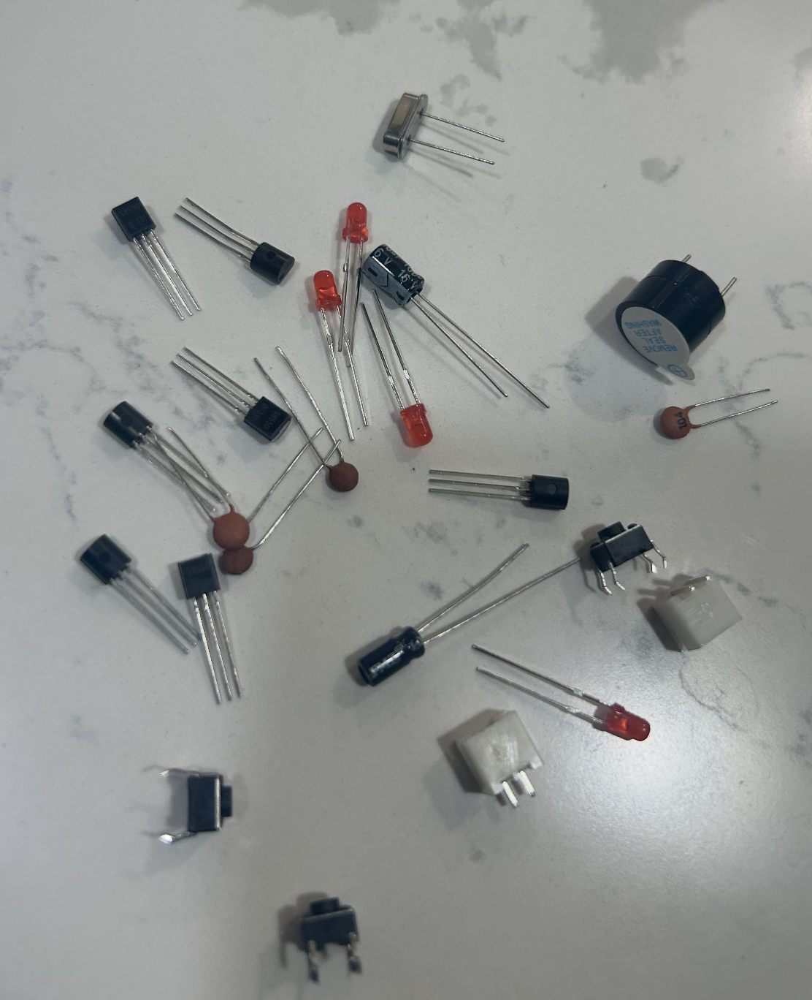
    <figcaption>Components laid out before assembly.</figcaption>
  </figure>
  <figure>
    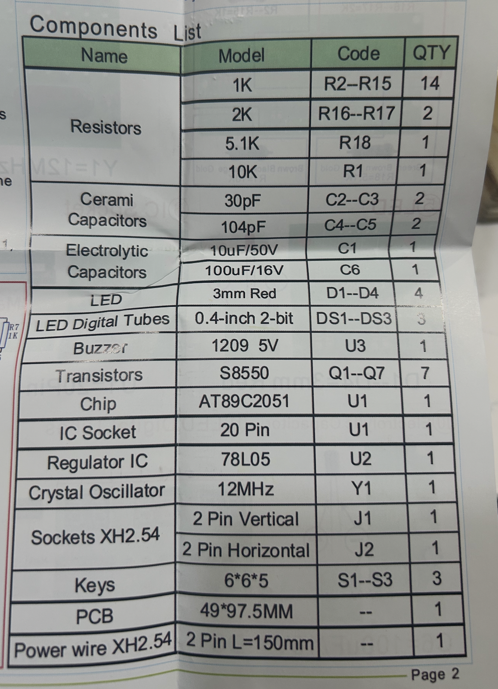
    <figcaption>The component list used to identify parts and quantities.</figcaption>
  </figure>
  <figure>
    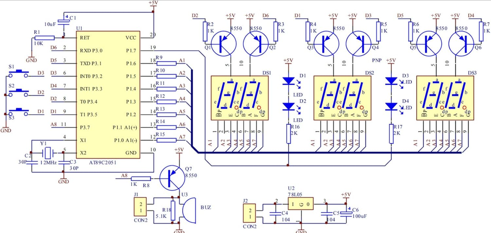
    <figcaption>The circuit reference used to understand how the parts connect.</figcaption>
  </figure>
  <figure>
    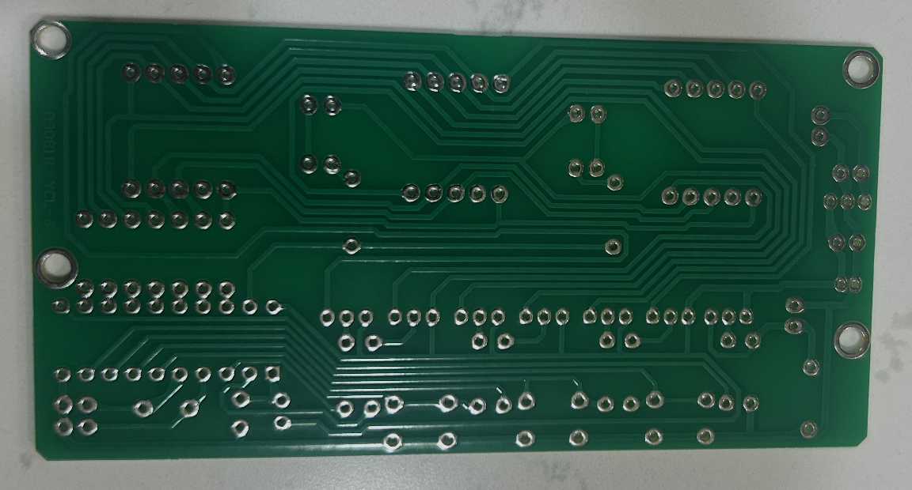
    <figcaption>The reverse side of the PCB, showing its copper traces and solder-pad locations.</figcaption>
  </figure>
</div>

## Step 2: Place the Resistors

I began with the resistors, because they are small and sit close to the surface of the board. One by one, I matched their designated positions to the PCB labels and inserted their leads through the corresponding holes.

Resistors do not have positive and negative ends, so their orientation does not affect their operation. **Their resistance values do matter**, however: two resistors can look almost identical while having different values. Some positions on this board require different values from the others, so a multimeter is preferable to relying only on color bands in photographs.

<div class="clock-build-gallery">
  <figure>
    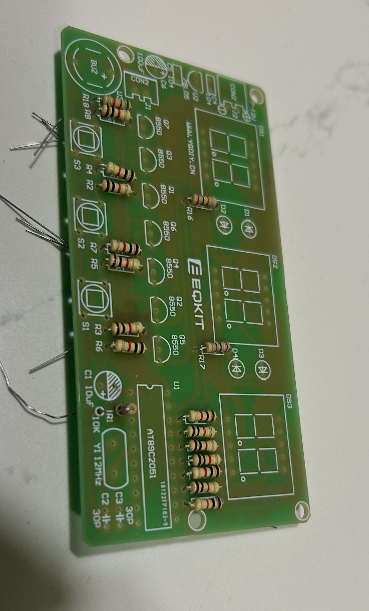
    <figcaption>Placing the resistors in their labeled positions.</figcaption>
  </figure>
  <figure>
    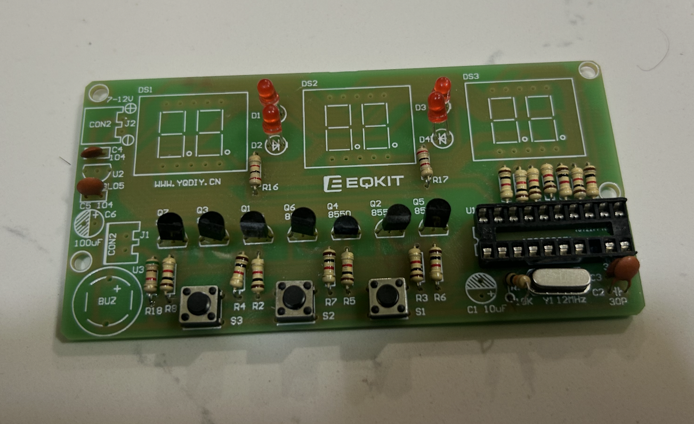
    <figcaption>Adjusting and checking the component placements one by one.</figcaption>
  </figure>
</div>

## Step 3: Solder and Inspect the Connections

After inserting the components, I turned the board over and soldered their leads to the copper pads. Solder creates an electrical and mechanical connection between the component lead and the PCB. I also examined the joints from different angles, looking for long protruding leads, incomplete joints, or unwanted connections between adjacent pads.

This stage was more demanding than I expected. Several joints appeared uneven, and the board required careful inspection and cleanup. 

<div class="clock-build-gallery">
  <figure>
    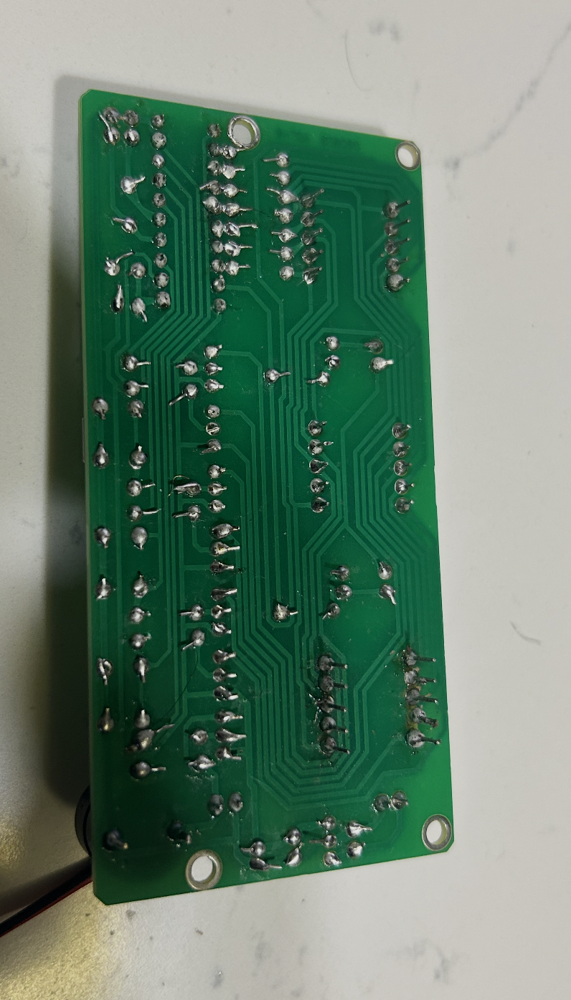
    <figcaption>Rear of the PCB after much of the through-hole soldering was completed.</figcaption>
  </figure>
</div>

## Step 4: Install the Remaining Electronics

Next came the components whose orientation needed particular attention: the **8550 transistors**, the **78L05 voltage regulator**, the **electrolytic capacitors**, the **red LEDs**, and the **AT89C2051 socket**. I fitted the **12 MHz quartz crystal**, the three push buttons, and the buzzer as well.

Unlike ordinary resistors, some of these parts are polarized or have specific pinouts. An LED has an anode and a cathode; an electrolytic capacitor has positive and negative terminals; and a regulator or transistor must be wired according to its actual pin configuration. Matching the printed outline is a useful first step, but it is not a substitute for checking polarity and pinouts.

<div class="clock-build-gallery">
  <figure>
    
    <figcaption>The board during the LED and semiconductor installation stage.</figcaption>
  </figure>
  <figure>
    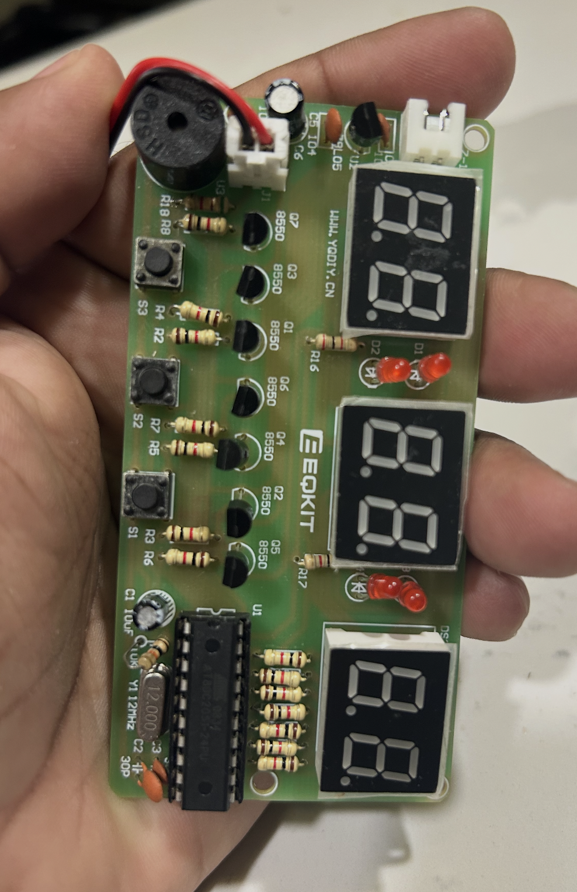
    <figcaption>The clock after the displays, buttons, socket, and other major parts were fitted.</figcaption>
  </figure>
</div>

## Step 5: Fit the Six-Digit Display and Microcontroller

Finally, I installed the three two-digit seven-segment LED modules (`DS1`, `DS2`, and `DS3`) and inserted the **AT89C2051** into its socket. With the circuit assembled, I could now see the device as a physical clock rather than a bare PCB covered in component labels.

This is a useful moment to recall the relationship between hardware and software. The LED modules provide the visible output, the transistors help switch the display circuitry, and the microcontroller's firmware is meant to determine which segments illuminate as time passes. The presence of all these parts does **not**, on its own, prove that the program is running.

## Step 6: First Power Experiments: An Unexpected Result

The board is marked for a **7–12 V DC input**, but I did not yet have the appropriate USB-to-DC adapter or dedicated power lead for a reliable final setup for now. A regular USB cable by itself is not equivalent to this input: standard USB power is typically 5 V, and the clock requires a correctly matched DC supply and connector.

I experimented with a **9 V battery** to see whether the assembled circuit would respond. At first, I connected the test lead to the white connector near the buzzer (`J1`). Most digits then illuminated as **8**, one digit stayed dark, and the buzzer sounded continuously. This was an abnormal result, not a successful clock startup. Further inspection showed that the board's designated **7–12 V power input is J2**, beside the first display.

When I tried the connection at **J2**, the display remained blank. The [assembly instructions for this style of kit](https://manuals.plus/icstation/6-digit-digital-electronic-clock-diy-kits-manual) identify J2 as the dedicated power-wire connection. If you are soldering, do follow the instructions and do make sure to buy a USB power supply cable, which, unfortunately is missing for our build. 


# Conclusion: Abnormal Results

We have now reached the final stage of assembling our digital LED clock. Most of the electronic components have been installed and soldered onto the Printed Circuit Board (PCB). We have substantially completed the physical assembly of our digital clock!

Throughout this exercise, we explored several fundamental ideas from physics, electrical engineering, electronics, and computer science.

We began by understanding electricity, electric charge, voltage, current, resistance, and Ohm's law. We then examined how resistors, capacitors, diodes, transistors, and semiconductors control electrical currents and signals.

Next, we explored binary numbers, Boolean logic, logic gates, and digital computation, learning how electronic circuits represent and process information using 0s and 1s. We also examined how a quartz crystal provides a timing reference, how the AT89C2051 microcontroller executes instructions, and how seven-segment LEDs convert electrical signals into visible numbers.

Finally, we applied these concepts by physically assembling the clock: identifying components, interpreting PCB markings, inserting resistors and transistors, and soldering the electronic connections. Perhaps, when time permits and when we have obtained the appropriate power supply, we can return to the circuit, investigate the unexpected results, and complete the final testing.

# Demo

Until then, We leave this tutorial at this stage with the Abnormal results. 

<div class="clock-build-gallery">
  <figure>
    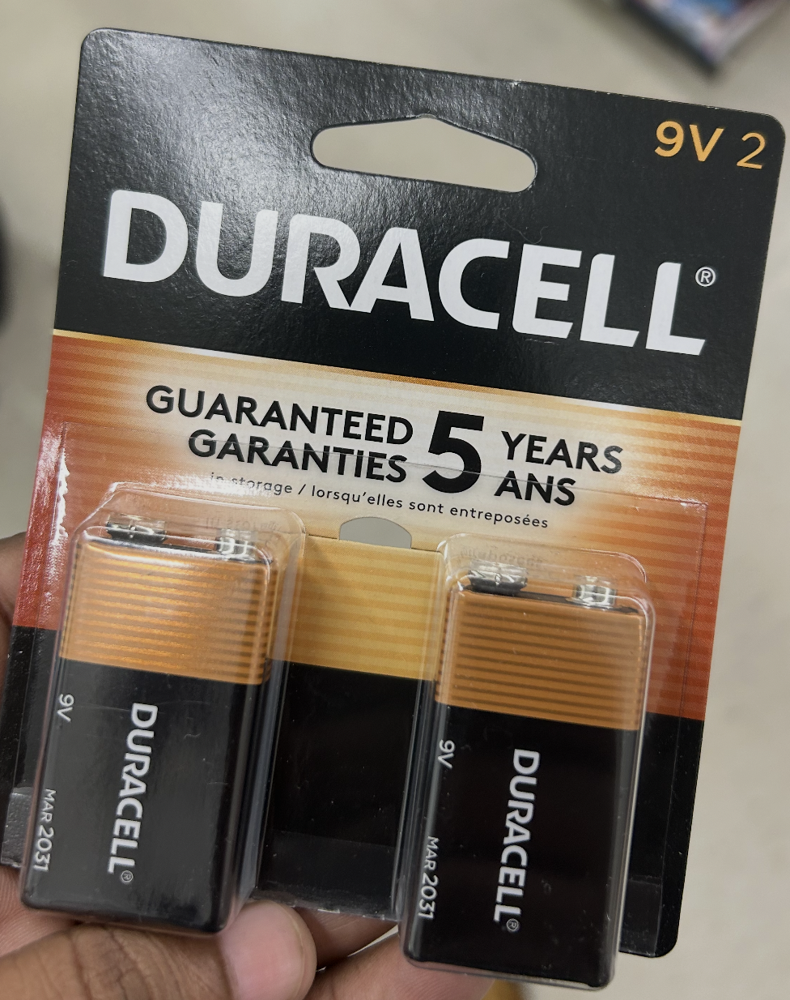
    <figcaption>The 9 V battery used for the initial test.</figcaption>
  </figure>
  <figure>
    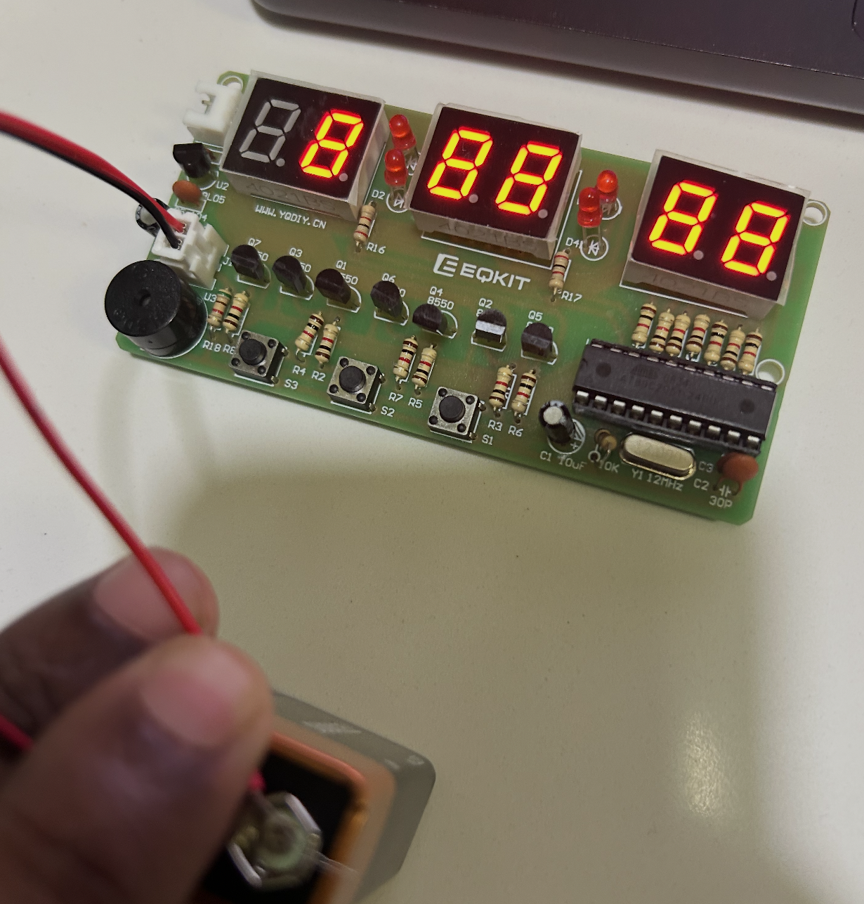
    <figcaption>Abnormal test: most digits showed 8 rather than the time.</figcaption>
  </figure>
  <figure>
    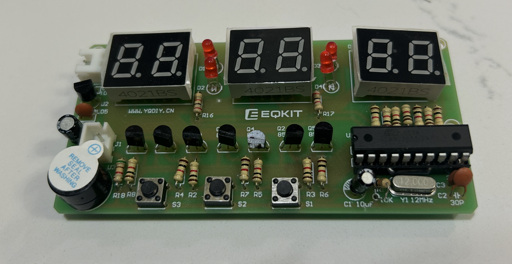
    <figcaption>Subsequent test at J2: the display stayed blank.</figcaption>
  </figure>
</div>

I also recorded the continuous beeping during the experiment:



::: {.callout-warning title="Power and testing note"}
The observations above document an **unsuccessful experiment**, not a recommended way to power this kit. The battery should remain disconnected until the wiring and solder joints are checked. The clock's `J2` connector is labeled for **7–12 V DC**; supply polarity must be verified before connecting power. Do not connect a raw USB cable or place loose bare wires against battery terminals.
:::


```{=html}
<style>
/* Share section — Notebook of Rick Rejeleene */

.rr-share {
  --rr-bg: #f0efe7;
  --rr-text: #363c42;
  --rr-muted: #666b70;
  --rr-accent: #a46c61;
  --rr-border: #d3d0c7;

  max-width: 100%;
  margin: 1.8rem 0;
  padding: 22px 24px;
  background: var(--rr-bg);
  border: 1px solid var(--rr-border);
  border-radius: 14px;
  font-family: system-ui, sans-serif;
}

.rr-share h3 {
  font-size: 1.12rem;
  font-weight: 750;
  color: var(--rr-text);
  margin: 0 0 6px;
}

.rr-share p {
  font-size: .86rem;
  color: var(--rr-muted);
  margin: 0 0 16px;
}

.rr-share-buttons {
  display: flex;
  flex-wrap: wrap;
  gap: 10px;
}

.rr-share-buttons button {
  display: inline-flex;
  align-items: center;
  justify-content: center;
  gap: 8px;
  padding: 10px 14px;
  border: 1px solid var(--rr-border);
  border-radius: 8px;
  background: #ffffff;
  color: var(--rr-text);
  font-size: .85rem;
  font-weight: 600;
  cursor: pointer;
  transition: background .2s, color .2s, border-color .2s;
}

.rr-share-buttons button:hover {
  background: var(--rr-accent);
  border-color: var(--rr-accent);
  color: white;
}

.rr-share-buttons button:focus-visible {
  outline: 3px solid var(--rr-accent);
  outline-offset: 3px;
}

.rr-share-buttons svg {
  width: 17px;
  height: 17px;
  flex-shrink: 0;
  fill: currentColor;
}

.rr-share-status {
  margin: 12px 0 0 !important;
  font-size: .78rem !important;
}

/* Dark mode */

[data-bs-theme="dark"] .rr-share {
  --rr-bg: #292c30;
  --rr-text: #f3f4f6;
  --rr-muted: #b9bec5;
  --rr-border: #484b50;
}

[data-bs-theme="dark"] .rr-share-buttons button {
  background: #373b40;
  color: #f3f4f6;
  border-color: #555b61;
}

[data-bs-theme="dark"] .rr-share-buttons button:hover {
  background: #a46c61;
  border-color: #a46c61;
}

@media (max-width: 600px) {
  .rr-share {
    padding: 17px;
  }

  .rr-share-buttons {
    gap: 8px;
  }

  .rr-share-buttons button {
    padding: 9px 12px;
    font-size: .8rem;
  }
}
</style>

<section class="rr-share" aria-label="Share this article">

  <h3>Share this article</h3>

  <p>Found this thought-provoking? Share it with others.</p>

  <div class="rr-share-buttons">

    <!-- WhatsApp -->
    <button type="button" onclick="rrShare('whatsapp')">
      <svg viewBox="0 0 24 24" aria-hidden="true">
        <path d="M12 2a10 10 0 0 0-8.6 15.1L2 22l5-1.3A10 10 0 1 0 12 2zm0 18a8 8 0 0 1-4-1.1l-.3-.2-3 .8.8-2.9-.2-.3A8 8 0 1 1 12 20zm4.4-5.7c-.2-.1-1.2-.6-1.4-.7-.2-.1-.3-.1-.5.1l-.7.9c-.1.2-.3.2-.5.1a6.6 6.6 0 0 1-3.2-2.8c-.2-.3.2-.4.5-.9.1-.1 0-.3 0-.4l-.7-1.6c-.2-.4-.4-.3-.5-.3h-.4c-.2 0-.4.1-.6.3-.2.3-.8.8-.8 1.9s.8 2.1.9 2.3a9 9 0 0 0 3.5 3.1c2 .8 2.7.8 3.2.7.5-.1 1.5-.6 1.7-1.2.2-.5.2-1 .1-1.1z"/>
      </svg>
      WhatsApp
    </button>

    <!-- Facebook -->
    <button type="button" onclick="rrShare('facebook')">
      <svg viewBox="0 0 24 24" aria-hidden="true">
        <path d="M22 12a10 10 0 1 0-11.6 9.9v-7H7.9V12h2.5V9.8c0-2.5 1.5-3.9 3.7-3.9 1.1 0 2.2.2 2.2.2v2.4H15c-1.2 0-1.5.7-1.5 1.5V12h2.7l-.4 2.9h-2.3v7A10 10 0 0 0 22 12z"/>
      </svg>
      Facebook
    </button>

    <!-- LinkedIn -->
    <button type="button" onclick="rrShare('linkedin')">
      <svg viewBox="0 0 24 24" aria-hidden="true">
        <path d="M20.4 2H3.6C2.7 2 2 2.7 2 3.6v16.8c0 .9.7 1.6 1.6 1.6h16.8c.9 0 1.6-.7 1.6-1.6V3.6c0-.9-.7-1.6-1.6-1.6zM7.9 18.7H5V9.3h2.9v9.4zM6.5 8a1.7 1.7 0 1 1 0-3.4 1.7 1.7 0 0 1 0 3.4zm12.2 10.7h-2.9v-4.6c0-1.1 0-2.5-1.5-2.5s-1.8 1.2-1.8 2.4v4.7H9.6V9.3h2.8v1.3h.1a3.1 3.1 0 0 1 2.8-1.5c3 0 3.4 1.9 3.4 4.4v5.2z"/>
      </svg>
      LinkedIn
    </button>

    <!-- X -->
    <button type="button" onclick="rrShare('x')">
      <svg viewBox="0 0 24 24" aria-hidden="true">
        <path d="M18.9 2H22l-6.8 7.8L23 22h-6.2l-4.9-7.5L5.3 22H2.1l7.3-8.5L1 2h6.4l4.4 6.8L18.9 2zm-1.1 18h1.7L6.4 3.9H4.6L17.8 20z"/>
      </svg>
      X
    </button>

    <!-- Reddit -->
    <button type="button" onclick="rrShare('reddit')">
      <svg viewBox="0 0 24 24" aria-hidden="true">
        <path d="M14.5 2 13 8.4c1.7.1 3.3.5 4.5 1.1a2.5 2.5 0 1 1 2 4.1c.1.4.1.7.1 1.1 0 3.3-3.4 6-7.6 6s-7.6-2.7-7.6-6c0-.4 0-.8.1-1.1a2.5 2.5 0 1 1 2-4.1A12 12 0 0 1 11 8.4l1.7-7 5 1.2-.4 1.7-3.8-.9zM8.6 13a1.3 1.3 0 1 0 0 2.6 1.3 1.3 0 0 0 0-2.6zm6.8 0a1.3 1.3 0 1 0 0 2.6 1.3 1.3 0 0 0 0-2.6zm-3.4 5a5 5 0 0 0 3.3-1.1l-.8-1a4 4 0 0 1-5 0l-.8 1A5 5 0 0 0 12 18z"/>
      </svg>
      Reddit
    </button>

    <!-- Telegram -->
    <button type="button" onclick="rrShare('telegram')">
      <svg viewBox="0 0 24 24" aria-hidden="true">
        <path d="M21.5 3.4 2.8 10.6c-1.3.5-1.3 1.2-.2 1.5l4.8 1.5 1.9 5.7c.2.7.1 1 .9 1 .6 0 .9-.3 1.2-.6l2.4-2.4 5 3.7c.9.5 1.6.3 1.8-.9L23 4.7c.3-1.5-.6-2.1-1.5-1.3zM9.1 13.2l9.4-5.9c.5-.3.9-.1.5.3l-7.8 7.1-.3 3.2-1.8-4.7z"/>
      </svg>
      Telegram
    </button>

    <!-- Email -->
    <button type="button" onclick="rrShare('email')">
      <svg viewBox="0 0 24 24" aria-hidden="true">
        <path d="M3 5h18a1 1 0 0 1 1 1v12a1 1 0 0 1-1 1H3a1 1 0 0 1-1-1V6a1 1 0 0 1 1-1zm1 2 8 6 8-6H4zm16 10V9l-8 6-8-6v8h16z"/>
      </svg>
      Email
    </button>

    <!-- Copy Link -->
    <button type="button" onclick="rrShare('copy')">
      <svg viewBox="0 0 24 24" aria-hidden="true">
        <path d="M16 1H4a2 2 0 0 0-2 2v14h2V3h12V1zm3 4H8a2 2 0 0 0-2 2v14a2 2 0 0 0 2 2h11a2 2 0 0 0 2-2V7a2 2 0 0 0-2-2zm0 16H8V7h11v14z"/>
      </svg>
      Copy Link
    </button>

  </div>

  <p id="rr-share-status"
     class="rr-share-status"
     role="status"
     aria-live="polite"></p>

</section>

<script>

/*
 * SHARE FUNCTION
 * Rick Rejeleene — Personal Blog
 *
 * Always uses the public URL:
 * https://rickrejeleene.me/Tamil/
 *
 * Never shares localhost.
 */

window.rrShare = function(platform) {

  // 1. Define the live website

  const siteURL = "https://rickrejeleene.me/Tamil/";

  // 2. Get the current article path

  let articlePath = window.location.pathname;

  // Remove /Tamil/ prefix if present

  articlePath = articlePath.replace(
    /^\/Tamil(?=\/|$)\/?/,
    ""
  );

  // Remove leading slashes

  articlePath = articlePath.replace(/^\/+/, "");

  // 3. Construct the public article URL

  const url = new URL(articlePath, siteURL).href;

  // 4. Get the article title

  const title = document.querySelector(
    "h1.title, #title-block-header h1, h1"
  )?.textContent.trim() || document.title;

  // 5. Encode sharing information

  const u = encodeURIComponent(url);
  const t = encodeURIComponent(title);
  const msg = encodeURIComponent(title + "\n" + url);

  // 6. Generate sharing URLs

  const shareUrls = {

    whatsapp:
      "https://api.whatsapp.com/send?text=" + msg,

    facebook:
      "https://www.facebook.com/sharer/sharer.php?u=" + u,

    linkedin:
      "https://www.linkedin.com/sharing/share-offsite/?url=" + u,

    x:
      "https://twitter.com/intent/tweet?text=" + t + "&url=" + u,

    reddit:
      "https://www.reddit.com/submit?url=" + u + "&title=" + t,

    telegram:
      "https://t.me/share/url?url=" + u + "&text=" + t,

    email:
      "mailto:?subject=" + t + "&body=" + msg
  };

  const status = document.getElementById(
    "rr-share-status"
  );

  // 7. Copy the live article link

  if (platform === "copy") {

    const copied = () => {
      if (status) {
        status.textContent = "✓ Public article link copied!";
      }
    };

    if (navigator.clipboard && window.isSecureContext) {

      navigator.clipboard.writeText(url)
        .then(copied)
        .catch(() => {
          fallbackCopy(url, copied, status);
        });

    } else {

      fallbackCopy(url, copied, status);

    }

    return;
  }

  // 8. Email sharing

  if (platform === "email") {
    window.location.href = shareUrls.email;
    return;
  }

  // 9. Open sharing platform

  if (shareUrls[platform]) {

    const opened = window.open(
      shareUrls[platform],
      "_blank",
      "noopener,noreferrer"
    );

    if (!opened && status) {
      status.textContent =
        "If nothing opened, please allow pop-ups for this website.";
    }
  }
};

// Fallback for copying links in browsers

function fallbackCopy(url, copied, status) {

  const temp = document.createElement("textarea");

  temp.value = url;
  temp.style.position = "fixed";
  temp.style.opacity = "0";

  document.body.appendChild(temp);
  temp.focus();
  temp.select();

  let success = false;

  try {
    success = document.execCommand("copy");
  } catch (e) {
    success = false;
  }

  temp.remove();

  if (success) {
    copied();
  } else if (status) {
    status.textContent =
      "Unable to copy automatically. Public URL: " + url;
  }
}

</script>
```


# References