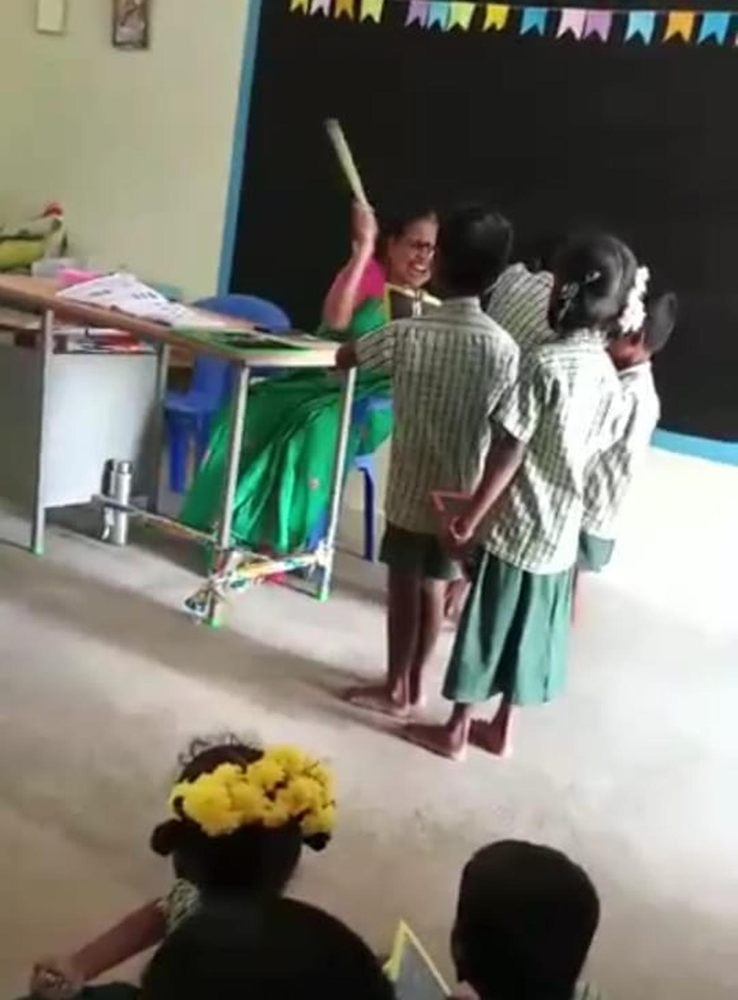
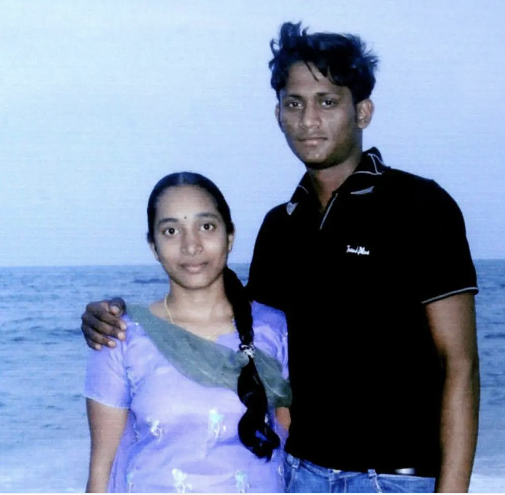
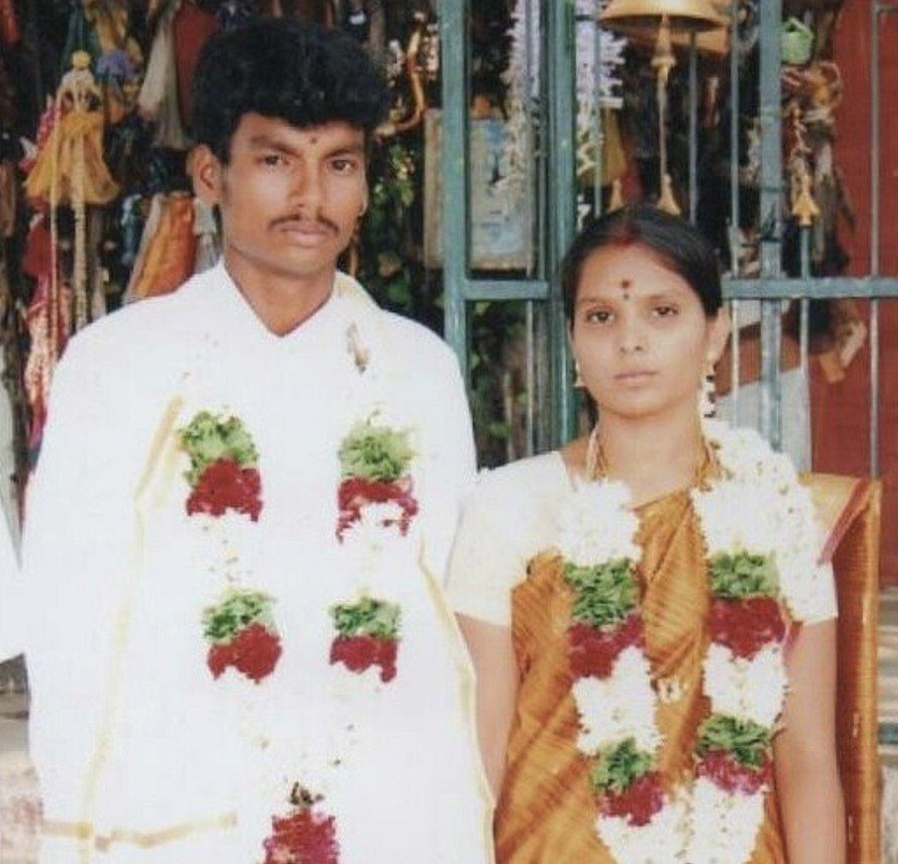
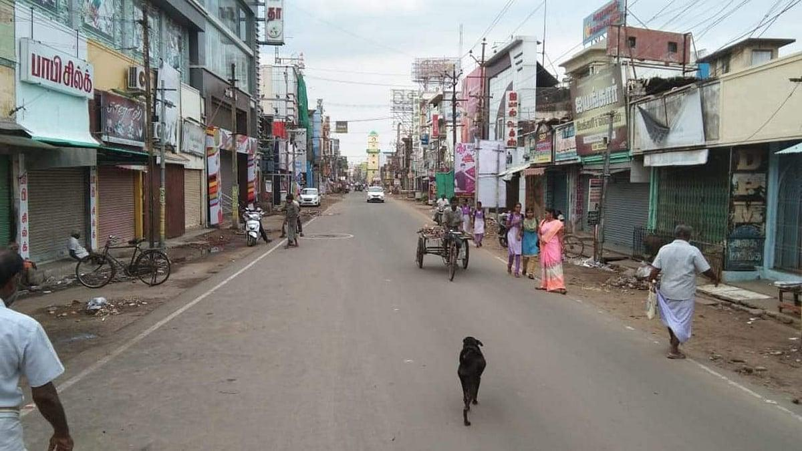
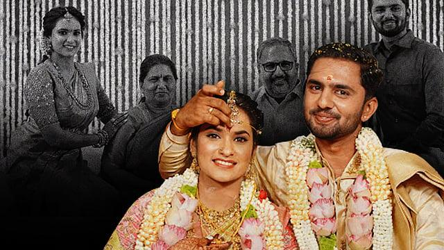
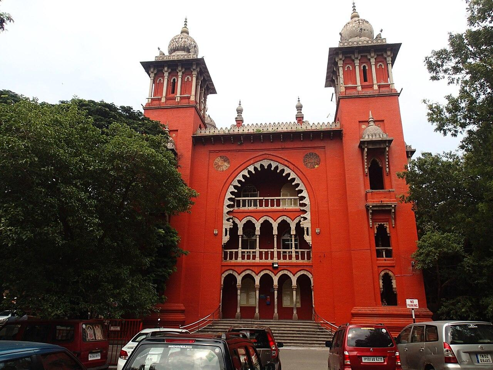

# Introduction

In Tirunelveli, where I grew up, a Tamil parent might beat a child to discipline them or to score high marks in maths and call it love. In other parts of the world, the same act is called child abuse. I wondered, which view is true?

{fig-alt="Illustration of physical punishment in a Tamil educational or family setting, questioning the belief that hitting children is an expression of love" width="50%"}

The teacher would abuse the poor child, calling him as an Ox, Buffalo, fit for janitor job for scoring poorly in Maths. If anyone questions, She'd say, because I care and love this child, I abuse him and beat him. 

A second puzzle came later. In the United States, an older parent in his eighties who can no longer look after himself may move into a nursing home that costs $6,000 to $12,000 a month, with full-time care, food, and support. 

A Tamil family hears this and is shocked. They feel the children have abandoned him and brought shame and use this as a way to portray American culture in negative, shameful way. The American family sees the opposite, they are honoring their parent with the best round-the-clock care they can give.

Both families love their parent. 
They are speaking different languages of love. 

This post tries to map those languages, using Tamil attitudes to love and marriage as the main case. And my point is families need to talk to each other, and to their own children, before a gap becomes a wound, and starts to hurt each other.

# Why I chose to write this? 

When I write on a topic, I am forced to be clear and precise. 
When I am wrong, readers can show me where, and that helps me build a more coherent understanding of the world.

Everyone has theories about love and relationships, how they should be, and how they should not be. If we write our views down, we can discuss what works and what doesn’t, understand each other, be accepting of each other.  

I would like people from a wide spectrum of beliefs to be aware of one another, to acknowledge and be respectful. Where cultures differ, I would rather stay curious than assume, and build trust rather than assign blame. 

# Moving between Social Value Systems

I am fortunate to have travel and moved across to many places in my life. 
Tirunelveli is where, I spent most of my years, which I describe as a socially-conservative town.
And then, I spent few years in capital of Tamil Nadu, Chennai (Madras).
Chennai was not a big culture shock apart from language and accents.

I am fortunate to have lived near Boston, which certainly is where I experienced existential questions of culture and life. 
The hardest part was the cold weather, dreary winters, sunlight gone by 4 p.m in the evening and entire sky turns pitch dark. 
Morever, I also absorbed newer cultural values of life-long learning, self-sufficiency. 

Morever, I was blessed again to have lived in Florida, Washington D.C, Virginia, New Hampshire, New York. 
Along the way I kept meeting values that conflicted with the ones I grew up with, so I began revisiting the social values of Tamil people. 
 If something isn’t true, why keep believing it? 

```{=html}
<style>
.color-values-atlas {
  --cva-text: #363c42;
  --cva-muted: #666b70;
  --cva-bg: #f0efe7;
  --cva-soft: #e9e7df;
  --cva-border: #d3d0c7;

  max-width: 1100px;
  margin: 2rem auto;
  font-family: system-ui, -apple-system, BlinkMacSystemFont,
    "Segoe UI", sans-serif;
  color: var(--cva-text);
}

.color-values-atlas * {
  box-sizing: border-box;
}

.cva-shell {
  border: 1px solid var(--cva-border);
  border-radius: 20px;
  padding: 24px;
  background:
    linear-gradient(180deg,
      rgba(255,255,255,0.25),
      rgba(255,255,255,0.00)),
    var(--cva-bg);
  box-shadow: none;
}

.cva-header {
  text-align: center;
  margin-bottom: 24px;
}

.cva-eyebrow {
  font-size: .75rem;
  font-weight: 800;
  letter-spacing: .12em;
  text-transform: uppercase;
  color: #907067;
  margin-bottom: 8px;
}

.cva-title {
  font-size: clamp(1.4rem, 3vw, 2rem);
  font-weight: 800;
  margin: 0 0 8px;
  background: linear-gradient(90deg, #74859c, #a46c61);
  -webkit-background-clip: text;
  -webkit-text-fill-color: transparent;
}

.cva-subtitle {
  max-width: 760px;
  margin: 0 auto;
  color: var(--cva-muted);
  font-size: .92rem;
  line-height: 1.7;
}

.cva-route {
  display: flex;
  flex-wrap: wrap;
  gap: 10px;
  margin: 1.5rem 0;
}

.cva-stop {
  border: none;
  border-radius: 999px;
  padding: 10px 16px;
  font-size: .82rem;
  font-weight: 700;
  cursor: pointer;
  color: white;
  background: #777570;
  box-shadow: none;
  transition: transform .15s ease, box-shadow .15s ease, opacity .15s ease;
}

.cva-stop:hover {
  transform: translateY(-1px);
  box-shadow: none;
}

.cva-stop.active {
  background: #a46c61;
  box-shadow: none;
}

.cva-stop:focus-visible {
  outline: 3px solid #93c5fd;
  outline-offset: 2px;
}

.cva-place {
  border-radius: 16px;
  padding: 18px 20px;
  background: #eae8df;
  border: 1px solid #d3d0c7;
  margin-bottom: 18px;
}

[data-bs-theme="dark"] .cva-place {
  background: linear-gradient(135deg, rgba(37,99,235,.18), rgba(139,92,246,.18));
  border-color: rgba(147,197,253,.20);
}

.cva-place h3 {
  margin: 0 0 8px;
  font-size: 1.15rem;
  color: #363c42;
}

.cva-place p {
  margin: 0;
  line-height: 1.7;
  font-size: .9rem;
}

.cva-grid {
  display: grid;
  grid-template-columns: 1.25fr .95fr;
  gap: 16px;
  margin-top: 14px;
}

.cva-panel {
  border: 1px solid var(--cva-border);
  border-radius: 16px;
  padding: 18px;
  background: var(--cva-bg);
}

.cva-panel-title {
  font-size: 1rem;
  font-weight: 800;
  margin: 0 0 14px;
}

.cva-cards {
  display: grid;
  grid-template-columns: 1fr 1fr;
  gap: 12px;
}

.cva-card {
  border-radius: 14px;
  padding: 15px;
  color: #1f2937;
  min-height: 150px;
}

.cva-card h4 {
  margin: 0 0 8px;
  font-size: .85rem;
  font-weight: 800;
}

.cva-card p {
  margin: 0;
  font-size: .84rem;
  line-height: 1.65;
}

.cva-card.friendship { background: linear-gradient(135deg, #dbeafe, #eff6ff); }
.cva-card.dating     { background: linear-gradient(135deg, #fce7f3, #fff1f2); }
.cva-card.marriage   { background: linear-gradient(135deg, #ede9fe, #f5f3ff); }
.cva-card.gender     { background: linear-gradient(135deg, #dcfce7, #f0fdf4); }
.cva-card.lgbtq      { background: linear-gradient(135deg, #fde68a, #fef3c7); }
.cva-card.clothing   { background: linear-gradient(135deg, #fae8df, #fdf4e9); }

.cva-cloud-wrap {
  margin-top: 14px;
  padding-top: 10px;
  border-top: 1px dashed var(--cva-border);
}

.cva-cloud-label {
  font-size: .82rem;
  font-weight: 800;
  margin-bottom: 10px;
  color: #70645d;
}

.cva-cloud {
  display: flex;
  flex-wrap: wrap;
  gap: 10px 12px;
  align-items: center;
}

.cva-tag {
  display: inline-block;
  border-radius: 999px;
  padding: 7px 12px;
  font-weight: 700;
  line-height: 1;
  color: white;
  box-shadow: 0 4px 12px rgba(0,0,0,.08);
}

.cva-size-1 { font-size: .75rem; }
.cva-size-2 { font-size: .85rem; }
.cva-size-3 { font-size: 1rem; }
.cva-size-4 { font-size: 1.12rem; }
.cva-size-5 { font-size: 1.28rem; }

.cva-color-1 { background: linear-gradient(90deg,#3b82f6,#2563eb); }
.cva-color-2 { background: linear-gradient(90deg,#8b5cf6,#7c3aed); }
.cva-color-3 { background: linear-gradient(90deg,#ec4899,#db2777); }
.cva-color-4 { background: linear-gradient(90deg,#10b981,#059669); }
.cva-color-5 { background: linear-gradient(90deg,#f59e0b,#d97706); }

.cva-metrics .cva-metric {
  margin: 14px 0;
}

.cva-metric-head {
  display: flex;
  justify-content: space-between;
  gap: 10px;
  font-size: .84rem;
  font-weight: 700;
  margin-bottom: 5px;
}

.cva-bar {
  height: 12px;
  background: #e5e7eb;
  border-radius: 999px;
  overflow: hidden;
}

[data-bs-theme="dark"] .cva-bar {
  background: rgba(255,255,255,.14);
}

.cva-fill {
  height: 100%;
  border-radius: 999px;
  background: linear-gradient(90deg, #74859c, #a46c61);
}

.cva-source {
  margin-top: 12px;
  font-size: .76rem;
  line-height: 1.65;
  color: var(--cva-muted);
}

.cva-note {
  margin-top: 18px;
  font-size: .8rem;
  line-height: 1.7;
  color: var(--cva-muted);
  background: var(--cva-soft);
  border-radius: 12px;
  padding: 14px;
}

@media (max-width: 850px) {
  .cva-grid {
    grid-template-columns: 1fr;
  }
}

@media (max-width: 650px) {
  .cva-shell { padding: 14px; }
  .cva-cards {
    grid-template-columns: 1fr;
  }
}

/* The survey stays compact even when sourced statewide results are shown. */
.cva-grid { grid-template-columns: minmax(0,1fr); }
.cva-survey-panel { background: #eae8df; padding: 15px 18px; }
.cva-metrics { display:grid; grid-template-columns:repeat(3,minmax(0,1fr)); gap:10px 18px; }
.cva-metrics .cva-metric { margin: 4px 0; }
.cva-metric-head { min-height: 3.5em; align-items: flex-end; }
.cva-source a { color:#865b50; text-decoration:underline; }
.cva-card.clothing { grid-column: 1 / -1; min-height: 110px; }
@media (max-width: 750px) { .cva-metrics {grid-template-columns:1fr;} .cva-metric-head {min-height:0;} }
@media (max-width: 650px) { .cva-card.clothing { grid-column: auto; } }

/* When survey data is absent, let the social-values cards take the
   full width and make the empty survey a small footnote-like strip. */
.cva-grid.cva-no-survey { grid-template-columns: minmax(0, 1fr); }
.cva-grid.cva-no-survey .cva-survey-panel {
  padding: 12px 16px;
  display: flex;
  align-items: baseline;
  flex-wrap: wrap;
  gap: 6px 14px;
  background: #eae8df;
}
.cva-grid.cva-no-survey .cva-survey-panel .cva-panel-title {
  font-size: .88rem;
  margin: 0;
}
.cva-grid.cva-no-survey .cva-survey-panel .cva-metrics p {
  margin: 0;
  font-size: .8rem !important;
}
.cva-grid.cva-no-survey .cva-survey-panel .cva-source { display: none; }
.cva-grid.cva-no-survey .cva-cards { grid-template-columns: repeat(2, minmax(0,1fr)); }
@media (max-width: 650px) {
  .cva-grid.cva-no-survey .cva-cards { grid-template-columns: 1fr; }
}

/* Additional social dimensions and compact survey cards */
.cva-card.choice { background: #e5e9ef; }
.cva-card.religion { background: #efe7db; }
.cva-card.clothing-judgment { background: #f4e5dc; }
.cva-card.intercaste { background: #e5ede2; }
.cva-scope { display: inline-block; padding: 4px 9px; margin-bottom: 8px; border-radius: 20px; background: #e5ddd2; color: #584b42; font-size: .75rem; font-weight: 750; }
.cva-survey-panel { margin-top: 15px; background: #eae8df; }
.cva-survey-panel .cva-panel-title { margin-bottom: 8px; }
.cva-metrics { display: grid; grid-template-columns: repeat(2,minmax(0,1fr)); gap: 2px 22px; }
.cva-metrics .cva-metric { margin: 9px 0; }
.cva-survey-intro { font-size: .8rem; color: var(--cva-muted); margin: 0 0 9px; line-height: 1.5; }
.cva-metric-head { align-items: start; }
.cva-survey-link { color: #84544c; text-decoration: underline; text-underline-offset: 2px; }
.cva-subnote { color: var(--cva-muted); font-size: .72rem; line-height: 1.5; margin-top: 4px; }
.cva-sources-label { font-weight: 700; }
@media (max-width: 700px) { .cva-metrics { grid-template-columns: 1fr; } }
</style>

<section class="color-values-atlas" id="color-values-atlas">
  <div class="cva-shell">
    <header class="cva-header">
      <div class="cva-eyebrow">Culture • Place • Values</div>
      <h2 class="cva-title">Comparing Value Systems</h2>
      <p class="cva-subtitle">
        From Tamil Culture to the Western world: explore how social expectations
        about friendships, dating, marriage, women’s clothing, gender, and LGBTQ acceptance
        can differ across places and communities.
      </p>
    </header>

    <nav class="cva-route" aria-label="Choose location">
      <button class="cva-stop active" data-i="0">Tirunelveli</button>
      <button class="cva-stop" data-i="1">Chennai</button>
      <button class="cva-stop" data-i="2">Near Boston</button>
      <button class="cva-stop" data-i="3">Florida</button>
      <button class="cva-stop" data-i="4">Washington, D.C.</button>
      <button class="cva-stop" data-i="5">Virginia</button>
      <button class="cva-stop" data-i="6">Arkansas</button>
    </nav>

    <div class="cva-place">
      <h3 id="cva-name">Tirunelveli, Tamil Nadu</h3>
      <p id="cva-intro"></p>
    </div>

    <div class="cva-grid">
      <div class="cva-panel">
        <h3 class="cva-panel-title">Social Values</h3>
        <div class="cva-cards" id="cva-values"></div>

        <div class="cva-cloud-wrap">
          <div class="cva-cloud-label">Word Cloud of Social Values</div>
          <div class="cva-cloud" id="cva-cloud"></div>
        </div>
      </div>

      <div class="cva-panel cva-survey-panel">
        <h3 class="cva-panel-title">Regional Survey Signals</h3>
        <div id="cva-scope" class="cva-scope"></div>
        <p id="cva-survey-intro" class="cva-survey-intro"></p>
        <div class="cva-metrics" id="cva-metrics"></div>
        <div class="cva-source" id="cva-source"></div>
      </div>
    </div>

    <div class="cva-note">
      <strong>How to read this:</strong> the “Social Values” cards and word cloud
      summarize illustrative cultural patterns and tensions that may be encountered in
      each place. They are interpretive and illustrative, not claims that every
      person in that location believes the same thing. The survey bars appear
      only where quantitative data has been cited. Tamil Nadu percentages are state-level,
      not estimates for Chennai or Tirunelveli. The U.S. percentages are state-level
      (or D.C.-level), not neighborhood estimates. Different survey questions are never
      presented as direct cross-country equivalents.
    </div>
  </div>
</section>

<script>
(function () {
  const root = document.getElementById("color-values-atlas");
  if (!root) return;

  const places = [
    {
      name: "Tirunelveli, Tamil Nadu",
      intro:
        "In more traditional settings, relationships between boys and girls may be closely watched. Family reputation, parental authority, caste expectations, and gender restrictions can shape daily life and future marriage decisions.",
      values: [
        ["Gender Friendships", "Friendships between boys and girls may be discouraged or carefully supervised, especially during adolescence.", "friendship"],
        ["Dating & Love", "Dating can be treated as socially risky or shameful, even though many young people still form relationships privately.", "dating"],
        ["Marriage & Caste", "Marriage may be understood as a family matter involving caste, religion, reputation, and parental approval.", "marriage"],
        ["Gender & Independence", "Girls may face stricter curfews, greater monitoring, and more restrictions on mobility than boys.", "gender"],
        ["LGBTQ Acceptance", "Open acceptance may be limited in more conservative circles, though attitudes vary by family and generation.", "lgbtq"],
        ["Women’s Clothing & Social Judgment", "Sarees, salwar kameez, and other modest styles may be viewed as conventional or respectable in some families. Jeans, shorts, sleeveless clothing, or western styles can attract criticism in more conservative settings; standards differ by generation, class, neighborhood, and occasion.", "clothing"],
        ["Adult Partner Choice", "Some parents treat partner selection as a shared family decision and expect approval, although adults increasingly negotiate or challenge these boundaries.", "choice"],
        ["Clothing, Modesty & Reputation", "Clothing can be interpreted as evidence of upbringing or family respectability; scrutiny often falls more heavily on young women than on men.", "clothing-judgment"],
        ["Religion & Dating", "Faith-based expectations about courtship, endogamy and marriage can intersect with caste, social standing and family approval; views differ within religious communities.", "religion"],
        ["Inter-caste Marriage", "Caste boundaries may influence proposed matches and family reactions; neither acceptance nor opposition should be assumed for all households.", "intercaste"]
      ],
      cloud: [
        ["family honor",5,2], ["obedience",4,1], ["curfew",3,5],
        ["caste",5,2], ["arranged marriage",4,3], ["shame",3,3],
        ["reputation",4,4], ["gender segregation",3,1], ["parental control",4,5], ["modesty & clothing",3,4]
      ],
      metrics: [["Women primarily responsible for childcare", 57, "https://www.pewresearch.org/religious-landscape-study/2022/03/02/gender-roles-in-the-family/", "Pew 2019–20 · Tamil Nadu adults"], ["Completely agree: wife must always obey husband", 36, "https://www.pewresearch.org/religious-landscape-study/2022/03/02/gender-roles-in-the-family/", "Pew 2019–20 · Tamil Nadu adults"], ["Married women who participate in three household decisions", 92.8, "https://www.mohfw.gov.in/sites/default/files/NFHS-5_Phase-II_0.pdf", "NFHS-5 2019–21 · currently married women aged 15–49; state factsheet"], ["Very important to prevent men marrying outside caste", 35, "https://www.pewresearch.org/religion/2021/06/29/attitudes-about-caste/", "Pew 2019–20 · Southern India overall, NOT Tamil Nadu-specific"]],
      surveyScope: "Tamil Nadu statewide; caste item is South India regional",
      surveyIntro: "The 35% inter-caste figure covers the broader South India region, not Tamil Nadu specifically. The NFHS household-decision percentage measures women acting alone or jointly, not unconditional freedom.",
      source: "Source details are linked on each indicator.",
      sourceUrl: "https://www.pewresearch.org/religious-landscape-study/2022/03/02/gender-roles-in-the-family/"
    },
    {
      name: "Chennai, Tamil Nadu",
      intro:
        "Chennai often brings greater exposure to professional life, higher education, and mixed-gender interaction, but modern education can coexist with traditional expectations about caste, religion, and marriage.",
      values: [
        ["Gender Friendships", "Mixed-gender friendships may be more visible in universities and workplaces, though family supervision can remain strong.", "friendship"],
        ["Dating & Love", "Dating exists more openly than in smaller conservative settings, but acceptance varies widely.", "dating"],
        ["Marriage & Caste", "Families may encourage education and career freedom while still preferring caste-compatible marriages.", "marriage"],
        ["Gender & Independence", "Women may enjoy more educational and professional freedom, but household expectations can remain unequal.", "gender"],
        ["LGBTQ Acceptance", "Urban visibility is greater, though genuine acceptance still differs considerably by household and community.", "lgbtq"],
        ["Women’s Clothing & Social Judgment", "Chennai features a wide variety of dress, from sarees and salwar suits to jeans and contemporary fashion. Yet some women still encounter family or public judgments about modesty, clothing, and perceived respectability.", "clothing"],
        ["Adult Partner Choice", "Education and professional independence can coexist with a family expectation that parents approve the prospective spouse.", "choice"],
        ["Clothing, Modesty & Reputation", "Jeans and contemporary fashion are common, yet clothing may still be debated as a matter of modesty, reputation or respectability in some circles.", "clothing-judgment"],
        ["Religion & Dating", "Some communities value religious compatibility and family participation in marriage; others prioritize individual choice.", "religion"],
        ["Inter-caste Marriage", "Mixed professional spaces do not automatically eliminate caste preferences in partner selection.", "intercaste"]
      ],
      cloud: [
        ["education",5,1], ["modernity",4,2], ["career",4,4],
        ["family approval",4,3], ["caste preference",4,5], ["negotiation",3,2],
        ["urban freedom",3,1], ["tradition",4,5], ["professional life",3,4], ["dress & judgment",3,4]
      ],
      metrics: [["Women primarily responsible for childcare", 57, "https://www.pewresearch.org/religious-landscape-study/2022/03/02/gender-roles-in-the-family/", "Pew 2019–20 · Tamil Nadu adults"], ["Completely agree: wife must always obey husband", 36, "https://www.pewresearch.org/religious-landscape-study/2022/03/02/gender-roles-in-the-family/", "Pew 2019–20 · Tamil Nadu adults"], ["Married women who participate in three household decisions", 92.8, "https://www.mohfw.gov.in/sites/default/files/NFHS-5_Phase-II_0.pdf", "NFHS-5 2019–21 · currently married women aged 15–49; state factsheet"], ["Very important to prevent men marrying outside caste", 35, "https://www.pewresearch.org/religion/2021/06/29/attitudes-about-caste/", "Pew 2019–20 · Southern India overall, NOT Tamil Nadu-specific"]],
      surveyScope: "Tamil Nadu statewide; caste item is South India regional",
      surveyIntro: "The 35% inter-caste figure covers the broader South India region, not Tamil Nadu specifically. The NFHS household-decision percentage measures women acting alone or jointly, not unconditional freedom.",
      source: "Source details are linked on each indicator.",
      sourceUrl: "https://www.pewresearch.org/religious-landscape-study/2022/03/02/gender-roles-in-the-family/"
    },
    {
      name: "Near Boston, Massachusetts",
      intro:
        "Greater social acceptance of dating, individual autonomy, and LGBTQ rights is more visible in many educational and professional environments. This does not eliminate family differences, but it changes what is publicly normalized.",
      values: [
        ["Gender Friendships", "Friendships across genders are broadly normal in schools, universities, and workplaces.", "friendship"],
        ["Dating & Love", "Dating is usually treated as a normal part of young-adult life and personal development.", "dating"],
        ["Marriage & Choice", "Choosing one’s partner is commonly understood as an individual decision, with family advice rather than family control.", "marriage"],
        ["Gender & Independence", "Young women living independently, working part-time, and managing daily life are highly visible.", "gender"],
        ["LGBTQ Acceptance", "Massachusetts shows high support for same-sex marriage and LGBTQ nondiscrimination protections.", "lgbtq"],
        ["Women’s Clothing & Social Judgment", "In many campuses and urban professional settings, clothing is more commonly approached as individual self-expression, although schools, employers, religious communities, and peers still have their own expectations.", "clothing"],
        ["Adult Partner Choice", "In many university and professional circles, partner choice is treated as a personal decision; family preferences can still influence relationships.", "choice"],
        ["Clothing, Modesty & Reputation", "A wide range of casual, formal and expressive clothing is visible; institutions and communities still establish context-specific dress expectations.", "clothing-judgment"],
        ["Religion & Dating", "Religious groups vary from emphasizing courtship rules and shared faith to supporting more individual approaches.", "religion"]
      ],
      cloud: [
        ["autonomy",5,1], ["dating",4,3], ["equality",5,4],
        ["independence",5,2], ["LGBTQ acceptance",5,3], ["choice",4,1],
        ["coeducation",3,2], ["self-expression",4,5], ["mobility",3,4], ["self-expression",3,4]
      ],
      metrics: [["Support for LGBTQ nondiscrimination protections", 86, "https://www.prri.org/wp-content/uploads/2025/02/PRRI-March-2025-LGBTQ-rights.pdf", "PRRI 2024 · statewide/D.C. adults; no city estimate"]],
      surveyScope: "Massachusetts statewide",
      surveyIntro: "PRRI 2024 state estimate; no city-level claim.",
      source: "Source details are linked on each indicator.",
      sourceUrl: "https://www.prri.org/wp-content/uploads/2025/02/PRRI-March-2025-LGBTQ-rights.pdf"
    },
    {
      name: "Florida",
      intro:
        "Florida contains many different subcultures. In some environments, dating and independence are normalized, while in others family, religion, and tradition remain powerful guides.",
      values: [
        ["Gender Friendships", "Mixed-gender interaction is common, especially in schools, workplaces, and public life.", "friendship"],
        ["Dating & Love", "Independent dating is widely visible, though religious communities may promote more traditional norms.", "dating"],
        ["Marriage & Family", "Marriage is typically understood as an adult decision, but family values still influence partner choice.", "marriage"],
        ["Gender & Independence", "Practical independence often comes earlier than in more family-controlled settings.", "gender"],
        ["LGBTQ Acceptance", "Attitudes vary considerably across cities, suburbs, and religious communities.", "lgbtq"],
        ["Women’s Clothing & Social Judgment", "Shorts, casual wear, and beach clothing are widely visible in many Florida settings. Expectations vary across workplaces, families, religious communities, and social occasions.", "clothing"],
        ["Adult Partner Choice", "Dating and partner selection often rest with adults, although household religion and immigrant-family traditions may exert influence.", "choice"],
        ["Clothing, Modesty & Reputation", "Beachwear and casual dress are visible, but notions of appropriate attire vary by venue, generation and faith community.", "clothing-judgment"],
        ["Religion & Dating", "Florida includes religiously conservative and secular communities with divergent expectations for dating and marriage.", "religion"]
      ],
      cloud: [
        ["pluralism",4,1], ["religion",3,5], ["dating",4,3],
        ["independence",4,2], ["Cultural Diversity",5,4], ["mixed values",4,1],
        ["family influence",3,5], ["choice",3,2], ["diversity",4,3], ["casual clothing",3,4]
      ],
      metrics: [["Support for LGBTQ nondiscrimination protections", 73, "https://www.prri.org/wp-content/uploads/2025/02/PRRI-March-2025-LGBTQ-rights.pdf", "PRRI 2024 · statewide/D.C. adults; no city estimate"]],
      surveyScope: "Florida statewide",
      surveyIntro: "PRRI 2024 state estimate; no city-level claim.",
      source: "Source details are linked on each indicator.",
      sourceUrl: "https://www.prri.org/wp-content/uploads/2025/02/PRRI-March-2025-LGBTQ-rights.pdf"
    },
    {
      name: "Washington, D.C.",
      intro:
        "Washington, D.C. often reflects a highly educated, mobile, and internationally connected environment. Individual autonomy is especially visible, though family traditions still matter to many people.",
      values: [
        ["Gender Friendships", "Mixed social and professional interaction is routine.", "friendship"],
        ["Dating & Love", "Dating is common and often understood as part of adult social life.", "dating"],
        ["Marriage & Choice", "Adults are generally expected to choose partners for themselves.", "marriage"],
        ["Gender & Independence", "Professional identity and self-sufficiency are strong features of city life.", "gender"],
        ["LGBTQ Acceptance", "Support for LGBTQ nondiscrimination protections is high.", "lgbtq"],
        ["Women’s Clothing & Social Judgment", "Professional and casual styles coexist. Office dress codes may influence attire, while individual choice is often more socially visible in recreational settings.", "clothing"],
        ["Adult Partner Choice", "Professional mobility and diverse networks make self-directed partner selection prominent, though extended families may have strong preferences.", "choice"],
        ["Clothing, Modesty & Reputation", "Professional settings emphasize context-specific dress codes; attire outside work is often regarded as individual expression.", "clothing-judgment"],
        ["Religion & Dating", "Faith communities and secular social circles approach dating and marriage differently in this diverse district.", "religion"]
      ],
      cloud: [
        ["professionalism",5,1], ["mobility",4,2], ["choice",4,3],
        ["diversity",5,4], ["LGBTQ support",5,3], ["international",3,2],
        ["self-sufficiency",4,5], ["career",4,1], ["networking",3,4], ["dress choice",3,4]
      ],
      metrics: [["Support for LGBTQ nondiscrimination protections", 88, "https://www.prri.org/wp-content/uploads/2025/02/PRRI-March-2025-LGBTQ-rights.pdf", "PRRI 2024 · statewide/D.C. adults; no city estimate"]],
      surveyScope: "District of Columbia",
      surveyIntro: "PRRI 2024 state estimate; no city-level claim.",
      source: "Source details are linked on each indicator.",
      sourceUrl: "https://www.prri.org/wp-content/uploads/2025/02/PRRI-March-2025-LGBTQ-rights.pdf"
    },
    {
      name: "Virginia",
      intro:
        "Virginia contains both highly cosmopolitan and more traditional communities. As a result, attitudes toward relationships, family life, and identity can vary sharply within the state.",
      values: [
        ["Gender Friendships", "Social expectations differ across suburban, urban, and more conservative communities.", "friendship"],
        ["Dating & Love", "Dating is common in many settings, though some families emphasize religion and traditional courtship.", "dating"],
        ["Marriage & Family", "Family guidance may remain important even where adult autonomy is respected.", "marriage"],
        ["Gender & Independence", "Expectations vary depending on class, religion, and region.", "gender"],
        ["LGBTQ Acceptance", "Acceptance varies widely across communities and generations.", "lgbtq"],
        ["Women’s Clothing & Social Judgment", "Attitudes toward women’s clothes differ across metropolitan, rural, religious, and professional contexts. Workplace norms and personal or family expectations can diverge.", "clothing"],
        ["Adult Partner Choice", "Expectations range from individual partner choice in some metropolitan communities to greater family involvement in others.", "choice"],
        ["Clothing, Modesty & Reputation", "Modesty expectations can be stronger in some faith communities, while metro and college settings exhibit broad clothing diversity.", "clothing-judgment"],
        ["Religion & Dating", "Conservative religious approaches and more secular relationship norms coexist across Virginia.", "religion"]
      ],
      cloud: [
        ["Cultural Diversity",5,1], ["religion",4,5], ["suburbia",3,2],
        ["family guidance",4,3], ["mixed values",4,4], ["independence",3,1],
        ["education",3,2], ["tradition",4,5], ["choice",3,3], ["dress norms",3,4]
      ],
      metrics: [["Support for LGBTQ nondiscrimination protections", 75, "https://www.prri.org/wp-content/uploads/2025/02/PRRI-March-2025-LGBTQ-rights.pdf", "PRRI 2024 · statewide/D.C. adults; no city estimate"]],
      surveyScope: "Virginia statewide",
      surveyIntro: "PRRI 2024 state estimate; no city-level claim.",
      source: "Source details are linked on each indicator.",
      sourceUrl: "https://www.prri.org/wp-content/uploads/2025/02/PRRI-March-2025-LGBTQ-rights.pdf"
    },
    {
      name: "Arkansas",
      intro:
        "Arkansas includes university settings, religious communities, and more traditional social environments. Compared with Massachusetts, support for LGBTQ rights is lower at the statewide level.",
      values: [
        ["Gender Friendships", "Mixed-gender friendships are common, but some communities still encourage traditional boundaries.", "friendship"],
        ["Dating & Love", "Dating is common, though some religious communities encourage stricter relationship norms.", "dating"],
        ["Marriage & Family", "Adult choice is recognized, but faith and traditional values may strongly shape decisions.", "marriage"],
        ["Gender & Independence", "Women’s independence is visible, though gender-role expectations may remain stronger in some settings.", "gender"],
        ["LGBTQ Acceptance", "Statewide support is lower than in Massachusetts, though attitudes differ by age and local community.", "lgbtq"],
        ["Women’s Clothing & Social Judgment", "Women wear many styles, while some faith communities and families place greater emphasis on modest dress. Campus and urban settings may have different expectations from more conservative circles.", "clothing"],
        ["Adult Partner Choice", "Adult relationships are generally self-directed, while faith, family networks and community opinion can still influence partner selection.", "choice"],
        ["Clothing, Modesty & Reputation", "Some families and churches emphasize modesty, while campuses and cities include wider everyday clothing norms.", "clothing-judgment"],
        ["Religion & Dating", "Christian traditions influence courtship expectations in some communities, alongside more permissive or secular approaches.", "religion"]
      ],
      cloud: [
        ["faith",5,5], ["tradition",4,2], ["family values",4,3],
        ["dating",3,1], ["religion",5,4], ["community norms",4,2],
        ["gender roles",3,5], ["Cultural Diversity",3,1], ["LGBTQ debate",4,3], ["modesty",3,4]
      ],
      metrics: [["Support for LGBTQ nondiscrimination protections", 60, "https://www.prri.org/wp-content/uploads/2025/02/PRRI-March-2025-LGBTQ-rights.pdf", "PRRI 2024 · statewide/D.C. adults; no city estimate"]],
      surveyScope: "Arkansas statewide",
      surveyIntro: "PRRI 2024 state estimate; no city-level claim.",
      source: "Source details are linked on each indicator.",
      sourceUrl: "https://www.prri.org/wp-content/uploads/2025/02/PRRI-March-2025-LGBTQ-rights.pdf"
    }
  ];

  const valuesBox = root.querySelector("#cva-values");
  const cloudBox = root.querySelector("#cva-cloud");
  const metricsBox = root.querySelector("#cva-metrics");

  function render(i) {
    const place = places[i];
    root.querySelector(".cva-grid").classList.toggle("cva-no-survey", place.metrics.length === 0);

    root.querySelectorAll(".cva-stop").forEach((btn, idx) => {
      btn.classList.toggle("active", idx === i);
      btn.setAttribute("aria-pressed", String(idx === i));
    });

    root.querySelector("#cva-name").textContent = place.name;
    root.querySelector("#cva-intro").textContent = place.intro;
    const sourceBox = root.querySelector("#cva-source");
    sourceBox.replaceChildren();
    if (place.metrics.length) {
      const sourceText = document.createElement("span");
      sourceText.textContent = place.source + " ";
      sourceBox.append(sourceText);
      if (place.sourceUrl) {
        const link = document.createElement("a");
        link.href = place.sourceUrl;
        link.target = "_blank";
        link.rel = "noopener noreferrer";
        link.textContent = "View survey source ↗";
        sourceBox.append(link);
      }
    }

    valuesBox.replaceChildren();
    place.values.forEach(([title, body, klass]) => {
      const card = document.createElement("div");
      card.className = "cva-card " + klass;

      const h4 = document.createElement("h4");
      h4.textContent = title;

      const p = document.createElement("p");
      p.textContent = body;

      card.append(h4, p);
      valuesBox.append(card);
    });

    cloudBox.replaceChildren();
    place.cloud.forEach(([word, size, color]) => {
      const tag = document.createElement("span");
      tag.className =
        "cva-tag cva-size-" + size + " cva-color-" + color;
      tag.textContent = word;
      cloudBox.append(tag);
    });

    metricsBox.replaceChildren();
    if (!place.metrics.length) {
      const p = document.createElement("p");
      p.style.fontSize = ".86rem";
      p.style.lineHeight = "1.7";
      p.textContent =
        "No sourced regional survey indicators are displayed for this location.";
      metricsBox.append(p);
    } else {
      place.metrics.forEach(([label, value, url, footnote]) => {
        const wrap = document.createElement("div");
        wrap.className = "cva-metric";

        const head = document.createElement("div");
        head.className = "cva-metric-head";

        const left = document.createElement("a");
        left.className = "cva-survey-link";
        left.href = url;
        left.target = "_blank";
        left.rel = "noopener noreferrer";
        left.textContent = label;

        const right = document.createElement("span");
        right.textContent = Number(value).toLocaleString("en-US", {maximumFractionDigits: 1}) + "%";

        head.append(left, right);

        const bar = document.createElement("div");
        bar.className = "cva-bar";

        const fill = document.createElement("div");
        fill.className = "cva-fill";
        fill.style.width = value + "%";

        bar.append(fill);
        const note = document.createElement("div");
        note.className = "cva-subnote";
        note.textContent = footnote;
        wrap.append(head, bar, note);
        metricsBox.append(wrap);
      });
    }
  }

  root.querySelectorAll(".cva-stop").forEach(btn => {
    btn.addEventListener("click", () => {
      render(Number(btn.dataset.i));
    });
  });

  render(0);
})();
</script>
```

# Why is talking to opposite gender considered shameful in Tamil Society? 

In Tirunelveli, if you are growing up from ages 13-26, relationships between men and women are frowned upon, socially, outside of marriage. 
I don’t think, Tamils who lived in Tirunelveli are allowed to date. Dating, meeting the opposite gender at these ages. These words would evoke strong emotions of feeling shame for either boys or girls in the town. 

Tamil Parents keep tight-knit control over their children. Unfortunately, if you are a girl, most likely you won’t be allowed to travel much and have extremely strict curfew time. My first eye-opening cultural difference is, when I saw more American college women working in coffee shops, they were more independent, taking care of their own self, having their own career, family. I bring this up, because, Tamil girls are strictly not allowed outside or experience freedom. While some might be allowed, those are exceptional families. 

Even though, relationships, dating, love is frowned upon in Tamil society. It doesn’t mean, every high-schooler or teenager, or even young college person follows it. Plenty of the young teenage Tamil girls chose to pursue a boy. They might go out for movies, or visit the beach. 
Most of the time, without their parents knowing and being aware. In high-schools, it is not promoted by teachers. People sit segregated, might not talk to each other, when adults are in the room. Even in churches, temples, mosques, gender segregation is common. 

In the high-school I attended, it was strictly forbidden for a girl to talk to a boy. Even though it is co-educational school. If a teacher noticed, she might yell, scream at the student, or ask both of them to bring their parents. The teachers, owner of the school would dismiss the relationships between a boy and a girl as childish, incomplete, blame it on hormones. Majority of the time, they try to break up the relationship. The young teenager does not have support from society, nor young adult Tamils. 

Anthropologist Leela Dube, in Women and Kinship (1997) [@dube1997women], helps explain why an ordinary friendship between a boy and a girl may be considered shameful in certain South Asian communities. Consider a teenage girl speaking regularly with a male classmate. The interaction itself need not involve anything sexual or inappropriate. She says, there's a valuable sociological distinction between personal shame (feeling that one has done something wrong) and socially imposed shame (being made to feel disgrace because one has violated a community expectation). In this case, the girl is forced to experience, socially imposed shame because, because marriage boundaries, and control over women are closely connected to broader Family's face and reputation. 

Another reason is collective identity, the girl's identity is broadly connected to the family's reputation, honor. 
Majority of Tamil Parent's see children as an extension of themselves, not as seperate individuals. 
So a child's failure is experienced as a collective family collapse, and bringing shame to the family. 
Meanwhile, in the West, a girl child is understood as a distinct, autonomous entity, their choices, successes, and failures belong primarily to them.

In many Tamil families, a young man's life is expected to follow a familiar path, study hard, score high marks, earn a degree, secure a respectable job with a stable income, and only then think about marriage. Once he is financially settled, his parents may begin searching for a suitable bride, considering her education, caste, religion, family background, and social standing.

But what happens when a fifteen- or sixteen-year-old boy falls in love with a girl and hopes to marry her someday? His parents may dismiss his feelings, asking, “You haven't even finished your studies or found a job. What do you know about love or marriage?” Depending on the family, however, attitudes toward young relationships can differ considerably. 

# How Tamil families differ? 

I propose distinguishing between two dimensions for understanding cultural values. 

1. **[Socioeconomic position](#socioeconomic-position)**

2. **[Social-cultural orientation](#social-cultural-orientation)**

Socioeconomic position describes a family's economic resources, occupational background, and social influence. 

Social-cultural orientation describes attitudes toward individual freedom, gender equality, relationships, caste, sexuality, and parental authority. These dimensions may influence one another, but they are not interchangeable.

## Socioeconomic Values {#socioeconomic-position}

In Tamil society which is hierarchical in values, socioeconomic position also intersects with caste, inherited property, family networks, and local social influence. Although caste and socioeconomic class are distinct, they can reinforce one another and shape access to education, employment, marriage networks, and social opportunities.

These differences matter when examining love, marriage, and family relationships. A family experiencing financial insecurity may place particular importance on a prospective spouse's stable employment, while a wealthy family may emphasize educational credentials, family background, or the preservation of inherited wealth and social standing. However, these are possible tendencies, not fixed rules.

Tamil families occupy diverse socioeconomic positions, ranging from agricultural laborers and informal-sector workers to salaried professionals, business owners, and established economic elites. For this discussion, I distinguish six illustrative socioeconomic categories to examine how economic circumstances and social standing may influence family expectations surrounding relationships and marriage.

```{=html}
<style>
.tamil-class-table {
  --ivory: #fffcf5;
  --ink: #263238;
  --muted: #64748b;
  --line: #e6dfd3;

  max-width: 1150px;
  margin: 1.5rem auto 2rem;
  padding: 20px;
  background: var(--ivory);
  border: 1px solid var(--line);
  border-radius: 16px;
  font-family: system-ui, -apple-system,
    BlinkMacSystemFont, "Segoe UI", sans-serif;
}

.tamil-class-table * {
  box-sizing: border-box;
}

.tamil-class-table-scroll {
  width: 100%;
  overflow-x: auto;
  -webkit-overflow-scrolling: touch;
  border: 1px solid var(--line);
  border-radius: 11px;
}

.tamil-class-table table {
  width: 100%;
  min-width: 1050px;
  border-collapse: separate;
  border-spacing: 0;
  table-layout: fixed;
  margin: 0 !important;
  font-size: .85rem;
  line-height: 1.6;
}

.tamil-class-table thead th {
  background: #334155 !important;
  color: #ffffff !important;
  padding: 15px 13px;
  text-align: left;
  font-weight: 750;
  border-bottom: 2px solid #1e293b;
}

.tamil-class-table tbody td {
  padding: 16px 13px;
  vertical-align: top;
  color: var(--ink) !important;
  border-bottom: 1px solid var(--line);
  background: #ffffff !important;
}

.tamil-class-table tbody tr:nth-child(even) td {
  background: #faf8f3 !important;
}

.tamil-class-table tbody tr:hover td {
  background: #f2f0fa !important;
}

.tamil-class-table tbody tr:last-child td {
  border-bottom: none;
}

.tamil-class-table tbody td:first-child {
  text-align: center;
  padding-top: 16px;
}

.tamil-class-badge {
  display: inline-flex;
  align-items: center;
  justify-content: center;
  width: 43px;
  height: 43px;
  border-radius: 11px;
  font-size: 1.15rem;
  font-weight: 800;
}

.tamil-class-badge.a {
  background: #dbeafe;
  color: #1e40af;
}

.tamil-class-badge.b {
  background: #e0eaff;
  color: #3155a0;
}

.tamil-class-badge.c {
  background: #ede9fe;
  color: #6d28d9;
}

.tamil-class-badge.d {
  background: #fce7dd;
  color: #9a4e28;
}

.tamil-class-badge.e {
  background: #fee2e2;
  color: #9f3333;
}

.tamil-class-badge.f {
  background: #fecaca;
  color: #991b1b;
}

.tamil-class-position {
  font-weight: 750;
  color: #334155;
}

.tamil-class-caption {
  margin-top: 13px;
  font-size: .79rem;
  line-height: 1.65;
  color: var(--muted);
  text-align: center;
}

@media (max-width: 600px) {
  .tamil-class-table {
    padding: 12px;
    border-radius: 12px;
  }

  .tamil-class-table table {
    font-size: .8rem;
  }
}
</style>

<div class="tamil-class-table">

<div class="tamil-class-table-scroll">
<table>
<thead>
<tr>
  <th style="width:7%">Category</th>
  <th style="width:17%">Socioeconomic Position</th>
  <th style="width:19%">Illustrative Background</th>
  <th style="width:28%">A Hypothetical Family Example</th>
  <th style="width:29%">Possible Challenges</th>
</tr>
</thead>
<tbody>

<tr>
<td><span class="tamil-class-badge a">A</span></td>
<td class="tamil-class-position">
Economically disadvantaged / Working class
</td>
<td>
Agricultural laborers, domestic workers,
daily-wage employees, and informal-sector workers.
</td>
<td>
A family in rural Tirunelveli where the father
works as an agricultural laborer and the mother
undertakes occasional domestic work. They rent
a modest house and depend on irregular earnings.
</td>
<td>
Irregular income may make it difficult to pay
for food, medical treatment, transportation,
and children's education. An unexpected illness
or loss of employment can lead to borrowing
or reduced household consumption. Limited savings
may restrict the family's ability to withstand
financial emergencies.
</td>
</tr>

<tr>
<td><span class="tamil-class-badge b">B</span></td>
<td class="tamil-class-position">Lower-middle class</td>
<td>
Clerical employees, shopkeepers,
junior salaried workers, and
lower-paid service employees.
</td>
<td>
A family in Madurai where the father is an
office clerk and the mother operates a small
tailoring business. They have relatively steady
earnings but limited savings after meeting
their monthly expenses.
</td>
<td>
Rising housing costs, school fees, medical bills,
and the cost of supporting elderly parents
can strain the family budget. Parents may
prioritize stable employment for their children
because they have limited financial reserves
to support prolonged unemployment.
</td>
</tr>

<tr>
<td><span class="tamil-class-badge c">C</span></td>
<td class="tamil-class-position">Middle class</td>
<td>
Teachers, government employees,
technicians, office workers,
and small-business owners.
</td>
<td>
A family in Tirunelveli where one parent
is a government schoolteacher and the
other works in a bank. They own a modest
house, receive regular salaries, and
save for their children's education
and retirement.
</td>
<td>
The family may need to balance university
fees, housing loans, retirement savings,
and support for aging relatives. Parents
may experience pressure to preserve financial
stability while helping their children pursue
career opportunities that involve uncertainty.
</td>
</tr>

<tr>
<td><span class="tamil-class-badge d">D</span></td>
<td class="tamil-class-position">Upper-middle class</td>
<td>
Physicians, engineers, professors,
IT professionals, senior managers,
and established entrepreneurs.
</td>
<td>
A family in Chennai where both parents
are physicians. They own a comfortable
apartment, have substantial savings,
and can finance postgraduate education
for their children, including study abroad.
</td>
<td>
Demanding professional schedules may
limit family time. Parents may have high
expectations concerning academic performance,
career success, and marriage compatibility.
Some families may experience disagreements
when their adult children's personal choices
differ from parental expectations.
</td>
</tr>

<tr>
<td><span class="tamil-class-badge e">E</span></td>
<td class="tamil-class-position">
Wealthy business and professional elite
</td>
<td>
Large business owners, industrialists,
high-income professionals, and
substantial property owners.
</td>
<td>
A family in Coimbatore owns a successful
textile manufacturing company employing
several hundred workers. They hold
multiple properties and significant
financial investments.
</td>
<td>
The family may face business risks,
succession planning, and disagreements
over ownership or management responsibilities.
Parents may expect their children to join
the family enterprise or maintain relationships
with established business networks.
</td>
</tr>

<tr>
<td><span class="tamil-class-badge f">F</span></td>
<td class="tamil-class-position">
Hereditary and socially influential elite
</td>
<td>
Families with longstanding landownership,
inherited wealth, political influence,
or established community authority.
</td>
<td>
A multigenerational family possesses
inherited agricultural estates,
commercial properties, and investments.
Its extended relatives have longstanding
connections within local business and
community institutions.
</td>
<td>
Inheritance and property distribution may
become sources of disagreement among relatives.
The family may also encounter expectations
to maintain its social standing, manage
inherited assets, and preserve longstanding
relationships or family traditions.
</td>
</tr>

</tbody>
</table>
</div>

<div class="tamil-class-caption">
  Table: Illustrative socioeconomic categories,
  hypothetical Tamil households, and possible
  economic or familial challenges.
  These are conceptual categories, not income-based
  classifications derived from a representative survey.
  Socioeconomic position does not determine a family's
  cultural or political attitudes.
</div>

</div>
```

These categories are descriptive rather than rigid classifications. 
Occupation alone does not determine social class, and families within the same occupational group may differ significantly in income, wealth, inherited assets, and social influence. More importantly, **a family's socioeconomic position should not be mistaken for its cultural values**.
A wealthy family is not necessarily socially liberal, and a family with limited economic resources is not necessarily conservative.
To understand attitudes toward marriage, caste, gender, and individual freedom, we need a second dimension.

## Tamil Families Social Attitudes Spectrum {#social-cultural-orientation}

I propose a simple continuum extending from **social liberalism on the left to social conservatism on the right**.
For visual clarity, the spectrum uses blue for socially liberal orientations, purple for centrist or pragmatic orientations, and red for socially conservative orientations. The purpose of this spectrum is describe cultural attitudes. So, we can describe differences in values and understand why families sometimes disagree about personal relationships, marriage, and individual choice.

At the far-left end are families that place considerable emphasis on personal autonomy, gender equality, and acceptance of diverse identities and relationships. These families may accept intercaste and interreligious marriages, support LGBTQ individuals and relationships, and regard marriage as a decision belonging primarily to the adults involved.

At the far-right end are families that place considerable emphasis on inherited traditions, caste and religious boundaries, parental authority, and preservation of family reputation. They may oppose intercaste marriage, discourage dating, reject LGBTQ relationships, and insist that parents or elders should exercise decisive influence over marriage.

Between these ends are families whose attitudes combine traditional expectations with varying degrees of flexibility.

```{=html}
<style>
.tamil-spectrum {
  max-width: 920px;
  margin: 2rem auto;
  padding: 24px;
  border: 1px solid #d8dfe8;
  border-radius: 14px;
  font-family: system-ui, -apple-system,
    BlinkMacSystemFont, "Segoe UI", sans-serif;
}

.tamil-spectrum * {
  box-sizing: border-box;
}

.tamil-spectrum-title {
  text-align: center;
  font-size: 1.3rem;
  font-weight: 700;
  margin-bottom: 8px;
}

.tamil-spectrum-subtitle {
  text-align: center;
  font-size: .92rem;
  color: #64748b;
  margin-bottom: 24px;
}

.tamil-spectrum-headings {
  display: flex;
  justify-content: space-between;
  align-items: center;
  gap: 8px;
  margin-bottom: 10px;
  font-size: .88rem;
  font-weight: 700;
}

.tamil-spectrum-headings span:first-child {
  color: #2563eb;
}

.tamil-spectrum-headings span:nth-child(2) {
  color: #8b5cf6;
}

.tamil-spectrum-headings span:last-child {
  color: #dc2626;
}

.tamil-gradient {
  width: 100%;
  height: 36px;
  border-radius: 9px;
  background: linear-gradient(
    to right,
    #1452b8 0%,
    #347de0 20%,
    #8984da 40%,
    #a78bfa 50%,
    #d78a9e 65%,
    #e46c64 80%,
    #b91c1c 100%
  );
}

.tamil-spectrum-ticks {
  display: flex;
  justify-content: space-between;
  font-size: .84rem;
  font-weight: 600;
  margin-top: 8px;
  color: var(--bs-body-color, #334155);
}

.tamil-spectrum-categories {
  display: grid;
  grid-template-columns: repeat(5, minmax(0, 1fr));
  gap: 5px;
  margin-top: 24px;
}

.tamil-spectrum-category {
  padding: 13px 7px;
  border-radius: 7px;
  text-align: center;
  font-size: .76rem;
  line-height: 1.45;
  overflow-wrap: anywhere;
}

.tamil-spectrum-category strong {
  display: block;
  margin-bottom: 5px;
}

.tamil-spectrum-category.c1 {
  background: #dbeafe;
  color: #1e40af;
}

.tamil-spectrum-category.c2 {
  background: #e0eaff;
  color: #3155a0;
}

.tamil-spectrum-category.c3 {
  background: #ede9fe;
  color: #6d28d9;
}

.tamil-spectrum-category.c4 {
  background: #fee2e2;
  color: #9f3333;
}

.tamil-spectrum-category.c5 {
  background: #fecaca;
  color: #991b1b;
}

.tamil-spectrum-note {
  margin-top: 20px;
  font-size: .82rem;
  line-height: 1.6;
  color: var(--bs-secondary-color, #64748b);
}

@media (max-width: 600px) {
  .tamil-spectrum {
    padding: 14px;
  }

  .tamil-spectrum-headings {
    font-size: .72rem;
  }

  .tamil-spectrum-categories {
    gap: 3px;
  }

  .tamil-spectrum-category {
    padding: 8px 3px;
    font-size: .64rem;
  }
}
</style>

<div class="tamil-spectrum">

  <div class="tamil-spectrum-title">
    The Tamil Family Social Attitudes Spectrum
  </div>

  <div class="tamil-spectrum-subtitle">
    From individual autonomy and social acceptance
    to traditional authority and social restrictions
  </div>

  <div class="tamil-spectrum-headings">
    <span>← SOCIALLY LIBERAL</span>
    <span>CENTRIST</span>
    <span>SOCIALLY CONSERVATIVE →</span>
  </div>

  <div class="tamil-gradient"></div>

  <div class="tamil-spectrum-ticks">
    <span>0</span>
    <span>25</span>
    <span>50</span>
    <span>75</span>
    <span>100</span>
  </div>

  <div class="tamil-spectrum-categories">

    <div class="tamil-spectrum-category c1">
      <strong>0–20</strong>
      Strongly Liberal
      <br>
      <br>
      LGBTQ acceptance,
      gender equality,
      personal autonomy
    </div>

    <div class="tamil-spectrum-category c2">
      <strong>21–40</strong>
      Moderately Liberal
      <br>
      <br>
      Supports individual
      choice with family
      consultation
    </div>

    <div class="tamil-spectrum-category c3">
      <strong>41–60</strong>
      Centrist / Pragmatic
      <br>
      <br>
      Balances family
      traditions with
      flexibility
    </div>

    <div class="tamil-spectrum-category c4">
      <strong>61–80</strong>
      Moderately Conservative
      <br>
      <br>
      Strong preferences
      concerning caste,
      marriage, tradition
    </div>

    <div class="tamil-spectrum-category c5">
      <strong>81–100</strong>
      Strongly Conservative
      <br>
      <br>
      Rigid caste boundaries,
      parental authority,
      restricted relationships
    </div>

  </div>

  <p class="tamil-spectrum-note">
    This is a conceptual spectrum rather than a
    scientifically validated measurement instrument.
    The numbers illustrate degrees of social-cultural
    orientation. They do not represent population
    estimates or empirically measured attitudes.
    The colors describe social attitudes, not
    affiliation with political parties in India
    or the United States.
  </p>

</div>
```

This distinction helps explain a striking contradiction. A family may support a daughter studying medicine, taking professional responsibility, earning a salary, and moving abroad, while denying that she should choose her own spouse. Professional competence and family authority are being judged according to different rules. Education can raise family prestige while romantic autonomy threatens established boundaries. Higher education does not automatically dissolve caste or gender expectations.

## Four Tamil Families: Why Do Their Values Differ?

**Why do some Tamil families give their adult children freedom to choose whom they love and marry, while others, sometimes equally educated, wealthy, and loving insist on making those decisions for them?** 
Consider four hypothetical Tamil families. They represent different combinations of socioeconomic position and cultural values, not actual households or fixed categories within Tamil society.

### Family B4: A Socially Liberal Lower-Middle-Class Family

Imagine a Tamil family where one parent works as a schoolteacher and the other operates a small business.
Money is limited, but the parents believe their son and daughter should have equal freedom to pursue education, careers, friendships, and relationships. When their daughter falls in love with someone from another caste, they want to understand his character, values, and compatibility with her rather than reject him because of his background.They also accept LGBTQ family members and believe adult children should make their own personal decisions.

**Their limited financial resources do not prevent them from holding socially liberal values.**

### Family E2: A Wealthy but Pragmatic Coimbatore Family

Consider a prosperous business family in Coimbatore.
The parents value education, financial security, family reputation, and established community relationships. They prefer their children to marry someone from a similar social, religious, or economic background. When their daughter introduces a partner from another caste, they initially hesitate. But after meeting him, learning about his family, and understanding the couple's plans, they may accept the relationship.

**They value tradition, but their expectations are negotiable.**

### Family D3: A Modern but Socially Conservative Chennai Family

Imagine two physicians living in Chennai.
They encourage their daughter to study medicine, pursue postgraduate education abroad, become financially independent, and succeed professionally.
They trust her to make important decisions in her career. But when she chooses to marry a colleague from another caste, they strongly oppose the relationship despite respecting his professional achievements.

Their daughter might wonder: *"You trust me to make decisions in my professional life, but why not in choosing the person I will marry?"*

**This family illustrates that professional modernity does not necessarily produce social liberalism.**

### Family C1: A Traditional Middle-Class Tirunelveli Family

Finally, consider a middle-class family in Tirunelveli.
The father is a government employee, and the mother is a homemaker. They value education, stable employment, religion, respect for elders, and family reputation. They discourage dating and close friendships between boys and girls. Their daughter faces stricter restrictions than their son.
When she falls in love with someone from another caste, the parents oppose the relationship, fearing criticism from relatives and the wider community. They believe they are protecting their daughter's future.
She believes they are restricting her independence.

**This family illustrates the tension between parental guidance and control over an adult child's decisions.**

These four families demonstrate that economic position, education, and cultural attitudes do not always move together.
A wealthy family may be socially conservative, while a family with limited financial resources may support greater individual freedom.
The spectrum from socially liberal to conservative is therefore an illustrative framework, not a scientific classification of Tamil families.

## Matrix Visualizing values of Four Hypothetical Families

The matrix allows us to compare Tamil-families across parental authority, gender equality, dating, marriage, caste, religion, sexuality, individual autonomy, and family reputation.


```{=html}
<div id="tamil-family-values-v2" class="tfv">
 <header class="tfv-intro"><span class="tfv-kicker">SOCIAL VALUES ATLAS · FICTIONAL CASE STUDIES</span><h2>Four Tamil Families, Different Values</h2><p>Where do their beliefs converge and conflict? Explore 22 questions about authority, marriage, gender, and social norms. Each family is fictional.</p></header>
 <div class="tfv-families"><div><b>B4</b><strong>Liberal lower-middle-class</strong><small>Lower resources · greater adult autonomy</small></div><div><b>E2</b><strong>Pragmatic wealthy</strong><small>Wealthy · negotiable traditions</small></div><div><b>D3</b><strong>Modern-conservative professionals</strong><small>Upper-middle-class · selective autonomy</small></div><div><b>C1</b><strong>Traditional middle-class</strong><small>Middle-class · greater parental control</small></div></div>
 <div class="tfv-legend"><span><i class="tfv-dot tfv-choice"></i>Adult choice / equality</span><span><i class="tfv-dot tfv-negotiated"></i>Negotiated / conditional</span><span><i class="tfv-dot tfv-authority"></i>Traditional expectation</span><span><i class="tfv-dot tfv-restrictive"></i>Strong restriction / control</span></div>
 <div class="tfv-toolbar"><label for="tfv-filter">Explore a domain</label><select id="tfv-filter"><option value="all">All 22 questions</option><option value="0">Authority &amp; individual autonomy</option><option value="1">Love, marriage &amp; caste</option><option value="2">Gender, expression &amp; sexuality</option><option value="3">Reputation, religion &amp; social norms</option></select></div>
 <div class="tfv-scroll" tabindex="0" aria-label="Scroll to view all family values columns"><table class="tfv-table"><thead><tr><th scope="col">Value / question</th><th scope="col">B4</th><th scope="col">E2</th><th scope="col">D3</th><th scope="col">C1</th></tr></thead><tbody id="tfv-body"></tbody></table></div>
 <section class="tfv-compare"><h3>Compare two families</h3><p>See where their answers differ, and where their values converge.</p><div class="tfv-compare-select"><label>First family<select id="tfv-a"><option value="0">B4 · Liberal lower-middle-class</option><option value="1">E2 · Pragmatic wealthy</option><option value="2">D3 · Modern-conservative</option><option value="3">C1 · Traditional middle-class</option></select></label><label>Second family<select id="tfv-b"><option value="3" selected>C1 · Traditional middle-class</option><option value="2">D3 · Modern-conservative</option><option value="1">E2 · Pragmatic wealthy</option><option value="0">B4 · Liberal lower-middle-class</option></select></label></div><button type="button" id="tfv-compare-btn">Compare family values</button><div id="tfv-results" hidden aria-live="polite"></div></section>
 <p class="tfv-note"><strong>Methodological note.</strong> These are fully specified <em>fictional</em> profiles, constructed to illustrate contrasting norms. Their answers are not observations, survey estimates, or claims about families in Tirunelveli, Chennai, or Coimbatore. Color identifies the <em>attitude in each answer</em>, not a family's overall ideology. Some borderline classifications are interpretive. Comparison counts refer to differences in these fictional answers, not empirical cultural distance.</p>
</div>
<style>
#tamil-family-values-v2{--ink:#30373d;--ivory:#fcfaf4;--line:#e4dfd5;max-width:1180px;margin:2rem auto;padding:clamp(14px,2.7vw,30px);background:var(--ivory);border:1px solid var(--line);border-radius:19px;color:var(--ink);font-family:system-ui,-apple-system,sans-serif;line-height:1.45}
#tamil-family-values-v2 *{box-sizing:border-box}
.tfv-intro{text-align:center;margin-bottom:23px}.tfv-kicker{font-size:.7rem;color:#99703b;letter-spacing:.12em;font-weight:800}.tfv-intro h2{font-size:clamp(1.45rem,3vw,2rem);margin:8px 0;color:#303943}.tfv-intro p{font-size:.9rem;color:#68747f;max-width:700px;margin:auto}
.tfv-families{display:grid;grid-template-columns:repeat(4,minmax(0,1fr));gap:9px;margin:23px 0 19px}.tfv-families>div{background:#fff;border:1px solid var(--line);border-top:3px solid #b6a287;border-radius:10px;padding:12px;display:flex;flex-direction:column;gap:3px}.tfv-families b{font-size:1.15rem}.tfv-families strong{font-size:.77rem;line-height:1.3}.tfv-families small{color:#737c84;font-size:.68rem}
.tfv-legend{display:flex;flex-wrap:wrap;gap:7px 14px;padding:13px;background:#fff;border:1px solid var(--line);border-radius:10px;margin-bottom:18px}.tfv-legend span{display:flex;gap:6px;align-items:center;font-size:.73rem;color:#4b5563}.tfv-dot{display:inline-block;width:12px;height:12px;border-radius:3px;flex-shrink:0}.tfv-choice{background:#cde5fa}.tfv-negotiated{background:#e7daf9}.tfv-authority{background:#fbe5bd}.tfv-restrictive{background:#f8d2d7}
.tfv-toolbar{display:flex;gap:12px;align-items:center;margin-bottom:13px}.tfv-toolbar label{font-size:.83rem;font-weight:700}.tfv select{background:#fff;color:#30373d;border:1px solid #c9c5bd;border-radius:8px;padding:9px;font-size:.8rem;max-width:100%}
.tfv-scroll{overflow-x:auto;background:#fff;border:1px solid var(--line);border-radius:11px}.tfv-table{table-layout:fixed;width:100%;min-width:700px;border-collapse:collapse;margin:0!important;font-size:.78rem}.tfv-table th,.tfv-table td{padding:7px;text-align:center;vertical-align:middle;border-bottom:1px solid #f0ece5}.tfv-table th:first-child,.tfv-table td:first-child{width:26%;text-align:left;padding-left:12px}.tfv-table th:not(:first-child){width:18.5%}.tfv-table thead th{position:sticky;top:0;background:#f5f1e8;z-index:1;color:#38424b;font-weight:800;border-bottom:2px solid #dad0c2}.tfv-table .tfv-section td{background:#eee9df;text-transform:none;color:#514b44;font-weight:800;font-size:.82rem;padding:10px 13px}.tfv-question{font-weight:650;color:#38414b}.tfv-value{display:flex;align-items:center;justify-content:center;min-height:58px;padding:9px 6px;border-radius:7px;line-height:1.3;font-size:.75rem;font-weight:650;overflow-wrap:anywhere}.tfv-value[data-stance=choice]{background:#dcecfb;color:#204e80}.tfv-value[data-stance=negotiated]{background:#eee5fc;color:#63469a}.tfv-value[data-stance=authority]{background:#fff0d1;color:#865717}.tfv-value[data-stance=restrictive]{background:#fbe1e3;color:#973d48}
.tfv-compare{margin-top:24px;background:#fff;padding:19px;border-radius:12px;border:1px solid var(--line)}.tfv-compare h3{font-size:1.17rem;margin:0 0 5px}.tfv-compare>p{color:#6b7280;font-size:.83rem;margin:0 0 15px}.tfv-compare-select{display:grid;grid-template-columns:1fr 1fr;gap:13px}.tfv-compare-select label{display:flex;flex-direction:column;gap:6px;font-weight:700;font-size:.79rem}.tfv-compare button{margin-top:15px;padding:11px 17px;background:#455b80;color:#fff;border:0;border-radius:9px;font-weight:700;cursor:pointer;width:100%;font-size:.85rem}.tfv-compare button:hover{background:#344866}.tfv-compare button:focus-visible,.tfv select:focus-visible{outline:3px solid #c79b5d;outline-offset:2px}.tfv-summary{background:#f3f0e9;padding:12px;border-radius:9px;margin:14px 0;font-size:.83rem;color:#4b4c50}.tfv-result-head{font-size:.88rem;font-weight:800;padding:9px 0;border-bottom:1px solid #ddd9d2;margin-top:16px}.tfv-result-row{border-bottom:1px solid #ebe6df;padding:12px 0}.tfv-result-row>strong{font-size:.8rem;display:block;margin-bottom:8px}.tfv-result-cells{display:grid;grid-template-columns:1fr 1fr;gap:9px}.tfv-result-cells .tfv-value{min-height:50px;display:block;text-align:left;padding:10px}.tfv-result-cells b{display:block;margin-bottom:4px;font-size:.7rem}.tfv-converge{padding:10px 12px;font-size:.8rem;background:#f4f2ed;border-radius:8px;margin-top:12px}.tfv-note{font-size:.75rem;color:#645c4e;background:#f3eee3;border-left:3px solid #b89a67;padding:15px;margin:19px 0 0;border-radius:7px}
@media(max-width:700px){.tfv-families{grid-template-columns:repeat(2,minmax(0,1fr))}.tfv-toolbar{align-items:stretch;flex-direction:column}.tfv-toolbar select{width:100%}.tfv-compare-select{grid-template-columns:1fr}.tfv-result-cells{grid-template-columns:1fr}}
@media(prefers-reduced-motion:reduce){#tamil-family-values-v2 *{scroll-behavior:auto!important}}
</style>
<script>
(function(){
const root=document.getElementById('tamil-family-values-v2');if(!root||root.dataset.ready)return;root.dataset.ready='1';
const rows=[{"group": "Authority & individual autonomy", "groupId": "0", "q": "Who has final authority over adult decisions?", "answers": [{"text": "Adult individual", "stance": "choice"}, {"text": "Adult after consultation", "stance": "negotiated"}, {"text": "Parents in major family matters", "stance": "authority"}, {"text": "Parents expected to decide", "stance": "restrictive"}]}, {"group": "Authority & individual autonomy", "groupId": "0", "q": "Can an adult disagree with parents?", "answers": [{"text": "Yes, openly", "stance": "choice"}, {"text": "Yes, respectfully", "stance": "choice"}, {"text": "Within limits", "stance": "authority"}, {"text": "Generally discouraged", "stance": "restrictive"}]}, {"group": "Authority & individual autonomy", "groupId": "0", "q": "Should adult children obey parents?", "answers": [{"text": "No unconditional duty", "stance": "choice"}, {"text": "Respect, not unconditional obedience", "stance": "negotiated"}, {"text": "Obedience emphasized", "stance": "authority"}, {"text": "Obedience strongly expected", "stance": "restrictive"}]}, {"group": "Authority & individual autonomy", "groupId": "0", "q": "Individual versus family interests", "answers": [{"text": "Adult rights prioritized", "stance": "choice"}, {"text": "Balance negotiated", "stance": "negotiated"}, {"text": "Family interests often prioritized", "stance": "authority"}, {"text": "Family interests prioritized", "stance": "restrictive"}]}, {"group": "Authority & individual autonomy", "groupId": "0", "q": "Can adult children live independently?", "answers": [{"text": "Fully supported", "stance": "choice"}, {"text": "Supported for practical reasons", "stance": "negotiated"}, {"text": "Accepted with expectations", "stance": "authority"}, {"text": "Prefer family involvement", "stance": "restrictive"}]}, {"group": "Love, marriage & caste", "groupId": "1", "q": "Who chooses a spouse?", "answers": [{"text": "Adult individual", "stance": "choice"}, {"text": "Adult with family input", "stance": "negotiated"}, {"text": "Family-led with consent", "stance": "authority"}, {"text": "Parents lead selection", "stance": "restrictive"}]}, {"group": "Love, marriage & caste", "groupId": "1", "q": "Intercaste marriage", "answers": [{"text": "Accept", "stance": "choice"}, {"text": "May accept", "stance": "negotiated"}, {"text": "Generally oppose", "stance": "authority"}, {"text": "Strongly oppose", "stance": "restrictive"}]}, {"group": "Love, marriage & caste", "groupId": "1", "q": "Dating before marriage", "answers": [{"text": "Accept", "stance": "choice"}, {"text": "Tolerate discreetly", "stance": "negotiated"}, {"text": "Discourage", "stance": "authority"}, {"text": "Oppose", "stance": "restrictive"}]}, {"group": "Love, marriage & caste", "groupId": "1", "q": "Interreligious marriage", "answers": [{"text": "Accept", "stance": "choice"}, {"text": "Consider case by case", "stance": "negotiated"}, {"text": "Generally oppose", "stance": "authority"}, {"text": "Strongly oppose", "stance": "restrictive"}]}, {"group": "Love, marriage & caste", "groupId": "1", "q": "Love marriage", "answers": [{"text": "Support", "stance": "choice"}, {"text": "Conditional support", "stance": "negotiated"}, {"text": "Reluctant acceptance", "stance": "authority"}, {"text": "Prefer arranged marriage", "stance": "authority"}]}, {"group": "Love, marriage & caste", "groupId": "1", "q": "Parents object to a chosen partner", "answers": [{"text": "May advise, not veto", "stance": "choice"}, {"text": "May object; respect final choice", "stance": "negotiated"}, {"text": "Expect substantial influence", "stance": "authority"}, {"text": "Expect final approval", "stance": "restrictive"}]}, {"group": "Gender, expression & sexuality", "groupId": "2", "q": "Women's careers", "answers": [{"text": "Equal freedom", "stance": "choice"}, {"text": "Strongly support", "stance": "choice"}, {"text": "Strongly support", "stance": "choice"}, {"text": "Support with conditions", "stance": "authority"}]}, {"group": "Gender, expression & sexuality", "groupId": "2", "q": "Domestic responsibilities", "answers": [{"text": "Shared equally", "stance": "choice"}, {"text": "Prefer shared roles", "stance": "negotiated"}, {"text": "Mixed expectations", "stance": "authority"}, {"text": "Traditional division", "stance": "authority"}]}, {"group": "Gender, expression & sexuality", "groupId": "2", "q": "Male–female friendships", "answers": [{"text": "Accept", "stance": "choice"}, {"text": "Generally accept", "stance": "choice"}, {"text": "Accept professionally", "stance": "negotiated"}, {"text": "Discourage socially", "stance": "restrictive"}]}, {"group": "Gender, expression & sexuality", "groupId": "2", "q": "LGBTQ family acceptance", "answers": [{"text": "Accept and support", "stance": "choice"}, {"text": "Respect but cautious", "stance": "negotiated"}, {"text": "Personally disapprove", "stance": "authority"}, {"text": "Strongly disapprove", "stance": "restrictive"}]}, {"group": "Gender, expression & sexuality", "groupId": "2", "q": "Who chooses clothing?", "answers": [{"text": "Individual", "stance": "choice"}, {"text": "Individual with discretion", "stance": "negotiated"}, {"text": "Modesty expectations", "stance": "authority"}, {"text": "Family norms emphasized", "stance": "restrictive"}]}, {"group": "Gender, expression & sexuality", "groupId": "2", "q": "Same freedoms for sons and daughters?", "answers": [{"text": "Yes, equally", "stance": "choice"}, {"text": "Largely equal", "stance": "negotiated"}, {"text": "Different expectations", "stance": "authority"}, {"text": "Sons have more freedom", "stance": "restrictive"}]}, {"group": "Reputation, religion & social norms", "groupId": "3", "q": "Importance of family reputation", "answers": [{"text": "Secondary to personal rights", "stance": "choice"}, {"text": "Important, negotiable", "stance": "negotiated"}, {"text": "Highly important", "stance": "authority"}, {"text": "Central obligation", "stance": "restrictive"}]}, {"group": "Reputation, religion & social norms", "groupId": "3", "q": "Religion in marriage", "answers": [{"text": "Personal preference", "stance": "choice"}, {"text": "Compatibility factor", "stance": "negotiated"}, {"text": "Strong requirement", "stance": "authority"}, {"text": "Expected requirement", "stance": "restrictive"}]}, {"group": "Reputation, religion & social norms", "groupId": "3", "q": "Freedom to change religion", "answers": [{"text": "Support", "stance": "choice"}, {"text": "Reluctantly respect", "stance": "negotiated"}, {"text": "Strongly discourage", "stance": "authority"}, {"text": "Oppose", "stance": "restrictive"}]}, {"group": "Reputation, religion & social norms", "groupId": "3", "q": "Privacy in adult relationships", "answers": [{"text": "Strongly respect", "stance": "choice"}, {"text": "Respect with disclosure", "stance": "negotiated"}, {"text": "Parents expect involvement", "stance": "authority"}, {"text": "Family oversight expected", "stance": "restrictive"}]}, {"group": "Reputation, religion & social norms", "groupId": "3", "q": "Response to community gossip", "answers": [{"text": "Generally ignore", "stance": "choice"}, {"text": "Manage diplomatically", "stance": "negotiated"}, {"text": "Seek to avoid", "stance": "authority"}, {"text": "Strongly avoid", "stance": "restrictive"}]}];
const ids=['B4','E2','D3','C1'];
const esc=s=>String(s).replace(/[&<>"']/g,c=>({'&':'&amp;','<':'&lt;','>':'&gt;','"':'&quot;',"'":'&#39;'}[c]));
const val=(a,label='')=>`<div class="tfv-value" data-stance="${esc(a.stance)}">${label?`<b>${esc(label)}</b>`:''}${esc(a.text)}</div>`;
function render(){const filt=root.querySelector('#tfv-filter').value;let out='',last='';for(const r of rows){if(filt!=='all'&&r.groupId!==filt)continue;if(r.group!==last){out+=`<tr class="tfv-section"><td colspan="5">${esc(r.group)}</td></tr>`;last=r.group}out+=`<tr><td class="tfv-question">${esc(r.q)}</td>${r.answers.map(a=>`<td>${val(a)}</td>`).join('')}</tr>`}root.querySelector('#tfv-body').innerHTML=out}
function compare(){const a=+root.querySelector('#tfv-a').value,b=+root.querySelector('#tfv-b').value,el=root.querySelector('#tfv-results');el.hidden=false;if(a===b){el.innerHTML='<div class="tfv-summary">Choose two different families.</div>';return}let diff=0,same=0,last='',out='';for(const r of rows){const x=r.answers[a],y=r.answers[b];if(x.text===y.text&&x.stance===y.stance){same++;continue}diff++;if(last!==r.group){last=r.group;out+=`<div class="tfv-result-head">${esc(r.group)}</div>`}out+=`<div class="tfv-result-row"><strong>${esc(r.q)}</strong><div class="tfv-result-cells">${val(x,ids[a])}${val(y,ids[b])}</div></div>`}el.innerHTML=`<div class="tfv-summary"><strong>${diff} of ${rows.length}</strong> hypothetical answers differ; <strong>${same}</strong> match exactly. These are descriptive comparisons, not measured social distances.</div>`+out+(same?`<p class="tfv-converge">The two fictional profiles also share ${same} identically worded answer${same===1?'':'s'}.</p>`:'')}
root.querySelector('#tfv-filter').addEventListener('change',render);root.querySelector('#tfv-compare-btn').addEventListener('click',compare);render();
})();
</script>
```

# Attitudes to Love and Marriage

When a young Tamil man falls in love at twenty-two, a parent may say: *First obtain a job. How will you support a household?* That is not an unreasonable practical concern. But what happens if the young man is already financially secure and the objections turn instead to caste or family standing?

Imagine a financially independent professional woman in Chennai whose parents are proud of her postgraduate education but oppose her relationship with a colleague from another community. They describe their opposition as concern for her future. She sees the same opposition as a refusal to recognize her judgment as an adult. Both parties may care about family relationships, but the dispute is about **who gets to make the final decision**.

Not every arranged marriage involves coercion. Imagine another couple introduced by their families who speak at length about their expectations, develop affection, and freely decide to marry. Family participation can be constructive when the couple can genuinely accept or decline. While Tamil people use *arranged* versus *love* marriage to speak highly of arranged marriage or make it honorable. However, they miss out on focusing what qualities, activities, ways the couple could be happy in their relationship for long run. 

## Story 1: A Young Man in Tirunelveli

Imagine a 22-year-old man from a conservative lower-middle-class family in Tirunelveli. He has recently completed his undergraduate degree in mechanical engineering and is looking for employment. During college, he developed a romantic relationship with a young woman. They have known each other for several years and hope to marry. When he informs his parents, however, they object. His father asks, "You don't even have a job. How are you going to support a wife and family?"

His mother is worried about the woman's family background and whether their relatives would approve. The young man believes that his feelings are genuine and that he and his partner can build a future together. His parents believe that marriage requires more than affection. They emphasize financial security, maturity, and family caste. Both sides may have legitimate concerns, but their priorities differ. Should financial independence be a prerequisite for marriage? How should young adults balance romantic commitments with practical responsibilities?

## Story 2: A Young Woman in Chennai

Consider a 27-year-old woman from an upper-middle-class family in Chennai.
She has completed postgraduate education, works as a professional, and is financially independent. Her parents are proud of her accomplishments.
However, they expect her to marry someone from a similar religious, caste, and socioeconomic background. She develops a relationship with a colleague whose background differs from hers.

When she tells her parents, they express disappointment and worry about cultural compatibility, religious differences, and reactions from extended relatives. From her perspective, she has become an independent adult capable of evaluating a potential life partner. From her parents' perspective, their concerns arise from a desire to protect her future and preserve important family traditions. The disagreement raises an important question: At what point does parental guidance become interference in an adult child's personal decisions? Can parents express their concerns while respecting their daughter's right to choose her spouse? Can she listen to their concerns without feeling obligated to accept their preferred choice?

## Story 3: A Family that prefers arranged marriage

Imagine a 29-year-old Tamil man whose parents have begun introducing him to prospective marriage partners. He has never been particularly interested in dating and is comfortable with his parents helping him find someone. He meets a young woman through family connections. They begin speaking regularly, discussing their careers, religious beliefs, personal values, financial expectations, and hopes for the future.

Over several months, they develop affection and decide to marry.
Their marriage is arranged through their families, but both individuals have freely participated in the decision. This raises another interesting point: arranged marriage and romantic love are not necessarily opposites.
Some individuals prefer finding partners independently. Others appreciate the involvement of family members. Still others combine both approaches.
The more important questions may concern mutual consent, compatibility, personal choice, and the freedom to decline a proposed marriage.

These stories illustrate how different Tamil families understand marriage, even when they share similar hopes for their children's happiness.

# Real Stories from Tamil Society

A young Tamil engineer secretly marries the woman he loves, fearing his family's disapproval. Two college students fall in love during their daily bus journeys, unaware of how fiercely their families might oppose their relationship. A landless agricultural labourer welcomes his son's bride from another caste, challenging the very social boundaries that wealthier families sometimes defend. A young IT professional hopes to marry a Siddha doctor, only to find that love and professional success may not be enough to satisfy family expectations.

Elsewhere, young couples face parental opposition, caste-based violence, dowry demands, and abuse within marriage. Some families stand by their children; others place caste, reputation, and social standing above their happiness and safety.

## Indian Laws on Inter-Caste Marriage

Indian law protects the right of consenting adults to choose their marriage partners, regardless of caste. These protections come from the Constitution, marriage legislation, and Supreme Court judgments.

1. **Article 14 – Equality Before the Law:** Guarantees equality before the law and equal protection of the laws. [Read Article 14](https://indiankanoon.org/doc/115651420/) [@constitutionIndia1950].

2. **Article 15 – Prohibition of Discrimination:** Prohibits specified forms of discrimination, including on grounds of caste and religion. [Read Article 15](https://indiankanoon.org/doc/237570/) [@constitutionIndia1950].

3. **Article 17 – Abolition of Untouchability:** Abolishes untouchability and prohibits its practice in any form. [Read the Constitution](https://indiankanoon.org/doc/237570/) [@constitutionIndia1950].

4. **Article 21 – Life and Personal Liberty:** Protects life and personal liberty, including adults' freedom to choose their life partners as interpreted by the Supreme Court. [Read the Constitution](https://indiankanoon.org/doc/115651420/) [@constitutionIndia1950].

5. **Hindu Marriage Act, 1955:** Does not require spouses covered by the Act to belong to the same caste. An inter-caste marriage is legally valid when the Act's conditions are satisfied. [Read the Act](https://indiankanoon.org/doc/590166/) [@hinduMarriageAct1955].

6. **Special Marriage Act, 1954:** Provides a civil framework for marriage, including inter-caste and interfaith marriages, subject to statutory requirements. [Read the Act](https://indiankanoon.org/doc/175209408/) [@specialMarriageAct1954].

7. **Lata Singh v. State of Uttar Pradesh (2006):** The Supreme Court affirmed adults' freedom to marry outside their caste and called for protection against threats, harassment, and violence. [Read the judgment](https://indiankanoon.org/doc/1364215/) [@lataSingh2006].

8. **Shakti Vahini v. Union of India (2018):** The Supreme Court affirmed that family or community approval is not required for consenting adults to marry and directed measures against honour-based violence. [Read the judgment](https://indiankanoon.org/doc/92846055/) [@shaktiVahini2018].

**A Tamil family may disapprove of an inter-caste marriage, but that disapproval gives it no legal authority to threaten, assault, unlawfully confine, or kill the adults involved.**

However in reality, it is hard for young adults to disconnect with their family, choose their own life in Tamil society. 
As Tamil society is collectivistic, identities of young people are formed by being part of a family. 
Therefore, to give up is to lose their identity and purpose of existence. 

## Cuddalore, 2003: The Marriage That Cost Two Young Graduates Their Lives

{fig-alt="Photograph associated with Murugesan and Kannagi, Cuddalore case" fig-align="center" width="70%"}

*Murugesan and Kannagi, Cuddalore, 2003.*

Murugesan was a 25-year-old chemical engineering graduate belonging to a Dalit community. Kannagi, 22, studied commerce and belonged to the Vanniyar community. They had met while studying in Chidambaram and fallen in love. Murugesan had secured employment in Bengaluru, and the couple hoped to begin a life together. But Kannagi's father, C. Duraisamy, was a locally influential panchayat president, and their relationship crossed a caste boundary her family refused to accept.

On 5 May 2003, the couple quietly registered their marriage in Cuddalore. They returned to their respective family homes, hoping to keep the marriage secret. Their future appeared possible: Murugesan was educated and employed, and their union had been legally registered. Yet in July, Kannagi's brother began searching for him. On 8 July 2003, the couple were discovered, poisoned, and killed in front of villagers. The Supreme Court would later identify Kannagi's father and brother as the principal perpetrators [@tamilmaran2025].

The tragedy did not end with their deaths. The initial police investigation was compromised, and members of Murugesan's own family were falsely implicated. His father, Samikannu, pursued justice for years, eventually securing a CBI investigation. In 2021, eighteen years after the murders, a special court convicted thirteen people. Following appeals, the Supreme Court upheld the convictions of the eleven appellants before it on 28 April 2025 and awarded compensation to Murugesan's father and stepmother [@tamilmaran2025].

The legal contradiction is striking. Murugesan and Kannagi were entitled to marry across caste lines, yet the opposition to their marriage became fatal. The Supreme Court explicitly identified the deeply entrenched caste hierarchy as the underlying cause of their murders.

**Murugesan had achieved the education and employment that Tamil families often regard as prerequisites for marriage. Yet those achievements could not overcome the caste boundary imposed upon him by Tamil people.**

## Dharmapuri, 2012: Love on a College Bus

{fig-alt="Divya and Ilavarasan, Dharmapuri" fig-align="center" width="70%"}

*Divya and Ilavarasan, Dharmapuri, 2012–2013.*

It began with an ordinary college journey. Divya and Ilavarasan lived in the same panchayat and travelled on the same bus. He studied computer science; she pursued nursing. Their friendship gradually developed into love. Ilavarasan belonged to a Dalit community, while Divya belonged to the Vanniyar community. Their education brought them together, but their caste identities would divide their families.

Ilavarasan's father, Ilangovan, worked in a government hospital. Divya's father, Nagarajan, was a junior clerk in a cooperative society. When the young couple secretly married in November 2012, Ilavarasan's father was surprised but reportedly welcomed them into his home. Divya's family opposed the marriage. Her father died by suicide shortly afterward, and devastating violence followed: three Dalit settlements were attacked, with numerous houses damaged or burned. The Madras High Court subsequently recorded the serious caste tensions and violence surrounding the case [@thirumavalavan2013].

Amid these events were small, deeply human gestures. Ilavarasan's parents bought Divya a carrom board, a chessboard, and a tablet to help her feel comfortable. In May 2013, her mother visited with sarees and sweets. She also sought Divya's signature on documents connected with a dependent employment opportunity for Divya's younger brother. Affection, economic security, grief, and community pressure had become entangled [@dharmapuriOpen2013].

Divya eventually returned to her mother's household. In June 2013, she told the Madras High Court that she did not wish to return to Ilavarasan. On 4 July 2013, he was found dead near railway tracks. Police concluded that he died by suicide, although his family disputed that finding [@dharmapuriTOI2013].

This tragedy illustrates that caste status and economic standing are not interchangeable. Ilavarasan's household enjoyed some occupational security, yet his Scheduled Caste identity remained central to the conflict. It also demonstrates how a marriage between two adults can become the focus of wider community tensions. **The couple's private decision to marry became a public struggle over caste, status, and community authority.** In majority of times, due to pressure, coersion, many give up on their prospects and submit to their parental decision. 

## Udumalpet, 2016: The Landless Father Who Accepted His Daughter-in-Law

{fig-alt="Shankar and Kausalya, Udumalpet" fig-align="center" width="70%"}

*Shankar and Kausalya, Udumalpet, 2016.*

Shankar's father, C. Veluchamy, owned no agricultural land. He worked as an agricultural labourer and struggled to provide his children with opportunities he had never enjoyed. Believing education offered a path toward a better life, he sent Shankar to study in Pollachi.

There, Shankar met Kausalya, a young woman from a more prosperous and socially influential Thevar family. Her father, Chinnasamy, worked as a driver and financier. Their relationship began during college. Kausalya later recalled that Shankar approached her on a college bus and told her that she resembled his late mother. Friendship developed into love, and the couple eventually married despite opposition from her family.

According to Kausalya's account, relatives offered Shankar ₹10 lakh to leave her. Veluchamy, by contrast, reportedly welcomed his daughter-in-law, believing that caste should not prevent the marriage. On 13 March 2016, Shankar and Kausalya were attacked near a crowded bus stand in Udumalpet. Shankar was killed, and Kausalya survived with serious injuries.

The case shocked Tamil Nadu. In 2017, a trial court sentenced Kausalya's father and five others to death. But in June 2020, the Madras High Court acquitted her father of all charges and commuted the death sentences of five others to life imprisonment. The State appealed his acquittal to the Supreme Court [@chinnasamy2020; @udumalpetAppeal2020]. The High Court's acquittal must be distinguished from the trial court's earlier judgment.

Kausalya later became a campaigner against caste discrimination and continued supporting Shankar's family. In 2018, when she remarried, Shankar's father and grandmother attended the ceremony.

The contrast between these households is particularly revealing. One family possessed greater economic resources and social influence, while the other depended on agricultural wages. Yet Shankar's economically disadvantaged father reportedly accepted a marriage across caste boundaries.**The family with fewer financial resources demonstrated that social acceptance does not necessarily depend on wealth, education, or prestige.**

## Tirunelveli, 2025: A Young IT Professional and a Siddha Doctor

{fig-alt="Kavin Selvaganesh, Tirunelveli" fig-align="center" width="70%"}

*Kavin Selvaganesh, Tirunelveli, 2025.*

More than two decades after the Cuddalore murders, another relationship between two educated young adults became the center of a murder investigation in southern Tamil Nadu.

Kavin Selvaganesh was the only son of Chandrasekar, a farmer, and Tamilselvi, from Arumugamangalam near Eral. He belonged to the Devendra Kula Vellalar community, classified as a Scheduled Caste, and worked in information technology in Chennai. Subhashini, the woman he loved, was a qualified Siddha doctor from a Maravar family. Both her parents, Saravanan and Krishnakumari, served as police sub-inspectors.

Their relatives described a longstanding relationship. When Kavin fell ill in Chennai in 2023, Subhashini reportedly travelled to see him. His mother later recalled asking her to reconsider the relationship because of opposition from her family. The couple nevertheless hoped to make their intentions known.

On 27 July 2025, Kavin accompanied relatives to a hospital in Tirunelveli. He was subsequently killed in a public street attack, and Subhashini's brother, Surjith, was named as the principal accused. Kavin's grieving family demanded action against Subhashini's parents as well.

But the subsequent legal proceedings require careful distinction between allegations and findings. Subhashini publicly denied her parents' involvement. On 29 September 2026, the Madras High Court quashed the charge sheet against them, finding insufficient material to sustain the allegations. On 16 October 2026, the Tamil Nadu government moved the Supreme Court challenging that decision. Proceedings against other accused also continued [@kavinHC2026; @kavinAppeal2026].

The State's appeal does not itself establish that the parents were criminally involved. Their liability remains a separate legal question.

What makes this story relevant to the broader discussion is the contrast between professional advancement and inherited caste expectations. Kavin had built a career in technology, while Subhashini had qualified in medicine. Their families occupied different positions within the local social hierarchy, and their relationship became entangled in caste-related opposition. **Professional achievement can transform economic opportunities without necessarily removing the social boundaries that influence marriage.**

## Marriage Beyond the Wedding: Consent, Dowry, and Abuse

The conflicts do not always end when a couple gets married. Sometimes marriage itself becomes the beginning of another struggle, involving parental authority, financial demands, and the rights of husband and wife.

### Tiruchirappalli, 2025: The Marriage She Never Chose

Sridharshini was in love with a classmate from a Scheduled Caste community. Her parents opposed the relationship because of caste differences. According to her testimony recorded by the Madras High Court, her family instead forced her into marriage with her maternal uncle. She had already approached the police, and her father had promised not to compel her to marry. Yet the marriage took place.

She eventually escaped. In June 2025, the Madras High Court recognized that she had left voluntarily, criticized the police response, and directed protection for her and those sheltering her [@kalyanasundaram2025].

{fig-alt="Sridharshini's case" width="80%"}

**What does parental love mean when a daughter must flee her own family to exercise her right to choose?**

### Tiruppur, 2025: The Wedding That Money Could Not Save

In April 2025, Rithanya married Kavin Kumar in a lavish ceremony. Reports described substantial gold gifts and a Volvo car worth approximately ₹70 lakh. Yet within months, the 27-year-old was dead. Before her death by suicide in June, she sent voice messages alleging physical and psychological abuse and continuing dowry demands. Her husband and in-laws were arrested; the allegations must not be mistaken for final findings of guilt [@janardhanan2025rithanya; @newsminute2025rithanya].

{fig-alt="Wedding photograph of Rithanya and Kavin Kumar, reproduced from news coverage" width="80%"}

A marriage could be celebrated with wealth, expensive gifts, and social prestige, yet none of these guaranteed a woman's safety. **What is the value of a prestigious marriage if the person inside it suffers?**

### Chennai, 2025: A Marriage That Lasted 43 Days

Their wedding took place in February 2021. Within weeks, the wife alleged that her husband humiliated her, pressured her sexually, demanded additional dowry, and repeatedly questioned her character. Even after separation, harassment reportedly continued.

In May 2025, a Chennai court ordered the husband to pay ₹5 lakh in compensation and restrained him and his parents from approaching her. The court found sustained physical, verbal, and emotional abuse during and following a marriage that had lasted just 43 days [@sundaram2025marriage].

{fig-alt="Illustrative image of a Chennai courthouse, not the individuals involved" width="80%"}

The case exposes another contradiction. Marriage may confer the social status of husband and wife, but it does not confer ownership over another person's body, dignity, or freedom.

## What These Stories Reveal About Caste and Marriage

These stories unfolded over more than twenty years, and there are many countless stories. 
The families included agricultural labourers, farmers, clerks, engineers, businesspeople, a medical professional, and police officers. Their educational qualifications and economic circumstances differed considerably, yet caste boundaries and expectations about family authority repeatedly became sources of conflict.

Anthropologically, caste has historically influenced marriage through *endogamy*: the expectation that individuals marry within socially recognized group boundaries. Marriage therefore concerns more than the compatibility of two individuals. It can also affect kinship networks, inherited status, property relationships, and community identity. This helps explain why a seemingly private romantic decision can provoke a wider social response.

Yet these stories also demonstrate that **socioeconomic position and cultural attitudes are not interchangeable**. A landless father may welcome an intercaste marriage, while a more prosperous family may oppose one. Education and occupational achievement do not guarantee that inherited prejudices will disappear. The Indian legal position is considerably clearer. Adults who satisfy the relevant marriage laws may marry across caste boundaries. Families may offer advice or express disagreement, but neither caste customs nor perceived family honor authorizes threats, violence, or coercion [@lataSingh2006; @shaktiVahini2018]. **Education and economic advancement has not necessarily weaken caste boundaries, So what would?**

# Tamil Marriages: have we been looking for the wrong qualities?

We have discussed how Tamil families differ in socioeconomic position, caste, religion, and social-cultural orientation. These differences become especially important when young men and women begin considering marriage. Growing up in Tirunelveli, I observed that marriage discussions often centered on whether the prospective bride or groom belonged to the same caste, followed the same religion, possessed good educational qualifications, earned a respectable income, and came from a suitable family. 

Parents may spend considerable time investigating a prospective spouse's employment, education, family reputation, and financial stability. Some families consult astrologers, compare horoscopes, and seek approval from extended relatives. These considerations are not necessarily irrational. Economic stability matters. Shared religious convictions can provide a foundation for marriage. Families may offer valuable advice based on their experiences. But something seems to be missing.

**How much do these qualifications tell us about whether two people will actually enjoy happily being married to one another?**

I wonder whether Tamil society has misunderstood something fundamental. We have developed elaborate expectations about *who is suitable for marriage*, but have given comparatively little attention to *what makes relationships genuinely happy?* This does not seem to either be the theme of Tamil movies, where the findings could be weaved into a story to communicate. 

## Different Expectations 

Consider how young Tamil men and women understand premarital relationships. 
In July 2022, a 28-year-old man from eastern Tamil Nadu described his experiences searching for a wife through arranged marriage. He had never been involved in a romantic or sexual relationship. When prospective brides disclosed previous relationships involving physical intimacy, he struggled to accept their pasts. Interestingly, he did not consider these women immoral. He explained that he liked some of them, but wanted a spouse whose experiences resembled his own.

He turned to an online community to question his thinking. [Read his anonymous first-person account](https://www.reddit.com/r/IndianRelationships/comments/wbrqk9/change_my_mind_i_am_a_virgin_and_i_want_only_a/).

This anonymous, unverified account cannot tell us how widespread such attitudes are. But it illustrates an interesting question, if someone has deliberately abstained from sexual relationships before marriage, is it unreasonable to seek a spouse who has made the same choice?
Now consider the reverse. Imagine a Tamil woman who has chosen premarital abstinence, perhaps because of her religious convictions or personal values. She may reject a prospective husband who has previously had sexual partners. Another woman may be entirely comfortable with his past, provided he is honest, faithful, and committed to their relationship. These are hypothetical examples, not documented interviews. 
They demonstrate how women within the same cultural community may hold different expectations.

Research suggests that these differences in attitudes are real. A survey involving 952 college students in Vellore, Tamil Nadu, found that 45% approved of premarital romantic relationships, while 20.3% approved of premarital sexual relationships when the individuals were in love. The proportion approving of premarital romantic relationships was 53.3% among male respondents and 24.7% among female respondents [@vellore2019sexual].

These findings describe the surveyed students rather than all young people in Tamil Nadu. Nevertheless, they reveal considerable differences in attitudes toward love and sexuality, even within a relatively narrow age group. There is nothing inherently unreasonable about wanting a spouse who shares one's religious or sexual convictions. However, we should distinguish between personal compatibility and moral judgments about another person's worth. **A person's virginity may matter greatly to a prospective spouse. But does it tell us whether that person will be kind, faithful, emotionally mature, or capable of handling disagreements?** These are different qualities. We should not assume that possessing one guarantees the others. 

## Tamil Marriages: What are families actually choosing?

In my earlier essay, [*The All-or-Nothing Marriage: How the Best Marriages Work*](https://rickrejeleene.me/Tamil/posts/book9/index.html), I reflected on the differences between Tamil and Western understandings of marriage[@rejeleeneMarriage]. I argued that marriage in Tamil Nadu is often understood through family honor, customs, religion, and responsibilities toward relatives, rather than exclusively through individual fulfillment. This distinction has an anthropological foundation. In *Women and Kinship* (1997), anthropologist Leela Dube examined how kinship systems shape gender relations, marriage arrangements, residence, inheritance, access to resources, and family responsibilities across South and Southeast Asia [@dube1997women]. Her work helps us understand why marriage cannot always be explained as a private relationship between two individuals.In many Tamil communities, marriage connects families, establishes obligations between relatives, influences inheritance and residence, and can preserve caste and religious boundaries. From the family's perspective, these arrangements serve important social purposes.
From the perspective of the individuals entering marriage, however, another set of questions becomes important.

**Do they enjoy one another's company?** 
**Do they understand each other's expectations?** 
**Can they discuss disagreements without humiliation or fear?** 
**Will they support each other's aspirations?** 
**Can they develop affection, trust, and emotional intimacy?**

Anthropologically, the institution of marriage may reproduce relationships between families and across generations. 
Psychologically, a satisfying marriage requires an interpersonal relationship between the spouses themselves. 
These are related, but they are not identical.

**A Tamil marriage can satisfy the expectations of two families without necessarily satisfying the emotional needs of the two individuals entering it.** This may be one of the most important distinctions missing from conventional discussions of arranged marriage.

## What happens after marriages?

Once the wedding ceremonies have ended and relatives return to their homes, the husband and wife must begin living together.
A study published in 2026 by Joseph Paul Jayaseelan and Victoria Narciso Apuan examined ten college-educated couples in arranged marriages in Tamil Nadu. The researchers explored how newlyweds negotiated differences in personality, emotional expectations, communication, personal freedom, and relationships with in-laws [@jayaseelan2026marriage]. Their findings identified acceptance, mutual understanding, and constructive approaches to disagreements as important aspects of adjustment. Five areas of difficulty deserve particular attention. These are recurring problems discussed in relationship research, not a statistically established ranking of the five most common problems among Tamil couples.

**Communication and emotional compatibility.** Two individuals may share the same education, caste, religion, and socioeconomic background but express emotions very differently. One may want to discuss disagreements openly, while the other avoids confrontation. What one person considers respectful silence, another may experience as emotional distance.

**Intimacy and sexual expectations.** Young men and women raised in conservative environments may have had little opportunity to discuss physical intimacy openly. Yet marriage introduces expectations of affection and sexual closeness. In a 2005 Chennai study, Sudha Sivaram and colleagues interviewed 43 individuals and conducted 12 focus groups in selected low-income communities. They found limited communication about sexual behavior and sexual health between some married spouses [@sivaram2005sexual]. Marriage changes the social acceptability of intimacy, but does not automatically prepare individuals to communicate their desires, concerns, or boundaries.

**Gender roles and household responsibilities.** A woman may have been encouraged to obtain postgraduate qualifications and build a professional career, yet discover that her husband or in-laws expect her to perform most domestic responsibilities. A husband may understand his primary responsibility as earning an income, while his wife expects a more equal sharing of household work. Two educated individuals may therefore have very different understandings of what it means to be married.

**Parental authority and personal independence.** Extended families can provide financial, emotional, and practical support. However, spouses may disagree about where they should live, how much money they should contribute to parents, whether a woman should continue working, or how relatives should participate in decisions concerning children. One spouse may regard parental involvement as an expression of love, while the other experiences excessive interference as a limitation on independence.

**Trust, honesty, and handling conflict.** Previous relationships, financial secrecy, jealousy, and differences in expectations may create distrust. Some couples learn to resolve disagreements constructively; others struggle with repeated suspicion or resentment. Serious coercion or domestic violence is a different and more severe issue, not an ordinary disagreement that can be resolved by asking one spouse to compromise.

These problems are not unique to arranged marriages. Couples who chose each other through romantic relationships may experience them too.
The underlying issue is that **Marital compatibility involves more than the characteristics families ordinarily examine when selecting a Spouse**.

## What does scientific research say about happy marriages?

Instead of asking only why marriages fail, perhaps we should begin examining what makes them satisfying.
In 2020, psychologist Samantha Joel and colleagues published a large-scale study in *Proceedings of the National Academy of Sciences*, analyzing 43 longitudinal datasets collected by 29 research laboratories[@joel2020relationship].

Using machine-learning methods, the researchers examined which characteristics were most strongly associated with how individuals evaluated their romantic relationships.

Five relationship-specific predictors stood out:

1. **Perceived partner commitment:** believing that one's partner genuinely wants the relationship to continue.
2. **Appreciation:** feeling valued and appreciated by one's partner.
3. **Sexual satisfaction:** experiencing a mutually satisfying intimate relationship.
4. **Perceived partner satisfaction:** believing that one's partner is happy in the relationship.
5. **Conflict:** how disagreements and tensions are experienced within the relationship.

These findings do not establish five universal causes of happy marriage, nor were they derived specifically from Tamil couples. The researchers also found that their models could not reliably predict which relationships would improve or deteriorate over time. Nevertheless, the findings raise an interesting question.

**When Tamil families investigate a prospective bride or groom, how much attention do they give to these relationship qualities?**

We may know a young man's salary, degree, caste, and family background. **But do we know how he responds when he is angry? Whether he appreciates his spouse? Whether he can admit that he is wrong?**

We may know a young woman's educational qualifications, occupation, religion, and family background. 
But do we know what she expects from marriage, how she expresses affection, or whether she shares her prospective husband's understanding of personal responsibility? Of course, these qualities cannot be assessed perfectly before marriage. People change, and relationships develop through shared experiences. But that is precisely why marriage preparation should involve more than comparing qualifications. **Educational achievement tells us something about a person's academic abilities. Income tells us something about earning capacity. Family background tells us something about social circumstances. None of these, by itself, tells us how that person will behave as a husband or wife.**

## Have We Misunderstood the Meaning of Adjustment?

In my earlier essay[@rejeleeneMarriage], I mentioned a familiar Tamil expression:

*Adjust panni vaazhanum*:அட்ஜஸ்ட் பண்ணி வாழணும்.

Roughly translated, it means learning to adjust and live together.
There is wisdom in this expression. Two individuals will inevitably differ in habits, preferences, expectations, and temperament. A lasting relationship usually requires patience, forgiveness, communication, and a willingness to accommodate one another.
But the expression also deserves closer examination.

**Who is expected to adjust, and how much?**

If both spouses willingly accommodate one another, compromise can strengthen their relationship.
But if one individual is repeatedly expected to sacrifice personal freedom, career aspirations, emotional well-being, or dignity, adjustment can become a justification for inequality. We should also distinguish between marital stability and marital happiness. Two people may remain married for forty years because they love and appreciate one another. Another couple may remain married because divorce carries social stigma, because of financial dependence, or because they are concerned about their children. Both marriages may appear equally successful when judged simply by their duration. But the experiences of the people living within them may be entirely different. A Tamil marriage lasting forty years tells us that it endured. It does not necessarily tell us whether the individuals were happy. This is why divorce rates or marital duration alone cannot establish that one cultural approach to marriage produces greater well-being than another.

# Concluding Reflections

One major gap is Tamil society is unable to use public language for coherently describing, contentful competing visions of relationships, marriage, love. From this, younger Tamils could draw from, contest, debate, and emulate for their own lives. Although tamil families might be practicing in their lives as a family, yet many are unable to articulate coherently, why and how it works, in contrasting with other versions.  

Consider four possible visions of marriage. One emphasizes lifelong duty, family solidarity, and obligations across generations. Another emphasizes companionship, emotional intimacy, and personal choice. A third prioritizes religious commitments, fidelity, and shared moral obligations. A fourth emphasizes individual autonomy, gender equality, and the freedom to renegotiate responsibilities. These are not necessarily mutually exclusive. Nor is any one vision automatically successful. Each contains valuable commitments, difficult trade-offs, and questions that deserve examination.

Perhaps one of the greatest contradictions within Tamil society is that we encourage young people to become educated, professionally successful, and financially independent, yet some families remain uncomfortable allowing those same adults to decide whom they love and marry. We teach young people to respect others, but sometimes discourage ordinary friendships between boys and girls. We expect them to become responsible husbands and wives, yet may give them few opportunities to develop the communication skills, emotional understanding, and mutual respect that intimate relationships require.

We value family honor, but preserving a family's reputation should not come at the expense of another person's dignity and independence.
Tamil families have invested enormously in their children's education, careers, financial security, and marriage prospects. These investments matter. Yet we have developed elaborate expectations concerning caste, religion, educational qualifications, income, family reputation, and sometimes horoscope compatibility, without devoting comparable attention to understanding what makes marriages genuinely happy. Consider Tamil couples who have been married for thirty or forty years. Some may have built relationships characterized by affection, trust, companionship, and mutual appreciation. Others may have remained together despite unhappiness, persistent disagreements, or unequal responsibilities.

**It's true, the length of a marriage does not necessarily tell us how happy the people within it have been.**

Rather than assuming that long-lasting marriages are necessarily successful, we can consider examining the experiences of both spouses. We could study how affection develops, how disagreements are resolved, how responsibilities are shared, and how couples support one another through illness, financial hardship, and personal disappointments. We could consider also investigating whether similarities in caste, religion, education, and socioeconomic background predict marital satisfaction, or whether emotional maturity, commitment, kindness, trust, and mutual appreciation are more consequential.

These are empirical questions that deserve careful study. Perhaps Tamil society has spent generations teaching young people how to become **eligible for marriage** without devoting comparable attention to teaching them how to become **good partners to one another**.

I return to what I witnessed growing up in Tirunelveli, where even an ordinary friendship between a boy and a girl could be treated as shameful.
I hope future generations of young Tamil men and women grow up in a society where friendship is not automatically viewed with suspicion, where young adults can discuss relationships openly with their families, and where parents guide their children without denying them the freedom to make their own decisions.

**Perhaps the change we need is not simply in how Tamils arrange marriages, but in how we teach young people to understand, respect, and love one another.**

# My Related Posts

For further reading on Tamil society, marriage, caste, and relationships written by me. 
Consider exploring the following works. 

- [Marriage, Women, and Family: From the Arctic to Tamil Nadu](https://rickrejeleene.me/Tamil/posts/2026-10-12-MarriagePractices/index.html) : Marriage customs, gender roles, family obligations.
- [The All-Or-Nothing Marriage: How the Best Marriages Work](https://rickrejeleene.me/Tamil/posts/book9/index.html) : Marital happiness, compatibility, emotional intimacy.
- [How to Make Friends](https://rickrejeleene.me/Tamil/posts/2026-01-01-Friends/index.html) : Friendship, social connections, belonging.
- [Castes in India: B. R. Ambedkar](https://rickrejeleene.me/Tamil/posts/2025-05-28-castes-in-india-ambedkar/index.html) : Caste endogamy, marriage restrictions, social hierarchy.
- [Caste in Tamil Nadu by Diane P. Mines](https://rickrejeleene.me/Tamil/posts/2025-08-14-Caste-System-Anthropologist/index.html) : Caste identity, social status, community expectations.
- [Gujarati Merchants, Millionaires, and Tamil Middle-Class Morality](https://rickrejeleene.me/Tamil/posts/2026-10-14-Gujarati/index.html) : Socioeconomic class, wealth, cultural values.
- [The Nayars of Kerala](https://rickrejeleene.me/Tamil/posts/2026-03-21-Nayars/index.html) : Matrilineal kinship, alternative family structures, marriage traditions.


```{=html}
<style>
/* Share section — Notebook of Rick Rejeleene */

.rr-share {
  --rr-bg: #f0efe7;
  --rr-text: #363c42;
  --rr-muted: #666b70;
  --rr-accent: #a46c61;
  --rr-border: #d3d0c7;

  max-width: 100%;
  margin: 1.8rem 0;
  padding: 22px 24px;
  background: var(--rr-bg);
  border: 1px solid var(--rr-border);
  border-radius: 14px;
  font-family: system-ui, sans-serif;
}

.rr-share h3 {
  font-size: 1.12rem;
  font-weight: 750;
  color: var(--rr-text);
  margin: 0 0 6px;
}

.rr-share p {
  font-size: .86rem;
  color: var(--rr-muted);
  margin: 0 0 16px;
}

.rr-share-buttons {
  display: flex;
  gap: 9px;
  flex-wrap: wrap;
}

.rr-share-buttons button {
  display: inline-flex;
  align-items: center;
  justify-content: center;
  gap: 8px;

  background: #e9e7df;
  border: 1px solid #d3d0c7;
  border-radius: 9px;
  padding: 10px 15px;

  color: #363c42;
  font-size: .84rem;
  font-weight: 650;
  line-height: 1.3;
  font-family: inherit;
  cursor: pointer;
  box-shadow: none;
  transition: background .2s, color .2s;
}

.rr-share-buttons button:hover {
  background: #a46c61;
  border-color: #a46c61;
  color: white;
}

.rr-share-buttons button:focus-visible {
  outline: 2px solid #a46c61;
  outline-offset: 3px;
}

.rr-share-buttons svg {
  width: 17px;
  height: 17px;
  flex-shrink: 0;
  fill: currentColor;
}

.rr-share-status {
  margin: 12px 0 0 !important;
  font-size: .78rem !important;
  overflow-wrap: anywhere;
}

/* Dark mode */

[data-bs-theme="dark"] .rr-share {
  --rr-bg: #292c30;
  --rr-text: #f3f4f6;
  --rr-muted: #b9bec5;
  --rr-border: #484b50;
}

[data-bs-theme="dark"] .rr-share-buttons button {
  background: #373b40;
  color: #f3f4f6;
  border-color: #555b61;
}

[data-bs-theme="dark"] .rr-share-buttons button:hover {
  background: #a46c61;
  border-color: #a46c61;
}

@media (max-width: 600px) {
  .rr-share {
    padding: 17px;
  }

  .rr-share-buttons {
    gap: 8px;
  }

  .rr-share-buttons button {
    padding: 9px 12px;
    font-size: .8rem;
  }
}
</style>

<section class="rr-share" aria-label="Share this article">

  <h3>Share this article</h3>

  <p>Found this thought-provoking? Share it with others.</p>

  <div class="rr-share-buttons">

    <!-- WhatsApp -->
    <button type="button" data-rr-platform="whatsapp">
      <svg viewBox="0 0 24 24" aria-hidden="true">
        <path d="M12 2a10 10 0 0 0-8.6 15.1L2 22l5-1.3A10 10 0 1 0 12 2zm0 18a8 8 0 0 1-4-1.1l-.3-.2-3 .8.8-2.9-.2-.3A8 8 0 1 1 12 20zm4.4-5.7c-.2-.1-1.2-.6-1.4-.7-.2-.1-.3-.1-.5.1l-.7.9c-.1.2-.3.2-.5.1a6.6 6.6 0 0 1-3.2-2.8c-.2-.3.2-.4.5-.9.1-.1 0-.3 0-.4l-.7-1.6c-.2-.4-.4-.3-.5-.3h-.4c-.2 0-.4.1-.6.3-.2.3-.8.8-.8 1.9s.8 2.1.9 2.3a9 9 0 0 0 3.5 3.1c2 .8 2.7.8 3.2.7.5-.1 1.5-.6 1.7-1.2.2-.5.2-1 .1-1.1z"/>
      </svg>
      WhatsApp
    </button>

    <!-- Facebook -->
    <button type="button" data-rr-platform="facebook">
      <svg viewBox="0 0 24 24" aria-hidden="true">
        <path d="M22 12a10 10 0 1 0-11.6 9.9v-7H7.9V12h2.5V9.8c0-2.5 1.5-3.9 3.7-3.9 1.1 0 2.2.2 2.2.2v2.4H15c-1.2 0-1.5.7-1.5 1.5V12h2.7l-.4 2.9h-2.3v7A10 10 0 0 0 22 12z"/>
      </svg>
      Facebook
    </button>

    <!-- LinkedIn -->
    <button type="button" data-rr-platform="linkedin">
      <svg viewBox="0 0 24 24" aria-hidden="true">
        <path d="M20.4 2H3.6C2.7 2 2 2.7 2 3.6v16.8c0 .9.7 1.6 1.6 1.6h16.8c.9 0 1.6-.7 1.6-1.6V3.6c0-.9-.7-1.6-1.6-1.6zM7.9 18.7H5V9.3h2.9v9.4zM6.5 8a1.7 1.7 0 1 1 0-3.4 1.7 1.7 0 0 1 0 3.4zm12.2 10.7h-2.9v-4.6c0-1.1 0-2.5-1.5-2.5s-1.8 1.2-1.8 2.4v4.7H9.6V9.3h2.8v1.3h.1a3.1 3.1 0 0 1 2.8-1.5c3 0 3.4 1.9 3.4 4.4v5.2z"/>
      </svg>
      LinkedIn
    </button>

    <!-- X -->
    <button type="button" data-rr-platform="x">
      <svg viewBox="0 0 24 24" aria-hidden="true">
        <path d="M18.9 2H22l-6.8 7.8L23 22h-6.2l-4.9-7.5L5.3 22H2.1l7.3-8.5L1 2h6.4l4.4 6.8L18.9 2zm-1.1 18h1.7L6.4 3.9H4.6L17.8 20z"/>
      </svg>
      X
    </button>

    <!-- Reddit -->
    <button type="button" data-rr-platform="reddit">
      <svg viewBox="0 0 24 24" aria-hidden="true">
        <path d="M14.5 2 13 8.4c1.7.1 3.3.5 4.5 1.1a2.5 2.5 0 1 1 2 4.1c.1.4.1.7.1 1.1 0 3.3-3.4 6-7.6 6s-7.6-2.7-7.6-6c0-.4 0-.8.1-1.1a2.5 2.5 0 1 1 2-4.1A12 12 0 0 1 11 8.4l1.7-7 5 1.2-.4 1.7-3.8-.9zM8.6 13a1.3 1.3 0 1 0 0 2.6 1.3 1.3 0 0 0 0-2.6zm6.8 0a1.3 1.3 0 1 0 0 2.6 1.3 1.3 0 0 0 0-2.6zm-3.4 5a5 5 0 0 0 3.3-1.1l-.8-1a4 4 0 0 1-5 0l-.8 1A5 5 0 0 0 12 18z"/>
      </svg>
      Reddit
    </button>

    <!-- Telegram -->
    <button type="button" data-rr-platform="telegram">
      <svg viewBox="0 0 24 24" aria-hidden="true">
        <path d="M21.5 3.4 2.8 10.6c-1.3.5-1.3 1.2-.2 1.5l4.8 1.5 1.9 5.7c.2.7.1 1 .9 1 .6 0 .9-.3 1.2-.6l2.4-2.4 5 3.7c.9.5 1.6.3 1.8-.9L23 4.7c.3-1.5-.6-2.1-1.5-1.3zM9.1 13.2l9.4-5.9c.5-.3.9-.1.5.3l-7.8 7.1-.3 3.2-1.8-4.7z"/>
      </svg>
      Telegram
    </button>

    <!-- Email -->
    <button type="button" data-rr-platform="email">
      <svg viewBox="0 0 24 24" aria-hidden="true">
        <path d="M3 5h18a1 1 0 0 1 1 1v12a1 1 0 0 1-1 1H3a1 1 0 0 1-1-1V6a1 1 0 0 1 1-1zm1 2 8 6 8-6H4zm16 10V9l-8 6-8-6v8h16z"/>
      </svg>
      Email
    </button>

    <!-- Copy Link -->
    <button type="button" data-rr-platform="copy">
      <svg viewBox="0 0 24 24" aria-hidden="true">
        <path d="M16 1H4a2 2 0 0 0-2 2v14h2V3h12V1zm3 4H8a2 2 0 0 0-2 2v14a2 2 0 0 0 2 2h11a2 2 0 0 0 2-2V7a2 2 0 0 0-2-2zm0 16H8V7h11v14z"/>
      </svg>
      Copy Link
    </button>

  </div>

  <p
    id="rr-share-status"
    class="rr-share-status"
    role="status"
    aria-live="polite">
  </p>

</section>

<script>
(function () {
  "use strict";

  /*
   * SHARE THIS ARTICLE
   * Notebook of Rick Rejeleene
   *
   * Public article:
   * South Indian Relationships:
   * From Adolescence to Marriage
   *
   * All buttons share the published URL.
   * Localhost URLs are never used.
   */

  const ARTICLE_URL =
    "https://rickrejeleene.me/Tamil/posts/2026-10-25-TamilRelationships/";

  const ARTICLE_TITLE =
    "South Indian Relationships: From Adolescence to Marriage";

  const shareSection = document.querySelector(".rr-share");

  if (!shareSection) {
    return;
  }

  const status = shareSection.querySelector("#rr-share-status");

  // Encode the public URL and title.

  const encodedURL = encodeURIComponent(ARTICLE_URL);
  const encodedTitle = encodeURIComponent(ARTICLE_TITLE);
  const encodedMessage = encodeURIComponent(
    ARTICLE_TITLE + "\n" + ARTICLE_URL
  );

  // Create links for the sharing platforms.

  const shareUrls = {

    whatsapp:
      "https://api.whatsapp.com/send?text=" +
      encodedMessage,

    facebook:
      "https://www.facebook.com/sharer/sharer.php?u=" +
      encodedURL,

    linkedin:
      "https://www.linkedin.com/sharing/share-offsite/?url=" +
      encodedURL,

    x:
      "https://twitter.com/intent/tweet?text=" +
      encodedTitle +
      "&url=" +
      encodedURL,

    reddit:
      "https://www.reddit.com/submit?url=" +
      encodedURL +
      "&title=" +
      encodedTitle,

    telegram:
      "https://t.me/share/url?url=" +
      encodedURL +
      "&text=" +
      encodedTitle,

    email:
      "mailto:?subject=" +
      encodedTitle +
      "&body=" +
      encodedMessage
  };

  // Display feedback below the buttons.

  function setStatus(message) {
    if (status) {
      status.textContent = message;
    }
  }

  // Fallback copy method for older browsers.

  function fallbackCopy(text) {
    const textarea = document.createElement("textarea");

    textarea.value = text;
    textarea.setAttribute("readonly", "");
    textarea.style.position = "fixed";
    textarea.style.left = "-9999px";

    document.body.appendChild(textarea);
    textarea.focus();
    textarea.select();

    let successful = false;

    try {
      successful = document.execCommand("copy");
    } catch (error) {
      successful = false;
    }

    textarea.remove();

    return successful;
  }

  // Copy the public article URL.

  async function copyArticleLink() {
    let successful = false;

    if (navigator.clipboard && window.isSecureContext) {
      try {
        await navigator.clipboard.writeText(ARTICLE_URL);
        successful = true;
      } catch (error) {
        successful = fallbackCopy(ARTICLE_URL);
      }
    } else {
      successful = fallbackCopy(ARTICLE_URL);
    }

    if (successful) {
      setStatus("✓ Public article link copied!");
    } else {
      setStatus(
        "Unable to copy automatically. Public link: " +
        ARTICLE_URL
      );
    }
  }

  // Handle clicks on share buttons.

  function shareArticle(platform) {

    if (platform === "copy") {
      copyArticleLink();
      return;
    }

    if (platform === "email") {
      window.location.href = shareUrls.email;
      return;
    }

    const destination = shareUrls[platform];

    if (!destination) {
      setStatus("Unsupported sharing platform.");
      return;
    }

    // Open the sharing page in a new browser tab.

    const link = document.createElement("a");

    link.href = destination;
    link.target = "_blank";
    link.rel = "noopener noreferrer";

    document.body.appendChild(link);
    link.click();
    link.remove();
  }

  // Attach click handlers to all sharing buttons.

  shareSection
    .querySelectorAll("[data-rr-platform]")
    .forEach(function (button) {

      button.addEventListener("click", function () {
        const platform = button.dataset.rrPlatform;
        shareArticle(platform);
      });

    });

})();
</script>
```


# References

::: {#refs}
:::