````{=html}
<style>
/* Share section — Notebook of Rick Rejeleene */

.rr-share {
  --rr-bg: #f0efe7;
  --rr-text: #363c42;
  --rr-muted: #666b70;
  --rr-accent: #a46c61;
  --rr-border: #d3d0c7;

  max-width: 100%;
  margin: 1.8rem 0;
  padding: 22px 24px;
  background: var(--rr-bg);
  border: 1px solid var(--rr-border);
  border-radius: 14px;
  font-family: system-ui, sans-serif;
}

.rr-share h3 {
  font-size: 1.12rem;
  font-weight: 750;
  color: var(--rr-text);
  margin: 0 0 6px;
}

.rr-share p {
  font-size: .86rem;
  color: var(--rr-muted);
  margin: 0 0 16px;
}

.rr-share-buttons {
  display: flex;
  gap: 9px;
  flex-wrap: wrap;
}

.rr-share-buttons button {
  display: inline-flex;
  align-items: center;
  justify-content: center;
  gap: 8px;
  background: #e9e7df;
  border: 1px solid #d3d0c7;
  border-radius: 9px;
  padding: 10px 15px;
  color: #363c42;
  font-size: .84rem;
  font-weight: 650;
  line-height: 1.3;
  font-family: inherit;
  cursor: pointer;
  box-shadow: none;
  transition: background .2s, color .2s;
}

.rr-share-buttons button:hover {
  background: #a46c61;
  border-color: #a46c61;
  color: white;
}

.rr-share-buttons button:focus-visible {
  outline: 2px solid #a46c61;
  outline-offset: 3px;
}

.rr-share-status {
  margin: 12px 0 0 !important;
  font-size: .78rem !important;
  overflow-wrap: anywhere;
}

/* Dark mode */

[data-bs-theme="dark"] .rr-share {
  --rr-bg: #292c30;
  --rr-text: #f3f4f6;
  --rr-muted: #b9bec5;
  --rr-border: #484b50;
}

[data-bs-theme="dark"] .rr-share-buttons button {
  background: #373b40;
  color: #f3f4f6;
  border-color: #555b61;
}

[data-bs-theme="dark"] .rr-share-buttons button:hover {
  background: #a46c61;
  border-color: #a46c61;
}

@media (max-width: 600px) {
  .rr-share {
    padding: 17px;
  }

  .rr-share-buttons {
    gap: 8px;
  }

  .rr-share-buttons button {
    padding: 9px 12px;
    font-size: .8rem;
  }
}
</style>

<section class="rr-share" aria-label="Share this article">

  <h3>Share this article</h3>

  <p>
    Interested in how scientific calculators work?
    Share this article with students, engineers,
    educators, and anyone curious about technology.
  </p>

  <div class="rr-share-buttons">

    <button type="button" data-rr-platform="whatsapp">
      WhatsApp
    </button>

    <button type="button" data-rr-platform="facebook">
      Facebook
    </button>

    <button type="button" data-rr-platform="linkedin">
      LinkedIn
    </button>

    <button type="button" data-rr-platform="x">
      X
    </button>

    <button type="button" data-rr-platform="reddit">
      Reddit
    </button>

    <button type="button" data-rr-platform="telegram">
      Telegram
    </button>

    <button type="button" data-rr-platform="email">
      Email
    </button>

    <button type="button" data-rr-platform="copy">
      Copy Link
    </button>

  </div>

  <p
    id="rr-share-status"
    class="rr-share-status"
    role="status"
    aria-live="polite">
  </p>

</section>

<script>
(function () {
  "use strict";

  /* 
   * Notebook of Rick Rejeleene
   * Casio Calculator: How It Works?
   */

  const ARTICLE_TITLE =
    "Casio Calculator: How It Works?";

  const ARTICLE_URL =
    "https://rickrejeleene.me/Tamil/posts/2026-11-05-CasioCalculator/index.html";

  const section = document.querySelector(".rr-share");

  if (!section) return;

  const status = section.querySelector("#rr-share-status");

  function setStatus(message) {
    if (status) {
      status.textContent = message;
    }
  }

  /*
   * Copy only the article URL.
   * Never copy HTML, CSS, or page contents.
   */

  function fallbackCopy(text) {
    const textarea = document.createElement("textarea");

    textarea.value = text;
    textarea.readOnly = true;
    textarea.style.position = "fixed";
    textarea.style.left = "-9999px";
    textarea.style.top = "0";

    document.body.appendChild(textarea);

    textarea.focus();
    textarea.select();
    textarea.setSelectionRange(0, text.length);

    let successful = false;

    try {
      successful = document.execCommand("copy");
    } catch (error) {
      successful = false;
    }

    textarea.remove();

    return successful;
  }

  async function copyArticleLink() {
    let successful = false;

    if (navigator.clipboard && window.isSecureContext) {
      try {
        await navigator.clipboard.writeText(ARTICLE_URL);
        successful = true;
      } catch (error) {
        successful = fallbackCopy(ARTICLE_URL);
      }
    } else {
      successful = fallbackCopy(ARTICLE_URL);
    }

    if (successful) {
      setStatus("✓ Article link copied successfully!");
    } else {
      setStatus(
        "Unable to copy automatically. Link: " + ARTICLE_URL
      );
    }
  }

  /*
   * Sharing destinations
   */

  const encodedURL = encodeURIComponent(ARTICLE_URL);
  const encodedTitle = encodeURIComponent(ARTICLE_TITLE);
  const encodedMessage = encodeURIComponent(
    ARTICLE_TITLE + "\n" + ARTICLE_URL
  );

  const shareUrls = {
    whatsapp:
      "https://api.whatsapp.com/send?text=" +
      encodedMessage,

    facebook:
      "https://www.facebook.com/sharer/sharer.php?u=" +
      encodedURL,

    linkedin:
      "https://www.linkedin.com/sharing/share-offsite/?url=" +
      encodedURL,

    x:
      "https://twitter.com/intent/tweet?text=" +
      encodedTitle + "&url=" + encodedURL,

    reddit:
      "https://www.reddit.com/submit?url=" +
      encodedURL + "&title=" + encodedTitle,

    telegram:
      "https://t.me/share/url?url=" +
      encodedURL + "&text=" + encodedTitle,

    email:
      "mailto:?subject=" +
      encodedTitle + "&body=" + encodedMessage
  };

  /*
   * Handle button clicks
   */

  section.querySelectorAll("[data-rr-platform]")
    .forEach(function (button) {

      button.addEventListener("click", function () {

        const platform = button.dataset.rrPlatform;

        if (platform === "copy") {
          copyArticleLink();
          return;
        }

        if (platform === "email") {
          window.location.href = shareUrls.email;
          return;
        }

        const destination = shareUrls[platform];

        if (!destination) {
          setStatus("Unsupported sharing platform.");
          return;
        }

        window.open(
          destination,
          "_blank",
          "noopener,noreferrer"
        );

      });

    });

})();
</script>
```` 

# 1 School Memories of Casio

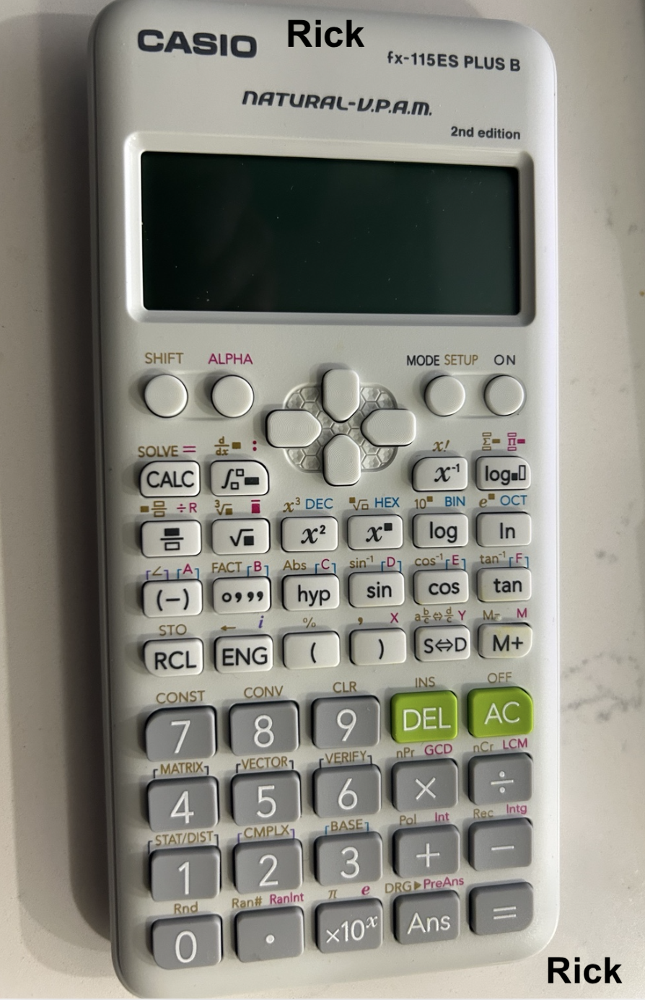{fig-alt="Casio Calculator" width="50%"}

In this post, We pick a Casio fx-115ES PLUS B, as a case study. 
It's because its a compact, affordable scientific calculator that performs surprisingly sophisticated mathematical operations using limited computing resources. Since my middle school days, I have fond memories of using Casio Calculators and Casio Watches. 
Both impressed deeply positive memoires in me and other middle schoolers at my school in Tirunelveli.  

{fig-alt="Casio Watch" width="50%"}

In the Casio watch model which I owned, you could look at different time-zones. 
I would frequently share the time in different countries with my friends. It was a fun way to learn about different countries and their time zones.
Morever, In some casio watches, you had a calculator within the Watch. 

One of my favorite physical activity in Middle school was swimming. I had a small bicycle, and I would ride all the way to Anna Stadium, Tirunelveli.
I was about 13 years old. At school, I enjoyed swimming by middle school. My swimming classes were held usually on afternoon by 4 p.m. 
In late middle school, my classmates and I would all find Swimming class as our favorite class. 

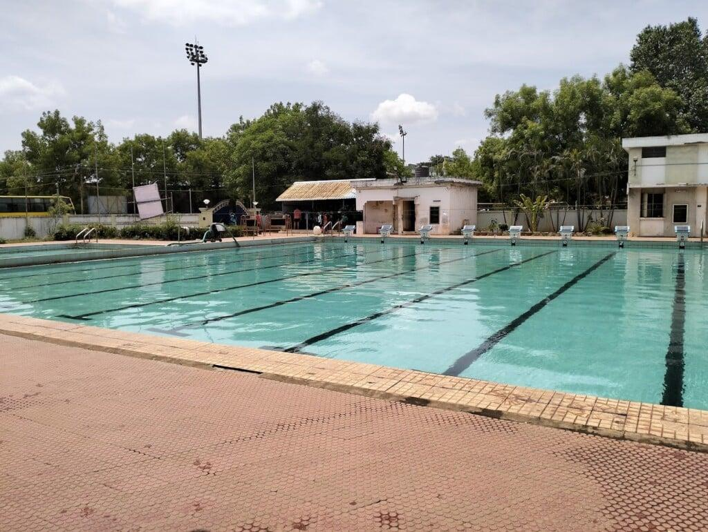{#fig-anna-stadium fig-alt="Swimming pool at Anna Stadium in Tirunelveli" width="75%" fig-align="center"}

My classmates at that age were Muthu Saranji, Praveen, Charanjith Raja, Shah Rukh and Girls like Indira, her sister Abirami, Subitha, Aarthy. 
It was one of the happiest times of my life, and as well for my classmates. We all would jump inside the swimming pool, and after swimming, we would all go to the nearby shop to eat some Samosa and drink some cold drinks. 

{#fig-childhood-swimming width="70%" fig-align="center"}

Even in the midst of such happiness, fun and joy, the Casio Watch would remain firmly on our wrists and not break, stop working. At times, the many of my classmates watches got water internally and stopped working. 
There were many instances, A watchmaker would open it up and repair it. Throughout late middle school and high school, Some of my friends in class loved the calculator so much; That they would create their own games and play by guessing numbers. 

However, it never occurred to me or rest of my classmates, what might it take to build the same one? 
We were all happy to use it, and we never thought about how it was built.
Everyone loved both the Casio Watches & the Calculator. 

The Tamil middle--high-school curriculum focused on creating repeating skills like a parrot, rather than technical product building skills? 
Twelve years of school in Tirunelveli, being forced to memorize pointless esoteric facts, and regurgitate into final exams. The top regurgitators get to make it in the Education-System, and are called Doctors in Tamil Nadu. 

I discussed this problem earlier in my [Digital LED Clock article — Education of Tamils](https://rickrejeleene.me/Tamil/posts/2026-10-18-LedClock/#education-of-tamils)

And not one throughout my middle school and high school classes, asked two important questions, which is highly relevant to modern world:

a. How is this calculator built? 
b. How does the theory gets deployed into a Consumer Application?

Rote-Learning Examination in India. It is a test of rote memorization. This education system, which I and millions of other students in India have gone through has wasted our time and energy, and has not taught us how to build things. It has not taught us how to think critically, how to solve problems, how to innovate, how to create. It has not taught us how to be engineers, scientists, or entrepreneurs. It has not taught us how to be human.

An Exam hall from Indian School. 
{#fig-examination width="75%" fig-align="center"}

A Middle School in America learning how to solder, a practical skill. 
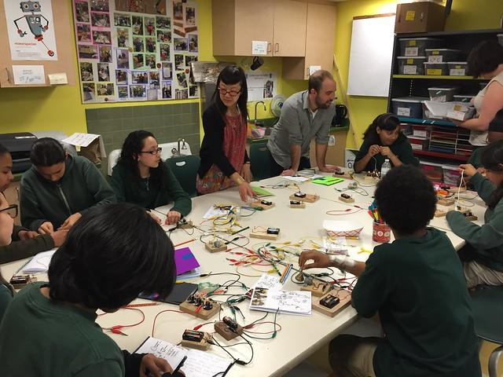{#fig-school-electronics width="85%" fig-align="center"}


# 2 Casio's Product Story

Well, It never occurred to me or my friends to ask what it would take to build one living in Tirunelveli. 

However, It occurred to Tadao Kashio, one of the founders of Casio.
Casio was established as Kashio Seisakujo in April 1946 by Tadao Kashio (1917–1993), an engineer specializing in fabrication technology. 
His first major product was the yubiwa pipe, a finger ring holding a cigarette so the wearer's hands stayed free, a hit in impoverished postwar Japan. 

In a country rebuilding from the devastation of World War II, practical ingenuity found a market. The success of the Yubiwa Pipe helped finance the Kashio brothers' ambitions, eventually leading to the development of the Casio 14A, an innovative relay-based electric calculator introduced in 1957. Over the following decades, Casio continued advancing electronic miniaturization, making calculators smaller, more affordable, and accessible to ordinary consumers. 

Having mastered the engineering required to fit complex calculations into increasingly compact electronic devices, Casio recognized another opportunity: bringing the same expertise in miniaturized electronics to something people carried every day, the wristwatch. In 1974, Casio introduced the CASIOTRON, the world's first digital wristwatch with an automatic calendar function, marking its entry into the watch industry. The iconic F-91W[@gearpatrol_f91w_2024] followed in 1989, becoming one of the world's most popular and enduring digital wristwatches, with widely cited estimates of approximately three million units produced annually[@casio_integrated_report_2025].

# 3 Sales Figures: Engineering into Commercial Success

And what happens, When we see engineering ingenuity mastered into a beautiful, affordable consumer products? 

Dollars. Numbers. Billions of units sold[@casio_revenue_history]. 

The iconic Casio F-91W, introduced in 1989, is estimated to have sold over 100 million units, with approximately 3 million watches produced annually, although Casio has not publicly confirmed these figures[@casio_calculator_sales_2025].

The G-SHOCK line[@casio_gshock_2017] achieved a verified milestone of 100 million units shipped worldwide by August 2017[@casio_gshock_2023], subsequently exceeding 140 million units by 2023[@esquire_f91w_2025]. Casio's calculator business achieved an even more remarkable scale. As of January 2025, the company reported 1.8 billion calculators sold worldwide across its product lines over approximately 60 years. Aggregating from available public data from 2009-2023, the annual revenues roughly come around, approximately close to $50 billion USD. 

Somewhere in Tamil Nadu, one of those 1.8 billion Casio calculators sat on a school desk. We learned to use it, admired its capabilities, and relied on it for years. Yet, how many of us ever seriously wondered what it would take to build one ourselves?

# 4 Inside the Casio Calculator

I opened a Casio fx-115ES PLUS B (2nd edition), to examine its internal construction and understand how its electronic components support mathematical computation.

Inside the calculator, we can identify three major components: a single AAA battery, a liquid crystal display (LCD) assembly, and a printed circuit board (PCB).

The opened calculator reveals several additional features, including battery terminals, the LCD connection region, small electronic components, and a black epoxy-covered region near the center of the PCB. This black region likely protects the calculator's main integrated circuit, which is responsible for processing user inputs and executing mathematical operations.

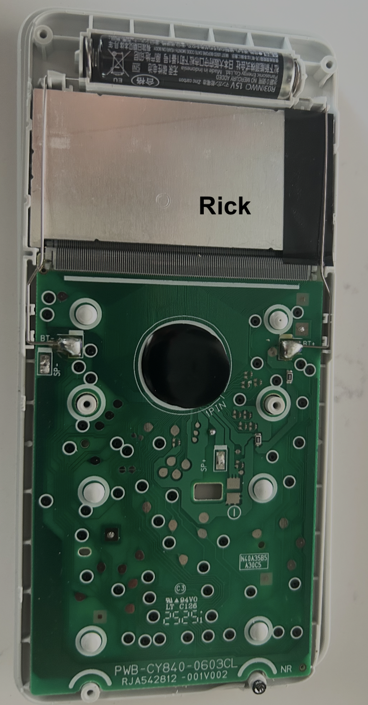{#fig-casio-opened width="45%" fig-align="center"}

As in earlier tutorials, We have seen PCB. The PCB is the green board that mechanically supports and electrically connects the components. 
Fine copper pathways, called traces, carry electrical signals between different parts of the circuit.

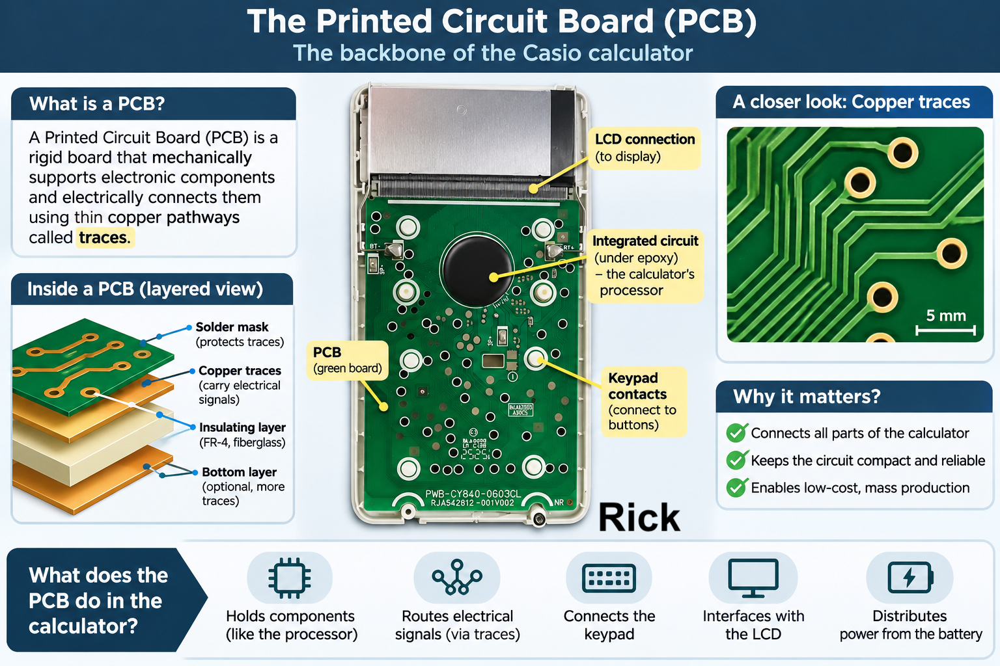{#fig-casio-pcb width="100%" fig-align="center"}

At the center of the PCB is a circular black protective covering, consistent with a chip-on-board integrated circuit. 
Beneath this covering is the semiconductor circuitry responsible for executing the calculator's firmware and mathematical operations.

Along the upper edge of the PCB, numerous closely spaced conductive connections provide an electrical interface to the LCD. 
Across the rest of the board, contact locations connect the physical keypad to the calculator's electronic circuitry. 
The device performs hundreds of mathematical functions, its visible internal construction is remarkably compact.

## 4.1 The Electronic Architecture

At the center of our Casio fx-115ES PLUS B's PCB is a black epoxy-covered region, likely protecting a semiconductor chip mounted directly onto the board. This construction is known as Chip-on-Board (COB) packaging. Beneath the protective epoxy, the silicon chip contains microscopic transistors organized into circuits that process inputs, execute instructions, perform mathematical calculations, and control the display.

Research on related Casio scientific calculators identifies the OKI/LAPIS ML610901 microcontroller, based on the 8-bit nX-U8/100 RISC (Reduced Instruction Set Computer) architecture. RISC architectures employ relatively simple machine instructions designed for efficient execution. The nX-U8/100 processor uses a three-stage instruction pipeline and incorporates an Arithmetic Logic Unit (ALU), registers, an instruction decoder, a Program Counter (PC), and a Stack Pointer (SP).

The ML610901 integrates this processor with 96 KB of Read-Only Memory (ROM) for program storage, 3,584 bytes of Random Access Memory (RAM) for temporary calculations, keypad input/output circuitry, timers, clock-generation circuitry, and an LCD controller. These components communicate through internal buses, enabling the microcontroller to function as a compact, low-power computing system.

The following diagram illustrates the documented ML610901 architecture, providing a reference for understanding the computing circuitry that may exist beneath the black epoxy covering in our calculator. However, the exact microcontroller used in the Casio fx-115ES PLUS B (2nd edition) has not been independently verified.

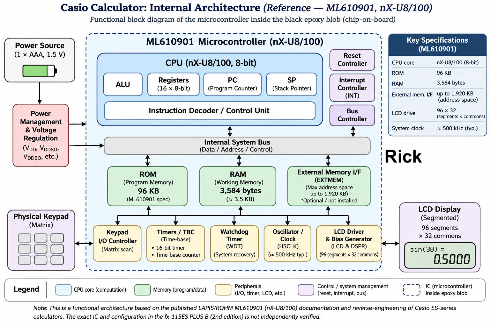{#fig-casio-architecture width="100%" fig-align="center"}

The basic architecture is, Battery gives Power distribution, that is then, transferred to Main IC, which controls or receives input from Keypad and results are displayed in LCD. More precisely, the battery powers the circuit, the keypad sends input signals to the IC, and the IC processes these inputs and controls the LCD.

## 4.2 The Microcontroller

The microcontroller executes a program stored in ROM, commonly called firmware. In related Casio scientific calculators using the nX-U8/100 architecture, this firmware can be implemented using C and assembly language, which are translated into machine instructions understood by the processor.

For example, the assembly instructions MOV R0, #25, MOV R1, #12, and ADD R0, R1 load two values into CPU registers and instruct the Arithmetic Logic Unit (ALU) to add them, producing 37. Each instruction is represented by a binary encoding that the CPU retrieves from memory, decodes, and executes.

The calculator's firmware combines such elementary instructions into more complex algorithms for arithmetic, trigonometry, logarithms, and numerical calculations. The exact firmware of our fx-115ES PLUS B has not been recovered or examined here, so this example illustrates the documented processor architecture rather than its verified internal program.

## 4.3 The Liquid Crystal Display

The Liquid Crystal Display (LCD) presents numbers, mathematical expressions, and calculation results.

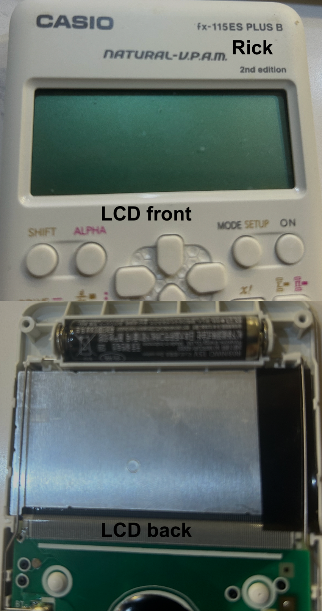{#fig-casio-lcd width="40%" fig-align="center"}

Unlike Light Emitting Diodes (LEDs), which generate light, the calculator's reflective LCD uses ambient light to make information visible. The display consists of liquid crystal material positioned between transparent electrodes and polarizing layers. Applying an electric field changes the optical behavior of the liquid crystals, allowing selected pixels to appear dark or light. 

The microcontroller's LCD controller generates electrical signals that activate the required pixels. These signals travel through conductive traces on the PCB and through the closely spaced connections between the circuit board and LCD assembly. The LCD is driven using alternating voltage waveforms, which help prevent damage to the liquid crystal material.

For example, when the processor calculates (25 + 12 = 37), the display controller activates the pixels forming the characters 3 and 7. Thus, the LCD converts electrical control signals into visible mathematical information

## 4.4 The Keypad and Input Circuit

The calculator's buttons operate electrical contacts on the PCB. 
Pressing a button allows a conductive rubber pad to bridge corresponding contacts, creating an electrical connection.

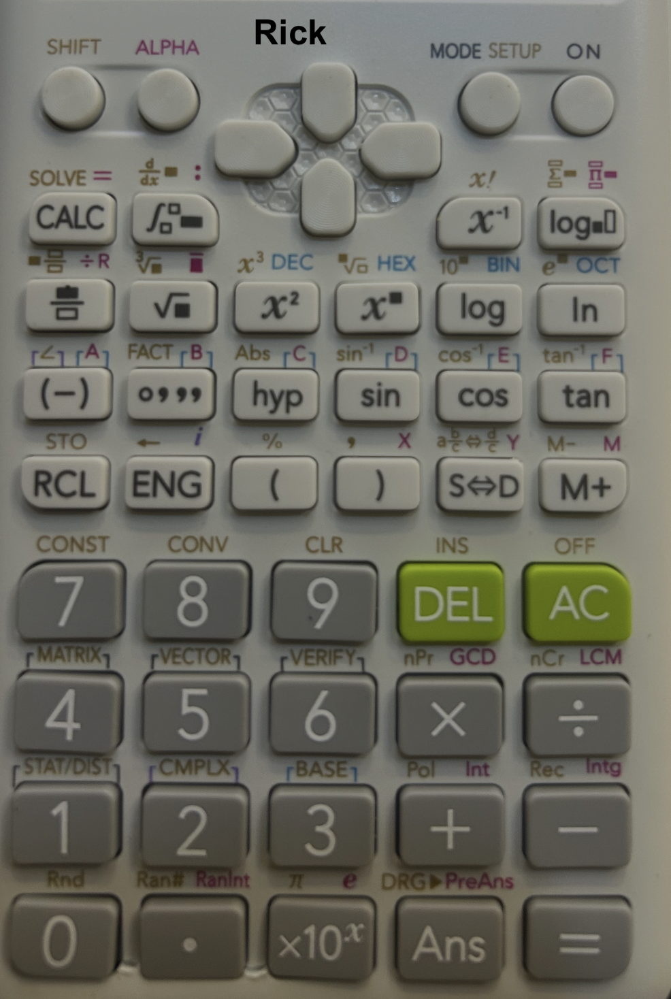{#fig-casio-keypad width="60%" fig-align="left"}

Calculator keypads commonly use a matrix architecture, organizing buttons into rows and columns to minimize the number of electrical connections.

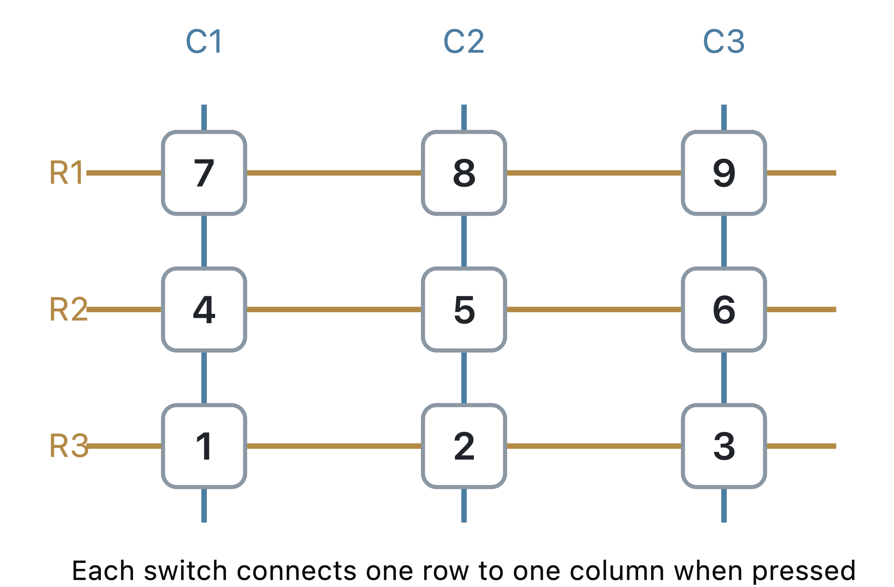{#fig-casio-keypad-matrix width="60%" fig-align="left"}

The processing circuitry scans these connections to determine which key was pressed. For example, in the illustrated matrix, pressing `2` connects row R3 to column C2. The microcontroller identifies the pressed key by detecting this electrical connection.

For example, pressing `2 + 3 =` produces a sequence of electrical inputs. The firmware interprets the expression, calculates the result, and instructs the LCD to display `5`.

## 4.5 Memory and Power Management

The Casio fx-115ES PLUS B requires memory to store numerical inputs, mathematical expressions, intermediate calculations, variables, and results. Its memory system can be understood in terms of **program memory**, which holds the calculator's firmware, and **working memory**, which stores information needed during calculations.

The firmware contains instructions for interpreting keyboard inputs, evaluating mathematical expressions, performing arithmetic operations, and executing numerical algorithms. Working memory holds temporary values and computational state while these instructions are executed. Although these functions require internal storage, Casio does not publicly specify the exact ROM and RAM capacities or memory technologies used in this model.

Casio documents several user-accessible memory functions:

- **Answer Memory (Ans):** Stores the most recent calculation result.
- **Previous Answer Memory (PreAns):** Stores the result preceding the most recent calculation. It is available in COMP mode.
- **Variable Memory:** Provides nine predefined variables: A, B, C, D, E, F, M, X, and Y.
- **Independent Memory (M):** Allows calculation results to be added to or subtracted from a stored value.

These are logical memory functions exposed to the user, rather than evidence of separate physical memory chips.

According to Casio's documentation, Ans, independent memory, and variable values are retained when the calculator is turned off normally. PreAns is also retained when turning off the calculator without leaving COMP mode. However, removing or replacing the battery clears the calculator's stored memory contents.

The Casio fx-115ES PLUS B is powered by a single **1.5 V AAA battery (R03/UM-4)**. The battery supplies electrical energy through terminals labeled BT+ and BT− on the printed circuit board.

According to Casio's specifications, the calculator's rated power consumption is approximately **0.0002 W (0.2 mW)**, with an estimated battery life of **two years**, assuming one hour of operation per day.

Electrical power is expressed as:

$$
P = VI
$$

where $P$ is power in watts, $V$ is voltage in volts, and $I$ is current in amperes.

Using the rated power consumption and nominal battery voltage, we can estimate the corresponding current:

$$
I = \frac{P}{V}
  = \frac{0.0002}{1.5}
  \approx 0.000133\ \text{A}
$$

This corresponds to approximately **133 µA** under the assumed operating conditions. It is a calculated estimate, not a direct measurement of the calculator's current consumption.

The calculator also provides an automatic power-off function to limit unnecessary battery consumption.

Low-power integrated-circuit design and power management allow the calculator to operate for extended periods using a single battery. However, the specific internal clock-management and power-saving mechanisms implemented in its semiconductor chip have not been independently verified.

Together, these components form a compact embedded computing system. The PCB provides electrical connections, the integrated circuit executes calculations and controls peripherals, memory maintains program and calculation state, the keypad provides user input, and the LCD displays mathematical expressions and results.

# 5 How Does the Calculator Perform Mathematics?

It's important to realize, the Calculator does not understand Mathematics.
It does not understand concepts such as logarithms, trigonometry, derivatives, or integrals.
What the calculator does is that it executes machine translated code instructions that implement numerical algorithms stored in firmware. 

## 5.1 Number Representation and Precision

The Casio fx-115ES PLUS B performs numerical calculations using up to 15 significant decimal digits internally. 
The displayed results generally has only approximately 10-digit precision.

For example, consider:

$$
\frac{10}{3}=3.33333333333333\ldots
$$

According to Casio's documentation, the calculator retains the approximate value

$$
3.33333333333333
$$

internally, even when the display is configured to show only three decimal places:

$$
3.333
$$

This distinction between internal precision and displayed precision allows the calculator to retain additional digits during successive calculations, reducing the accumulation of rounding errors.

The calculator supports numerical values ranging approximately from

$$
\pm 1\times10^{-99}
\quad\text{to}\quad
\pm 9.999999999\times10^{99}
$$

as well as zero.

Casio calculators identifies an 8-bit RISC processor, this does not restrict calculations to 8-bit numerical values. 
The firmware can store and manipulate larger numbers across multiple bytes of memory. Casio's documentation establishes the numerical precision and calculation range, but does not disclose the exact internal encoding used to store these numbers.

## 5.2 Arithmetic Operations

The Casio fx-115ES PLUS B performs arithmetic using numerical routines executed by its processor. Research on related Casio fx-ES PLUS firmware indicates that numerical values can be represented using Binary-Coded Decimal (BCD), where each decimal digit is encoded using four bits.

Consider:

$$
25 + 12 \times 3 = 61
$$

A plausible execution sequence is:

| Step | Operation | What happens internally |
|---|---|---|
| 1 | Read input | Store `25`, `12`, `3`, and their operators |
| 2 | Parse expression | Identify multiplication as having higher precedence |
| 3 | Load operands | Retrieve the internal representations of 12 and 3 |
| 4 | Multiply | Apply digit-wise multiplication, accumulate partial products, and handle carries |
| 5 | Intermediate result | Store 36 in a register or working memory |
| 6 | Add | Align the numerical representations, add 25 and 36, and propagate carries |
| 7 | Format | Convert the numerical result into display characters |
| 8 | Output | LCD displays `61` |

For example, in BCD, the number 25 is represented as:

$$
25_{\mathrm{BCD}} = 0010\ 0101
$$

Unlike ordinary binary representation, each four-bit group represents one decimal digit.

The actual processor may execute several machine instructions for each arithmetic operation, particularly when the operands exceed the capacity of an individual 8-bit register.

This digit-wise BCD implementation is a plausible reconstruction based on related Casio firmware, rather than a verified instruction trace from our B-model calculator.

## 5.3 Trigonometric and Logarithmic Functions

Trigonometric and logarithmic functions require more elaborate numerical algorithms. The calculator approximates these functions using combinations of arithmetic operations.

### Trigonometric Functions

Consider:

$$
\sin(30^\circ) = 0.5
$$

One possible implementation is to convert the input into radians, reduce the angle to a convenient interval, and evaluate a polynomial approximation.

For example, the Taylor series for sine is:

$$
\sin(x) =
x-\frac{x^3}{3!}+\frac{x^5}{5!}
-\frac{x^7}{7!}+\cdots
$$

A possible computational sequence is:

| Step | Operation | What happens internally |
|---|---|---|
| 1 | Input | Read `sin(30)` |
| 2 | Check angle mode | Determine that the angle is in degrees |
| 3 | Convert | Calculate $x=30\pi/180=\pi/6$ |
| 4 | Reduce angle | Transform the argument into a convenient interval, if necessary |
| 5 | Approximate | Evaluate a polynomial or another numerical approximation |
| 6 | Round | Format the result according to calculator precision |
| 7 | Display | Show `0.5` |

Evaluating the first four nonzero Taylor terms at $x=\pi/6$ gives approximately $0.4999999919$. Additional terms improve the approximation.

The Taylor series illustrates how the computation could be performed. It does not establish that Casio uses this particular approximation.

### Logarithmic Functions

Consider:

$$
\log_{10}(200)=2.30102999566\ldots
$$

A possible implementation separates the power of ten and approximates the remaining logarithm.

$$
200=2\times10^2
$$

Therefore:

$$
\log_{10}(200)
=2+\frac{\ln(2)}{\ln(10)}
$$

A convergent series for the natural logarithm is:

$$
\ln(x)=2\sum_{n=0}^{\infty}
\frac{z^{2n+1}}{2n+1},
\qquad
z=\frac{x-1}{x+1}
$$

For $x=2$, we obtain $z=1/3$.

| Step | Operation | What happens internally |
|---|---|---|
| 1 | Input | Read `log(200)` |
| 2 | Normalize | Express 200 as $2\times10^2$ |
| 3 | Approximate | Compute $\ln(2)$ using a numerical approximation |
| 4 | Scale | Divide by the constant $\ln(10)$ |
| 5 | Adjust exponent | Add 2 |
| 6 | Output | Display approximately `2.301029996` |

This is one mathematically valid implementation. Casio may instead use a different polynomial, lookup-table technique, or digit-oriented algorithm. The exact implementation has not been established.

## 5.5 Numerical Differentiation

Casio documents the central difference method for numerical differentiation.

$$
f'(x)\approx\frac{f(x+h)-f(x-h)}{2h}
$$

Consider differentiating $f(x)=x^2$ at $x=3$. We choose $h=0.01$ for illustration.

| Step | Operation | Result |
|---|---|---|
| 1 | Read expression | $f(x)=x^2$ |
| 2 | Read point | $x=3$ |
| 3 | Choose step | $h=0.01$, illustrative |
| 4 | Evaluate first point | $f(3.01)=9.0601$ |
| 5 | Evaluate second point | $f(2.99)=8.9401$ |
| 6 | Subtract | $9.0601-8.9401=0.12$ |
| 7 | Divide | $0.12/0.02=6$ |
| 8 | Display | `6` |

The firmware can evaluate the mathematical expression at two nearby values without symbolically differentiating it.

The precise step-selection procedure in our calculator has not been verified.

## 5.6 Numerical Integration

Casio documents the Gauss–Kronrod method for numerical integration.

Consider:

$$
\int_0^1 x^2\,dx=\frac{1}{3}
$$

The method approximates an integral using carefully selected points and numerical weights:

$$
I\approx\sum_{i=1}^{n}w_i f(x_i)
$$

An embedded Gauss–Kronrod pair produces two estimates that can be compared to assess numerical error.

| Step | Operation | What happens internally |
|---|---|---|
| 1 | Read function | $f(x)=x^2$ |
| 2 | Read limits | $a=0,\ b=1$ |
| 3 | Select nodes | Obtain quadrature points and weights |
| 4 | Evaluate | Compute $f(x_i)$ at selected points |
| 5 | Weighted sum | Multiply function values by their weights and accumulate |
| 6 | Error estimate | Compare Gauss and Kronrod approximations |
| 7 | Refine | If needed, subdivide the interval and repeat |
| 8 | Output | Approximately `0.3333333333` |

For this simple polynomial, an appropriate Gauss–Kronrod rule can integrate the function exactly in ideal arithmetic. Actual calculator results remain subject to finite precision and formatting.

The adaptive refinement step is a plausible implementation, but Casio does not disclose the precise quadrature pair or subdivision procedure used in this model.

## 5.7 Equation Solving

Casio documents Newton's method for its SOLVE function.

$$
x_{n+1}=x_n-\frac{f(x_n)}{f'(x_n)}
$$

Consider solving:

$$
x^2-2=0
$$

Starting with $x_0=1.5$, the mathematical iteration becomes:

$$
x_{n+1}=\frac12\left(x_n+\frac{2}{x_n}\right)
$$

| Iteration | Current estimate | Next estimate |
|---|---:|---:|
| 0 | 1.500000000 | 1.416666667 |
| 1 | 1.416666667 | 1.414215686 |
| 2 | 1.414215686 | 1.414213562 |
| 3 | 1.414213562 | 1.414213562 |

A plausible firmware implementation repeatedly evaluates the equation, estimates or calculates the derivative, computes the Newton correction, updates the current estimate, and checks whether the solution has converged.

The table demonstrates Newton's method using the analytically known derivative $f'(x)=2x$. It does not establish that Casio symbolically differentiates the expression or follows these exact intermediate values.

The calculator may use numerical derivative estimates and additional convergence safeguards, but those implementation details remain unverified.

## 5.8 Required Electronic Components

A scientific calculator can be constructed using commercially available electronic components. There is no need to manufacture the microprocessor, display, or individual electronic components. Instead, the primary engineering challenge is to integrate these components into a functional device and develop firmware capable of performing mathematical operations.

For an initial prototype, we can use the **Raspberry Pi Pico 2**, a low-cost microcontroller development board. It provides processing capabilities, memory, and general-purpose input/output (GPIO) connections for interfacing with a display and keyboard.

### 5.8.1 Bill of Materials

The following table presents an illustrative bill of materials (BOM) for a basic calculator prototype.

| Component | Quantity | Function | Estimated Cost (USD) |
|---|---:|---|---:|
| Raspberry Pi Pico 2 | 1 | Executes the calculator firmware | $5–$8 |
| 4 × 4 matrix keypad | 1 | Provides 16 physical input keys | $3–$10 |
| 128 × 64 OLED display | 1 | Displays mathematical expressions and results | $5–$20 |
| Breadboard | 1 | Supports temporary electrical connections | $5–$10 |
| Jumper wires | 1 set | Connects electronic components | $3–$8 |
| USB cable | 1 | Supplies power and supports programming | $3–$7 |
| Resistors and capacitors | 1 assortment | Supports circuit development | $3–$10 |
| Battery holder and power circuitry | 1 set | Enables portable operation in a later revision | $5–$15 |
| **Estimated total** | | | **$32–$88** |

*Note: These are approximate retail estimates for planning purposes, not supplier quotations. The initial prototype can operate over USB without a separate battery supply. A practical beginner's budget is approximately $40–$100, allowing for miscellaneous supplies.*

A 16-key matrix keypad is sufficient for a basic calculator. However, a scientific calculator requires additional functionality, including trigonometric functions, logarithms, powers, square roots, and numerical methods.

These functions can be accessed using a shift key or by designing a larger keyboard.

### 5.8.2 Component Suppliers

Several established distributors provide electronic components suitable for prototyping:

- [Raspberry Pi — Pico 2](https://www.raspberrypi.com/products/raspberry-pi-pico-2/)
- [DigiKey Electronics](https://www.digikey.com/)
- [Mouser Electronics](https://www.mouser.com/)
- [Adafruit Industries](https://www.adafruit.com/)

The availability of standardized electronic components significantly reduces the cost and technical complexity of hardware development.

The primary tasks are component selection, circuit integration, firmware development, and testing.

## 5.9 Implementing Mathematical Functions

The microcontroller executes instructions stored in its firmware. To function as a scientific calculator, the firmware must interpret keyboard inputs, evaluate mathematical expressions, and display results.

A simplified calculator software architecture consists of five components:

1. **Input processing:** Detecting keyboard inputs and identifying selected operations.
2. **Expression parsing:** Interpreting mathematical expressions, parentheses, operators, and functions.
3. **Numerical computation:** Executing arithmetic and mathematical algorithms.
4. **Result formatting:** Converting numerical outputs into readable decimal or scientific notation.
5. **Display management:** Presenting expressions, results, and error messages.

For example, consider:

$$
\sin(30^\circ)+\sqrt{16}=4.5
$$

The firmware must identify the mathematical operations, convert the angle into radians when required, evaluate the functions, and format the numerical result.

### 5.9.1 Implementing Mathematical Operations in C

The C standard library provides mathematical functions such as `sin()`, `cos()`, `log()`, `pow()`, and `sqrt()`.

The following example demonstrates a basic mathematical computation:

```c
#include <math.h>
#include <stdio.h>

#define PI 3.14159265358979323846

int main(void) {
    double angle = 30.0;
    double radians = angle * PI / 180.0;

    double result = sin(radians) + sqrt(16.0);

    printf("Result: %.10f\n", result);

    return 0;
}
```

Expected output:

```text
Result: 4.5000000000
```

This program demonstrates mathematical computation on a general-purpose computer. To execute the same calculation on a microcontroller, the software must be adapted to its development environment and connected to keypad and display drivers.

A fully functioning scientific calculator must also evaluate nested expressions, such as:

$$
\frac{\sqrt{25}+\log_{10}(100)}{\sin(30^\circ)}
$$

An expression parser is required to preserve operator precedence, process parentheses, and evaluate mathematical functions in the correct sequence.

### 5.9.2 Numerical Accuracy and Limitations

Implementing mathematical functions is only part of the problem. A scientific calculator must also produce sufficiently accurate and reproducible results.

Important considerations include:

- Floating-point representation and rounding.
- Overflow and underflow.
- Division by zero and mathematical domain errors.
- Trigonometric function accuracy.
- Numerical differentiation and integration.
- Equation solving and root-finding algorithms.

For example:

$$
0.1+0.2
$$

cannot generally be represented exactly using binary floating-point arithmetic.

This occurs because many decimal fractions do not have finite binary representations.

Commercial scientific calculators may employ different numerical representations, precision-management strategies, and mathematical algorithms.

Therefore, using a standard mathematical library does not necessarily reproduce the behavior of a commercial Casio calculator.

An interesting experiment would be to implement identical mathematical functions on a custom calculator and compare the numerical results against those produced by the Casio fx-115ES PLUS B.

## 5.10 Building a Working Prototype

A working calculator prototype can be developed using inexpensive components and commonly available engineering tools.

The initial objective should not be to reproduce every feature of a commercial scientific calculator. Instead, it should be to construct a functioning device that accepts mathematical inputs, evaluates expressions, and displays results.

### 5.10.1 Existing Projects and Tutorials

Several publicly documented calculator projects provide useful starting points.

| Project | Main Learning Objective | Difficulty |
|---|---|---|
| [SunFounder Arduino Calculator](https://docs.sunfounder.com/projects/summary-of-fun-projects/en/latest/arduino/calculator.html) | Keypad interfacing, display control, basic arithmetic | Beginner |
| [All About Circuits — Arduino Calculator](https://www.allaboutcircuits.com/projects/simple-arduino-based-calculator/) | Circuit assembly and calculator programming | Beginner |
| [PiCalc — Raspberry Pi Pico Calculator](https://www.instructables.com/PiCalc-Raspberry-Pi-Pico-Based-Pocked-Calculator/) | Handheld calculator construction using a Pico | Intermediate |
| [Delta Pico](https://github.com/AaronC81/delta-pico) | Scientific calculator firmware and design | Intermediate–Advanced |
| [OpenRPNCalc](https://github.com/apoluekt/OpenRPNCalc) | Open-source scientific calculator hardware and software | Advanced |
| [KiCad Documentation](https://docs.kicad.org/master/en/getting_started_in_kicad/getting_started_in_kicad.html) | PCB schematic capture and layout | Intermediate |

These projects demonstrate different levels of engineering complexity.

The Arduino examples are suitable for understanding basic electronic interfaces and arithmetic functions, while more advanced open-source calculators are useful references for scientific functionality and custom hardware design. Project documentation, code, and licensing terms should be examined before adapting an existing design for commercial applications.

### 5.10.2 Prototype Development Process

The development process can be divided into five stages.

**Stage 1: Construct the circuit**

Connect the microcontroller, keypad, and display using a breadboard.
The keypad interfaces with GPIO pins, while the display may use a serial communication interface such as I²C.

Initially, the circuit can be powered through USB.
The first objective is to verify that the microcontroller correctly identifies key presses and displays the corresponding characters.

**Stage 2: Develop calculator firmware**

Implement basic arithmetic operations:

$$
+, \quad -, \quad \times, \quad \div
$$

Then extend the firmware to support decimal numbers, negative values, parentheses, and operator precedence.

For example:

$$
25+12\times3=61
$$

This stage also requires implementing input validation and error handling.

**Stage 3: Implement scientific functions**

Introduce trigonometric functions, logarithms, powers, roots, and other mathematical operations.
Develop test cases to verify numerical accuracy and identify computational limitations.

**Stage 4: Design and manufacture a custom PCB**

Once the breadboard prototype functions reliably, the circuit can be transferred to a printed circuit board.
Using KiCad, the engineer creates the schematic, selects component footprints, arranges components, and routes electrical connections.

The resulting manufacturing files can be submitted to a PCB supplier.

Examples include:

- [JLCPCB](https://jlcpcb.com/)
- [PCBWay](https://www.pcbway.com/)

PCB fabrication produces the bare circuit board. PCB assembly involves installing and soldering the electronic components.

Both services may be outsourced.

**Stage 5: Design and assemble the enclosure**

A mechanical enclosure can be designed using computer-aided design (CAD) software.
For prototypes, 3D printing provides an accessible manufacturing method.

The enclosure must accommodate the PCB, display, keyboard, and battery compartment while maintaining suitable mechanical tolerances.

### 5.10.4 Required Engineering Skills

| Engineering Area | Required Skills | Importance |
|---|---|---|
| Programming | C/C++, debugging, data structures | Essential |
| Electronics | Voltage, current, GPIO, circuit fundamentals | Essential |
| Embedded systems | Microcontroller programming, display and keypad interfaces | Essential |
| Numerical computing | Floating-point arithmetic and numerical algorithms | Essential for scientific functionality |
| PCB engineering | Circuit schematics, PCB layout, fabrication files | Required for custom PCB |
| Soldering | Component installation and electrical connections | Required for manual assembly |
| Mechanical engineering | CAD, dimensions, tolerances, enclosure design | Required for finished product |
| Manufacturing | Supplier selection, BOM management, quality control | Required for commercial production |

An individual with programming experience can construct a basic calculator while learning electronics and embedded systems.

A commercially reliable product, however, may require additional engineering expertise and manufacturing support.

### 5.11.1 Required Equipment

| Equipment | Quantity | Purpose | Estimated Cost |
|---|---:|---|---:|
| Computer | 1 | Firmware, CAD, and PCB design | Existing |
| Digital multimeter | 1 | Electrical measurements | $15–$40 |
| Soldering iron and accessories | 1 set | Component assembly | $25–$80 |
| Wire cutters and tweezers | 1 set | General assembly | $10–$30 |
| USB logic analyzer | 1 | Digital signal debugging | $10–$30 |
| Oscilloscope | Optional | Advanced electronic debugging | Varies |
| 3D printer | Optional | Enclosure prototyping | Varies |

For an initial breadboard prototype, a soldering iron and oscilloscope are not strictly necessary.

A practical starting equipment budget is approximately **$50–$150**, excluding the computer and electronic components.

Many public libraries, universities, and makerspaces also provide access to electronic tools and 3D printers.

### 5.11.2 Estimated Development Effort

| Development Activity | Estimated Effort |
|---|---:|
| Learn basic electronics and embedded programming | 10–25 hours |
| Connect keypad and display | 4–8 hours |
| Implement expression parsing and arithmetic | 10–25 hours |
| Implement and test scientific functions | 15–40 hours |
| Design the PCB | 10–25 hours |
| Design and assemble an enclosure | 8–20 hours |
| **Total estimated effort** | **57–133 hours** |

*Note: These are illustrative estimates for a relatively simple project, not empirically measured development times. They exclude supplier lead times and depend strongly on the developer's experience.*

A basic calculator can potentially be constructed over several weekends, while a polished scientific calculator with robust numerical algorithms and custom hardware requires substantially greater effort.

## 5.12 Manufacturing Costs and Commercialization

Constructing a single working prototype is fundamentally different from manufacturing a commercial electronic product.

Prototype development focuses on functionality and feasibility. Commercial manufacturing additionally requires reproducible assembly, component availability, quality assurance, regulatory compliance where applicable, and sustainable economics.

### 5.12.1 Manufacturing Cost Structure

A simplified cost model is:

$$
C_{\text{unit}} =
C_{\text{components}}
+
C_{\text{PCB}}
+
C_{\text{assembly}}
+
C_{\text{enclosure}}
+
C_{\text{testing}}
+
C_{\text{packaging}}
$$

Where:

- $C_{\text{components}}$: Electronic component costs.
- $C_{\text{PCB}}$: PCB fabrication costs.
- $C_{\text{assembly}}$: Component soldering and installation.
- $C_{\text{enclosure}}$: Mechanical housing and keypad manufacturing.
- $C_{\text{testing}}$: Functional testing and quality assurance.
- $C_{\text{packaging}}$: Packaging materials and preparation.

This model excludes fixed engineering and tooling expenses, shipping, certification, distribution, warranty, and other commercial costs.

### 5.12.2 Illustrative Production Costs

The following hypothetical scenario demonstrates how manufacturing cost may change with production volume.

| Cost Category | 100 Units | 1,000 Units |
|---|---:|---:|
| Electronic components | $12.00 | $8.00 |
| PCB fabrication | $3.00 | $1.50 |
| PCB assembly | $6.00 | $3.00 |
| Enclosure and keypad | $8.00 | $4.00 |
| Testing and final assembly | $5.00 | $2.50 |
| Packaging | $2.00 | $1.00 |
| **Variable cost per unit** | **$36.00** | **$20.00** |
| **Total variable production cost** | **$3,600** | **$20,000** |

*Note: These figures are hypothetical assumptions for illustrating manufacturing economics, not verified factory quotations. Actual costs require a completed engineering design and supplier quotations.*

The reduction in unit costs at larger volumes is partly explained by purchasing economies, more efficient assembly, and spreading certain setup expenses across additional units.

However, fixed expenses must also be considered separately.

### 5.12.3 Enclosure Manufacturing: 3D Printing vs. Injection Molding

For low-volume prototypes, 3D printing is a convenient manufacturing method.
For larger volumes, injection molding may reduce the unit cost but introduces an upfront tooling expense.

The cost of 3D printing can be represented as:

$$
C_{\text{3D}} = N c_{\text{3D}}
$$

Injection molding can be modeled as:

$$
C_{\text{molding}} = F + N c_{\text{molding}}
$$

Where:

- $N$: Number of enclosures produced.
- $F$: Fixed tooling expense.
- $c_{\text{3D}}$: Cost per 3D-printed enclosure.
- $c_{\text{molding}}$: Variable cost per molded enclosure.

Assume the following illustrative values:

| Parameter | Hypothetical Cost |
|---|---:|
| 3D printing per enclosure | $12 |
| Injection mold tooling | $5,000 |
| Injection molding per enclosure | $2 |

The break-even production quantity is:

$$
N =
\frac{F}{c_{\text{3D}}-c_{\text{molding}}}
$$

$$
N =
\frac{5000}{12-2}
=
500
$$

Under these assumptions, injection molding becomes less expensive than 3D printing above approximately 500 units.

Actual break-even quantities depend on component geometry, materials, mold design, production yield, and supplier pricing.

### 5.12.4 Commercial Feasibility

Manufacturing a calculator is technically feasible, but building a profitable calculator business is a separate challenge.

A product must provide sufficient value to customers while covering development, manufacturing, and distribution expenses.

Consider a hypothetical calculator with:

- Selling price: $50.
- Variable cost per unit: $20.
- Fixed development and tooling expenses: $15,000.

The contribution margin per unit is:

$$
M = P - C
$$

$$
M = 50 - 20 = \$30
$$

The break-even production volume is:

$$
N_{\text{break-even}} =
\frac{C_{\text{fixed}}}{M}
$$

$$
N_{\text{break-even}} =
\frac{15000}{30}
=
500 \text{ units}
$$

Under these simplified assumptions, selling 500 units would recover the fixed development and tooling expenses.

However, this calculation excludes additional selling expenses, payment processing fees, taxes, distribution costs, returns, and warranty support.

### 5.12.5 Opportunities for Differentiation

Commercial scientific calculators are already widely available, and established manufacturers benefit from mature engineering designs, production scale, and distribution networks.

A new manufacturer would therefore need to identify a meaningful product advantage.

Potential directions include:

1. **Open-source scientific calculator:** A programmable device with openly documented hardware and mathematical algorithms.
2. **Educational calculator:** A calculator that reveals intermediate computational steps and explains numerical methods.
3. **Research-oriented calculator:** A portable device for experimenting with numerical algorithms and precision.
4. **Specialized technical calculator:** A device designed around the mathematical requirements of a particular engineering or scientific application.

These are potential product concepts, not evidence of established market demand.

Their commercial feasibility would require customer research, prototype evaluation, and willingness-to-pay studies.

### 5.12.6 Conclusion

Building a scientific calculator illustrates how multiple engineering disciplines contribute to the development of an electronic product.
A functional prototype can be constructed with inexpensive electronic components, openly available software, and basic laboratory equipment.

However, producing a reliable commercial product requires additional expertise in electronics, embedded software, mechanical design, manufacturing, quality assurance, and business economics. The most useful next step would be to construct a working prototype, document its actual development costs, evaluate its numerical performance, and investigate the feasibility of manufacturing the design at larger volumes.

# 6 What Should Engineering Education Teach Us?

When I was in middle school in Tirunelveli, my classmates and I enjoyed using Casio calculators and watches. We admired their capabilities, but rarely asked how these devices were designed, manufactured, or brought to market.

Years later, opening a Casio fx-115ES PLUS B and examining its internal construction raises a question: What should a student learn from a scientific calculator beyond how to operate it?

A scientific calculator is the result of several disciplines working together: mathematics, computer science, electronics, mechanical engineering, manufacturing, and business.

Throughout this investigation, we have seen how mathematical algorithms become machine instructions, how a microcontroller executes computations, how a keypad communicates with the processor, and how an LCD displays results.

We have also considered what would be required to build a working prototype and eventually manufacture a commercial product.

## 6.1 From Learning Mathematics to Implementing Mathematics

In school, we learn arithmetic, trigonometry, differentiation, and integration. These subjects are essential, but learning mathematical procedures is different from implementing them in a computing device.

For example, a student might learn that:

$$
f'(x)=\lim_{h\to0}\frac{f(x+h)-f(x)}{h}
$$

But how does a calculator approximate this limiting process using finite memory and computation time?

Studying the central difference method allows students to connect the mathematical definition of a derivative to a numerical algorithm.

Similarly, implementing a numerical integration algorithm requires understanding approximation error, precision, computational cost, and convergence.

These questions help connect theoretical mathematics to practical computational engineering.

## 6.2 From Understanding Electronics to Building Electronics

Learning about transistors, resistors, microcontrollers, and digital circuits is valuable. However, for real world success, what we need is learn how to design a complete electronic product.

Consider what students would need to build a scientific calculator:

| Engineering discipline | What students could learn |
|---|---|
| Mathematics | Numerical methods, approximation, and error analysis |
| Computer Science | Algorithms, programming, data representation, and testing |
| Digital Electronics | Logic gates, registers, processors, and memory |
| Embedded Systems | Microcontroller programming and peripheral interfaces |
| Electrical Engineering | Circuit design, voltage, current, power consumption, and PCB design |
| Mechanical Engineering | Enclosure design, assembly, durability, and ergonomics |
| Manufacturing | Component sourcing, fabrication, assembly, and quality control |
| Economics and Business | Production costs, pricing, demand, and commercialization |

A multidisciplinary project would help students understand how individual subjects contribute to the development of a functioning product.

## 6.3 From Examinations to Engineering Projects

An examination can assess whether a student understands mathematical formulas or theoretical concepts. However, constructing a working device  requires skills which are difficult to evaluate through written examinations alone. Students must identify requirements, select components, implement software, troubleshoot failures, measure performance, and revise their designs.

A useful early high school or entry-level engineering curriculum could therefore combine theoretical instruction with practical projects.

| Traditional learning activity | Complementary practical activity |
|---|---|
| Learn arithmetic and algebra | Program arithmetic operations on a microcontroller |
| Study derivatives | Implement and test numerical differentiation |
| Study numerical integration | Compare numerical integration algorithms |
| Learn digital logic | Build and test a small digital circuit |
| Study electronic components | Assemble and debug a working PCB |
| Learn computer architecture | Program a microcontroller and inspect its memory usage |
| Study engineering economics | Estimate manufacturing costs and selling prices |
| Complete a written examination | Demonstrate a functioning prototype and document its limitations |

The objective is students learn how to apply theoretical knowledge to real engineering problems.


## 6.4 Engineering Also Requires Understanding Manufacturing and Markets

Designing a working prototype is an important achievement, but it does not automatically create a commercially successful product.

A manufacturer must consider component availability, production volume, assembly costs, reliability, quality assurance, distribution, pricing, and customer demand. Casio's history illustrates how engineering innovation can be transformed into products manufactured at enormous scale.

A student who builds a working calculator may gain an understanding of electronics and software. 
A student who also investigates manufacturing costs, suppliers, quality testing, and market requirements begins to understand the larger industrial process. These capabilities are important for developing independent engineering expertise and entrepreneurship.

## 6.5 Engineering Education in Tamil Nadu

My grievances about the education I experienced in Tamil Nadu is not that mathematics, physics, or examinations are unnecessary. 
They are important foundations. Rather, I believe there should be more opportunities for students to connect their theoretical knowledge to the design and construction of useful products. 

I would have benefited from learning how to solder a circuit, program a microcontroller, design a PCB, investigate manufacturing costs, and build a working electronic device during my school years.

A scientific calculator provides a useful example because it connects so many areas of engineering within a relatively small and affordable product.

Instead of asking students only to calculate an answer, we could also ask:

1. How does the calculator represent that number?
2. What algorithm does it use to compute the result?
3. How is that algorithm executed by its processor?
4. Could we design and build a device that performs the same operation?
5. What would it cost to manufacture, and would anyone purchase it?

These questions encourage students to investigate how scientific knowledge becomes functioning technology.

# 7 Experiments

## 7.1 Numerical Differentiation

Using the Casio fx-115ES PLUS B (2nd edition), I performed three numerical differentiation experiments to compare the calculator's displayed results with analytically determined derivatives and investigate potential limitations.

### Experiment 1: Quadratic Function

The first experiment evaluated the numerical derivative of:

$$
f(x)=x^2
$$

at $x=3$ using the calculator's `d/dx` function.

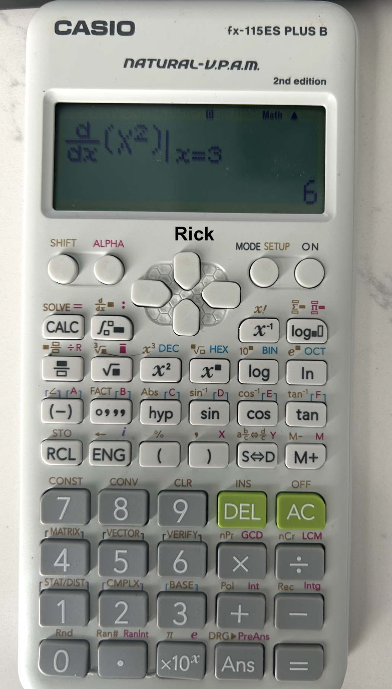{#fig-casio-experiment1 width="40%" fig-align="left"}

The analytical derivative is:

$$
f'(x)=2x
$$

Therefore:

$$
f'(3)=2(3)=6
$$

The calculator displayed `6`, matching the analytical result.

### Experiment 2: Cubic Function

The second experiment evaluated the numerical derivative of:

$$
f(x)=x^3
$$

at $x=2$ using the calculator's `d/dx` function.

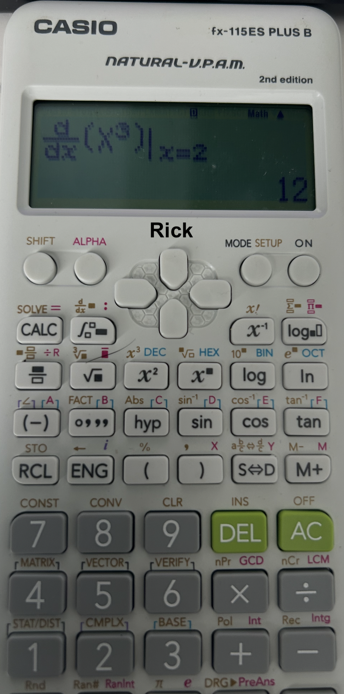{#fig-casio-experiment2 width="40%" fig-align="left"}

The analytical derivative is:

$$
f'(x)=3x^2
$$

Therefore:

$$
f'(2)=3(2)^2=12
$$

The calculator displayed `12`, matching the analytical result.

### Experiment 3: Nondifferentiable Function

The third experiment investigated how the calculator handles a function that is not differentiable at a particular point.

Consider the absolute-value function:

$$
f(x)=|x|
$$

I evaluated its numerical derivative at $x=0$ using the calculator's `d/dx` function.

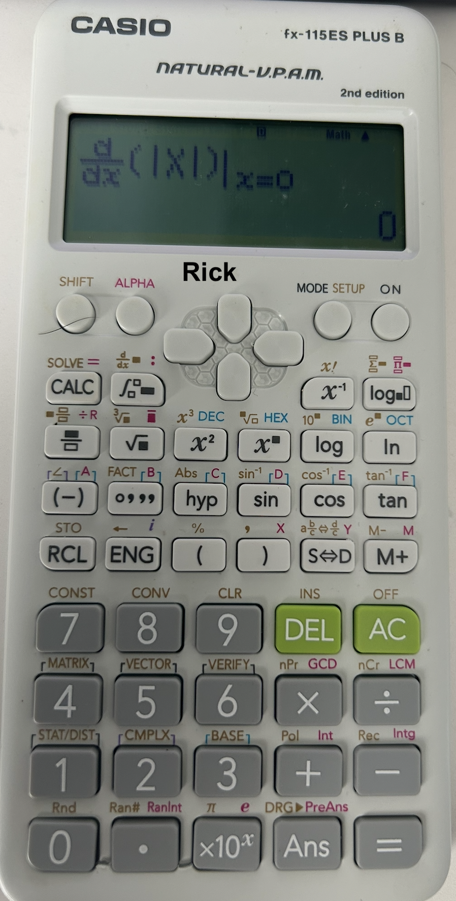{#fig-casio-experiment3 width="40%" fig-align="left"}

The left-hand derivative at zero is:

$$
f'_-(0)=-1
$$

The right-hand derivative is:

$$
f'_+(0)=1
$$

Since the left-hand and right-hand derivatives are unequal, the derivative at $x=0$ does not exist.

However, the calculator displayed:

$$
D_{\text{calculator}}=0
$$

This result can be explained by the central-difference approximation:

$$
f'(x)\approx\frac{f(x+h)-f(x-h)}{2h}
$$

At $x=0$, for any nonzero $h$:

$$
\frac{|h|-|-h|}{2h}=0
$$

Thus, the symmetric numerical difference produces zero even though the mathematical derivative does not exist.

The observed result is consistent with the calculator's documented central-difference method, but it does not establish the precise internal sequence of operations.

### Experimental Results

For functions with an analytically defined derivative, the displayed absolute error is calculated as:

$$
E_{\text{display}}=
\left|D_{\text{observed}}-D_{\text{analytical}}\right|
$$

| Function | Evaluation Point | Analytical Derivative | Observed Calculator Result | Displayed Absolute Error |
|---|---:|---:|---:|---:|
| $x^2$ | 3 | 6 | 6 | 0 |
| $x^3$ | 2 | 12 | 12 | 0 |
| $\lvert x\rvert$ | 0 | Undefined | 0 | N/A |

The absolute error is not applicable to Experiment 3 because the analytical derivative does not exist at the evaluation point.

### Interpretation and Limitations

The first two experiments produced results matching the analytical derivatives at the displayed precision.

For a quadratic function, the central-difference approximation is mathematically exact in ideal arithmetic for any nonzero step size:

$$
\frac{(x+h)^2-(x-h)^2}{2h}=2x
$$

For a cubic function, the same approximation gives:

$$
\frac{(x+h)^3-(x-h)^3}{2h}=3x^2+h^2
$$

The cubic function therefore has a theoretical truncation error of $h^2$ for a nonzero differentiation step size.

Although the calculator displayed the analytical results in both experiments, this does not establish that its internal calculations were error-free.

The third experiment revealed a more significant mathematical limitation. The calculator returned `0` for the derivative of $|x|$ at $x=0$, even though the derivative is undefined.

This illustrates an important distinction between numerical approximation and mathematical validity. A numerical differentiation algorithm can produce a finite result without determining whether a derivative exists at the evaluation point.

**Overall, these experiments demonstrate that correct-looking numerical results do not necessarily establish mathematical correctness.** 
The calculator successfully reproduced the analytical results in two differentiable cases but returned a misleading numerical value at a nondifferentiable point.

The experiments do not independently establish the calculator's internal precision, differentiation step size, or exact implementation details.

# 8 Final Reflection

As a middle-school student in Tirunelveli, I admired my Casio watch and calculator because of what they could do.

Today, I find myself more interested in how they were built, how the underlying technologies work, and how engineers transformed those technologies into commercially successful products. How beautiful would our lives might have changed earlier, if we were introduced to rigorous practical based engineering-application?

The transition from using technology to understanding and building technology is an important educational step.
Certainly, We do not need every student to manufacture a scientific calculator. But students should have opportunities to design, construct, and test real products using the scientific principles they learn. I believe, they ought to learn, The fundamental principles that underline all engineering products.

To conclude, engineering education should teach students more than, how to solve problems presented in textbooks, but also how to identify problems in the world and develop practical, reliable solutions. That is the kind of engineering, practical-education I wish I had experienced more often in school. 

# Related Posts

I have written several other articles exploring electrical engineering, electronics, embedded systems, reverse engineering, product development, manufacturing, and the application of scientific knowledge to practical engineering problems.

## Electronics, Embedded Systems, and Practical Engineering

- [**How to Build a Digital LED Clock?**](https://rickrejeleene.me/Tamil/posts/2026-10-18-LedClock/): Explore digital electronics, microcontrollers, electrical circuits, and the construction of a working digital clock.

- [**How to Solder and Build a Simple Alarm Clock?**](https://rickrejeleene.me/Tamil/posts/2026-03-29-TutorialSoldering/):  Learn electronic assembly, soldering techniques, circuit components, and the construction of a functioning alarm clock.

- [**How to Build a Handheld Game Console?**](https://rickrejeleene.me/Tamil/posts/2026-04-20-TutorialHandheldConsole/): Investigate microcontrollers, electronic displays, PCB assembly, firmware, and the construction of a handheld gaming device.

- [**How to Build a Microcontroller Relay Control with Temperature Sensor?**](https://rickrejeleene.me/Tamil/posts/2026-02-19-TutorialBreadboard/):  Learn how microcontrollers interface with temperature sensors and control electrical devices through relays.

- [**How to Build a Weather Station with Temperature Display?**](https://rickrejeleene.me/Tamil/posts/2026-03-07-TutorialLED/):  Construct a weather-monitoring device using environmental sensors, microcontrollers, and electronic displays.

- [**How to Store and Build Weather Data Logging Using ESP32?**](https://rickrejeleene.me/Tamil/posts/2026-03-14-BasicsLogging/):  Develop an ESP32-based environmental monitoring system with sensor measurements, OLED displays, and persistent data logging.

## Understanding and Reverse-Engineering Consumer Products

- [**How Do Mobile Phones Work?**](https://rickrejeleene.me/Tamil/posts/2026-05-13NokiaPhone/):  Understand mobile-phone architecture, processors, communication systems, electronic components, and the engineering behind modern telecommunications.

- [**How Does the Nokia 3210 4G Work?**](https://rickrejeleene.me/Tamil/posts/2026-05-20Nokia3210/): Examine how processors, memory, displays, batteries, and communication subsystems interact inside a consumer mobile phone.

- [**How Airconditioners Work?**](https://rickrejeleene.me/Tamil/posts/2025-07-15-Airconditioners/): Explore the thermodynamics, refrigeration cycle, compressors, heat exchangers, and engineering principles underlying modern inverter air-conditioning systems.

- [**Reverse-Engineering Window AC: A Teardown and Cost Analysis**](https://rickrejeleene.me/Tamil/posts/2025-08-21-Window_AC/):  Examine an air-conditioner's internal components, electrical and mechanical engineering, assembly, manufacturing, and cost structure.

## Engineering Design, Transportation, and Product Development

- [**How Theory Informs Practical Application: Medical Devices and Maglev Trains**](https://rickrejeleene.me/Tamil/posts/2025-06-22-theory-to-practice-medical-maglev/): Explore how scientific theories and engineering principles are translated into medical technology and advanced transportation systems.

- [**Bullet Trains in Tamil Nadu**](https://rickrejeleene.me/Tamil/posts/2026-08-21-BulleTrainsTamilNadu/): Investigate high-speed railway engineering, vehicle dynamics, traction, braking, infrastructure, manufacturing capabilities, and technological development.

- [**Notes from Guide to Product Design and Development**](https://rickrejeleene.me/Tamil/posts/2024-10-14-Product-Design/): Explore product development, engineering design processes, and the transformation of ideas into manufacturable products.

- [**Visvesvaraya's Legacy: How Engineering Colleges Can Improve**](https://rickrejeleene.me/Tamil/posts/2025-06-28-Why-Tamil-Engineers/): Examine engineering education, practical technical capabilities, and the relationship between engineering institutions and industrial development.

- [**Urban Planning in Chennai**](https://rickrejeleene.me/Tamil/posts/2026-07-05-UrbanPlanningChennai/): Explore urban infrastructure, transportation, public spaces, and the challenges of designing functional cities.

- [**Urban Planning in South India**](https://rickrejeleene.me/Tamil/posts/2026-07-05-UrbanPlanningTamilNadu/): Examine the engineering, infrastructure, and institutional challenges involved in improving South Indian cities.

- [**How Did Houten Build a World-Class Planned Town?**](https://rickrejeleene.me/Tamil/posts/2026-06-20-UrbanPlanningHouten/): Study the design principles, transportation systems, and urban-planning decisions behind a planned Dutch town.

## Manufacturing, Industrialization, and Technological Capability

- [**How Germany Became an Industrial-Scientific Powerhouse?**](https://rickrejeleene.me/Tamil/posts/2026-09-06-GermanIndustrialization/): Investigate the relationship between scientific research, technical education, industrial institutions, and manufacturing capabilities.

- [**How Did South Korea Industrialize?**](https://rickrejeleene.me/Tamil/posts/2026-08-10-SouthKorea/): Understand how industrial policy, engineering capabilities, manufacturing firms, and exports contributed to South Korea's industrial development.

- [**East Asia's Industrialization: What It Means for India?**](https://rickrejeleene.me/Tamil/posts/2026-04-13-EastAsiaIndustrialization/): Explore industrial development, technological learning, manufacturing competitiveness, and lessons for India's economic transformation.

- [**How Are Industrialists Made in Indian Society?**](https://rickrejeleene.me/Tamil/posts/2026-11-12-IndianIndustrialists/): Examine entrepreneurship, industrial leadership, business capabilities, and the social conditions that contribute to the emergence of successful industrialists.

# References

::: {#refs}
:::