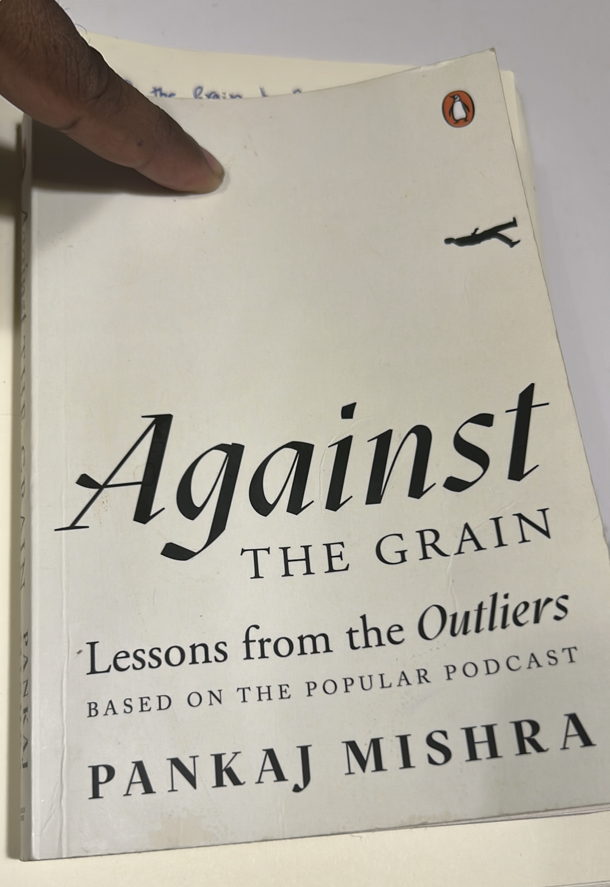
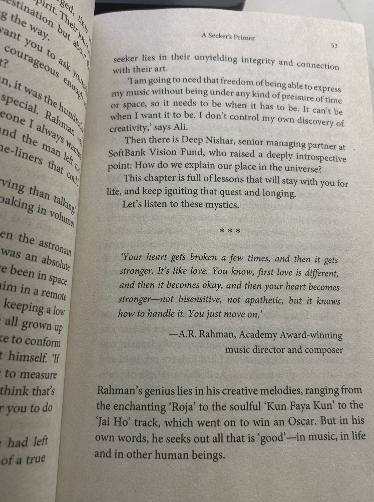

# Introduction 

Recently, I came across Pankaj Mishra's *Against the Grain: Lessons from the Outliers*.
I have listened to FactorDaily, both the publication and the podcast. 
Thanks to FactorDaily, I got a chance to hear from some of the recent accomplished Indian Entrepreneurs.
I always look forward to hearing stories of Indian founders. The book is based on Mishra's podcast, *Outliers*, which features conversations with accomplished individuals across various fields. 

He interviews Sridhar Vembu, Girish Mathrubootham, Nithin Kamath, Narayana Murthy, Nandan Nilekani, Vijay Shekhar Sharma, Naval Ravikant, A. R. Rahman, Rakesh Sharma, Sonam Wangchuk, C. K. Ranganathan, Kailash Katkar, and several others.

{fig-alt="Against the Grain: Lessons from the Outliers" width="50%"}

As I finished reading the book, it reminded me of my last post, [Gujaratis and Tamils](https://rickrejeleene.me/Tamil/posts/2026-10-14-Gujarati/index.html), where I explored the prominence of certain business communities in India and the emergence of industrial families. The Section from [Tamil Society](https://rickrejeleene.me/Tamil/posts/2026-10-14-Gujarati/#on-tamil-society), I share briefly about Old Tamil Industrialists and Newly minted Tamil Industrialists. Pankaj Mishra's book provides a more personal perspective, he leads the conversation freely, allowing me to understand how these individuals interpreted their own journeys, what drove them, and how they navigated the complexities of building successful enterprises. 

In this post, I share findings from two questions. 

**1. How are Indian industrialists made broadly in Indian society?** What roles do family background, social origins, community networks, economic opportunities, individual motivation, and psychological characteristics play in their emergence?

**2. From Pankaj Mishra's book, what are the key lessons from the experiences of accomplished Indian entrepreneurs and industrialists?**
What do their experiences reveal about ambition, failure, leadership, decision-making, and the challenges of building enduring enterprises?

My goal is to give the reader an understanding of Indian industrialists, motivations, social origins, psychological characteristics, inferences from Pankaj's book, and the challenges they face in building enduring enterprises. 

# The Social origins of Indian Industrialists

As an avid reader of Indian history, I've focused on examining how different kingdoms and empires emerged, how they organized their economies, the extent of their participation in commerce, and whether their rulers invested in scientific research, technological development, and innovation. It's important to remember that, the social-structure of our country largely remained feudal, with revenues centered on land-ownership, agriculture. During the British rule, social structure started to change this dynamic, and slowly, started to modernize. The British introduced Railways, modern factories, new legal institutions, and other developments transformed parts of the economy, and created new opportunities for Indian entrepreneurs.

In Indian public discourse, Most of the time, we read and hear publicaly about how the British looted India, but rarely do we read and hear how  British rule created path for India's new Middle Class and as well as Industrialists. 

Nevertheless, this raises an important question: How did these industrialists emerge during British rule?
Gijsbert Oonk, a historian answers this question in his work, 'The Emergence of Indigenous Industrialists in Calcutta, Bombay, and Ahmedabad, 1850–1947', [@oonk2014industrialists], compares the emergence of indigenous industrialists in Calcutta, Bombay, and Ahmedabad. 

India's first major indigenous industrialists began emerging in the 1850s. They emerged particularly in Bombay, followed by Ahmedabad in the 1860s and Calcutta in the early twentieth century. Surprisingly, most were already merchants, bankers, financiers, or members of commercially established families.

In Calcutta, British businessmen started the local jute industry, but Marwaris took over on the eve of independence in the 1930s. 
In contrast, right from the start, non-Europeans took the lead in developing cotton textile industries in Bombay and Ahmedabad. 
As a result, the imperial economic center of the world, Manchester, faced its toughest competition from local business communities based in the so-called periphery, namely Bombay and Ahmedabad. [@oonk2014industrialists] also challenges earlier Weberian interpretations of Indian economic history, particularly the argument that Indian religious and cultural traditions, especially Hinduism, discouraged risk-taking, entrepreneurship, and long-term capital investment. As Oonk observes[@oonk2014industrialists], contemporary economic historians generally do not accept the proposition that Indian cultural traditions inherently prevented entrepreneurial initiative and industrial investment.

```{=html}
<style>
.industrialists-table {
  margin: 1.5rem 0;
  overflow-x: auto;
  border: 1px solid #dce5ef;
  border-radius: 12px;
  box-shadow: 0 4px 16px rgba(24, 49, 83, 0.08);
}

.industrialists-table table {
  width: 100%;
  margin: 0;
  border-collapse: collapse;
  font-size: 0.95rem;
  line-height: 1.6;
  color: #243449;
  background: #ffffff;
}

.industrialists-table caption {
  caption-side: top;
  padding: 1rem 1.2rem;
  text-align: left;
  font-size: 1.1rem;
  font-weight: 700;
  color: #17365d;
  background: #edf3fa;
}

.industrialists-table thead th {
  padding: 0.9rem 1rem;
  text-align: left;
  vertical-align: bottom;
  color: #ffffff;
  background: #17365d;
  border: none;
}

.industrialists-table tbody td {
  padding: 1rem;
  vertical-align: top;
  border-bottom: 1px solid #dce5ef;
}

.industrialists-table tbody tr:nth-child(even) {
  background: #f3f7fc;
}

.industrialists-table tbody tr:hover {
  background: #e8f1fb;
}

.industrialists-table tbody tr:last-child td {
  border-bottom: none;
}

.industrialists-table .period {
  white-space: nowrap;
  font-weight: 600;
  color: #17365d;
}

.industrialists-table .city {
  display: inline-block;
  padding: 0.2rem 0.65rem;
  border-radius: 999px;
  white-space: nowrap;
  font-size: 0.85rem;
  font-weight: 600;
}

.industrialists-table .bombay {
  color: #075985;
  background: #e0f2fe;
}

.industrialists-table .ahmedabad {
  color: #065f46;
  background: #d1fae5;
}

.industrialists-table .calcutta {
  color: #6b21a8;
  background: #f3e8ff;
}
</style>

<div class="industrialists-table">
<table>
  <caption>Early Indian Industrialists and Their Routes into Industry</caption>
  <thead>
    <tr>
      <th scope="col">Period</th>
      <th scope="col">City</th>
      <th scope="col">Early industrialists</th>
      <th scope="col">How they entered industry</th>
    </tr>
  </thead>
  <tbody>
    <tr>
      <td class="period">1854 onward</td>
      <td><span class="city bombay">Bombay</span></td>
      <td>Parsi merchant families</td>
      <td>Invested profits from cotton and opium trading into mechanized textile mills</td>
    </tr>
    <tr>
      <td class="period">Early 1860s</td>
      <td><span class="city ahmedabad">Ahmedabad</span></td>
      <td>Ranchhodlal Chhotalal</td>
      <td>A former colonial civil servant who sought support to establish a cotton mill</td>
    </tr>
    <tr>
      <td class="period">1877</td>
      <td><span class="city ahmedabad">Ahmedabad</span></td>
      <td>Jamnabhai Bagubhai</td>
      <td>Used family wealth accumulated through speculation to establish a textile company</td>
    </tr>
    <tr>
      <td class="period">1881</td>
      <td><span class="city ahmedabad">Ahmedabad</span></td>
      <td>Manganbhai Sarabhai</td>
      <td>Drew on his family's banking and financing background</td>
    </tr>
    <tr>
      <td class="period">1919</td>
      <td><span class="city calcutta">Calcutta</span></td>
      <td>G. D. Birla</td>
      <td>Established a jute mill after developing trading and financial interests</td>
    </tr>
    <tr>
      <td class="period">1940s</td>
      <td><span class="city calcutta">Calcutta</span></td>
      <td>Goenka and Bangur families</td>
      <td>Acquired existing British-controlled jute mills</td>
    </tr>
  </tbody>
</table>
</div>
```

It is also important to recognize that these industrialists emerged under British colonial rule, when expanding commercial markets, access to industrial machinery, new transport infrastructure, and changing financial and administrative institutions created opportunities for industrial investment. Indian merchants and financiers who had accumulated wealth through trade and banking were increasingly able to redirect some of their capital into mechanized manufacturing. However, as Oonk's research demonstrates, the opportunities and conditions for indigenous industrialists differed considerably across Calcutta, Bombay, and Ahmedabad.

In Calcutta, British businessmen initially dominated the jute industry, and Marwari merchants encountered hostility and exclusion from established European business networks. In contrast, Bombay developed closer commercial relationships between British businessmen and Parsi merchants, allowing some Indian entrepreneurs to gain business experience, establish partnerships, and eventually invest in their own cotton textile mills.

Ahmedabad followed a different trajectory. British businessmen played a relatively limited role in its commercial economy, while local Indian merchants, bankers, and financiers led the development of cotton textile manufacturing. Ranchhodlal Chhotalal's early industrial venture demonstrated the possibilities of mechanized production, encouraging other indigenous investors to establish factories.

These contrasting experiences suggest that the emergence of Indian industrialists depended not simply on individual ambition or accumulated wealth, but also on access to capital, commercial relationships, industrial knowledge, and the institutional environment in which entrepreneurs operated. [@oonk2014industrialists]

We also want to keep in mind that, A society can have many wealthy individuals without producing many industrialists. Wealth may remain invested in land, lending, property, precious metals, or commerce. Industrialization requires some capital owners to redirect resources toward productive enterprises that demand technical organization, long-term investment, and the ability to withstand business failures. In Tamil Nadu, the majority of the Middle classes invest their wealth in real estate, gold, fixed deposit and chit-funds, and not in productive enterprises. Why do some individuals and commercially established families invest in manufacturing and other productive enterprises, while others prefer relatively familiar forms of investment, such as real estate, gold, bank deposits, and other financial assets? What economic and institutional conditions influence these decisions?

One possible explanation for the emergence of industrial entrepreneurs can be found in the work of economists Bishnupriya Gupta[@gupta2022community] and colleagues 'Community Origins of Industrial Entrepreneurship in Colonial India'. The authors argue that social network, Community networks played an important role in the emergence of industrial entrepreneurship in colonial India [@gupta2022community]. They find, Company directors clustered strongly by community, Prior upstream trading experience did not explain the observed entry patterns, The accumulated presence of entrepreneurs from a community was associated with further entry from that community. Initially, the person might be raising funds from within their community, and network, so Entrepreneurship becomes self-reinforcing within communities, and once a few members establish businesses, others gain access to resources that outsiders may struggle to obtain.

# How Indian industrialists are made? 

It’s interesting to notice how and why industrialists are made in Indian society. In my earlier post on [Gujaratis and Tamils](https://rickrejeleene.me/Tamil/posts/2026-10-14-Gujarati/index.html), Many Indians believe that Gujaratis dominate India's business world. The top of India’s industrialists' lists are Gujaratis. Some Indian media have reported that roughly half (around 45 to 50) of the business leaders and families on India’s top 100 wealthiest lists are of Gujarati origin. This is not to say others from the rest of India are not building new businesses, churning entrepreneurs and slowly consolidating them into large industrialists. 

**If I were to ask my high school classmates how they are made?**

They’d say, Oh, it’s usually children from business families that go on to establish businesses, or it’s the Tamils who are born into poverty. 
To which I usually respond, "இஷ்டத்துக்கு அடிச்சி விடு" [Makes stuff up].

For this, They would cite in Tirunelveli, famous businessman - Mr. A. Chelladurai[@bellpinsAbout], the founder of Bell Pins. His family is now part of old money families in the district. Official public records say their revenues come close to $60-$90 million. From my perspective, they occupy firms operating in secondary industries, i.e manufacturing. Mr. A. Chelladurai[@bellpinsAbout] was born in 1916, went to Srilanka to study, came and worked in Sivakasi for 10 rupees a month salary (inflation-adjusted $30-40 per month salary). He quit because his boss didn’t give him a raise of 2 rupees ($5 dollars) and co-started Standard Fireworks in 1942, and the rest is history. His subsequent generations are old money families of Tirunelveli.

However, there are more example anecdotes, Mr. Dhirubhai Ambani [@relianceRefining] was from a modest family. He went to Aden, Yemen, and worked in the Petroleum industry around the 1930s to 1940s. And we know where Reliance Industries is now? We also know Gautam Adani’s father was from a modest family, who owned Adani Textiles in Ahmedabad, Gujarat, India. And everyone in India knows who is making profits from airports, ports, coal mining, et cetera. Let’s leave aside politics, which is not the aim of this post. So, anecdotally, we could assume my high school classmates' theories might be true. It’s usually poorest Indians or children of business family, let’s just extend poorest to lower-middle-class Indian families, as finances are tight, which squeezes them to seek for financial opportunities and risks. 

However, this is not the case for all. Industrialists in India are made from all kinds of backgrounds, and one that shatters the expectation is this Indian, who is currently popular. When looking at financial necessity as pushing him to start his company, it is not the case, either. 

It is Mr. Bhavish Aggarwal[@sen2019aggarwal], born in 1985 in Ludhiana, Punjab. His father was an orthopedic surgeon and his mother a pathologist.  He grew up in an upper-middle-class Indian household, studied Computer Science at IIT Bombay, which is among the best computer science departments in all of India. In Sociology, upper-middle-class Indian families are characterized by acquisition of English-language education, propensity for higher education, and being financially comfortable enough for international travel. After IIT-Bombay, He subsequently worked at Microsoft Research, publishing research in top journals and filing patents. 

He told his father, ‘Papa mujhe yeh business karna hein,’ (Dad, I want to be in this business), his reaction was, ‘Beta, tum travel agency khol rahe ho! Tum IIT gaye… uske baad, why are you opening a travel agency?’ (Son, why are you opening a travel agency after getting a degree from IIT?)
He founded Ola in 2010, with his father’s support. He was supportive and helped in the early days. At present, His firms, in which he holds ownership[@businessToday2025Ola], have an approximate operating revenue of ₹4,645 crore [@kuvera2026Bhavish]. His net worth stands at approximately $340 million.

In the world of Indian industrialists, not many clear the IIT-JEE, Bhavish persisted after he failed to clear his first attempt. In his second attempt, he came to an All-India Rank of 23. To go beyond what motivates many like Mr. Bhavish Aggarwal to come out of a comfortable life, psychological research identifies characteristics such as achievement motivation, self-efficacy, autonomy, innovativeness, stress tolerance, and a proactive personality as being associated with entrepreneurship.

To answer our question, how are Indian industrialists made? 

Psychological research[@rauch2007person] suggests that men and women[@mcclelland1961achieving] who have a higher predilection for achievement motivation[@collins2004achievement], self-efficacy, autonomy, innovativeness, stress tolerance, and a proactive personality are more likely to incline themselves towards entrepreneurship[@mcclelland1987characteristics]. These traits help explain why some individuals enter entrepreneurship. However, they do not necessarily explain why a small proportion of entrepreneurs go on to establish enormous industrial enterprises.

For enormous industrial enterprises, there’s a wide range and distinct spectrum of skills and competence between entering, starting the enterprise, and scaling to incredible scale and complexity, which Mukesh Ambani has accomplished. His Reliance Jamnagar[@relianceRefining] refinery generates close to approximately $64 billion USD annually, with recent talks of opening a new American Refinery in Texas. From Mukesh Ambani’s point of view, running one of the most profitable oil refineries requires commercial judgment, gauging opportunities in global energy markets, and, most importantly, incredible breadth of capital allocation skills. This also requires assembling efficient resources, such as teams, to operate and deploy crude oil safely and profitably at enormous scale. And the market has rewarded him massively!   

The entrepreneurial development itself can be defined through three stages, entering entrepreneurship, sustaining a viable business, and building an organization capable of operating at industrial scale. The first may be influenced by motivation, self-efficacy, and opportunity recognition. The second requires commercial judgment, customer relationships, technical competence, and financial discipline. The third introduces a substantially different set of challenges involving capital allocation, organizational design, professional management, governance, and long-term strategy.

Perhaps Tamil families, instead of watching Tamil movies, rewarding particular actors like Vijay, Ajith, Rajini, Surya, Kamal with enormous fame and wealth, could redirect their attention, finances and resources into alternative productive spaces. There is nothing wrong with enjoying cinema occasionally. Maybe they might need to ask what the market would reward them for?

What knowledge, skills, products, services, or enterprises could we develop that the market would reward us for? 
Rather than merely celebrating the wealth of others, how might we create wealth ourselves? Perhaps these questions deserve considerably more attention in our discussions about wealth creation in Tamil and broader Indian society.

# Reflections from Pankaj Mishra's book, *Against the Grain: Lessons from the Outliers*

I read this book[@mishra2024against], because I was highly interested to hear stories from founders in Indian Society. 
Moreover, I wanted to hear what set them apart from the rest. I have read FactorDaily and also the podcast for a long time. 
So, I wanted to hear what Pankaj had written about the founders themselves. It’s a compilation of stories from many founders. 

Pankaj Mishra's conversations bring together a remarkably diverse group of individuals whose journeys illuminate different dimensions of entrepreneurship, innovation, leadership, and success in contemporary India. They include technology entrepreneurs such as [Sridhar Vembu (Zoho)](https://www.zoho.com/ourstory.html), [Girish Mathrubootham (Freshworks)](https://www.together.fund/team/girish-mathrubootham), [Nithin Kamath (Zerodha)](https://zerodha.com/about/), [Aneesh Reddy (Capillary Technologies)](https://www.capillarytech.com/about-us/), [Ashwini Asokan (Mad Street Den)](https://yourstory.com/people/ashwini-asokan), [Vijay Shekhar Sharma (Paytm)](https://ir.paytm.com/directors-and-committees), [Naval Ravikant (AngelList)](https://wellfound.com/p/naval), and [Jayaprakash Vijayan (Tekion)](https://tekion.com/about-us/our-leaders). The conversations also extend beyond business to figures such as [Rakesh Sharma, India's first astronaut](https://www.isro.gov.in/ISRO_EN/Indian_microgravity_research_Axiom4_mission.html), musicians [A. R. Rahman](https://www.arrahman.com/) and [Lucky Ali](https://www.imdb.com/name/nm0004699/bio/), and education innovator [Sonam Wangchuk](https://www.ashoka.org/en-us/fellow/sonam-wangchuk).

Other accounts explore pioneers of India's digital economy, including [K. Vaitheeswaran (Fabmart/Indiaplaza)](https://www.wef.org.in/vaitheeswaran/), [Ashish Hemrajani (BookMyShow)](https://lk.bookmyshow.com/aboutus), [Nandan Nilekani (Infosys)](https://www.infosys.com/about/management-profiles/nandan-nilekani.html), [Phanindra Sama (redBus)](https://inktalks.com/talks/the-redbus-journey/), [N. R. Narayana Murthy (Infosys)](https://www.infosys.com/about/management-profiles/narayana-murthy.html), and [Jyoti Bansal (AppDynamics/Harness)](https://www.harness.io/company/about-us). The experiences of [Kailash Katkar (Quick Heal)](https://www.quickheal.com/quick-heal-security-solutions), [Sanjay Nayak (Tejas Networks)](https://www.tejasnetworks.com/our-journey/), [Anand Deshpande (Persistent Systems)](https://www.persistent.com/company-overview/board-of-directors/anand-deshpande/), and [C. K. Ranganathan (CavinKare)](https://cavinkare.com/about-us/leadership/) offer further perspectives on building and sustaining Indian enterprises.

Equally significant are the contributions of [Nand Kishore Chaudhary (Jaipur Rugs)](https://www.nkchaudhary.com/about/), [Dr. Gullapalli N. Rao (L. V. Prasad Eye Institute)](https://www.lvpei.org/team-members/gullapalli-n-rao/), and [Ravi Venkatesan (Microsoft India/GEAPP)](https://energyalliance.org/people/ravi-venkatesan/), whose work illustrates the intersections of enterprise, healthcare, social development, and institutional leadership. The story of the late [Arvindkumar Alagarswamy (Attune Technologies)](https://archive.factordaily.com/attune-arvindkumar-alagarswamy/) also provides an important reminder of the personal and organizational vulnerabilities that can accompany entrepreneurship.

Mishra presents these experiences through a largely free-flowing, conversational approach, allowing individuals to narrate their ambitions, setbacks, decisions, and achievements in their own words. This makes the accounts engaging and accessible. Yet, as I read them, I found myself wishing that some conversations had moved beyond individual experiences toward a more systematic examination of the conditions that produce entrepreneurial and organizational success.

## Outline of the book {#book-outline}

1. [Outliers: Learning from Failure](#outliers)
2. [A Seeker’s Primer](#seekers-primer)
3. [The Importance of Crisis](#importance-of-crisis)
4. [Finding Value in Entrepreneurship](#value-in-entrepreneurship)
5. [Rising after the Fall: The Comeback Stories](#comeback-stories)
6. [Revisiting the Conversations](#revisiting-conversations)

### Outliers: Learning from Failure {#outliers}

The first chapter is learning from failures. Some founders say life is full of failures and that’s the reality. 
Sridhar Vembu says it’s not a failure, only a setback, if you recover from it, and every company, product’s journey goes through many failures, iterations, until they succeed. In entrepreneurship because businesses rarely progress through a predictable sequence of successful decisions.

Nithin Kamath likes to think of worst-case scenarios, and only continue if he is okay with proceeding with the outcome. 
When he works with people who join his team, he does ask them how they feel about the worst case scenario, and if they are comfortable with it, then he proceeds. He says, if you are not comfortable with the worst case scenario, then you should not proceed. This suggests that successful entrepreneurship is not necessarily described by an extraordinary willingness to take risks. It may instead involve the ability to distinguish between risks that can be managed and those that could threaten the survival of the enterprise. While, it is easy to write here about failures, in reality, when a company runs out of cash, and has no money to provide salary, or engineers work on a product for 3 or 4 years, only for it to fail, that situation is death experience. 

Naval emphasis on where you direct your energy towards in your life. Reflecting on what opportunities to pursue, and Gratitude of missing out. 

Harsh Mariwala is the founder of consumer goods company Marico Ltd. He says, he views failures as a way to learn, sometimes you win, sometimes you lose, for him in his early career, he missed hiring specialists for ethics, safety and legal team, cost him losses. So he says, it was a big lesson. From this, we learn that Insufficient attention to specialized organizational functions affects enterprise performance and is an important management lesson. His experience illustrates another dimension of entrepreneurial development, as businesses grow, founders must recognize the limits of their own knowledge and gradually establish specialized capabilities within the organization.

Subroto Bagchi, co-founder of Mindtree says, he thinks life as a river, we do not need to worry about where we are going, a river doesn’t fret over a mountain or a tree infront of it, it just passes through it, so same way, we live life and adapt. William Nanda Bissell is the founder of FabIndia. He says, his biggest failure was acquisition of a UK based company, which he believed that distracted him.

Phanindra Sharma is the founder of Rebus. It’s been a long time, but I have used RedBus, right after my high-school days. For him, failures in entrepreneurship has allowed him to take middle ground, not extreme, where if he gives tasks, and has high level of oversight of his team, then they complain, he micro-manages, and if he allows them to be on their own, then they complain, he doesn’t give any support. So, we could ask, How does an entrepreneur learn to manage people rather than simply manage tasks? The capabilities necessary to develop a product are not necessarily the same as those required to organize teams, delegate responsibilities, evaluate performance, and create conditions in which employees can operate effectively. So he speaks of finding the right balance. 

What I take from this chapter is that failure becomes valuable only when it results in learning and improved decisions. Perseverance may allow a founder to continue, but it does not automatically produce better products, sound financial management, or organizational competence.

### A Seeker’s Primer {#seekers-primer}

For the second chapter, the author sets up saying, behind our quests, ambitious, attempts, desires, many individuals are seeking something. Behind their ambitions may lie personal values, aspirations, the desire for independence, or a search for meaning.

The founders who are seekers have set an impression on Pankaj Mishra. A. R. Rahman is one of India’s most celebrated composers and musicians and has won numerous prestigious awards. His father, R. K. Shekhar, was a film composer and conductor whose memory remains an inspiration to him. Although the family was initially financially comfortable, they faced hardship after Shekhar died when Rahman was nine, prompting Rahman to work at a young age to help support them.

{fig-alt="A.R Rahman" width="50%"}

For A.R Rahman, he says always tries to find goodness in people and his work. 
He says, better be a source of goodness. Be a source of goodness in your work, in your character, in everything, smiling at people. 
Sometimes in life, even though, you can’t, if you are in pain, you don’t lose anything by being a source of goodness. One of the most important lessons A.R Rahman shares is that he learns more in observing, rather than talking. For him, it’s a call to listen more, talk less. 

Although Rahman is not an industrialist, I find his observations relevant to leadership. Individuals who operate complex organizations must understand people with different capabilities, motivations, and perspectives. Listening becomes particularly important when founders begin managing specialized teams whose expertise may exceed their own in particular areas.

Lucky Ali in the beginning found a job at an Oil Rig near Pondicherry. He shares he was inspired by his father, who had 150 horses, and was a self-made man. Lucky Ali emphasizes staying humble. From Lucky Ali, we can take away, for founders, humility is an important quality, as it allows them to recognize the limits of their own knowledge, seek advice from others, and remain open to new ideas. And even if they are successful, humility can help them maintain perspective and avoid the pitfalls of pride.

As we read more in this chapter, We hear Mishra's interview with Rakesh Sharma, the first Indian astronaut to visit space. 
While Rakesh shares his life story, his biggest lesson was being authentic. For him, being authentic has been liberating. 
Being authentic, in this context, may involve understanding one's own motivations, values, and aspirations rather than allowing external expectations to determine every major decision. In context of Indian industrialists, An individual may remain committed to a personal vision while still making poor commercial decisions. Building a viable enterprise also requires listening to criticism, responding to market evidence, acquiring new knowledge, and recognizing when an original strategy needs to change.

Nand Kishore Chowdary, founder of Jaipur Rugs, who is from Marwari community. He began his entrepreneurial journey in 1978 with two looms and nine artisans. For him, self-realization is the journey of entrepreneurship. As he tells Pankaj Mishra, “The more I lose myself, the more I find myself.”
What I find interesting is how Chaudhary's understanding of leadership evolved. He recognized his tendency to micromanage and learned to trust others, including artisans whose practical knowledge was often overlooked. His enterprise also created economic opportunities for rural artisans and marginalized communities, demonstrating how entrepreneurship can generate social as well as economic value. We can also learn from him, that,  As businesses grow, entrepreneurs must learn not only how to manage resources, but also how to develop and empower people.

Aneesh Reddy, founder of Capillary Technologies, reflects on how early entrepreneurial success affected his behavior toward others. After experiencing considerable success, his co-founder confronted him about his treatment of colleagues, pointing out that he had become a bully.
What I find interesting is that success itself can become a challenge for entrepreneurs. Early achievements may reinforce overconfidence, making founders less receptive to criticism and increasingly unaware of how their behavior affects employees. In a growing enterprise, this can damage trust, discourage disagreement, and undermine organizational culture.

Vijay Shekhar Sharma, founder of Paytm, reflects on his entrepreneurial journey, which began long before Paytm became successful. He established an earlier technology company and eventually sold it, gaining experience that influenced his subsequent ventures. Although widely regarded as a successful entrepreneur, he does not consider himself an outlier. One of his interesting reflections is the importance of keeping life simple.
The ability to distinguish what matters from what does not may be as important as the ambition to achieve more.

Subroto Bagchi, co-founder of Mindtree, shares several lessons from his life and entrepreneurial journey. One of his most interesting observations is the power to receive, which he considers a greater determinant of success than the power to give. For him, what matters is not merely what individuals are offered, but how they receive, interpret, and cultivate what they learn from their surroundings. To illustrate this, he describes a family with five children raised by the same parents. One becomes hardworking, another lazy, another selfish, one grows into a good human being, and another becomes wealthy and hardworking. Despite growing up in the same household, the children develop different values, personalities, and life trajectories. I find this particularly relevant to understanding how industrialists emerge. Family background, education, wealth, and community networks may provide opportunities, but individuals differ in how they respond to these circumstances. Bagchi also observes that life is a continuous negotiation and that overachievers can become their own greatest strengths and weaknesses. His reflections on resilience, self-doubt, and the importance of not demonizing government suggest that entrepreneurship involves negotiating not only with oneself, but also with people, institutions, and circumstances beyond one's control.

For Ashish Gupta, founder of Helion Advisors, wealth represents the freedom to pursue what he wants in life. I find this perspective interesting because wealth, beyond providing financial security, can give individuals greater independence over their time, choices, and ambitions. For some entrepreneurs, accumulating wealth may not be the ultimate objective, but rather a means of achieving personal autonomy and pursuing opportunities without depending on others.

Ashwini Asokan, co-founder of Mad Street Den, offers a different perspective. She reflects on the difficulties of being both a mother and an entrepreneur, particularly the judgments she faced from people who questioned her decisions. Society often presents women with a false choice: either become a stay-at-home mother or pursue a demanding professional career at the expense of family responsibilities.

What I find particularly interesting from these conversations is that accomplished individuals are not necessarily seeking the same things in life.
For some, it is the freedom to make independent choices; for others, it is personal fulfillment, self-realization, meaningful work, or the opportunity to create value for others. In the context of Indian industrialists, the motivations that lead someone to establish an enterprise may be very different from the capabilities required to build and sustain it.

### The Importance of Crisis {#importance-of-crisis}

The third chapter examines how entrepreneurs and accomplished individuals respond to crises, unexpected challenges, and difficult circumstances.
Ashwini Asokan, co-founder of Mad Street Den, describes crisis management as an exercise in managing change. During the COVID-19 pandemic, she recognized the importance of helping employees understand what was changing and why. Manish Sharma, co-founder of Printo, describes crisis as a process of self-discovery. His company experienced significant difficulties during the 2008 global financial crisis, after a period of aggressive expansion. That experience influenced how the company subsequently approached profitability, financial discipline, and growth. During the COVID-19 pandemic, he reflected on the importance of conserving cash, managing costs, and remaining transparent about the organization's circumstances.

What I find interesting is that rapid business expansion does not necessarily indicate financial strength. An enterprise may increase its revenues and expand its operations while remaining vulnerable to economic downturns. The ability to manage cash flow, maintain sustainable margins, and balance growth with financial stability is essential to organizational survival. Jay Vijayan, former Chief Information Officer at Tesla and founder of Tekion, reflects on how overcoming resistance can make individuals stronger. His experience developing enterprise software systems at Tesla illustrates the challenges of implementing technological solutions within complex organizations. I find his reflections relevant because industrial entrepreneurship often involves overcoming technical, organizational, and institutional barriers. However, determination alone is insufficient; individuals must also develop the capabilities necessary to translate ambitious ideas into working systems.

Sonam Wangchuk, founder of the Students' Educational and Cultural Movement of Ladakh (SECMOL), offers another perspective on crises and innovation. His work on ice stupas and solar-powered technologies illustrates how environmental constraints can encourage the development of practical solutions. Ice stupas, for instance, were developed to help address seasonal water shortages faced by communities in Ladakh. Ravi Venkatesan, former chairman of Microsoft India, shares one of the most interesting industrial turnaround experiences in this chapter. In 1996, he joined the struggling Tata Cummins joint venture, which manufactured diesel engines. According to his account, the factory had been designed to produce approximately 250 engines daily but was manufacturing only one or two. The company faced serious product-quality problems, financial difficulties, and strained relationships between its joint-venture partners.

Venkatesan initially faced the prospect of closing the operation. Instead, he worked on obtaining financial support, rebuilding relationships, improving manufacturing quality, and reducing production costs. He recounts that engine costs were reduced by approximately 85% over 18 months, and by the summer of 1999, production had increased to approximately 200–220 engines daily.

I find this example particularly valuable because it demonstrates the complexity of managing industrial enterprises. A struggling factory cannot be rescued merely through optimism, determination, or motivational speeches. It requires technical expertise, financial resources, operational improvements, effective management, and the ability to coordinate employees, suppliers, and business partners.

Rohith Bhat, founder of Robosoft Technologies, offers another perspective on building an enterprise through changing technological and commercial conditions. Starting in Udupi, Karnataka, Robosoft developed software capabilities and established long-term relationships with international technology companies, including Apple. Over time, the company expanded into mobile applications and other digital products.

What I take from these conversations is that crises do not automatically make entrepreneurs or their organizations stronger. Some companies fail despite the determination and hard work of their founders. Others recover because they possess sufficient financial resources, recognize their weaknesses, adapt their strategies, and implement necessary changes. In the context of understanding how Indian industrialists are made, crises can become important periods of organizational learning. However, surviving them requires more than personal courage.


### Finding Value in Entrepreneurship {#value-in-entrepreneurship}

The fourth chapter explores what it means to create value through entrepreneurship. From Pankaj Mishra's conversations with Ajit Isaac, Nandan Nilekani, Sridhar Vembu, and several other founders, one recurring idea emerges: the purpose behind an entrepreneurial journey may be more important than how quickly someone achieves success. For Nand Kishore Chaudhary, founder of Jaipur Rugs, the purpose of entrepreneurship is closely connected to creating value for the broader ecosystem in which a business operates.

Ajit Isaac, founder of Quess Corp, offers an interesting perspective on the relationship between ambition and purpose. His entrepreneurial journey developed over nearly three decades, during which he built a large employment services enterprise. He emphasizes that what individuals choose to pursue matters more than the speed at which they reach their goals. As his organization grew, he also found that decisions carried greater consequences for employees and other stakeholders.

Sridhar Vembu, co-founder of Zoho, thinks about entrepreneurship in the long term. Rather than simply looking toward Silicon Valley and its culture of rapid growth, he admires Japanese companies that have survived and remained productive for generations. Zoho's own journey has involved difficult periods, including the dot-com downturn, which required the company to reconsider its business strategy. Vembu has consistently emphasized building an enterprise gradually, maintaining independence, and avoiding unnecessary dependence on external capital. He asks the question, "Why must productive employment, technical expertise, and economic opportunities remain concentrated in a relatively small number of cities?"

What I find particularly interesting is his decision to develop Zoho's operations in Tenkasi, Tamil Nadu. He recognizes that talented individuals from smaller towns and rural communities often migrate to large cities in search of employment. By creating technology jobs outside metropolitan centers, Zoho offers an alternative pathway for people who might otherwise have to relocate. Vembu also reflects on frugality and the importance of maintaining perspective. His observations about people who struggle to meet even their immediate financial needs remind us that entrepreneurial problems, however significant they may appear to successful founders, exist alongside much greater economic hardships experienced by others.

Nandan Nilekani, co-founder of Infosys and a central figure in the development of India's Aadhaar system, approaches value creation through the lens of scale. He describes himself as someone interested in both thinking and execution. His work illustrates the possibility of applying technological and organizational capabilities to problems affecting millions of people. I find this particularly relevant because creating a successful technology product and implementing a nationwide system are different challenges. Large-scale initiatives require coordination between technical specialists, administrators, institutions, and the people who ultimately use these systems.

Phanindra Sama, co-founder of redBus, reflects on the determination required to pursue entrepreneurship through uncertainty. He also describes entrepreneurship as a process that challenges and reshapes individuals. What makes his journey particularly interesting is his decision to sell redBus rather than continue pursuing a potentially larger valuation indefinitely. His decision was influenced partly by his desire to share the financial rewards of his success with his aging parents while they could still enjoy them. Manish Sharma, co-founder of Printo, discusses the relationship between founders and investors. Rather than treating every meeting with a potential investor as an opportunity to sell a business proposition, he emphasizes finding people with whom the entrepreneur can develop a good working relationship.

Nithin Kamath, co-founder of Zerodha, had been involved in financial trading long before establishing the brokerage company in 2010. His journey included learning through trading, managing client accounts, and working with brokerage services. This experience helped him recognize limitations in existing brokerage offerings and opportunities to improve them. What interests me is that Zerodha did not emerge solely from an abstract technological idea. It developed from practical knowledge of an existing industry and its customers. Later, the company strengthened its technological capabilities to reduce dependence on external software providers.

Dr. Gullapalli Nageswara Rao, founder of the L. V. Prasad Eye Institute, offers another perspective on creating value. After developing his medical career in the United States, he returned to India and helped establish an institution dedicated to providing high-quality eye care. What distinguishes his approach is the commitment to delivering quality medical services to both paying and non-paying patients. His work challenges the assumption that an institution must choose between technical excellence and serving economically disadvantaged communities.

N. R. Narayana Murthy, co-founder of Infosys, offers a more systematic approach to organizational value creation. He emphasizes four principles: predictability, sustainability, profitability, and de-risking. Murthy also discusses decision-making within large organizations. He emphasizes the importance of gathering information, consulting people with relevant expertise, examining alternatives, and communicating the reasoning behind important decisions. For him, leaders should be willing to acknowledge mistakes rather than conceal them. Jyoti Bansal, founder of AppDynamics, describes how he developed business knowledge while building a technology enterprise. Although his background was primarily technical, he had to learn about sales, marketing, recruitment, and organizational management. He found that conversations with experienced professionals, including interviews with potential senior executives, provided opportunities to acquire knowledge about unfamiliar business functions. However, he also recognized that advice is useful only when it addresses a meaningful problem.

Rajiv Chilaka, founder of Green Gold Animation and creator of Chhota Bheem, offers an example of entrepreneurship driven by a long-standing creative ambition. Inspired by Walt Disney, he returned to Hyderabad after studying computer science in the United States and pursued his goal of building an animation company. His father initially opposed the decision, but his family later supported him. The journey was far from an overnight success. Chilaka began his entrepreneurial efforts around 2000, while Chhota Bheem premiered on television in 2008. Before the show's release, he experienced serious difficulties, including a fire at his office, financial pressures, and uncertainty surrounding investment. His experience illustrates the importance of intellectual property in entrepreneurship. Creating a successful character or entertainment franchise can generate value beyond the initial product through licensing, merchandising, distribution, and related businesses. However, building such an enterprise requires creative capabilities, sustained investment, audience understanding, and the ability to commercialize intellectual property.

Reflecting on these interviews, I find that entrepreneurs do not necessarily agree on what constitutes success or value. For some, it is financial independence; for others, it is creating employment, developing technologies, solving social problems, building enduring institutions, or pursuing creative ambitions.

### Rising after the Fall: The Comeback Stories {#comeback-stories}

The fifth chapter explores the experiences of individuals who faced difficult circumstances, setbacks, and failures but continued pursuing their ambitions. We find that founders did not necessarily begin with extraordinary resources, academic achievements, or favorable circumstances. Some developed their capabilities gradually, while others had to rebuild their enterprises after serious financial and commercial difficulties.

Sal Khan, founder of Khan Academy, shares how his interest in education began with tutoring others. Growing up in a single-parent household, he was influenced by his older sister, who excelled academically. His sister had made such a strong impression on her teachers that they remembered her years later. These expectations also encouraged Khan to take his own education more seriously.

Khan Academy itself began when he started tutoring his cousin Nadia, who was struggling with mathematics. As more relatives sought his help, he began developing educational resources that could be shared with a larger audience. His motivation was that anyone who wanted to learn should have access to quality education, regardless of their financial circumstances. In Khan's journey, We noticed, how a relatively small effort to help a family member gradually developed into a much larger educational initiative. Khan did not initially set out to build a global educational institution through a conventional business plan. Instead, his organization emerged from an identifiable educational need and his ability to use technology to serve more learners.

Girish Mathrubootham, founder of Freshworks, reflects on the challenges he experienced after returning to India in 2001, following the collapse of the dot-com bubble. The technology industry was experiencing widespread pessimism, and he found himself rebuilding his career under difficult financial circumstances. While some of his friends had already purchased homes and established themselves financially, he was earning a modest salary and struggling with ordinary living expenses. These experiences later helped him in his approach to building Freshworks. So, we can notice that, career progress is rarely uniform. Individuals may experience periods when their peers appear considerably more successful, but those differences do not necessarily predict their eventual achievements. The skills, industry knowledge, and professional relationships developed through those experiences can become valuable when new opportunities emerge.

Ravi Venkatesan, former chairman of Microsoft India, reflects on the extraordinary resilience of people who have survived severe personal tragedies. In one account, he describes meeting a survivor of the Rwandan genocide who had endured devastating violence and personal loss, yet later pursued higher education and continued contributing to her community. Venkatesan also discusses the Stockdale Paradox, associated with Admiral James Stockdale, who endured years of captivity during the Vietnam War. The central idea is that individuals must confront the harsh realities of their present circumstances while retaining confidence that they can eventually overcome them. In entrepreneurship, however, refusing to acknowledge serious financial or operational problems can be dangerous. A founder who believes everything will eventually improve without confronting deteriorating revenues, exhausted cash reserves, or declining customer demand may unintentionally accelerate the collapse of an enterprise.

Naval Ravikant, entrepreneur and investor, offers another perspective on failure and persistence. He suggests that setbacks can occur suddenly, while meaningful progress often requires sustained effort over many years. Rather than interpreting every failure as the end of a journey, individuals must determine what went wrong, reconsider their approach, and direct their energy toward problems worth solving.

Jay Vijayan, former Chief Information Officer at Tesla and founder of Tekion, reflects on overcoming resistance and learning from the experiences of others. Having worked closely with Elon Musk, he observed the importance of translating an ambitious technological vision into practical execution. His experience reminds us that having a compelling vision is different from developing the capabilities required to implement it. Complex technological systems require coordinated engineering efforts, operational planning, and the ability to address unexpected obstacles. Entrepreneurs may learn not only from their own failures but also from observing how others approach difficult problems.

C.K. Ranganathan, founder of CavinKare, shares one of the most interesting personal journeys in this chapter. Growing up in Tamil Nadu, he struggled academically and developed an inferiority complex as other family members pursued professional careers. As a schoolboy, he was fascinated by pigeons and reportedly kept more than 500 birds, experimenting with breeding different varieties. His mother eventually confronted him about his lack of interest in studies, asking him to choose between his pigeons and his education. Despite his academic difficulties, Ranganathan developed an interest in business and eventually left his family home to pursue his entrepreneurial ambitions. His father, R. Chinnikrishnan, had pioneered the idea of selling shampoo in small sachets, making products accessible to consumers who could not afford larger bottles. Ranganathan subsequently developed Chik shampoo and built CavinKare into a major Indian consumer-goods enterprise.

We find that, Ranganathan did not describe himself as someone who began with exceptional managerial capabilities. He openly acknowledged learning by observing and imitating existing practices. Over time, he worked to improve his English, read extensively, and develop the skills necessary to manage a growing enterprise. His reflections on organizational culture are particularly valuable. He emphasizes three elements required to build an enduring organization: culture, processes, and leadership. He also recognizes the importance of creating an environment in which employees can express disagreements and criticism without fear.

We notice, Formal education can provide valuable knowledge, but the ability to identify market opportunities, understand consumers, develop products, and manage organizations can also be acquired through practical experience and sustained learning. This does not imply that education is unimportant. 

Kailash Katkar, founder of Quick Heal Technologies, offers another remarkable example. Growing up in a financially modest family in Pune, Maharashtra, he had limited formal education and struggled academically. His father worked as a machine setter at Philips, while his mother encouraged him to find practical ways to contribute to the household. Katkar began his professional journey repairing electronic devices, including radios and calculators, for a modest monthly salary. Although he lacked advanced technical qualifications, he was eager to understand how electronic systems worked. He wanted to become someone capable of repairing different kinds of equipment rather than specializing in only one task. His encounter with computers changed the direction of his career. He eventually established a computer services business in Pune in 1993, working alongside his brother Sanjay Katkar, who contributed the technical expertise involved in developing antivirus software. The business gradually evolved from computer repair and maintenance into cybersecurity products under the Quick Heal brand. Through repairing computers and interacting with customers, he encountered the problems users faced and developed an understanding of their technological needs. His journey shows, the importance of combining complementary capabilities. Kailash contributed business development, customer relationships, and practical market knowledge, while his brother brought software development expertise. Building a successful technology company required these different capabilities to work together.

Sanjay Nayak, founder of Tejas Networks, shares one of the most significant organizational comeback stories. Founded in 2000, Tejas sought to develop telecommunications equipment in India, competing in an industry dominated by established international manufacturers. The company experienced a major setback in 2009 when Nortel, one of its largest customers, filed for bankruptcy. At the time, Tejas's international business had been growing rapidly, with revenues increasing by approximately 100% annually, partly because of its relationship with Nortel. When Nortel collapsed, Tejas lost a major source of business. The company encountered another serious challenge during the disruption of India's telecommunications sector around 2010–2012, when regulatory uncertainty and the controversies surrounding the 2G spectrum allocation affected investments in telecommunications infrastructure. According to Nayak, Tejas's revenues declined from more than ₹600 crore to approximately ₹200 crore. The company had to reconsider its strategy, financial position, and approach to surviving a difficult market.

The company faced significant risks despite developing sophisticated technology and establishing relationships with major customers. We notice technical capability alone did not protect it from customer concentration, regulatory uncertainty, or changes in industry investment. Tejas eventually recovered sufficiently to launch an initial public offering of approximately ₹450 crore in June 2017.

For Ashwini Ashokan, sooner or later, all companies die, death is inevitable to all of us, it is only a matter of when?

Reflecting on these comeback stories, I find that entrepreneurial recovery is not simply a matter of refusing to give up. Sal Khan identified an educational need and developed a scalable solution. Ranganathan acquired managerial capabilities despite academic difficulties. Katkar transformed practical repair experience into a technology enterprise. Nayak and his team navigated commercial and regulatory crises that threatened the survival of their company. These experiences suggest that entrepreneurial capabilities can be developed through experience.


### Revisiting the Conversations {#revisiting-conversations}

As Pankaj Mishra closes the book, he reflects on the transformative power of looking back in order to move forward. Hindsight is not merely about revisiting the past, but about understanding the choices we made, the paths we followed, and the mistakes we encountered along the way. It is about examining the why behind the what, and learning from those experiences as we prepare for the road ahead.

As the philosopher Søren Kierkegaard[@kierkegaard1843life] is often paraphrased, “Life can only be understood backwards, but it must be lived forwards.”

Mishra leaves his readers with a question worth reflecting upon: As we look back at the chapters of our lives, both those already written and those yet to come, how can we apply the wisdom of hindsight to make better decisions about our future?

# Conclusion

I finished Pankaj Mishra's *Against the Grain* with appreciation for the diversity of experiences he assembled, but also with more questions than I began with. The book provides valuable insights into how accomplished individuals understand ambition, failure, leadership, and the meaning of their work. Its greatest strength lies in allowing readers to encounter the founders as people whose beliefs and priorities have evolved through experience. Its limitation is that retrospective conversations, however revealing, cannot fully explain why some individuals succeed while many others with similar aspirations do not.

I do not think industrialists are made through a single psychological trait, family background, or fortunate circumstance. Achievement motivation may help explain why some individuals pursue entrepreneurship. Self-efficacy, initiative, and autonomy may influence how they approach uncertainty. Technical knowledge, commercial judgment, and learning may help explain how they establish viable businesses. Access to capital, professional networks, infrastructure, and market opportunities influences what they can build. Organizational capabilities, governance, and succession help explain whether their enterprises endure.

Historical circumstances matter as well. The same entrepreneur operating in a different decade, industry, or institutional environment might have achieved a very different outcome. We should therefore resist treating every successful industrialist as proof of exceptional personal virtue or every failed entrepreneur as evidence of insufficient determination.

**Maybe for policy-makers, civil servants, Indians as a whole, we could consider how Indian society can better create, support the conditions for thousands of capable individuals to build productive, competitive, and enduring enterprises?**

I'd say, rather than merely celebrating the wealth of others, how might we create wealth ourselves? What knowledge, skills, products, and services could we develop that markets would reward? And beyond wealth, what kinds of institutions would we want our efforts to leave behind? I believe these questions deserve considerably more attention in discussions about wealth creation in Tamil and broader Indian society.

# My Related Writings {#related-writings}

For readers interested in the historical, social, and
economic conditions behind entrepreneurship and
industrialization, I have explored related questions
in my other writings:

- [Gujarati Merchants, Millionaires, and Tamil Middle-Class Morality](https://rickrejeleene.me/Tamil/posts/2026-10-14-Gujarati/index.html)
- [Nagarathar Chettiar: Social Group of Tamil Nadu](https://rickrejeleene.me/Tamil/posts/2026-06-25-NagaratharCaste/index.html)
- [Nadars: From Palm Trees to Entrepreneurs](https://rickrejeleene.me/Tamil/posts/2025-08-29-Nadar/index.html)
- [Economic Transitions, From Feudalism to Economic Prosperity](https://rickrejeleene.me/Tamil/posts/2025-08-20-Feudalism-Economy/index.html)
- [East Asia's Industrialization: What It Means for India?](https://rickrejeleene.me/Tamil/posts/2026-04-13-EastAsiaIndustrialization/index.html)
- [What Can We Learn from Wang Chuanfu, the Founder of BYD?](https://rickrejeleene.me/Tamil/posts/2025-07-13-BYD/index.html)
- [MITI Japan: Industrial Policy of Japan, 1925–1975](https://rickrejeleene.me/Tamil/posts/2026-03-16-MITIJapan/index.html)
- [Examining Political Economy of Tamil Nadu](https://rickrejeleene.me/Tamil/posts/2026-09-25-TamilNaduBudget/index.html)


```{=html}
<style>
/* Share section — Notebook of Rick Rejeleene */

.rr-share {
  --rr-bg: #f0efe7;
  --rr-text: #363c42;
  --rr-muted: #666b70;
  --rr-accent: #a46c61;
  --rr-border: #d3d0c7;

  max-width: 100%;
  margin: 1.8rem 0;
  padding: 22px 24px;
  background: var(--rr-bg);
  border: 1px solid var(--rr-border);
  border-radius: 14px;
  font-family: system-ui, sans-serif;
}

.rr-share h3 {
  font-size: 1.12rem;
  font-weight: 750;
  color: var(--rr-text);
  margin: 0 0 6px;
}

.rr-share p {
  font-size: .86rem;
  color: var(--rr-muted);
  margin: 0 0 16px;
}

.rr-share-buttons {
  display: flex;
  gap: 9px;
  flex-wrap: wrap;
}

.rr-share-buttons button {
  display: inline-flex;
  align-items: center;
  justify-content: center;
  gap: 8px;
  background: #e9e7df;
  border: 1px solid #d3d0c7;
  border-radius: 9px;
  padding: 10px 15px;
  color: #363c42;
  font-size: .84rem;
  font-weight: 650;
  line-height: 1.3;
  font-family: inherit;
  cursor: pointer;
  box-shadow: none;
  transition: background .2s, color .2s;
}

.rr-share-buttons button:hover {
  background: #a46c61;
  border-color: #a46c61;
  color: white;
}

.rr-share-buttons button:focus-visible {
  outline: 2px solid #a46c61;
  outline-offset: 3px;
}

.rr-share-buttons svg {
  width: 17px;
  height: 17px;
  flex-shrink: 0;
  fill: currentColor;
}

.rr-share-status {
  margin: 12px 0 0 !important;
  font-size: .78rem !important;
  overflow-wrap: anywhere;
}

/* Dark mode */

[data-bs-theme="dark"] .rr-share {
  --rr-bg: #292c30;
  --rr-text: #f3f4f6;
  --rr-muted: #b9bec5;
  --rr-border: #484b50;
}

[data-bs-theme="dark"] .rr-share-buttons button {
  background: #373b40;
  color: #f3f4f6;
  border-color: #555b61;
}

[data-bs-theme="dark"] .rr-share-buttons button:hover {
  background: #a46c61;
  border-color: #a46c61;
}

@media (max-width: 600px) {
  .rr-share {
    padding: 17px;
  }

  .rr-share-buttons {
    gap: 8px;
  }

  .rr-share-buttons button {
    padding: 9px 12px;
    font-size: .8rem;
  }
}
</style>

<section class="rr-share" aria-label="Share this article">

  <h3>Share this article</h3>

  <p>Found this thought-provoking? Share it with others.</p>

  <div class="rr-share-buttons">

    <!-- WhatsApp -->
    <button type="button" data-rr-platform="whatsapp">
      <svg viewBox="0 0 24 24" aria-hidden="true">
        <path d="M12 2a10 10 0 0 0-8.6 15.1L2 22l5-1.3A10 10 0 1 0 12 2zm0 18a8 8 0 0 1-4-1.1l-.3-.2-3 .8.8-2.9-.2-.3A8 8 0 1 1 12 20zm4.4-5.7c-.2-.1-1.2-.6-1.4-.7-.2-.1-.3-.1-.5.1l-.7.9c-.1.2-.3.2-.5.1a6.6 6.6 0 0 1-3.2-2.8c-.2-.3.2-.4.5-.9.1-.1 0-.3 0-.4l-.7-1.6c-.2-.4-.4-.3-.5-.3h-.4c-.2 0-.4.1-.6.3-.2.3-.8.8-.8 1.9s.8 2.1.9 2.3a9 9 0 0 0 3.5 3.1c2 .8 2.7.8 3.2.7.5-.1 1.5-.6 1.7-1.2.2-.5.2-1 .1-1.1z"/>
      </svg>
      WhatsApp
    </button>

    <!-- Facebook -->
    <button type="button" data-rr-platform="facebook">
      <svg viewBox="0 0 24 24" aria-hidden="true">
        <path d="M22 12a10 10 0 1 0-11.6 9.9v-7H7.9V12h2.5V9.8c0-2.5 1.5-3.9 3.7-3.9 1.1 0 2.2.2 2.2.2v2.4H15c-1.2 0-1.5.7-1.5 1.5V12h2.7l-.4 2.9h-2.3v7A10 10 0 0 0 22 12z"/>
      </svg>
      Facebook
    </button>

    <!-- LinkedIn -->
    <button type="button" data-rr-platform="linkedin">
      <svg viewBox="0 0 24 24" aria-hidden="true">
        <path d="M20.4 2H3.6C2.7 2 2 2.7 2 3.6v16.8c0 .9.7 1.6 1.6 1.6h16.8c.9 0 1.6-.7 1.6-1.6V3.6c0-.9-.7-1.6-1.6-1.6zM7.9 18.7H5V9.3h2.9v9.4zM6.5 8a1.7 1.7 0 1 1 0-3.4 1.7 1.7 0 0 1 0 3.4zm12.2 10.7h-2.9v-4.6c0-1.1 0-2.5-1.5-2.5s-1.8 1.2-1.8 2.4v4.7H9.6V9.3h2.8v1.3h.1a3.1 3.1 0 0 1 2.8-1.5c3 0 3.4 1.9 3.4 4.4v5.2z"/>
      </svg>
      LinkedIn
    </button>

    <!-- X -->
    <button type="button" data-rr-platform="x">
      <svg viewBox="0 0 24 24" aria-hidden="true">
        <path d="M18.9 2H22l-6.8 7.8L23 22h-6.2l-4.9-7.5L5.3 22H2.1l7.3-8.5L1 2h6.4l4.4 6.8L18.9 2zm-1.1 18h1.7L6.4 3.9H4.6L17.8 20z"/>
      </svg>
      X
    </button>

    <!-- Reddit -->
    <button type="button" data-rr-platform="reddit">
      <svg viewBox="0 0 24 24" aria-hidden="true">
        <path d="M14.5 2 13 8.4c1.7.1 3.3.5 4.5 1.1a2.5 2.5 0 1 1 2 4.1c.1.4.1.7.1 1.1 0 3.3-3.4 6-7.6 6s-7.6-2.7-7.6-6c0-.4 0-.8.1-1.1a2.5 2.5 0 1 1 2-4.1A12 12 0 0 1 11 8.4l1.7-7 5 1.2-.4 1.7-3.8-.9zM8.6 13a1.3 1.3 0 1 0 0 2.6 1.3 1.3 0 0 0 0-2.6zm6.8 0a1.3 1.3 0 1 0 0 2.6 1.3 1.3 0 0 0 0-2.6zm-3.4 5a5 5 0 0 0 3.3-1.1l-.8-1a4 4 0 0 1-5 0l-.8 1A5 5 0 0 0 12 18z"/>
      </svg>
      Reddit
    </button>

    <!-- Telegram -->
    <button type="button" data-rr-platform="telegram">
      <svg viewBox="0 0 24 24" aria-hidden="true">
        <path d="M21.5 3.4 2.8 10.6c-1.3.5-1.3 1.2-.2 1.5l4.8 1.5 1.9 5.7c.2.7.1 1 .9 1 .6 0 .9-.3 1.2-.6l2.4-2.4 5 3.7c.9.5 1.6.3 1.8-.9L23 4.7c.3-1.5-.6-2.1-1.5-1.3zM9.1 13.2l9.4-5.9c.5-.3.9-.1.5.3l-7.8 7.1-.3 3.2-1.8-4.7z"/>
      </svg>
      Telegram
    </button>

    <!-- Email -->
    <button type="button" data-rr-platform="email">
      <svg viewBox="0 0 24 24" aria-hidden="true">
        <path d="M3 5h18a1 1 0 0 1 1 1v12a1 1 0 0 1-1 1H3a1 1 0 0 1-1-1V6a1 1 0 0 1 1-1zm1 2 8 6 8-6H4zm16 10V9l-8 6-8-6v8h16z"/>
      </svg>
      Email
    </button>

    <!-- Copy Link -->
    <button type="button" data-rr-platform="copy">
      <svg viewBox="0 0 24 24" aria-hidden="true">
        <path d="M16 1H4a2 2 0 0 0-2 2v14h2V3h12V1zm3 4H8a2 2 0 0 0-2 2v14a2 2 0 0 0 2 2h11a2 2 0 0 0 2-2V7a2 2 0 0 0-2-2zm0 16H8V7h11v14z"/>
      </svg>
      Copy Link
    </button>

  </div>

  <p
    id="rr-share-status"
    class="rr-share-status"
    role="status"
    aria-live="polite">
  </p>

</section>

<script>
(function () {
  "use strict";

  /*
   * SHARE THIS ARTICLE
   * Notebook of Rick Rejeleene
   *
   * How Are Industrialists Made in Indian Society?
   *
   * All buttons share the fixed published URL,
   * including when previewing locally in Quarto.
   */

  const ARTICLE_URL =
    "https://rickrejeleene.me/Tamil/posts/2026-11-12-IndianIndustrialists/index.html";

  const ARTICLE_TITLE =
    "How Are Industrialists Made in Indian Society?";

  const shareSection = document.querySelector(".rr-share");

  if (!shareSection) return;

  const status = shareSection.querySelector("#rr-share-status");

  const encodedURL = encodeURIComponent(ARTICLE_URL);
  const encodedTitle = encodeURIComponent(ARTICLE_TITLE);
  const encodedMessage = encodeURIComponent(
    ARTICLE_TITLE + "\n" + ARTICLE_URL
  );

  const shareUrls = {
    whatsapp:
      "https://api.whatsapp.com/send?text=" +
      encodedMessage,

    facebook:
      "https://www.facebook.com/sharer/sharer.php?u=" +
      encodedURL,

    linkedin:
      "https://www.linkedin.com/sharing/share-offsite/?url=" +
      encodedURL,

    x:
      "https://twitter.com/intent/tweet?text=" +
      encodedTitle + "&url=" + encodedURL,

    reddit:
      "https://www.reddit.com/submit?url=" +
      encodedURL + "&title=" + encodedTitle,

    telegram:
      "https://t.me/share/url?url=" +
      encodedURL + "&text=" + encodedTitle,

    email:
      "mailto:?subject=" +
      encodedTitle + "&body=" + encodedMessage
  };

  function setStatus(message) {
    if (status) status.textContent = message;
  }

  function fallbackCopy(text) {
    const textarea = document.createElement("textarea");

    textarea.value = text;
    textarea.setAttribute("readonly", "");
    textarea.style.position = "fixed";
    textarea.style.left = "-9999px";

    document.body.appendChild(textarea);
    textarea.focus();
    textarea.select();

    let successful = false;

    try {
      successful = document.execCommand("copy");
    } catch (error) {
      successful = false;
    }

    textarea.remove();
    return successful;
  }

  async function copyArticleLink() {
    let successful = false;

    if (navigator.clipboard && window.isSecureContext) {
      try {
        await navigator.clipboard.writeText(ARTICLE_URL);
        successful = true;
      } catch (error) {
        successful = fallbackCopy(ARTICLE_URL);
      }
    } else {
      successful = fallbackCopy(ARTICLE_URL);
    }

    if (successful) {
      setStatus("✓ Public article link copied!");
    } else {
      setStatus(
        "Unable to copy automatically. Public link: " +
        ARTICLE_URL
      );
    }
  }

  function shareArticle(platform) {
    if (platform === "copy") {
      copyArticleLink();
      return;
    }

    if (platform === "email") {
      window.location.href = shareUrls.email;
      return;
    }

    const destination = shareUrls[platform];

    if (!destination) {
      setStatus("Unsupported sharing platform.");
      return;
    }

    const link = document.createElement("a");

    link.href = destination;
    link.target = "_blank";
    link.rel = "noopener noreferrer";

    document.body.appendChild(link);
    link.click();
    link.remove();
  }

  shareSection
    .querySelectorAll("[data-rr-platform]")
    .forEach(function (button) {
      button.addEventListener("click", function () {
        shareArticle(button.dataset.rrPlatform);
      });
    });

})();
</script>
```

# References

::: {#refs}
:::


